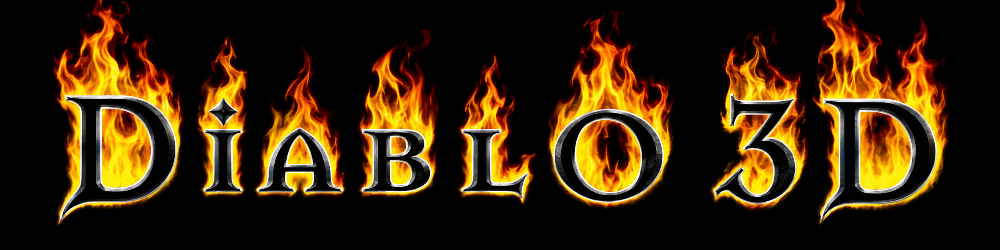

# Diablo 3D · D3D

A Vibecoded community project led by **Douglas Pan** to bring **almost the whole Diablo 1 game into 3D**, including its procedurally generated dungeon levels, built on [DevilutionX](https://github.com/diasurgical/devilutionX). The native simulation remains responsible for maps, seeds, combat, collision, items and saves. The visual layer adds 3D rendering and gameplay cameras while retaining original-view comparison. Tristram and a pilot of nine nearby regions in the first normal Cathedral level exist; reconstruction, loading/reentry and performance still need work.

**[Architecture and execution guide](docs/PROJECT-EXECUTION.md)** — current stage, dependencies, completion criteria and ongoing work. Contributors and agents should consult this guide and [AGENTS.md](AGENTS.md) before implementing changes.

**[Real code map and lifecycle contracts](docs/CODE-ARCHITECTURE.md)** · **[Versioned functionality/build checkpoint](docs/CHECKPOINT-2026-10-11.md)** · **[Code gaps and duplication audit](docs/CODE-AUDIT.md)** — existing paths, state owners, NEW/load/transitions, native/web build templates and validation gates for human and AI-assisted development. Planned architecture is kept separate from deployed behavior.

**[Website & Devlog](https://douglasopan.github.io/diablo-3d/)** · **[Official Discord](https://discord.gg/4YxQ7s69S)** · **[Contribute](docs/CONTRIBUTING.md)** · **[Roadmap](docs/ROADMAP.md)** · **[Build and play](docs/BUILDING-D3D.md)** · **[Estado em português](docs/TRISTRAM-STATUS.pt-BR.md)**

**[Community model inspector / Inspetor de modelos](docs/MODEL-INSPECTOR.md)** — review public metadata identifying **130 distinct GLB files**, including source revisions, derivatives, candidates, rigs and animation clips. Compare locally available original GLB and converted D3D files, distinguish map bindings and export review notes. This is a review catalog, not 130 finished or approved assets. Model and reference media are kept separate and are not bundled with the public catalog.

**[Items, concepts and matching inventory icons / Itens e conceitos](docs/ITEM-ASSET-CATALOG.md)** — a source-linked inventory of all current Diablo/Hellfire item tables, with **nine initial concept turnarounds** and a searchable [review gallery](docs/items-study/gallery.html). The intended pipeline uses the same accepted 3D master for equipped items, ground objects and rendered inventory icons. The remaining concepts, models and runtime bindings are still pending.

> This is modified DevilutionX software, distributed under its inherited **[Sustainable Use License](LICENSE.md)**. Source is public for collaboration; distribution must be free of charge and non-commercial. This is not an MIT/GPL release or an OSI-approved open-source license. Preserve upstream notices. Original Diablo game data is required and is not included.

## Installed local prototype

- F4 compares original/3D in Tristram and the first normal Cathedral pilot when the 3D frame is valid. The pilot covers nine nearby regions; load/reentry refusal remains a blocker. Other dungeon levels remain native in b775.
- Choose **Third Person or First Person** in the gameplay camera settings or switch with K. The mouse wheel zooms between them; movement and combat retain the native simulation. Legacy isometric/orbit poses remain available to diagnostics.
- Look through 360°, adjust pitch and zoom. Tristram architecture obstructing or containing the camera can be hidden locally and restored when clear; trees, props and Cathedral geometry are outside this first visibility implementation. A **provisional external horizon and fog** are integrated; terrain continuity and class-specific eye calibration still need work.
- **Meshy OFF** disables the 13 known architectural bindings and Ogden. Tristram uses simpler substitutes; models, masters, revisions and the historical import pipeline are preserved for review and reconstruction.
- **Ogden currently uses his native sprite.** His imported rigged model/idle was an earlier prototype, not active in b775. Other sprite-derived actor proxies remain provisional. The player's rigged hero is not installed.
- Walking, collisions, inventory and NPC interaction use the existing game simulation.
- Windows build, headless scene diagnostics and native-view comparison tools are included as source.
- A [Godot editor](docs/GODOT-EDITOR.md) supports local architecture/model inspection and explicit static exports to a separate review profile. Native collision remains authoritative. Godot is an authoring tool; the game still runs in DevilutionX.
- [Soundtrack settings](docs/MUSIC.md) select Vanilla, Rock or a mix for eight environments, in the main settings and during play. Rock2 is the local menu default; the earlier composition stays selectable, and missing replacements use the original music. [Listen and download the five custom tracks for free](https://douglasopan.github.io/diablo-3d/en/musica/), with **Douglas Pan** embedded in their authorship tags. The installed custom tracks carry the same credits.
- [Subscribe for project updates](https://douglasopan.github.io/diablo-3d/en/novidades/): optional email signup, language preference and consent, with private responses and a cancellation form. Reading and downloads remain open without signup.
- The [responsive HD HUD](docs/HUD-IMPLEMENTATION.md) presents the original controls with new RGBA stone, metal, sculptures and resource globes, without adding gameplay actions. Its layout and the main menu layout can be edited in Godot; the game retains native handlers, item/spell icons and bitmap fonts. The approved menu background is included. The HD revision passed technical checks and is installed in the regular launcher; artistic review during play remains pending.
- In-game settings omit options that cannot apply during play and use responsive pages: eight content rows at 960×540 and eighteen at Full HD, with shared drawing/input geometry.
- New games prefer the 3D town view. **Start in 3D** is a saved video preference; **F4** switches views during play, and **Home** restores Third Person for the session without changing the saved camera preference. Only Tristram and the first normal Cathedral pilot support 3D so far.
- The owner-provided [animated logo](docs/ANIMATED-LOGO.md) contains 240 frames over eight seconds and covers the main, title and Escape menus.

The **installed build is an offline prototype with optional Direct3D 11 on Windows and a CPU fallback**. GPU rendering and edge smoothing are independent settings under **Esc → Settings → Graphics**. Simulation and scene preparation still use the CPU. The original GLB, converted package and actual frame are separate evidence; an inspector preview does not reproduce game lighting/palette. [Generation and model review tools](docs/MESHY-WORKFLOW.md) preserve provenance; generated candidates still require fidelity approval.

**F4 provides the native-rendering comparison; Home restores Third Person.** Identical original-backend pixels do not prove a perfect 3D reconstruction. Forced-mesh comparisons still show differences. Contributors must compare the actual geometry with the native view and inspect rotated views before calling an asset faithful.

## Technical stages and technologies

The core is **C++/DevilutionX with SDL**: native state feeds a visual scene, CPU/D3D11 rasterization and existing SDL composition. The browser prototype uses **Emscripten/WebGL2** and local storage. **Godot, GLB/D3D revision manifests and Python tools** support authoring and reproducibility; Godot is not a port of the whole game. Meshy/Tripo are generation workflows, not automatic asset acceptance. Belzebub was studied as a reference; this README does not claim its executable code or a new HD-texture set was integrated.

| Stage | Implemented / tested | Pending |
| --- | --- | --- |
| **Map / Tristram** | Native map, seed, collision and simulation preserved; visual scene, provisional horizon/fog, static architecture shadows and Godot review. | Faithful complete objects, terrain, lighting and placement. Meshy OFF is reversible retirement, not completed reconstruction. |
| **Procedural 3D** | First normal Cathedral pilot, nine nearby regions and native materials. | Load/reentry, wall/grate/object composition and transitions. Private preparations for 16 base floors/four special levels are not installed; Hellfire is not automatically covered. |
| **First / Third Person** | Gameplay modes, remappable switching, pitch/zoom and native movement integration; third person is default. FP capture has technical checks. | Complete target/interactions testing and performance. Free TP mouse look and newer UI/play-state rules remain pending. |
| **Controls** | Native simulation and configurable movement/camera bindings. | Requested stationary-attack-only LMB, `S` conflict guard and fresh-frame policy are private candidates; input R4 is not installed in b775. |
| **HUD / menus** | Responsive HD main HUD, native handlers, menu background, soundtrack/language/project credits and Godot previews. | New dragging/resizing and other panel candidates. Next visual request concerns ESC/Settings only; approved inventory transparency is preserved. |
| **Actors / items / effects** | Native sprites, review catalog and concepts; earlier Ogden rig/idle prototype preserved. | Complete heroes, rigs, animation sync, monsters, equipped/ground items and final inventory icons. Concepts are not installed models. |

## Build and play

See [BUILDING-D3D.md](docs/BUILDING-D3D.md) for Windows compiler prerequisites and diagnostics. With Visual Studio 2022 or later, CMake and Ninja available:

Supply your own `DIABDAT.MPQ`, or separately obtain supported shareware data. For a data directory outside the launcher's detected locations, use `Iniciar-Tristram.ps1 -DataDirectory 'C:\path\to\your\Diablo'` during setup. Saves and settings remain in the ignored `perfil-tristram/` folder. Nothing needs to be installed over your original game.

**New Controls** | Action |

WASD - movement
E - interact (open doors, grab things, open "crates", talk to npcs...)
Q - spells
Right mouse button - attack
Right mouse button - spells (same as original)
M - map
TAB - Inventory or activate cursor
K - Change camera (third or first person)
Mouse wheel - zoom (in/out) between camera modes
- shift for running not implemented yet.

Remap the camera shortcut in **Settings → Keymapping**. Existing saved bindings, including an explicitly unbound camera shortcut, remain intact; another action already using K keeps priority over the new default.

## Help create complete 3D objects

**Human developers are welcome**, including people contributing with AI assistance. Help with renderer performance, procedural adapters, controls/UI, Godot tools, art, rigs/animations and reproducible tests. **AI-assisted work requires human responsibility, review and testing**: explain the change, provenance, build tested and remaining limits. Generated code or art does not bypass review.

Contributions support the whole-game goal. Current art review focuses on Tristram houses, the cathedral exterior, trees, rocks, props, townspeople and characters; dungeon reconstruction will expand the catalog in later stages. Renderer, import, camera, tooling and procedural-map contributions are also welcome. Match composition, scale, silhouette, doors, windows, ground contact and placement at the original camera angle. Then complete the unseen faces and review the entire object through 360°.

## Dungeon reference study and adaptation

Thank you to **plopsDOTio / plops.io**, author of [Diablo First Person](https://forge.plops.io/t/diablo-first-person-devilutionx-mod-for-windows), for publishing its source and dungeon reconstruction work. The author's [announcement](https://www.reddit.com/r/Diablo1/comments/1x1wtjz/diablo_1_in_first_person_original_automap_butcher/) identifies an independent DevilutionX mod inspired by Drelvak's video; we do not have Drelvak's unpublished code.

This independent fan project is not affiliated with Blizzard Entertainment. Diablo and associated marks belong to their respective owners. Public source access does not grant rights to proprietary game assets.

The original engine [README](docs/UPSTREAM-README.md), [contribution instructions](docs/UPSTREAM-CONTRIBUTING.md), [license](LICENSE.md) and other upstream notices are preserved. The renderer prototype started from DevilutionX commit `dac104babfb6187415432f428ac2516747ffc154`.
