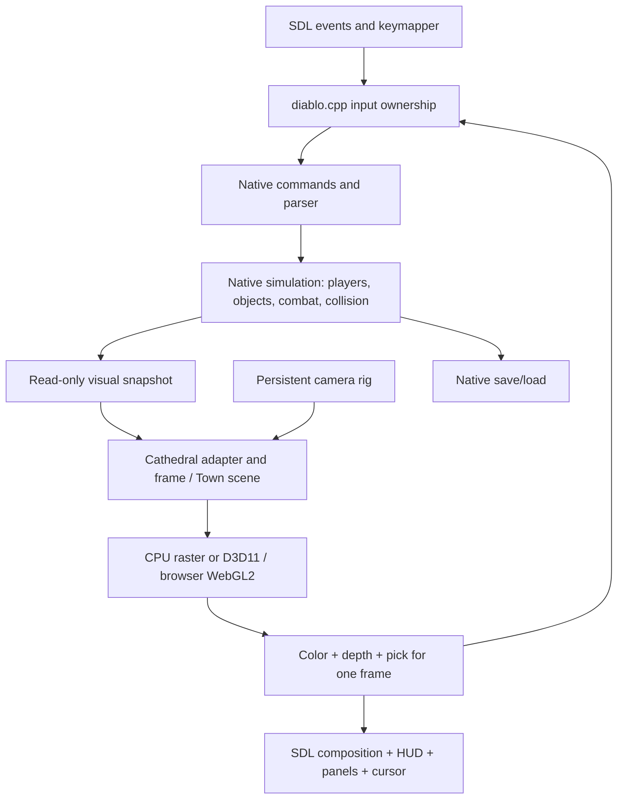

# Code architecture and change contracts

Documentation revision **2026.10.11-r1**, inspected on **11 October 2026, America/Sao_Paulo**. This maps existing code, including a private candidate; it does not announce a new engine or a completed refactor. Read the [versioned checkpoint](CHECKPOINT-2026-10-11.md) before attributing a feature to a build, and use [PROJECT-EXECUTION.md](PROJECT-EXECUTION.md) for the active queue. [CODE-AUDIT.md](CODE-AUDIT.md) records the gaps found during this inspection.

**Em português:** este é o mapa do código real para desenvolvedores humanos e IAs, inicialmente inspecionado em r1. O incremento operacional r2 compilou a base limpa e entregou a revisão isolada **4391a5 / R26**, com fixture delimitada aprovada; gameplay físico/FPS e aceite visual continuam pendentes. Código presente, candidato testado, versão instalada e aprovação visual são estados diferentes. Não substituir o trabalho selecionado apenas porque existe um arquivo mais novo.

## 1. Which source is being described?

| Source identity | Meaning |
| --- | --- |
| Public repository checkpoint `5c3d090fc7e103a356c910d5308d22e2342ace60` | Documentation parent at the start of this inspection. It is not a source-to-binary receipt for the local installed EXE. This documentation batch changes no game source. |
| Frozen private baseline associated with Windows `b77562161864…` | Coherent source preserved separately from the working tree. Working-tree WIP must not be substituted when reproducing this binary. |
| Frozen dungeon candidate, normal build R4 `ed0e0ad8566d…` | 735-file Source closure inspected for the call paths below: baseline 734 plus one new material header. Retains our camera, movement adapter, Town and UI; adds the bounded dungeon adaptation. Bounded fixtures have separate binary identities. |
| Separate `clean-base/devilutionx-c1-r1` checkout | Detached upstream `dac104babfb6187415432f428ac2516747ffc154`, plus 186 initial declared Source deltas (113 added/73 modified); 11 paths subsequently changed for bounded C1 defects. Fresh normal EXE `4391a5…` and R26 fixture compiled; 735-file Source closure sealed, isolated review delivered. Dependency minimality and a completed modular rewrite are not established; normal physical gameplay remains pending. |
| Main developer working tree | Other unpublished Source/CMake/UI/asset work remains present. It is not automatically part of any of the versions above. |

Paths below are relative to the engine repository root. Names beginning with `town_` are historical: several already serve Cathedral rendering too. They are not separate new engines. Some private candidate files are not yet present in a public checkout; their names describe inspected code, not a promised public build.

## 2. Authorities and boundaries



The renderer reads the live map; it does not generate a replacement dungeon, advance its RNG, author collision or rewrite a save. One visual unit is one native tile; height is up. Native `dPiece[x][y]` becomes explicit row-major snapshot indexing. Preserve that conversion rather than transposing the world to fix an image.

Color, depth and picking must belong to the same frame, camera, level epoch and resource identity. A stale or failed visual frame cannot authorize an attack, pickup or click-walk. Rendering invisible actors less often must never disable their native simulation.

## 3. Real modules and state owners

| Concern | Existing implementation / entry points | State ownership and boundary |
| --- | --- | --- |
| Game start and load | `Source/diablo.cpp`: `StartGame`, `LoadGameLevel`, `FreeGameMem`; `Source/interfac.cpp`: `DoLoad`, progress events | Native loading owns map, graphics, player entry, lighting and transition completion. A loader-only fixture must also process the native join-level completion before testing input. |
| Simulation and walking | `Source/player.cpp`, `Source/controls/plrctrls.cpp`, `Source/track.cpp`, `Source/engine/animationinfo.cpp`, `Source/engine/actor_position.cpp` | Native player modes, paths, animation clocks and collision stay authoritative. Camera-relative input supplies an eight-way direction, not a new velocity or independent movement clock. |
| Event/input adapter | `Source/diablo.cpp`: capture services, movement ownership, deferred clicks, `SuspendTownFirstPersonInput`; `Source/controls/keymapper.*` | Owns SDL capture, physical aliases, UI-versus-world routing and the native walk it issued. Stop only that owned walk; do not clear another input system's action indiscriminately. |
| Pure capture and intent | `Source/controls/town_first_person_input.*`: `StepTownFirstPersonInput`, `StepTownCameraMovement` | Caller-owned state, copied through step/result. Released → Enabling → Captured → Releasing. No SDL, save, attack, collision or player mutation in these functions. TP movement uses a distinct state without acquiring relative mouse. |
| Persistent camera | `Source/engine/render/town_camera.*`: `TownCameraRig`, `BuildTownCameraFrame`; `town_camera_gameplay.hpp`, `town_camera_collision.*`, `town_camera_visibility.*` | Rig stores mode, separate poses and preferences; `town_view.cpp` owns the runtime rig, follow history, drag and collision-resolved eye. `Suspend` preserves poses. Camera coordinates do not alter player facing or native input. |
| World host and resources | `Source/engine/render/town_view.*`: `PrepareTownViewLiveFrame`, `DrawTownView`, `PickTownViewDetailed`, `ResetTownViewResources` | Owns active 3D flag, frame readiness, depth/pick buffers, sampling surfaces, native/material caches and renderer telemetry. This is still a large adapter, not fully separated services. |
| Native Cathedral capture | `Source/engine/render/cathedral/native/cathedral_native_capture.*`, `cathedral_snapshot.hpp` | Captures cells, native SOL byte, doors, triggers and provenance on the simulation/render owning thread. No resource loads, RNG advancement or map generation inside capture. |
| Cathedral level lifecycle | `cathedral/cathedral_live.*`: `MarkLiveLevelLoaded`, `RefreshLiveFrame`, `LiveFrameCurrent`, `InvalidateLiveLevel` | Owns level epoch, seed, frame revision, fingerprint, frozen snapshot, scene and adapter. Current admission is retail, normal Cathedral floor 1 only, excluding shareware, Hellfire and set levels. |
| Cathedral geometry and materials | `cathedral/cathedral_adapter.*`, `cathedral_frame.*`, `cathedral_native_*.hpp`, `native-wall-*.hpp`; candidate `dungeon_rectified_material.hpp` | Adapter caches immutable 8×8-cell regions by level/signature; frame validates 100 regions and draws a neighborhood of at most nine. Floor/wall sampling changes UV/materials, not physical native collision. |
| Town scene | `town_scene.*`, `town_scene_projection.*`, `town_volume.*`, `town_props.*`, `town_vegetation.*`, `town_horizon.*` | Builds visual replacements and groups while retaining native identities. Horizon/fog are provisional; they do not add explorable surface maps. |
| Imported models and resolver | `town_model_import.*`, `town_editor_map.*`; `Source/engine/assets.*`: `FindAsset`, `OpenAsset`; `assets/registry.json` | Loader checks exact expected hash before committing a visual replacement. Missing/malformed content retains a substitute. Known Meshy retirement is an explicit content-hash policy, not inference from a filename/provider. Registry approval is separate from successful loading. |
| Actor visuals | `actor_model.*`, `actor_pose.*`, `actor_visual_snapshot.*`, `town_actor.*`, `ogden_idle_*` | Visual identity/pose follows native actors and clocks. Historical Ogden rig code remains; Meshy OFF leaves his native sprite active. No completed hero/monster roster is implied. |
| GPU backend | `town_gpu.*`, `town_gpu_mesh.hpp`, `town_gpu_mesh_backend.inc`; working-tree browser backend `town_gpu_webgl2.cpp` | GPU owns device, frame recording, uploaded textures/LUTs and resident meshes. Host owns pick-ID-to-native-record mapping. Windows returns indexed color, depth and pick through synchronous readback. Browser build has its own qualified bundle. |
| Composition | `town_presentation.*`, `ui_overlay_regions.*`, `d3d_menu_presentation.*`, `d3d_hud_presentation.*`, `d3d_panel_presentation.*`; `Source/engine/dx.cpp` | SDL output, RGBA art and logical native UI are composited together. Recovery and reset APIs remain necessary. Native item/spell icons and bitmap fonts still exist. World pass timing is not whole-game FPS. |
| HUD, panels and menus | `Source/control/d3d_hud*`, `d3d_floating_panels.*`, `control_panel.*`; `Source/DiabloUI/*`, `Source/gmenu.cpp`, `gamemenu.cpp`, `ingame_settings.*` | Drawing and hit testing share geometry. Settings owns its temporary handler and restores the previous handler on close. Panel code presence does not prove dragging/resizing is promoted or qualified in the delivered build. |
| Editable layout | `d3d_ui_layout.*`: `ReloadD3dUiLayout`, `GetD3dUiRect`; `editor/godot/` | Bounded `d3d-ui/layout.ini` override with layout generation and native fallback. Godot is external visual authorship/review, not the runtime engine or collision authority. |
| Options and music | `Source/options.*`, `Source/engine/sound.*`, `Source/ingame_settings.cpp` | Saved preferences and value-change callbacks distinguish immediate versus restart/resource-reset application. Custom soundtrack selection exists; all distributed custom tracks retain Douglas Pan's internal authorship tags. |
| Saves and networking | `Source/loadsave.cpp`, `pfile.cpp`, `multi.cpp`, `msg.cpp`, `Source/dvlnet/` | Native serializers, command parser and tick authority. Helper build uses `NONET=ON`; loopback command plumbing still matters. `MAX_PLRS` remains 4; voice/expanded servers are not implemented. |

LOD selector `town_asset_lod.*` and `town_model_v2.*` are preparations, not active replacement logic in the inspected clean Source registry. Do not claim close-up masters automatically load because these files exist. See [CODE-AUDIT.md](CODE-AUDIT.md).

## 4. Init, update, reset and disposal

| Owner | Initialize / acquire | Update / publish | Invalidate / release |
| --- | --- | --- | --- |
| Camera session | `StartGame` → `InitializeTownViewForGame`, apply saved preferences and start-in-3D flag | Orbit/zoom/mode APIs, `AdvanceTownViewCamera`, collision/follow resolution | F4 suspends; Home uses `ResetTownViewGameplayCamera` for session TP. `ResetTownViewCamera` is the legacy isometric diagnostic API. Frame refusal clears follow/pick validity and suspends the rig; it is not permission to erase all saved preferences. |
| Input ownership | Sync eligible UI/world state; relative-mouse acquisition acknowledged separately | Physical DOWN/UP aliases, fresh pick, deferred-click barrier, intent at native movement tick | Focus loss, Escape, UI, mode/epoch changes or refusal suspend input and release only owned capture/walk. Focus return/held key alone must not reacquire FP capture. |
| Cathedral level | Invalidate before loader; mark a fresh epoch after native graphics, entry, light/vision and cursor setup | Capture → adapter region reuse → validated pilot frame → renderer publishes matching color/depth/pick | Level change/game free resets level state. A refused frame clears frame data; the native fallback remains usable. |
| Native/material cache | Resource reset, current level epoch, explicit binding identity | Decode native loader-ready CLX/CEL via our decoder; rectified coverage remains distinct from palette index | `ResetCathedralNativeTextureCache` on world resource reset; reject old-epoch references. Do not retain borrowed native pointers after their graphics are freed. |
| GPU resources | `TownGpuBeginFrame` with hardware default; explicit diagnostic permission for WARP | Upload immutable textures/LUTs/meshes, submit projected/resident draws, `TownGpuEndFrame` | Capacity, invalid input and device errors are distinct. End-frame publishes all three outputs together or clears them; resource reset invalidates device/uploads/borrowed outputs. |
| Layout/UI | Load optional layout; begin presentation and install appropriate handler | Shared rectangles, capture/seal/finalize and compose | Reset/recover presentation when needed; settings close restores handler. UI consumes its click pair before world dispatch. |

Current `RefreshLiveFrame` still creates a snapshot/scene on each call and checks a broad fingerprint before and after capture. Region caching does not remove that work. Several getters also recompute the fingerprint. Splitting static geometry identity, dynamic actors/light and frame freshness is a documented next change, not an already installed optimization.

### Is the UI already an independent persistent module?

**Partly separated implementation, not a complete persistent window-state service.** Visibility is still native/global state (`CharFlag`, `invflag`, `QuestLogIsOpen`, `SpellbookFlag`); panel positions come from native layout rectangles and `GetPanelPosition`. `d3d_floating_panels.cpp` reads those flags and adds headers/close handling. The inspected delivered source does not own a general drag/resize state or serialize arbitrary window placement.

`LoadGameLevel` calls `InitMainPanel` only under `firstflag`. `LoadGameLevelFirstFlagEntry` closes inventory and initializes inventory/help/stores/automap-once; `InitMainPanel` initializes chat/buttons/character/spell state. These are session/first-entry initialization, not a new UI instance for every normal floor. The ordinary loader's cursor-reset helper only returns a temporary action cursor to the hand. `ResetTownViewResources` does clear rendering/overlay resources per level; that is different from clearing all panel visibility. `UiDestroy` releases main-menu resources when starting a game, and `engine/dx.cpp` resets presentation resources during renderer teardown.

No frame/scene object owns every UI state, but the boundaries remain coupled to input and composition. Persistent position/visibility/focus across Town↔Dungeon, resize and full save/load needs an explicit window-state contract and tests; this inspection does not establish that entire feature as implemented.

### Incremental clean-base boundaries — proposed changes, existing foundations

This sequence belongs to the same execution queue. The column on the right is the delta to prove; it is not a list of already implemented new service classes.

| Boundary | Reuse existing implementation | Next contract/delta |
| --- | --- | --- |
| Input/action map/cursor-focus | `diablo.cpp`, keymapper, pure capture/TP intent | Shared physical bindings and UI/world ownership across environments; no separate keymap per floor. Preserve fresh-frame and release barriers. |
| Player state/movement | Native player/plrctrls/animation/actor-position | Keep native cadence, tile collision and entry point; only adapt intent. Qualify Speed 32 and Town↔Dungeon instead of rewriting walking. |
| Camera | Existing rig/collision/follow code | Persistent preferences/poses, explicit frame/epoch invalidation and recoverable capture; separate from map/UI state. |
| Combat/actions | Native parser, action state and attack clocks | Separate requested attack animation, interaction and damage authorization. Add the Town attack-animation requirement below without enabling Town damage/PvP. |
| UI/window state | Native flags/layout, own HUD/panel/menu presentation | Preserve accepted UI; make window position/visibility/focus ownership explicit before drag/resize/persistence work. |
| Level/scene/environment rules | Native generator, SOL, loader; read-only capture/adapter | Separate changing level data/visual resources from persistent controls/UI/camera. Complete C1 visuals before promoting more families. |
| Resource cache | Current epoch/material/GPU caches and resolver | Measure freshness/reuse/residency; dispose only invalidated resources, never simulation entities. HD remains deferred. |
| Save/session orchestration | Native `StartGame`, `DoLoad`, `LoadGameLevel`, serializers | Preserve native saves and loading/join completion; version profiles and gate NEW/load/transitions with visual/session owners. |

### Authorized Town attack animation — not implemented yet

The new requirement permits attacking/animating in Tristram while friendly NPCs remain unharmed/unkillable, with no new PvP. Native behavior currently routes Town actors to talk (`plrctrls.cpp::Interact`); standing/ranged command handlers in `msg.cpp` reject `DTYPE_TOWN`. `player.cpp::LoadPlrGFX` also skips attack graphics in Town. R4 dungeon action eligibility explicitly limits the new attack path to normal C1. Sending its existing command in Town therefore does not implement this feature.

The required bounded delta spans input/action admission, native parser/action acceptance, attack-art readiness and damage/projectile policy. Keep native attack animation/cadence and terminal-state handling, but distinguish Town animation from a permitted damaging hit. Do not remove Town checks globally: `DoAttack`/`DoRangeAttack` can reach native hit/projectile logic, and cursor town-NPC identity must not be interpreted as a dungeon monster target. E interaction/talking and friendly immunities remain separate. No save format, NPC life, item durability/resource side effect, collision, entry point or PvP policy should change merely to show a Town swing.

Future gates cover empty Town ground, every friendly NPC, another player, melee/ranged animation and release, UI clicks, E conversation, Town↔Dungeon and full load/reentry, at habitual Speed 32. Verify unchanged NPC/player damage state and native dungeon damage behavior. This checkpoint delivers the mapping/required delta only, not a runtime Town-attack implementation.

## 5. Native flows that must survive changes

**NEW:** native `NetInit`, hero/new-game state and `InitLevels` remain in charge. `InitializeTownViewForGame` initializes the visual session before `RunGameLoop`. `DoLoad` drives the native level loader. Only after native data is ready may the visual epoch be marked. The native progress completion/join-level event makes the player actionable; bypassing it produced a false input failure in a test fixture.

**Load:** native `LoadGame`/`LoadLevel` restore simulation and art. A restored ground item may have zero animation timing; the visual fingerprint must not reject a valid native item merely because its saved clock differs from a moving actor's clock. Only live referenced corpse slots may borrow corpse art. Neither fix changes the saved item/corpse state.

**Town → C1 → Town → C1 and 1 → 2 → 1:** `LoadGameLevel` invalidates the old visual epoch before loading, then resets world resources after `SetDungeonMicros`, completes native setup, and calls `MarkLiveLevelLoaded`. Native level 2 remains supported by the game but outside this 3D pilot. The return to level 1 must obtain fresh bindings without regenerating its seed or overwriting the player's camera preference.

**Render/fallback:** `Source/engine/render/scrollrt.cpp::DrawGame` prepares the live frame, then returns after successful `DrawTownView`. It normally does not render two complete worlds. If 3D refuses, it suspends owned input/invalidate picks and draws the native world. Removing this path would remove recovery, comparison and unsupported-level rendering.

**Interaction:** candidate R4 intercepts world LMB in eligible C1 TP/FP after UI routing, requires fresh renderer picking and native line of sight, and sends native stationary attack commands. `track.cpp` repeat retains native action guards; interpolation/event polling must not resend attacks. E checks adjacent reach, excludes actors and calls native secondary interaction. Empty-floor DOWN/UP tests passed; nearby loot, doors, enemies, full held-combat cadence and UI/focus coverage still need completion.

**Map contract, separate from camera/input/HUD:** `Source/automap.cpp` owns `AutomapView`, active state, scale/offset and minimap geometry; native lighting calls `SetAutomapView` to mark exploration. Native `loadsave.cpp` serializes/restores exploration. `scrollrt.cpp::DrawView` calls `DrawAutomap` after world drawing when active, including 3D. Tile/door geometry, player arrows and nearby item diamonds remain native map functions; item diamonds are conditional on `AutoMapShowItems`. A map window/layout/camera change must not erase exploration, remove marks or invent floor-specific map controls. A new isolated profile is a different play state, not migration of the player's exploration. Current R3/R4 automap sources are byte-identical to the frozen b775 baseline; the reported disappearance still requires same-state drawing/composition evidence. See the [regression/provenance audit](CODE-AUDIT.md#reported-regression-and-provenance).

## 6. Configuration and intended controls

For the **next isolated profile**, explicitly preserve the habitual cadence:

```ini
[Game]
Speed=32
Run in Town=0

[Graphics]
Brightness Correction=15
```

Native default `Speed` is 20 (`Source/options.cpp`); `multi.cpp` copies it to `nTickRate` and derives tick delay. The delivered experimental preview omitted the override and uses 20, versus habitual 32. The nominal ratio is 0.625, not a measured walking-distance result. Do not compensate by inventing sprint or changing animation clocks. Do not overwrite a player's current settings to repair an example. Brightness is a comparison baseline, not a universal lighting solution.

| Control / capability | Actual state at this checkpoint |
| --- | --- |
| F4, remappable K, Home; TP/FP; WASD/aliases | Existing own camera/input path. Home restores TP for gameplay; saved bindings and native UI ownership remain authoritative. |
| E near interaction, LMB stationary attack | Bounded C1 R4 candidate; not in preview `337eba…` or habitual `b775…`. Full interaction/target matrix pending. |
| Q spells, Tab inventory/cursor, M map, J quests, complete remapping policy | Requested unified design. Inspect actual registered/saved bindings before implementation; this list is not a delivered default map. |
| Panel close/window presentation | Existing code and observed prototype behavior; build qualification matters. |
| General panel drag/resize; map pan/zoom/recenter/compass; broader responsive UI | Planned or unpromoted preparations. No promise that these work in the active preview. |
| Shift run and stamina | Deferred. No new runtime implementation from this work. |
| HD-first resolution/prefetch | Local extraction and private floor preparation only; no HD pack/adapter installed in these builds. |

## 7. Building and checking a change

Use [BUILDING-D3D.md](BUILDING-D3D.md) for the public Windows build and the [dated checkpoint](CHECKPOINT-2026-10-11.md#build-identities) for the separate browser state. A public checkout does not reproduce unpublished R4/clean-source layers or proprietary data. Select the exact source manifest before building. Never reuse the habitual build cache for a detached candidate from another path/compiler.

The following are **command templates based on existing CMake options**, not commands executed by this documentation update. Run Windows commands from a Visual Studio x64 developer shell with CMake/Ninja and the required dependencies:

```powershell
cmake -S . -B build-review-r1 -G Ninja -DCMAKE_BUILD_TYPE=Release -DNONET=ON -DBUILD_TESTING=ON -DBUILD_TOWN_VIEW_SMOKE=ON -DBUILD_ASSETS_MPQ=OFF -DDISABLE_LTO=ON -DTRISTRAM_EXECUTABLE_NAME=Diablo3D-review
cmake --build build-review-r1 --target devilutionx town_view_smoke town_first_person_input_smoke town_first_person_runtime_smoke hud_runtime_smoke ingame_settings_smoke
ctest --test-dir build-review-r1 --output-on-failure
```

The current helper `build.ps1` deliberately sets `BUILD_TESTING=OFF`, so building a smoke target is not running the upstream test suite. Optional smoke executables also need explicit execution with their documented arguments. The private native loader/input/GPU fixtures reported in the checkpoint are not public CTest targets yet.

For a browser source revision that contains the WebGL2 backend and packaging, activate an Emscripten SDK, configure a **different directory**, then build:

```sh
emcmake cmake -S . -B build-web-review-r1 -DCMAKE_BUILD_TYPE=Release -DNONET=ON -DBUILD_ASSETS_MPQ=OFF
cmake --build build-web-review-r1 --target devilutionx
```

`CMake/platforms/emscripten.cmake` disables `BUILD_TESTING`; compile success is not a browser runtime test. R12 remains a separately pinned local bundle. New material/input changes require their own WebGL image/depth/pick, import/IDBFS, focus/pointer-lock, resize and transition validation before deployment.

### Completion gates for the existing Cathedral task

1. Pin source, compiler/options, support assets, EXE, profile and private test-data provenance; no paid-service credential or user save in public artifacts.
2. Exercise real native NEW, full save/load, Town/C1 reentry and 1→2→1 with unchanged observed map, occupancy, RNG and save bytes across presentation.
3. Validate TP/FP fresh-frame color/depth/pick, collision, UI click ownership, physical aliases, focus/capture release and recovery.
4. Validate adjacent E loot/doors/triggers and stationary held melee/ranged attacks at native tick cadence, with no stale click-walk or event/interpolation duplicates.
5. Compare matching native and 3D camera scenes: floor, opaque unseen walls, grates/arches, door states, stairs, candelabra without false corner pillars, details and lighting; also rotate and inspect close FP. Pure checks do not approve appearance.
6. Measure cold and warm frames, whole gameplay FPS, CPU preparation, GPU draw/readback, uploads, texture/mesh residency and failure reasons on the same route/settings. A handful of warm frames cannot establish sustained FPS.
7. Qualify the browser revision separately. Promote only the tested isolated candidate/profile; preserve the previous launcher/snapshot and human sessions.

## 8. Workflow and provenance

Record the defect or requirement, current queue item, files, owner, invariant and success criterion before changing code. Keep patches small. Check actual callers, compile registration, platform flags and save/network usage before removing a supposed duplicate. An alternative backend, native fallback, GPU buffer or unpromoted asset tool is not dead code merely because one local build does not use it.

Update this map and the checkpoint when ownership, lifecycle or delivered behavior changes; update AGENTS for durable development rules, not every private fixture. Review exact diff, links and secrets. Documentation may be published separately; unknown WIP is never implicitly promoted. Tests are evidence with scope, not a blanket statement of quality. AGENTS helps coordination; it cannot guarantee error-free code.

The engine and reference adaptation retain [Sustainable Use License 1.0](../LICENSE.md), upstream contributors and Blizzard/original Diablo credits. The dungeon sampling adaptation credits **plopsDOTio / plops.io**, [official source](https://forge.plops.io/t/diablo-first-person-devilutionx-mod-for-windows), with its [preserved modification notice](credits/diablo-first-person/MODIFICATION-NOTICE.txt). Reference 0.3.2/base `bf574c9…` differs from our upstream base `dac104b…`; no reference camera/input/Town/CPU rasterizer was transplanted.

[DamnationX](https://github.com/trygentic/damnationx) is an HD reference and owner-supplied local asset preparation, not an imported renderer or a distributed HD pack. Belzebub remains an analyzed reference, not a claim of copied executable code. Record asset rights separately from source-code license. [ASSET-APPROVAL.md](ASSET-APPROVAL.md) and [MUSIC.md](MUSIC.md) retain their own approval/provenance requirements.
