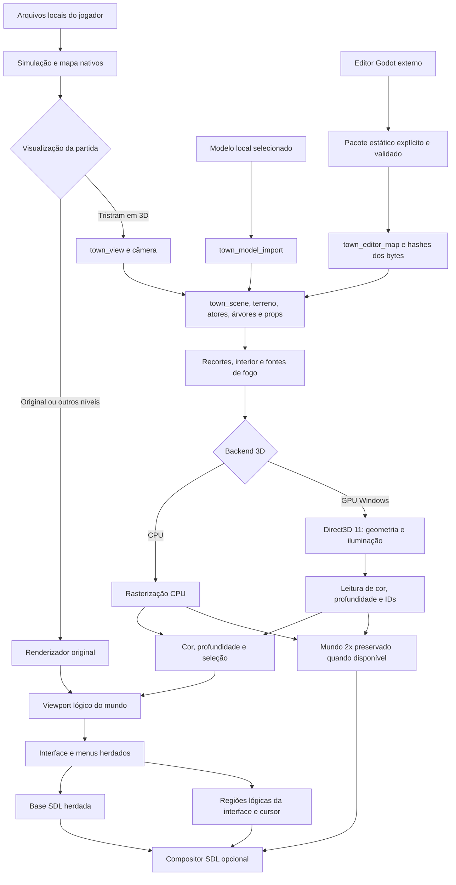
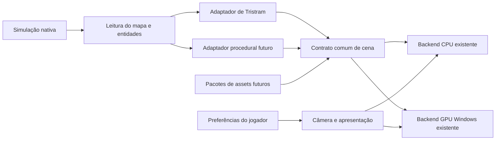
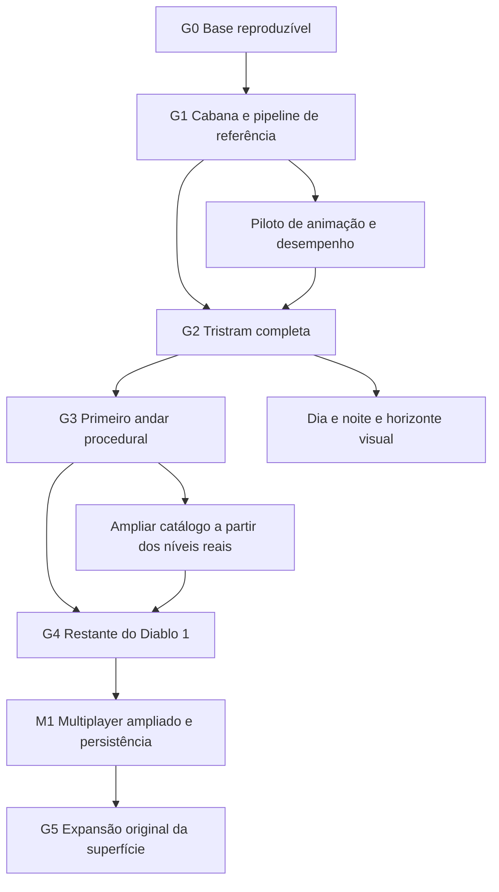
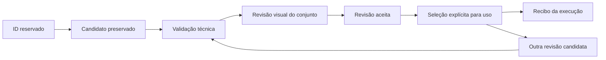

# Arquitetura e execução do Diablo 3D

O objetivo é reconstruir **o Diablo 1 inteiro em 3D**, permitindo alternar a visualização na mesma partida. Tristram é o primeiro ambiente de validação. Depois vêm o primeiro andar procedural da Catedral, os demais ambientes, personagens, monstros e efeitos. A ordem definida é concluir e estabilizar esse jogo completo, depois desenvolver o multiplayer ampliado/mundo persistente, e só então a expansão original, priorizando a superfície. Diablo 2 foi cancelado e fica fora deste roadmap.

Este é o guia operacional do desenvolvimento. Antes de iniciar uma mudança, o responsável consulta a etapa ativa, os contratos e a fila abaixo; ao concluir, registra o resultado e a próxima ação. O [roadmap](ROADMAP.md) descreve os recursos desejados; este guia determina suas dependências e o que permite avançar. As instruções para os agentes estão em [AGENTS.md](../AGENTS.md).

## Estado de execução

**Local4 Tristram publicada —14/10/2026:** continuidade c433;143 objetos/link/PE-PDB PASS, EXEffd8d95e. Pacote completo MPQ-only com cena histórica19:05, iluminação nativa,18 efeitos Godot pendentes. Primeira instalação/reuso/preservação/recusa de cena alterada/ZIP extraído PASS,19 arquivos/14 arquiteturas/18 luzes/25 células/4 rotas. Warrior Light Town TP/FP desenhado; poço4 estados, conjunto130 checks. Cache candidato2023 checks/16 controles frios/48 passagens PASS; reprodução original na base INCONCLUSIVE. Sequência completa de input C1 FAIL RefreshLiveFrameRefused; não declarar C1/GPU/FPS/gameplay físico aprovados. Douglas abriu manualmente a candidata; nenhum resultado humano presumido. Fonte pública c957ab57cfa77d7f67632dc768d630dc0944f384; release https://github.com/douglasopan/diablo-3d/releases/tag/v0.1.0-preview.local4-tristram.full1. Source/EXE original, local3, perfis/saves e Godot atual preservados. Próximo: investigar captura C1 e reprodução do relato; novas execuções somente fora da sessão humana, seguir fila existente. PT/EN em docs/LOCAL4-PACKAGE.*.md.

**Site — início do pacote FULL4, 14/10/2026:** requisito humano explicita abrir Iniciar-Diablo3D.cmd na pasta extraída, nas instruções de download PT/EN e no diálogo da home; nome conferido no ZIP público. Preserva DIABDAT.MPQ original, releases e fila de desempenho. Evidência em website/QA.md; próxima ação é acompanhar dúvidas de instalação.

**Site — download único, 14/10/2026:** novo requisito humano unifica os dois CTAs da home em Download, com diálogo PT/EN para GitHub Releases e Panvia Launcher. Abertura, fechar, Escape e retorno de foco verificados; build/verificação do site PASS. Evidência em website/QA.md. Preserva releases e a fila de desempenho; próxima ação é acompanhar retorno dos visitantes.

**Tristram selecionada distribuível com somente DIABDAT.MPQ — 14/10/2026, FULL4:** requisito humano corrigiu a omissão da cena na FULL3. Componente de preparação isolado recupera a base D463 exata do MPQ local, aplica os 20 bytes de edições e reproduz os 19 arquivos cardinal R2 com os mesmos hashes. Loader real matched14 arquiteturas/25743 objetos/1349 texturas, sem fallback; WorldPatch aplicado13 células/4 rotas. Executável 0f4d/Source24080 e Warrior TP/FP preservados. Não distribui arquivos estáticos/paleta originais; os três RGB arquitetônicos já públicos R17 foram comprovados byte a byte. ZIP extraído, primeira preparação/reuso/preservação/recusa de cena alterada PASS. Sem janela/input/gameplay/saves; desempenho e teste manual continuam pendentes. Fonte, notas de release e instruções PT/EN publicadas: https://github.com/douglasopan/diablo-3d/releases/tag/v0.1.0-preview.local3-tristram.full4. Fila de desempenho permanece igual; nenhuma compilação/profiling na lane reservada após ACK.

**Projeto e pacote público completo publicados — 14/10/2026:** núcleo local3 congelado, ferramentas, editor, documentação e recursos próprios enviados ao GitHub; WIP preservado separadamente na branch `snapshot/workspace-20261014`. Nova release https://github.com/douglasopan/diablo-3d/releases/tag/v0.1.0-preview.local3-full3 inclui executável/bibliotecas/recursos R17/Warrior/Clock e pede somente DIABDAT.MPQ original. ZIP SHA256 `73c3ba21ff341442261dca3a2b26c2e785cb10100899349c4207415245a16c16`. Integridade, tags Douglas Pan e preparo de perfil limpo PASS; gate de gameplay dessa nova montagem pública NÃO executado. Cena cardinal privada não distribuída; cidade usa dados nativos do jogador. Fonte, saves e edição humana originais preservados. Fila de desempenho permanece a mesma.

**Checkpoint local3 preservado e download técnico publicado — 14/10/2026:** fechamento solicitado explicitamente pelo usuário antes de continuar o desenvolvimento. Fonte privada congelada `24080e8900d695f9c88f9d3ad417917499d8103f`, EXE `0f4d9290c0589cbee3eb6c22791f373d4a1b67dd618b97e3bfb5a86637f9bd6c` e ZIP fino `d897b2623af520ba0d6d19ffe445f1d085f7916a7e5292674094221edd55eed6` preservados sem otimizações WIP. [Release com binários, fonte correspondente, instruções e hashes](https://github.com/douglasopan/diablo-3d/releases/tag/v0.1.0-checkpoint.local3); download anônimo verificado byte a byte. É pacote técnico, não instalador completo: exige runtimes privados selados e assets R17 externos; DIABDAT.MPQ sozinho não basta. A R17 pública anterior permanece separada.

Montagem local qualificada: Warrior Light Town/C1 TP/FP com rig/pose/olhos/braços compartilhados, Short Sword/Buckler, HUD R4, cena cardinal de staging e GPU requerida. Gates finais: Warrior CPU2.301, TP158, HUD29.263, SDK8.272 e RX57033.393 checks; desempenho pendente, com médias estacionárias ocultas Town214,85ms/C1176,02ms, sem equivaler a FPS de gameplay. Novo devlog PT/EN e duas capturas automatizadas publicados. Checkpoint privado de fonte/histórico, cena/Warrior/assets e recibos em `D:/Diablo 1 3D/diagnostics/release-local3-20261014-r1/private-checkpoint`; manifesto da preservação na pasta responsável. Nada de MPQ, saves ou mapas/modelos privados foi publicado; nenhuma partida, foco, input ou exportação Godot foi iniciado para a publicação. Próximo na fila existente: diagnóstico e correção pontual da gravação CPU da cena com comparação antes/depois e regressão HUD/Warrior/câmera, mantendo a local3 intacta. Estados abaixo são históricos e não qualificam outra closure.

**Prévia integrada CPU observada em gameplay - 14/10/2026, local2-cpu-preview:** a frente local DESENVOLVIMENTO DIABLO 3D observou janela DevilutionX e Douglas jogando Tristram em primeira pessoa com Warrior 3D, mãos, Short Sword, Buckler e HUD em 05:57:51 UTC. Fonte privada `d3b4892656d1c8a86a92ca28e9bb0651dd9d221c`; EXE normal MSVC Release, versão `1.6.0-dev-Release-d3b4892`, SHA256 `d44536b8f9ec550add0efeac2ffc2935b7532daee6627c4a7cf97ad14457e9c1`. Esta revisão tem caller real do Warrior Light no host Town/Catedral1; o registro local1 sem caller abaixo é histórico. CPU PASS2013/49 capturas; evidência física da frente local em `diagnostics/local-control-warrior-20261014-r1/delivery.json` e `live-warrior-FP.png`.

Launcher isolado: `C:/Users/dougl/Documents/Codex/2026-10-13/task-11/Diablo3D-Windows-candidate-20261014-local2-cpu-preview/Iniciar-Build-Candidata.cmd`. Perfil novo, CPU/GPU=0 e Speed32; runtime privado de cena cardinal staging e três actor packets separados, sem consumir a edição humana Godot. Última observação confirmou jogo PID48240/launcher37520 aberto para Douglas. Não encerrar, reiniciar, escrever perfil ou executar GPU/testes pesados concorrentes sem nova coordenação. CPU é prévia de diagnóstico, não entrega final GPU. O único teste GPU completo desta revisão atingiu timeout120s no primeiro DrawView; nenhuma qualificação GPU ou FPS sustentado. Correção R4 de cache selada em três arquivos, ainda pendente de integração e prova real no hardware. Prioridade humana atual: GPU funcional.

Pendências relatadas: FP deve usar olhos do mesmo rig/pose mantendo animações; TP ataque/interação E; painéis HUD com descompasso entre resize, conteúdo e hitboxes; lentidão direcional na Catedral ainda sem causa comprovada. Correções isoladas, sem rewrite ou simplificação de assets. Modularização posterior incremental: HUD, Tristram fixa, entorno procedural e dungeons, com contratos/testes separados. Tristram manual não é regenerada; exportação canônica permanece suspensa. Entorno nativo está em staging, não incluído nesta prévia. [Estado corrente e limites](<C:/Users/dougl/Documents/Codex/2026-10-13/task-11/INTEGRATED-CURRENT-HANDOFF.md>).

**Build sucessora Windows entregue isoladamente — 13/10/2026, 2026.10.13-local1:** pedido humano de nova build retomado após `systemError` do chat principal. Executor confirmado `DOUGLAS_PAN / Windows x64`. Source congelada de `clean-base/devilutionx-c1-r1`, HEAD detached `dac104babfb6187415432f428ac2516747ffc154` + alterações locais: 20 arquivos novos e 18 alterados sobre a Source correspondente R17. EXE normal recompilado MSVC Release, SHA `5091102a3aad177af50264a490ea567352c0cdfc92af32edca39364ffd8f41aa`; nenhum C++ de produção editado nesta retomada. Paths do CMake/harness rebased somente na cópia. Build habitual, Source e assets originais preservados; sem release pública.

Candidato em `C:/Users/dougl/Documents/Codex/2026-10-13/task-11/Diablo3D-Windows-candidate-20261013-local1/Iniciar-Build-Candidata.cmd`, perfil próprio Speed32/GPU/smooth/terceira pessoa, assets R17 locais por junction. ZIP binário separado, sem MPQ, saves ou packs, SHA `693e48b2c484dc7585c8825b79d3da816b4e4bf8810739aa23daa5dc9f8b98a3`. Gates do snapshot: nativo106.749, câmera875, loader49/33 recusas, GPU256 PASS na RX570 sem WARP. Smoke normal chegou ao renderer Direct3D/áudio do menu e ficou vivo30s; sem handle de janela observável, input físico, QA visual ou FPS sustentado; só o processo de teste foi encerrado. **Warrior 3D continua sem caller do host**, e resources.cpp não está no CMake normal; não anunciar piloto jogável. Próximo continua G2/pilotoG3 Town+C1 conforme fila existente. [Handoff e evidências](<C:/Users/dougl/Documents/Codex/2026-10-13/task-11/HANDOFF-BUILD.md>).

**Warrior — pacote composto e transporte de equipamento verificados, 13/10/2026:** a Short Sword real agora tem pegada direita composta aos onze clips de pegada esquerda. O novo BODY `48106d5b7d95…9863d` conserva 52 joints, 68 nodes, 13.627 vértices/11.039 triângulos e textura 2048². O avaliador C++ real passa 11.502 poses/keys, oito direções explícitas, quatro endpoints de transição com payload exato e três recusas atômicas; mínimoY −0,000621194427367. O mapa de índices é novo: death0/block1/fire2/lightning3/magic4/idle5/walk6/attack7/hit8/entry9/exit10; o host deve resolver o ledger, sem reutilizar ordinais R2. Recibo `diagnostics/warrior-composed-bundle-20261013-r1/DELIVERY.json`, SHA `2f5118f3…26283`.

O endpoint final de morte é bitwise estável em 65 repetições. **Hold em tempos arbitrários permanece FALSE:** a amostragem interior e a última key/clamp normalizam o quaternion em caminhos distintos, com diferenças máximas da ordem de 6,4e−8. O contraexemplo foi preservado, sem editar o avaliador nem anunciar delta zero. A próxima ligação do host deve fixar `seconds=2.0` no estado terminal, mantendo a pose final; este teste não qualifica o dispatcher/interrupções nativos ou a apresentação jogável.

Novo `actor_attachment_resource.hpp/.cpp` no checkout candidato reaproveita o transporte D3DMESH2 com bounds antes de alocação, partes próprias e commits atômicos. Short Sword (`6a64e13b…35971`) conserva 11 partes/6 materiais; Buckler (`45c84d2a…bc738d`) conserva 27 partes/4 materiais. O gate verifica exatamente os **94.248 cantos** dos triângulos, posição/normal/UV/COLOR_0/tangentes e metadados de material, mais refusals: 24 checks PASS com BODY atual. A preparação de frame conserva COLOR_0 linear separado do material. Captura Idle e sockets locais desse smoke são sintéticos; os dois recursos não têm imagens embutidas. Não é prova de pegada calibrada, material renderizado, PBR, admissão ou gameplay. Recibo `diagnostics/actor-attachment-transport-20261013-r1/DELIVERY.json`, SHA `26df7b92…e42a61b`; falhas iniciais de link e nomes de ossos da fixture permanecem registradas.

O clipping de câmera conserva/interpola COLOR_0 nos seis planos e na amostragem com correção de perspectiva, recusando componentes não finitos/fora de [0,1]. Cor branca constante permanece exatamente neutra; posição/UV/projeção/depth são idênticos com/sem atributo nos casos verificados. Gate passa **875 checks**, incluindo os 253 contratos anteriores de câmera, duas projeções e referência affine independente. Recibo `diagnostics/actor-color-clip-20261013-r1/DELIVERY.json`, SHA `1a441981…07c522`. Esta geometria é sintética; não prova desenho do actor no mundo ou CPU/GPU parity.

O dono `PlayerActorPresentation` foi preparado separadamente: captura/admissão, frame completo e referências de materiais ficam em snapshot próprio; falha ou stamp antigo recusa tudo. Sua fixture passa 62 checks com Player/parser reais e positivos sintéticos de manifest/gear/material. A extensão GPU de COLOR_0/RGBA LUT está no responsável do renderer, ainda em validação. **Próximo na mesma fila G2/piloto G3:** ligar loader/materials/presentation em Town+C1, validar iluminação/picking/default smooth, interrupções/transições e cadáver terminal com equipamento retido/drop, então entregar candidato privado jogável a Speed32. A build pública R17 e as seleções/masters continuam preservados; NPCs → itens/armas → Catedral1/monstros → Catedral2 seguem a ordem humana, com texturas/prévias em paralelo e os demais requisitos ainda abertos.

**Warrior — eventos nativos ligados e ressurreição verificada, 13/10/2026:** o candidato `clean-base/devilutionx-c1-r1` agora observa carregamento/liberação, criação/init/unpack/join, equipamento aninhado, morte e ressurreição por `PlayerActorLifecycle` e scopes nos donos nativos. Unpacker falível só confirma seu valor final; recursos/câmera/foco não resetam a época nativa. Defeito reproduzido: após drop vazio e retorno vivo com inventário/gráfico iguais, o witness antigo persistia. `BeginResurrection/EndResurrection` exige origem/conclusão reais, HP fixed-point vivo e activation nova; smoke com Player real passa 110 checks.

Gate com NEW/NetInit/DoLoad/LoadGame/transições Town+C1, StartPlayerKill retained/drop, ApplyResurrect, parser/UnPackNetPlayer e FreeGameMem reais passa **106.749 checks**, execução pass4 em `diagnostics/player-actor-native-hooks-20261013-r1`. Closure de 775 arquivos Source/gate permaneceu idêntica durante a execução, com 437 assets R17 e perfil novo Speed32. Probe GPU hardware Radeon RX570 em TP/FP passa sem WARP/CPU raster fallback; não prova FPS sustentado ou apresentação do Warrior 3D. Leituras preservam simulação/RNG/ocupação e tokens antigos são recusados. Falhas preparatórias foram da fixture (join de prontidão e limites de comparação de arquivos); logs preservados, sem alterar guards/simulação. [Contrato e limites](studies/universal-modder/PLAYER-ACTOR-LIFECYCLE.md).

Biblioteca de pegada esquerda concluída: onze clips, 11.551 poses incluindo todas as keys, seis gates densos PASS, nonfinger local delta zero, tradução/escala/canais restantes preservados. Clamp explícito em walk/entry/exit; morte mantém corpo e dois sockets em 244 amostras até +2s. Mapa `diagnostics/warrior-left-grip-library-20261013-r1/CLIP-MAP.json` SHA `e7b90b63…ae94aa`, recibo final `eea62103…fc691`; principal conferiu os onze hashes/gates atuais. Não equivale a colisão triângulo-triângulo, anatomia/pressão, PBR ou cobertura nativa. Great Sword é surrogate; a Short Sword original tem geometria candidata, mas suas primeiras pegadas foram recusadas e a receita direita específica está em andamento.

Próximo na mesma fila: fechar Short Sword/dedos direitos, compor pacote e transições/interrupções, ligar apresentação/material/paleta/picking e validar o Warrior jogável privado em Town/C1. Sprites, revisão pública R17 e masters/seleções permanecem intactos. NPCs, primeira pessoa com arma/hit, movimento, criador, materiais e demais famílias continuam abertos; o objetivo completo não foi reduzido a estes testes.

**Warrior — equipamento, frame composto e emissão nativa corrigida, 13/10/2026:** o broquel R2 agora tem receita de pegada esquerda com 15 rotações locais, mantendo malha/rig/textura, braços/punho/root, traduções e escalas. Idle, ataque e caminhada passam invariantes e os cinco dedos têm proximidade <0,002 em 0/0,5/1; nenhum dos vértices amostrados de dedos/palma fica dentro do cabo. Isto não prova todas as interseções entre triângulos, anatomia ou contato em toda a interpolação. Socket canônico `70815a34…` desloca a fonte `(0, .055, .018)` em relação ao anterior, com rotação/escala preservadas; recibo `diagnostics/shield-grip-20261013-r1/DELIVERY-GRIP-FINAL.json`. O principal revisou a vista palmar e corpo completo: mão envolve o cabo, mas acabamento/anatomia continuam candidatos.

A morte R3 foi corrigida para esse encaixe: o candidato antigo com o novo socket falhou em −0,006206675 e foi preservado. A nova revisão limita rotações de LeftArm/ForeArm/Hand a 12°, mantendo o restante e o cadáver final. GLB e C++ reais passam 1.031 fases/keys: escudo mínimoY +0,000214239, corpo +0,000195272, espada +0,089791198; 145 amostras finais têm delta zero. Vinte renders passam canvas, e queda/cadáver frontal/perfil foram revisados também pelo principal. Recibo `diagnostics/death-shield-contact-20261013-r1/socket-grip-r2-revalidation/DELIVERY-DEATH-SHIELD-R3.json`; GLB `be574d936938…`, D3DACTR1 `9a4efa0da70a…`. A pegada finger-only ainda precisa ser composta a essa morte e revalidada; o gate do socket anterior não foi reutilizado. A composição de todos os clips está na mesma frente, em `diagnostics/warrior-left-grip-library-20261013-r1`, sem nova seleção ou pacote runtime.

`actor_player_frame.hpp/.cpp` prepara corpo e todas as attachments da mesma pose antes de qualquer desenho. Cada parte conserva material/UV/índices; sockets recebem o mesmo fit uniforme/footpoint/yaw e normais usam inverse-transpose. O orçamento agregado de corpo+equipamentos é 100.000 vértices/300.000 índices. Comparação independente GLB/C++: 400 casos (dez clips, cinco fases, oito direções), delta máximo de matriz 4,76837e−7 e vértices 9,53674e−7; 11 checks cobrem recusas de payload completo, orçamento, body-only e um controle sintético de normal sob escala não uniforme. Esta grade usa captura Idle sintética e não prova dispatcher/combate/timing das ações. Recibo `diagnostics/actor-player-frame-20261013-r1/DELIVERY.json`, SHA `b3b3dc70f54f…`; geometria anterior revalidada em `diagnostics/actor-geometry-20261013-r2`. Ainda não há ligação ao renderer, material/paleta, picking ou lifecycle do host.

**Defeito de emissão reproduzido e corrigido:** o corpo exato de `DoSpell` emite em `AnimInfo.currentFrame == _pSFNum`, ao contrário de `DoAttack`, que usa `_pAFNum-1`. A captura estava um frame cedo; agora publica `_pSFNum` sem alterar a simulação. O harness do corpo nativo extraído passa 52 casos/896 chamadas com zero divergências após a correção; baseline falha preservada. Recibos `diagnostics/native-spell-marker-20261013-r1` e `r2`, SHA R2 `635288345028…`. A regressão com Player/AnimationInfo/captura/parser reais foi recompilada: oito checks, 7.700 comparações de fase e 18 ticks repetidos passam, sem mutação do Player. Recibo `diagnostics/native-capture-regression-r8/DELIVERY.json`, SHA `8bfa0af4027c…`. Não equivale a execução integral do jogo ou emissão real de efeitos; o warning C4530 herdado do wrapper source-exact e logs esperados de preview ficaram registrados.

`ClosedSwordShieldPilot` exige as 18 chaves completas do recorte, identidade Short Sword/Buckler, transições/interrupções e dois estados de equipamento na morte. A releitura nativa mostrou que algumas mortes derrubam os itens e zeram `_pgfxnum` inteiro: corpse com equipamentos retidos exige witness próprio, enquanto drop confirmado prepara body-only e bindings vazios. O gate isolado passa 133 checks, incluindo 22 positivos **sintéticos** e 96 recusas atômicas; o pacote real incompleto continua recusado. Recibo `diagnostics/warrior-pilot-admission-20261013-r1/DELIVERY.json`. O host ainda precisa gerar witnesses reais de ativação/época/equipamento/drop e carregar inputs somente dos bindings admitidos.

Próximo na mesma fila: terminar composição da pegada/morte em todos os clips, identidade da Short Sword inicial (a espada isolada de estudo não a qualifica), interrupções reais e encaixe de apresentação nos dois mundos. O candidato de Short Sword está reservado à frente em `diagnostics/starter-sword-20261013-r1`. Depois vêm os gates da partida/build privada; as metas restantes do objetivo, NPCs, primeira pessoa, movimento, criador, materiais e demais famílias continuam abertas. Release R17, sprites, masters/seleções e perfis permanecem intactos; este incremento não criou uma build normal nem publicou assets.

**Warrior — preparação de geometria e próximo marco do piloto, 13/10/2026:** `actor_player_geometry.hpp/.cpp`, no checkout candidato `clean-base/devilutionx-c1-r1`, prepara uma malha animada própria por frame a partir da fração capturada, escala uniforme, footpoint e direção nativos. Mantém UVs/índices e evita o cache GPU de meshes estáticas imutáveis. Compilação MSVC e harness C++ passam 20 checks: uma fase de idle em oito direções, com 13.627 vértices por direção; deltas máximos de posição 2,93011e−7 e normal 1,30834e−7, além de recusas atômicas de identidade/fase/fit/índices inválidos. Foi corrigida uma mistura float/double somente no teste. Recibo `diagnostics/actor-geometry-20261013-r1/DELIVERY.json`, SHA `097d7b4eb6bb`. Ainda não há ligação ao worldrenderer, material/paleta, picking, lifecycle ou gate da partida; não é uma nova build.

A saída terminal caminhada→guarda R1 também foi entregue: extremos exatos, 1.025 fases GLB e C++ sem penetração além da tolerância, mínimoY C++ +0,000029005 e 72 renders com corpo/arma. É one-shot a partir de walk.phase=1; não resolve interrupções em fases arbitrárias. Fontes e limites em `diagnostics/universal-modder-20261012/warrior-walk-exit-r1/DELIVERY-EXIT-R1.json`; a biblioteca R2 continua preservada. A política isolada `warrior_actor_admission.hpp` passa 52 checks, mas seu modo Gameplay exige a cobertura global de 450 combinações, enquanto DiagnosticAction jamais autoriza substituir sprites. Recibo `diagnostics/warrior-admission-20261013-r1/DELIVERY.json`; strings de revisão e gerações fornecidas pelo caller não são autenticação automática de aceite/freshness.

**Próximo marco na mesma fila G2/piloto G3:** Warrior light com equipamento inicial SwordShield, cobrindo todas as ações desse recorte em Town e Catedral 1, seguido de candidato jogável privado. A biblioteca completa de classes/equipamentos pertence a G4; o requisito global de 450 combinações não deve substituir o marco delimitado do piloto. Ainda é necessário implementar uma admissão específica, com domínio fechado e evidência de 18 chaves de ação (nove por ambiente); trocar para equipamento fora dele recusa integralmente a apresentação 3D. Diagnósticos atuais não viram aprovação nem ativação por ação isolada.

O escudo inicial agora tem candidato de geometria, mas pegada esquerda permanece aberta. Uma prova densa do socket em dez clips revelou mínimoY −0,059078996 na morte, fora da tolerância −0,002: nova dependência de equipamento, sem invalidar a prova anterior do corpo/morte R6. Fechar pegada/contato do escudo, identidade dos itens, transições e interrupções reais; depois conectar os dois caminhos de apresentação, paleta/luz, pausa, NEW/load/troca de nível, picking e combate a `Speed=32`. Em paralelo podem avançar autoria de NPCs coerentes e texturas/prévias de repetição; produção em série usa a pipeline validada. Viewmodel/confirmação de hit, movimento opcional e criação personalizada seguem os contratos de `docs/studies/universal-modder/INTEGRATION.md`. Sprites e release R17 permanecem ativos.

DLSS permanece estudo posterior à medição e estabilidade do renderer. A [documentação NVIDIA de 22/09/2026](https://developer.nvidia.com/blog/whats-new-for-game-developers-dlss-5-with-3d-guided-neural-rendering-nvidia-ace-updates-and-new-rtx-kit-capabilities) apresenta DLSS 5 como etapa de neural rendering para iluminação/materiais, usando cor e vetores de movimento, em RTX 50. Isso motiva pesquisa futura de integração e controles artísticos, não comprova compatibilidade, ganho ou aparência no nosso renderer. A qualidade-base de assets, iluminação e geometria continua sendo uma entrega própria.

**Warrior — biblioteca de candidatos R2 e captura de magia, 13/10/2026:** dez clips compatíveis agora compartilham uma malha/rig/textura: guarda, caminhada, ataque, reação ao golpe, três conjurações, postura de bloqueio, morte e entrada na caminhada. A união compara geometria/pesos/IBMs/imagens resolvidos e preserva exatamente as poses das fontes. O pacote D3DACTR1 `550df3ed8521` passa 1.025 amostras por clip no loader/avaliador C++ real; o pior chão é −0,000621194, dentro da tolerância −0,002. A morte permanece imóvel no trecho final, com delta zero na grade C++ a partir de fase 0,86035, e não retorna à guarda. Recibo: `diagnostics/universal-modder-20261012/warrior-clips-bundle-r2/DELIVERY-BUNDLE-R2.json`. Estes valores usam o espaço do asset, não uma escala física já calibrada no jogo.

Raio e magia também foram exportados e revisados frontal/perfil; os dois passam chão/retorno em 1.025 poses C++, e a arma fica acima do chão. A captura agora identifica Fire/Lightning/Magic por `Player::getGraphic()` e `executedSpell`, com metadados nativos reais: 78 checks sobre 36 magias, inclusive fila/seleção conflitantes e falha atômica para IDs inválidos. A regressão foi recompilada com as fontes atuais: 7.700 comparações de fase e 18 ticks repetidos passam. A seleção foi provada por extração exata das funções nativas em harness isolado; isso não equivale ao aplicativo completo. Recibos em `warrior-cast-variant-evidence-r1`, `native-cast-selection-r1` e `diagnostics/native-capture-regression-r7`.

A mistura direta guarda→caminhada foi recusada por penetrar −0,017114 no chão. Uma entrada específica passa após refinar 20 keys de contato: começo igual à guarda, fim igual à caminhada, restante do ciclo preservado e chão −0,000573154 em 1.025 fases. O primeiro candidato e o canvas cortado permanecem para diagnóstico; o canvas corrigido, com escala/origem constantes, passa 72 renders em oito direções. Entrada é one-shot e não pode reiniciar a cada tile; dispatcher/transições reais ainda não conectados. Recibo: `warrior-walk-entry-r2/DELIVERY-ENTRY-R2.json`.

A morte R6 tem queda completa, corpo apoiado e pose final mantida, com revisão de oito direções e arma preservada na mão. A postura de bloqueio ainda não tem escudo nem pegada esquerda qualificados. A auditoria de admissão confirma que o Warrior inicial usa escudo, morte zera o nibble de arma e conjuração em Town remapeia gráficos; também identifica dois caminhos de desenho, paleta distinta da Catedral e GPU imutável. Não selecionar apenas por Sword no frame corrente nem ativar cobertura parcial. Evidência: `warrior-death-r6/DELIVERY-DEATH-R6.json`, `warrior-block-posture-r1/DELIVERY-BLOCK-R1.json` e `warrior-runtime-admission-audit-r1/ADMISSION.md`. Próximo na mesma fila: equipamentos/escudo/ranged/armaduras e transições, admissão nativa, apresentação CPU/GPU e gates jogáveis. Sprites continuam ativos; nenhuma build normal, registro ou publicação foi alterada.

**Warrior — conjuração candidata fogo/raio/magia R1, 13/10/2026:** GetPlayerGraphicForSpell nativo confirma três gráficos por MagicType. guard_cast_candidate.py cria três gestos próprios de mão esquerda com IK limitado braço/cotovelo, palma orientada pelo basis real da mão, preparo/release/recuperação; direita/pegada/pernas/root/mesh/material intactos. Seiskeys, release plateau inclui13/19; não emite projétil/dano/mana. GLB de cada variante passa layout/prefixo/reach/motion/ground/retorno; erro de alcance<4,3e−7 e ground0,000195238. Fire exportado D3DACTR1 diffuse-only explícito 68nodes/52joints/53tracks/11039tri/texture2048; C++ loader/EvaluateActorPose em1.025 fases ground0,000195272,motion0,239980593,endpoint0 PASS. Prévia frontal de Fire em release revisada; raio/magia ainda sem export/revisão visual. ActorPlayerClipTime recebe authoredEmissionPhase, ancora somente Spell/nativeEmissionFrame, recusa combinação impacto+emissão/loop/ação errada sem alterar output; 16checksC++PASS incluindo regressões de ataque/socket. Não é conexão no host: captura já lê marker, mas seleção do gráfico e dispatcher/worldrenderer ainda pendentes. Recibo diagnostics/universal-modder-20261012/CAST-DELIVERY-R1.json. Sprites seguem ativos, nenhuma build/registro/publicação alterada. Próximo: revisar/exportar raio/magia, seleção gráfica nativa, block/death/equipamentos/transições e gates jogáveis.

**Warrior — reação ao golpe candidata R1, 13/10/2026:** guard_hit_candidate.py autoria recoil breve de tronco/cabeça e recuperação à guarda com5keys; sem modificar pernas/root/finger grip/comprimentos/mesh/textura. Locais fora do tronco/cabeça delta4,45e−16, 129 fases+keys GLB ground0,000195238, motion0,056602741, endpoint0; layout/prefixo source preservados. Export D3DACTR1 diffuse-only explícito 68nodes/52joints/53tracks/11039tri/texture2048. Avaliador C++ real em1.025 fases ground0,000195272, motion0,056573249, endpoint0 PASS; pequenas diferenças dos máximos vêm do pico authored0,15 não coincidir com a grade uniforme nativa. Arma ground mínimo0,619427 em1.025 fases+pico, PASS; proximidade dos cinco dedos ao cabo mantém-se em0/.5/1. Prévia frontal do pico0,15 corpo/arma e pegada revisada; não aceite direcional/colisão/anatomia/gameplay. Ferramenta de prévia agora aceita fases explícitas para não omitir picos curtos. Recibo diagnostics/universal-modder-20261012/warrior-guard-hit-r1/DELIVERY-HIT-R1.json; EXE de prova congelado. Idle/walk/attack/hit têm candidatos, não cobertura completa nem integração normal. Próximo: block/cast/death/equipamentos/transições e validação jogável; sprites seguem ativos, nenhuma build pública/registro alterado.

**Warrior — repouso em guarda 3D candidato R1, 13/10/2026:** revisão das 25 animações locais não comprova clips adequados de magia/morte; nomes não viram cobertura. guard_idle_candidate.py autoria respiração real sobre pose de guarda/pegada R4: somente rotações Spine/Spine1/Spine2/Neck/Head, sem root motion, escala, comprimento de ossos ou repetição de still. 49 keys/2,5s de autoria, timing nativo ainda separado. 129 fases GLB: máximo deslocamento8,33838e−3, endpoint0, mínimoY0,000195238, locais fora do tronco/cabeça delta4,44e−16; layout/prefixo source preservados. Export D3DACTR1 diffuse-only explícito, 68nodes/52joints/53tracks/11039tri/texture2048; loader/EvaluateActorPose C++ efetivos em1.025 fases: motion0,008338387, endpoint0, ground0,000195272 PASS. Superfície do cabo mantém proximidade dos cinco dedos em0/.5/1. Prévia frontal de corpo/arma no meio da respiração revisada; não aceite direcional/anatomia/colisão. Recibo diagnostics/universal-modder-20261012/warrior-guard-idle-r1/DELIVERY-IDLE-R1.json e EXE de prova congelado no mesmo diretório. Nenhum worldrenderer/registry/build jogável modificado; sprites continuam. Próximo: transições idle/walk/attack e revisão direcional/arma; completar hit/block/cast/death antes de ativação.

**Warrior — contato real do cabo e caminhada R4, 13/10/2026:** auditoria de falanges distais contra triângulos reais do cabo (bounds explícitos, distância não assinada) mostrou que o sourceGrip anterior estava alto/próximo à guarda: dedos R3 a 6–15mm da superfície mais próxima. Socket R4 reposiciona o ponto de referência no centro do cabo vermelho sem alterar a pose da mão. Nos cinco dedos há vértices a menos de 2mm do cabo em guarda/meio/fim; mínimos 0,071–0,519mm. Isto comprova proximidade, não ausência de penetração. Mesma receita local de dedos reutilizada na caminhada após igualdade exata de skeleton/mesh/material; prévia revisada mostra pegada mantida. 129 fases: delta local fora dos dedos ataque 3,0716e−8/caminhada 4,2635e−8 e chão do corpo preservado. Arma conferida em 1.025 fases por clip, mínimoY ataque0,584498/caminhada0,253879, PASS. Masters/layout/prefixo binário preservados; dois testes analíticos da distância superfície PASS. Descoberto extras de procedência da caminhada com SHA da referência de ataque: ferramenta corrigida e derivado warrior-grip-provenance-fixed.glb muda só esse campo, binário idêntico, recibo PROVENANCE-REPAIR.json; original preservado. Entrega em diagnostics/universal-modder-20261012/weapon-socket-calibration-r4/DELIVERY-R4.json. Não é aceite de colisão/anatomia, integração worldrenderer ou build nova. Próximo: cobertura completa idle/hit/block/spell/death/transições do Warrior e export/validação direcional dos candidatos com pegada antes de ativar 3D; sprites seguem ativos.

**Warrior — pegada candidata R3, 13/10/2026:** defeito de dedos abertos tratado em derivado privado finger-only. Ajuste livre R1 deformou falanges e foi recusado visualmente; R2 limitou flexão a hinges mas mostrou cabo perto demais do pulso. R3 desloca socket à base dos dedos/plano da palma e mantém mesma orientação de lâmina; prévias frontal/lateral mostram mão envolvendo cabo, com anatomia/contato ainda parciais (targets de indicador/anelar/mínimo distam 12–17mm). Não aprovar só porque solver convergiu. 129 fases conferem delta máximo local fora dos dedos 3,07162249e−8 e ground−0,000557309; documento confirma nodes/meshes/skins/materials/textures/images/samplers/scenes e prefixo binário source exatos. Ferramenta tools/art_studio/weapon_grip_candidate.py; recibos diagnostics/universal-modder-20261012/warrior-grip-r3/receipt.json e INVARIANTS-AND-REVIEW.json. Nenhuma seleção/build/runtime alterada; sprites continuam. Próximo: ajuste individual de flexão/polegar e contato com cabo, validação dos anchors na caminhada, então demais ações Warrior e gates jogáveis.

**Warrior — calibração de arma e prova de socket R2, 13/10/2026:** o GLB local great sword contém cinco representações da arma; o candidato isola componentes inteiros de uma espada, preservando master/materiais/texturas e sem confirmar identidade de item ou selecionar no gameplay. Prévia conjunta corpo/arma com z-buffer foi revisada em guarda e golpe: arma acompanha a mão, mas os dedos permanecem estendidos; pegada ainda é defeito aberto. Referência independente GLB e loader/EvaluateActorPose/ActorPlayerAttachment C++ efetivos comparados em 1.025 fases: máximo delta de matriz 3,632158041e−7, endpoint exato Δ0, PASS. Ferramentas weapon_socket_reference.py/weapon_socket_smoke.cpp e recibo diagnostics/universal-modder-20261012/weapon-socket-native-r2/DELIVERY-R2.json registram fontes e limites. Não é integração no worldrenderer, aceite de pegada, seleção artística ou nova build; sprites permanecem ativos. Próximo: fechar dedos com pegada coerente sem alterar master, validar caminhada/ataque e completar idle/hit/block/spell/death/transições antes dos gates jogáveis.

**Warrior — captura nativa somente leitura R6,13/10/2026:** AnimationInfo recebe sampleRenderPhase(progress128) semalterar processamento/combate/save/layout da classe; captura distribuição/carry e fração visual pelo estado nativo. PlayerActorCapture compila com Playerreal, lê ações/direção/equipamento/frames/markers/época e registra Source/CMake.11checks aritméticos e11bindingchecksPASS; harness com setters/processAnimation/getFrameToUseForRendering reais passa7700comparações (frames16/20,delay1/2,skip−1/0/2,flags0/1/2/4/7,frações0..128), mais18ticks repetidos. Teste amplo revelouprévia lógica negativa com distribuição ativa; corrigido para respeitarframe exibido, nãoforçar0. Logs nativos de elapsed−128 nafixture depreview preservados; primeira falha SDLmain do harness corrigida somente no teste. Objeto animationinfo compilado isolado com warningC4530 herdado de flags/log, semnova buildnormal. Recibo NATIVE-CAPTURE-DELIVERY-R6.json inclui hashes. Não conecta ainda worldrenderer nem selecionaWarrior3D: faltam arma/grip e conjunto completoidle/hit/block/spell/death/transições/gatesgameplay. Próximo: calibraçãoarma e cobertura das ações, mantendo sprites e objetivo ativo.

**Warrior — recuperação de guarda e componentes C++ R5,13/10/2026:** attack_settle.py deriva recuperação smoothstep final25%, preserva windup/golpe primeiros75% com máximoΔ3,985e−8; endpoint volta exatamenteà guarda (Δ0 no avaliadorGLB e C++).1025fases ground−0,000621235/C++−0,000621194 dentro−0,002.40renders8direções5fases/canvas/coberturaPASS,32 imagens distintas pois início/fim iguais; sheetfrontal/perfil inspecionado. D3DACTR1 exportado 68nodes/52joints/53tracks/11039tri/texture2048, perfil diffuse-onlyexplicit/masters intactos. Source candidato recebe headerpuro actor_player_binding.hpp: amostra por identidade/framesnativos, marcadorvisual deimpacto semdano, socket porbone comTRSuniforme/erroatômico.11checksC++PASS e8PythonPASS. Inspeção AnimationInfo::RepeatedAction e player.cpp reveloucarryde recuperação do ataqueanterior: helper usa displayedFrame e fração nativa explícita quandofornecida; não inventa fraction de clock. Adaptador de fração distribuidanativa e conexãoPlayerhost ainda pendentes; nenhumpersonagem3Dliberado/gameplay/build modificado. GreatSwordGLB local apenasinspecionado (hash2da976ab3935,9525tri), semseleção/associação a equipamento nemgrip aprovado. Recibo diagnostics/universal-modder-20261012/warrior-attack-settle-r5/DELIVERY-R5.json. Próximo: fraçãoADL/capturaPlayer, calibrarweaponGrip/socket, estadoscompletosWarrior e gatesjogáveis. Objetivoativo, spritesnativos mantidos até conjunto correto.

**Warrior — contato corrigido em candidatos R4,13/10/2026:** walk8/attack20 agora preservam master/mesh/textura/rig, correção somente rotação em cadeias das pernas/pés; poses checkpointadas, export somente52joints ponderados corrige crash de terminal semrotation.6testesPASS incluindo regressão de exportação/reabertura. Auditoria independente1025fases e loader/EvaluateActorPose C++ efetivos compilados em harnessisolado passamground: walkY−0,000573154 (C++−0,000573099), attackY−0,000621235 (C++−0,000621194), tolerância−0,002 preservada. Walk diferençaendpoint0,00057538; attack0,0951444 exige transição à guarda, não loop. Cada clip D3DACTR1 68nodes/52joints/13627vertices/11039tri/53tracks/texture2048; marcador opcional vazioFB_ngon removido só derivado, bytes geom/tex/anim intactos; specular omitido explicitamente no perfil diffuse-only, masterPBR intacto.80renders8direções5fases/canvas/coberturaPASS; front/perfil inspecionados sem grande distorção nova, não aceite integral/anatomia/foot-lock. Recibo CONTACT-DELIVERY-R4.json inclui hashes exatos do source/harness, sem atribuir prova a EXE R17. Nenhum runtime/gameplay/registry/build/publicação mudou. R3 walkfalhaexport preservada; attackR3 encerrado por defeito comprovado do mesmoexportador e substituído porR4, não por timeout. Próximo: transição guarda/ataque, mão/socket/arma, sincronização nativeActionFrame e demais estados completos; sprites seguem ativos. Objetivo continua ativo.

**Warrior — correção de contato em execução,13/10/2026:** audit129fases localiza penetração na sola/tornozelo/perna direita e ponta do pé, bind apoiado. tools/art_studio/foot_contact.py aplica correção rotacional limitada12° em thighs/knees/feet/toes, sem elevar quadril/global ou mudar mesh/comprimentos. Testes skin/IBMs + arte passam5; primeira execução recusada por homogeneous coord omitida, corrigida antes de qualquer output. Dois jobs atuais exec10879/PID3896(walk8) e exec96087/PID25220(attack20), handles vivos/CPU confirmados; output walk-contact-r3/attack-contact-r3 ainda sem resultado. Não reiniciar por timeout: re-pollar esses handles. Recibo privado CONTACT-WORK-20261013.json. Nenhum runtime/build/seleção alterado; sucesso do solver não provado. Próximo: término, readback de poses interpoladas, continuidade/apoio/joelho/arma e timing nativo; objetivo ativo.

**Warrior — diagnóstico de animações,13/10/2026:** continuidade do objetivo humano fechar experiência jogável. Auditoria efetiva de25clips do GLB humano local identifica índices0/1 com pouca excursão de mãos/pés, nomes não comprovavam ataque/caminhada. Nova prova usa walk.001 índice8 e ataque índice20; todos52joints mapeados, bind/mesh/material/bytes preservados. Pose bind Warrior mínimoY≈−2,67e−8 confirma chão correto; clips retarget ficam−0,00545177/−0,00983019, portanto defeito temporal e não offsetfixo.80renders/8direções/5fases passaram cobertura/canvas; sheets frontal/perfil inspecionados mostram marcha e preparação/golpe/recuperação reais. Semarma/aceite de contato/anatomia/timing; candidatos recusados pelo gateground vigente. Nenhum Source/runtime/asset selecionado/build alterado. Recibo diagnostics/universal-modder-20261012/GOAL-PROGRESS-20261013.json e auditoria warrior-donor-motion-audit-r2.json. Próximo: contato/IK em derivado, sockets e fases de ações nativas, mantendo sprites até conjunto correto; objetivo permanece ativo.

**Universal Modder / criador / movimento — estudo e ferramentas,12/10/2026:** pedido humano de recorte/transparência/registro, texturas/repetição, personagens reutilizáveis, NewGame personalizado, movimento livre, armaFP e hitconfirm. `tools/art_studio` entregue: prep comum de frames/alpha, preview textura3×3, NPCmorph CC0 e retargetprobe reaproveitando pipeline existente;3testesPASS/masters intactos. MakeHuman core data pinado importado como fonte de autoria (163ossos/zero clips; loader96, não runtime). Warrior r3 preservado; donorlocal65joints/25clips corresponde aos52joints do alvo reparado. Probes walk/attack movimentos reais preservam mesh/textura/bind mas falhamground≤−0,002; attack24renders válidos ainda não demonstram golpe semanticamente correto. Gameplay continua sprites. Catálogo navegável132notas upstream em docs/studies/universal-modder/games.html. [Contrato e estado](studies/universal-modder/INTEGRATION.md), README tools/art_studio. Novo requisito registra modo clássico/custom (aparência, atributos,itens,desbloqueios), sem UI/save mutation entregue; movimento contínuo/viewmodel/hitconfirm ainda em estudo, não presentes na R17. Próximo: corrigir contato/classificação/açõesWarrior e adaptar NPC ao mesmoestilo; candidato isolado dos sistemas player/UI com gates nativos. Recibos diagnostics/universal-modder-20261012. Não selecionar novo modelo nem reabrir retarget rejeitado anterior sem este novo donor/requisito.

**Distribuição R17 — 12/10/2026:** pedido humano de liberar download oficial/Panvia. Release `v0.1.0-early-access.r17` publicada em https://github.com/douglasopan/diablo-3d/releases/tag/v0.1.0-early-access.r17. ZIP Windows x64 189483255 bytes, SHA256 `57b600786a8cda6debb52137199af3480c0770cd7353f439be79d6b905161676`, 471 arquivos, mesmo EXE82cc84f5d6b9. Sem MPQ/saves/pack HD de terceiros; launcher escolhe DIABDAT.MPQ externo e perfil LOCALAPPDATA/Diablo3D/profile; runtime MSVC app-local. VerifyOnly, PrepareOnly/preservação em perfil isolado e validador ZIP real Panvia passaram. Panvia baixou/qualificou ZIP público e inventário; aplicação no catálogo aguarda sessão administrativa humana/MFA recente, sem contorno nem Jogar automático. Fonte correspondente .tar.gz e licença Sustainable Use/avisos/créditos anexos; DamnationX referência estudada. Site isolado commit49e1832 adiciona /download/ PT/EN e releases.json; build70páginas/verify72HTML e testes passaram, Pages publicado com sucesso; readback HTTP200 /download/ e /en/download/ e SHA256 de releases.json conferidos. Recibo privado `diagnostics/distribution-r17-20261012/PUBLICATION.json`. Próximo: sincronização administrativa Panvia após login/MFA humano; esta publicação não qualifica demais andares nem partículas.

**Fogo sobre crânios integrado — R17,12/10/2026:** OBJ_SKFIRE recebe modelo texturizado; rotação rígida29,4494° por plano de apoio, escalauniforme0,9, trêscontatosY0 e todos vértices acima do chão,10955faces/UV preservados. Material COLOR_0 convertido em texturaRGBderivada1254², masters intactos. Chama nativa separada em cache próprio, remove ossos antigos por cobertura real (canvas tempadding); contatoY0,11219 na cavidade. Native raio5/colisão/SOL/animação/saves/RNG preservados. EXE82cc84f5d6b9, prévia `versions/diablo3d-preview-82cc84f5d6b9-skull-fire-r17`,438arquivos VerifyOnly. GatePASS125743 com4vistasGPU/CPU, chama em3frames/cobertura não vazia e witness/restauração/saveLoad/R16/R15/R14. Seed usada não contém sala de esqueletos: fixture privada conserva emissor nativo e substitui temporariamente sprite/corpo/piso; restauração conferida, nenhum objeto injetado na build normal. Captura final chama visível conferida; falhas anteriores semsala e recorte removendochama preservadas. [Contrato](own-art-pack/SKULL-FIRE-RUNTIME.md), recibo diagnostics/skull-fire-integration-20261012-r17/DELIVERY.json. Aprovação humana/FPSsustentado/andares posteriores pendentes; sem promoçãohabitual/pública/Panvia. Próximo: revisão humana e fila atual; efeito de fogo por partículas, separado de emissor/simulação e com orçamento por qualidade, registrado após conversa humana.

**Textura do fogo sobre crânios — 12/10/2026:** GLB humano human+skulls sem textura/UV. Textura de osso envelhecido gerada com imagegen a partir da referência humana; derivado privado `local-assets/own-art/props/skull-fire-user-r1/skulls-textured-r1.glb` adiciona UV xatlas259charts e PNG1254² embutido. 10955triângulos/posições/normais/transforms originais exatos; duplicação de vértices só para seamsUV. Centro escurecido por cor de material interpolada nos vértices, PNGmaster intacto; roughness0,9/metal0, sem fogo pintado. Readback passou e duas vistas da mesh renderizada conferidas. Recibo `diagnostics/skull-fire-texturing-20261012-r1/TEXTURE-RECEIPT.json`. OBJ_SKFIRE reservado como vínculo nativo pretendido, integração/runtime/chama/luz e gate do jogo ainda pendentes. Build R16 intacta; esta entrega é GLB texturizado para revisão, sem seleção artística integral/publicação. Próxima ação da fila: aplicar corpo e chama nativa ao OBJ_SKFIRE após esta preparação.

**Braseiro fonte de luz01 — R16,12/10/2026:** GLB humano metal+brazier Clone1 vinculado ao corpo do OBJ_L1LIGHT/piece269, admissão existente Catedral nível1. Master/UV/textura1024 intactos, escalauniforme1,4,1048faces válidas de1058 (dezdegeneradas excluídas só derivado). Chama/frame nativos ancorados na tigelaY1,38, raio5/SOL/ocupação/mapa/RNG/save/comandos intactos; fallbackcorpo nativo semasset. Material paleta→RGBsuave R14, nãoPBR/albedoRGB pleno. EXEfea1921da46f, prévia `versions/diablo3d-preview-fea1921da46f-brazier-light01-r16`,437arquivos VerifyOnly. GatePASS125712 com4vistasGPU/CPU, chama original em3frames, witness/restauração dafixture e regressãoR15/R14/saveLoad. [Contrato](own-art-pack/BRAZIER-LIGHT01-RUNTIME.md), recibo diagnostics/brazier-integration-20261012-r16/DELIVERY.json. Revisão privada, semaceitehumano/FPS sustentado ou promoçãohabitual/pública/Panvia. Próximo: revisão humana do braseiro e fila existente; extensão do limite/qualificação dos demais andares permanece pendente.

**Arcos das portas — R15, 12/10/2026:** defeito humano reabre geração de alvenaria junto às portas da Catedral. Reserva visual 3×3 (um quadrado ao redor da célula da porta), altura 2,8, corta paredes/encontros e recua seus términos em todos os estados Left/Right; exclui acabamento procedural ArchFrame 11/12 cujo centro pertence à reserva e CLX antigo na vizinhança imediata quando kit próprio carregado. Assets/escala/texturas R14 intactos; SOL/mapa/comandos/saves nativos preservados. EXE `cf852f25769b`, prévia `versions/diablo3d-preview-cf852f25769b-door-arches-r15`; gate PASS125683 inclui vão livre por geometria, ambos sentidos, fechar/abrir/bloqueado, picks, CPU/GPU e iluminação suave R14/save-load. Recibo `diagnostics/door-arch-clearance-20261012-r15/DELIVERY.json`; capturas frontais/topo/RGB, logs intermediários preservados. Build isolada para revisão humana, sem promoção habitual/pública/Panvia. Próxima ação: conferência visual humana do recuo nas portas reportadas; fila geral e qualificação dos demais andares permanecem.

**Iluminação suave do 3D — R14, 12/10/2026:** requisito humano reabre bandas/quadrados de luz. Composição ARGB8888 separada do HUD, intensidade/cores por pixel, campo nativo visual bilinear, penumbra PCF contínua e céu/névoa graduais; opção gráfica Smooth 3D Lighting ON/persistente/aplica próximo frame. Imagem indexada de recuperação, depth/picks, simulação/raios/SOL/RNG/saves preservados. Bases/masters/assets R13 intactos; não PBR pleno. EXE77996c8571df, prévia `versions/diablo3d-preview-77996c8571df-smooth-lighting-r14`,436arquivos VerifyOnly. GatePASS125731 inclui RGB real Town/C1 CPU-GPU,1291cores, plano com>240intensidades e salto<=2/255, UI preta por cobertura/fade, imagem indexada idêntica, budgets/reset e recursos R13. Clock diagnóstico captura portas sem custo de PNG afetar a fase; jogo normal mantém SDL350/600ms. [Contrato](SMOOTH-3D-LIGHTING.md), recibo diagnostics/smooth-lighting-20261012-r14/DELIVERY.json. Perfil privado Town/Speed32/terceira pessoa/entardecer. Sem aceite humano/FPS sustentado ou promoção habitual/web/Git/Panvia. Próximo: revisão humana da iluminação e fila existente.

**Casa do healer humana — R13,12/10/2026:** cabin2GLB aplicado somente a Pepin/IDtristram.arch.house-pepin. Três nós/transforms/UV/textura1024/master intactos; escalauniforme8/yaw90/centro(50.4,79),1986faces de1989 (2degeneradas+1colapsada em precisão world removidas somente do derivado). Entrada para+X junto a Pepin; pintura/envelope e SOL/interação/RNG/saves nativos. EXE27507ae55fb7, prévia `versions/diablo3d-preview-27507ae55fb7-healer-house-r13`,436arquivos VerifyOnly,1assetnovo; recursosR12/R11 e outros modelos intactos. GatePASS125446 com4vistasGPU/3fases/CPU,Pepin visível/pick+handler,witness/reset e baús/portas/props/HUD/C1/saveLoad. Código sem modelo mantémproxy PASS125431. [Contrato](own-art-pack/HEALER-HOUSE-RUNTIME.md), recibo diagnostics/healer-house-20261012-r13/DELIVERY.json. Perfil privadoTown;visitarPepin. Seminterior/animporta novos,aceitehumano/FPSsustentado ou promoçãohabitual/web/Git/Panvia. Próximo: revisão humana e fila existente.

**Outros baús humanos — R12,12/10/2026:** dois GLBs adicionais integrados: reforçado Chest2/TChest2,82partes/3687tri/45tampa; madeira Chest3/TChest3,45partes/4086tri/23tampa. Baú R6 nos tipos1 preservado. Masters/UV/texturas/materiais/triângulos intactos, escalauniforme1, hinge600ms/105graus/final mantido, corpo fixo; nenhuma mudança de loot/armadilhas/SOL/saves/RNG. GLBs animados separados e127derivados pinados porhash. EXEe3f8a6edd8a4, prévia `versions/diablo3d-preview-e3f8a6edd8a4-chest-variants-r12`,435arquivos VerifyOnly. GatePASS125431 inclui quatro tipos2/3 normais/armadilha, GPU/CPU/closed-mid-final-hold,witnessrestaurado e recursosR11/R10/R7; código sem novos assets mantémR6fallback PASS125330. [Contrato](own-art-pack/CHEST-VARIANTS-RUNTIME.md), recibo diagnostics/chest-variants-20261012-r12/DELIVERY.json. Perfil privado entra emTown; entrar naCatedral para revisar. Sem aceitehumano/FPSsustentado ou promoçãohabitual/web/Git/Panvia. Próxima ação: revisão humana e fila existente.

**Catedral de Tristram e dia/noite R11 —12/10/2026:** requisito humano amplia igreja1.9x uniformemente (escala22.8), mantendo entrada(25,28.39707), nativeSOL/gatilho e master4464tri/UV intactos. Graduação azul-cinza no material; entrada e duas janelas frontais recortadas/recessos inferidos com vermelho. Configuração gráfica manual Day/Evening/Night, entardecer padrão, persistente/aplica próximo frame; LUTs/horizonte/névoa escurecem mundo3D, UI/C1 preservados. EXE0486ef5c4228, prévia `versions/diablo3d-preview-0486ef5c4228-town-lighting-r11`, assetsR10 iguais/308arquivos. GatePASS125329 com escala/âncora/recorte,4ângulosGPU,3fases+CPUnoite/noitemaisescura,witnessnativo,portas/props/HUD/saveLoad; VerifyOnly308. [Contrato](own-art-pack/TOWN-CHURCH-LIGHTING-RUNTIME.md), recibo diagnostics/town-lighting-20261012-r11/DELIVERY.json. Sem ciclo automático/interior integral/FPS sustentado ou aceite humano; colisão continua nativa. R10/habitual/web/Git/Panvia intactos. Próxima ação: revisão humana e fila existente.

**Portas e arcos da Catedral — R10, 12/10/2026:** os dois GLBs fornecidos por Douglas substituem a folha e a moldura das portas L1 na apresentação 3D. A folha gira 90° em 350 ms, abre/fecha suavemente e mantém o estado final; portas bloqueadas ficam abertas. Estado, colisão, visão, sons, comandos e saves continuam nativos. Originais/UV/texturas1024 preservados; escalas uniformes 2.4/2.8, 7389 faces na folha (uma face degenerada excluída somente do derivado) e 6876 no arco. Dois buffers residentes são compartilhados pelas instâncias GPU; warm sem reupload. EXE127ff633c9cb, prévia `versions/diablo3d-preview-127ff633c9cb-doors-r10`,308arquivos. Gate PASS125319 com portas reais nas duas orientações, pick da folha, open/close/blocked, CPU/GPU, witness nativo por desenho e todos recursos R9/R7 retestados. Mesmo código sem novos modelos mantém fallback: PASS125186. Perfil privado carrega Tristram; entrar na Catedral para revisão. [Contrato](own-art-pack/CATHEDRAL-DOORS-RUNTIME.md) e recibo diagnostics/doors-integration-20261012-r1/DELIVERY.json. Falha inicial da fixture (trecho sem portas) e erro de include do gate preservados; nenhum assert relaxado. Revisão visual humana, FPS sustentado e andares posteriores continuam pendentes. Sem promoção habitual/web/Git/Panvia. Próxima ação: revisão humana do kit e fila existente.

**Igreja/cabine humanas de Tristram R9 —12/10/2026:** novos GLBs recebidos nesta fila. Igreja4464tri/1024texture escalauniforme12/centro(25,22.4), cabine4187tri/1024 escalauniforme5.6/yaw90/centro(71.45,68.875). Masters/UV/texturas preservados, IDs tristram.arch.cathedral-exterior e tristram.arch.cabin reutilizados nos manifestos privados; seleção pinada por hash, revisão humana pendente. Igreja antiga projetava paint das células25,29 e25,30 na porta; somente esse paint é ocultado quando novaigrejaimporta, sem alterar gatilho/mapa/SOL. Cabine nova usa exterior fechado, sem os cortes/interior específicos do master Meshy antigo; política MeshyOFF mantida. EXE76b27287137c, prévia `versions/diablo3d-preview-76b27287137c-town-buildings-r9`,306arquivos;PASS125217 com4vistasGPUpor modelo,witnessTown/RNG,reset/transições/fullsaveLoadTown e R7materiais/props/UI. Perfil sintético NativeLoadGate abre emTown. SourceR7/header08bf também recompilados no build global normal; recibo diagnostics/church-integration-20261012-r1/DELIVERY-R9.json e snapshot source-r9. R8intermediária com sobreposição preservada,nãoentregue. Sempublicação/Panvia ou FPSinterativo sustentado; colisãonativa e silhuetaautoral não são geometria idêntica. Próximo: revisão humana dos encaixes e fila existente.

**Piso e paredes próprios R7 — 12/10/2026:** pedido humano de aplicação concluído na prévia local `versions/diablo3d-preview-8496b3b7ee7c-materials-r7`, EXE `8496b3b7ee7c`, pack `5336b93ec2085` com 1.448 entradas e os 1.446 payloads da R6 preservados. Piso r1 CLX128×128 compartilhado antes do fallback por peça; parede r1 CLX64×128 somente Masonry+SolidMasonry antes das courses, mantendo Bake/luz, geometria/recortes e cache8MiB. Masters RGB1254² e revisões anteriores intactos; LOD indexado com seams originais, sem RGB/PBR pleno. Gate próprio PASS125186 inclui consumo dos pixels exatos, CPU/GPU, luz uniforme/per-pixel, warm/reset, orçamento raw+lit e witness mapa/SOL/atores/loot/RNG; R6 baú/barril/cadáver/caixão/logo/HUD retestados. Mesmo código com pack R6 ausente dos novos materiais: fallback PASS111634. VerifyOnly304 sem iniciar jogo, perfil sintético Speed32/FOV80 separado; sem promoção habitual, Git/Panvia ou aceite visual humano anunciado. A execução foi transferida pelo principal após R6, sem writer/build concorrente. [Contrato e limites](own-art-pack/C1-MATERIALS-RUNTIME.md); recibo `diagnostics/own-art-c1-material-apply-20261012-r1/DELIVERY.json`. Próxima ação: revisão humana da R7 e fila existente; demais andares/animações próprias/teto/arcos continuam pendentes.

**Baú humano R6 —12/10/2026:** GLB66partes/2994tri preservado;31partes da tampa/ferragens agrupadas em hingeX(0,0.330,−0.313), abertura−105graus/600ms e final mantido. Corpo35partes fixo,escalauniforme1,footprintnativo1célula. OBJ_CHEST1–3/TCHEST1–3 seguem estados/loot/trap/som/RNG nativos; apresentação observa fechado→aberto,save aberto entra final sem repetir. Reset visual descarta cache por slot/tile/tipo; relógioSDL somente visual. EXEedaa8d9a2851,prévia `versions/diablo3d-preview-edaa8d9a2851-chest-r6`,304arquivos;PASS111.634 hardware/capturas fechado/início/meio/final/hold+witness nativo, R5+caixão/logo/HUD retestados. Arte indexada,nãoPBR. Sem aceite humano ou publicação; recibo diagnostics/chest-integration-20261012-r1/DELIVERY.json. Próxima fila: consumo e gate dos materiais próprios r1 preparados pela frenteC1.

**Fragmentos e cadáveres R5 —12/10/2026:** requisito humano reabre restos de barril R4 e billboard de cadáveres. GLB938tri passa a fragmentos rígidos determinísticos por célula/frame, caem e mantêm estado terminal; sprite nativo apenas explosão ativa. Cadáver dCorpse usa plano XZ fixo e direção nativa da morte, sem seguir câmera. EXEb259fda99232, prévia local `versions/diablo3d-preview-b259fda99232-barrel-corpses-r5`,238arquivos VerifyOnly; gate Tristram/C1 PASS111.610,3ângulos e witness nativo/RNG. Sem aceite visual humano ou publicação. Recibo diagnostics/barrel-integration-20261012-r1/DELIVERY-R5.json; Source congelada source-r5. Próximo: baú GLB humano com tampa articulada; materiais próprios r1 preparados pela frenteC1 entram na mesma fila após props.

**Barril integrado R4 —12/10/2026:** GLB humano 7partes/938triângulos convertido semredução,resoluçõesoriginais mantidas,escalauniforme1/footprint1célula. Intacto→mesh;quebra/explosão/restos→sprite/frame nativo,DrawBarrelNativeBreakEffect separada para futura troca artística;nenhuma alteração BreakBarrel/dano/loot/RNG/colisão. [Contrato](own-art-pack/BARREL-EFFECT-CONTRACT.md). EXEe2456cbf377c,prévia `versions/diablo3d-preview-e2456cbf377c-barrel-r4`,238arquivos,PASS111.594 hardware+normal/explosivo1/2/terminal+witnessrestore. R3caixão+R2logo/nível/HUD preservados. Arteanimada heróis/NPCs continua sprite,semDamnationX;C1paleta/nãoPBR,e defeitoandaresposteriores pendente. Recibo diagnostics/barrel-integration-20261012-r1/DELIVERY.json;sem promoçãohabitual/pública/Panvia.

**Caixão integrado R3 —12/10/2026:** GLB humano convertido em body1362/lid461triângulos D3DMESH1 semredução, texturas2048/1024 preservadas. CenaC1 substitui somente OBJ_SARC visual; yaw+90/escalauniforme2/centroowner(x,y−0.5) respeitam footprint2células. Tampa−X0.36progress/_oAnimFrame1..5,folgaY0.0064 para interseçãoherdada+0.016aberta; frame5mantémtampa parada. Native interações/loot/SOL/RNG intactos. GPUC1 usa texelspaleta/luznativa,semPBRcompleto; tentativaalbedoTown foi recusada InvalidInput e preservada,semexpandirbudgets. Importsfixadosporhash/reset+cachepaleta. EXE4fe0f467cd56,prévia `versions/diablo3d-preview-4fe0f467cd56-sarcophagus-r3`,231arquivosconferidos,PASS111.564 comhardwareestados1/3/5/5/5+witnessrestaurado. FalhafixtureMissilesderivados apósmudançacâmera resolvida compriminganteswitness,semrelaxarassert;BMPpaletacapturacorrigida. R2logo/nível/HUDpreservados,spritesheróisNPCs,nãoDamnationX. Artelotesestáticoseandaresposteriorescontinuampendentes;semnovapublicaçãoGit/Panvia. Recibo privado diagnostics/sarcophagus-integration-20261012-r1/DELIVERY.json.

**Caixão GLB humano —12/10/2026:** arquivo `stone chest 3d model.glb` recebido,2partes/1823triângulos; corpo/tampa rígidos identificados. Derivado privado `local-assets/own-art/props/sarcophagus-user-r1/stone-chest-lid-slide-r1.glb` adicionaOpen/Close somente tampa (-Z0.18,folgaY0.008),geometria/UV/texturas preservadas,skin humanoide herdado removido no derivado;original intacto. Footprint solicitado2quadrados (proporção2×1),escalauniforme. Readback canais/buffers passou;QAvisual solicitado àfrenteC1. Tempo0.60s depreview,não clocknative. Integração OBJ_SARC1→2–4→5 ainda pendente,sem instalação/seleção automática.

**Logo/botão de nível — R2,12/10/2026:** defeito humano reabre marca na prévia semHD: removerpacktambémretiravaRGBA própria. Pacote independente de3logos/720frames contémsomente marca; compositornão depende defundofotográfico. Botão/textonível entram na regiãoHUDde encaminhamentomouse; testesdirectosanterioresnão provavamdispatcher. EXE42883d5f7f19,prévia `versions/diablo3d-preview-42883d5f7f19-own-logo-r2`,PASS111.539 comSDL real/capturalogosemfundo e DOWN/UPrealnível. Duasfalhasfixturepreservadas(handlernãoinstalado;expectedempty confundidocomerror),sem relaxarcomportamento. SemDamnationX;spritesnativos,regressãoSOLreturnandaresposteriorescontinuaaberta. Caixãoarcadasr1rejeitado;novoestudor2usaOBJ_SARCnativo,aguardarevisão,sem modelo/seleção/qualificaçãodistribuição.

**Prévia nativa local — 12/10/2026:** pedido humano de testar o estado atual. Versão `versions/diablo3d-preview-d33d3aa9f3fc-native-r1`, EXE H25 `d33d3aa9f3fc`,228 arquivos conferidos,sem pack DamnationX,heroes/NPCs sprites nativos. Gate específico Tristram/C1 PASS111.508 (NEW,reentrada,save/load,GPU,escadas,câmera,input,loot,resize). Gate amplo anterior falhou no witness SOL/geometria retorno2→1;falha preservada,andares posteriores NÃO qualificados. Arte própria nova segue masters,não integrada. Prévia não é release pública/instalador/Panvia.

**Pack próprio para distribuição — direção humana de 11/10/2026:** concluir a frente de arte própria na nuvem (`01a12deb-9f8d-751c-ac49-8a1ac93d9031`) e não usar nem exigir importação do HD DamnationX. Inventário inicial e critérios em [contrato de distribuição](own-art-pack/DISTRIBUTION-CONTRACT.md). Instalação deve incluir nosso pack, sem Python/conversores; dados originais do usuário permanecem separados. Produção iniciada não é pack completo nem release pronta. Reutilizar conceitos existentes, validar animações/slots e manter aprovação/geração/integração distintas. H23 humana preservada; scaling H25 passou 195.053 checks, não instalado; fonte H26 tem qualificação específica pendente. Fundo personalizado removido no candidato H25 por pedido humano. Teto mais alto e arcos arredondados são requisitos novos ainda não implementados.

**HUD, escadas e input — H23, 11/10/2026:** continuidade explícita dos ajustes acumulados e novos requisitos de defaults/loja/janelas. Na base isolada, escadas sobem/descem centradas no footprint nativo 2×2; recorte de paredes/joins reserva voo e entrada, sem alterar mapa/SOL/gatilhos nativos. H15 câmera TP aprovado visualmente por Douglas e preservado. Novo perfil Windows inicia 1280×720, todos os booleanos de Gameplay e mods disponíveis usam default ON; coleta de poções usa limite8. Valores explicitamente salvos continuam prevalecendo, exceto Store UI fixada em Visual Grid por pedido humano. GPU 3D default ON. A grade da loja e pausa usam skin R1; cinza sólido removido da seleção/menu. Seletores do menu recebem tradução entre paleta do arquivo e paleta ativa.

Inventário/personagem/missões/feitiços/loja/baú usam arraste pelo título. Estado visual pertence ao perfil (`hud-windows.layout`), separado de save/nível; mudança de PrefPath invalida posições/drag, bounds se limitam à tela. Mouse UP encerra/salva o gesto sem ação mundial. Mapa maior tem posição independente e botão clássico/janela; mudança de modo mantém mapa ativo e exploração. **Ainda não há escala/redimensionamento completo do conteúdo nem z-order livre de todas as telas:** não anunciar sistema completo de janelas responsivas. Próxima ação mantém essa pendência e cobertura restante do pack na mesma fila, sem reabrir câmera aprovada.

Logo original de Douglas conserva240 frames/8s; RGBA do master remove ordered dither. Pack `eab2d3262d59`,1.461.770.289 bytes,454 recursos/12.591 frames; 2.198 imagens/2.205 arquivos seguem importados. Fonte de água `tfountn` ligada em128px conforme objdat; r3 incorreto de96px não entregue. Logo menu/título/pausa ligado ao pack, cache RGB limitado8MiB; composição main-menu ligada ao frame/Surface e reset, pausa à receita do painel. Capturas SDL reais conferidas sem pontilhado. Fontes HD indexadas e terreno Town/variantes sem slot ainda não foram ativados; não declarar todas as imagens em uso ou renderer mundial RGB.

H23 normal `8a9796915cba`, PASS195.047: escadas up/down sem parede/join no pocket; TP em16ângulos; drag/reabertura inventário/mapa; mapa/inventário recapturados elegíveis a ações; shrine visível mantém captura/ações e erros nativos continuam modais; botão/texto de nível recebem down/up e abrem painel sem gastar pontos; magia RMB segurada repete em ticks/parsers nativos, muda mira, consome mana e cessa ao UP; demais loader/NEW/reentrada/save/load/GPU/UI/RGB/loot nativos. H22 falhou na fixture, cuja inspeção só admitia ataques XY; H23 adicionou corpos tipados SPELLXY/XYD/ID/PID apenas na prova de magia, sem ampliar permissões dos outros testes. Arte privada, nenhuma promoção web/habitual ou publicação de binário/pack. Revisão `versions/diablo3d-hd-8a9796915cba-h23/Iniciar-Diablo3D.cmd`; loja/menu/foco físicos, sessão prolongada/FPS e cobertura integral continuam sem aceite humano. Selagem/entrega têm seus recibos privados; Source/EXE/sprites não foram promovidos ao repo principal.

**Câmera de terceira pessoa na Catedral — H15, 11/10/2026:** requisito humano reabre a política de câmera: paredes entre câmera e herói devem ser ocultadas visualmente, sem zoom brusco. Na Source isolada, terceira pessoa reutiliza a política de atravessamento visual de Tristram; primeira pessoa conserva a política anterior. A máscara da Catedral usa identidade de instância, não região inteira, mantém pisos/escadas e objetos interativos, e é invalidada por revisão geométrica/apresentação; reset/dispose libera o índice. Color/depth/pick recebem a mesma exclusão de módulos. Nenhum SOL, mapa, ator, RNG ou colisão do personagem foi alterado. Build normal `86b3f62d5eec`, mesmos assets H12; H15 PASS194.123 inclui 16 ângulos com nenhuma varredura de arquitetura para aproximar o boom, posição desejada preservada e testemunho nativo intacto. Resultado técnico não substitui aceite visual humano; máscara usa geometria disponível no frame, não revela regiões não exploradas. Revisão separada `versions/diablo3d-hd-86b3f62d5eec-h15/Iniciar-Diablo3D.cmd`. Habitual/web intactos. O candidato também contém ajustes de input em andamento para ações com painéis recapturados, repetição esquerda/direita, mensagens de shrine não bloqueantes e botão de nível; o gate anterior de input passou, mas ainda falta matriz específica desses novos casos. Ícones/logo/menu ESC e abertura/alinhamento das escadas continuam pendências visuais relatadas, sem anunciar correção.

**Mouse com mapa/inventário — H13, 11/10/2026:** defeito humano: mapa bloqueava captura e painéis abertos impediam retomar look. A Source isolada remove o bloqueio global de mapa grande e separa abertura da UI da retomada deliberada da câmera. Máscara de painéis pertence à sessão FP; mudança de máscara/mode, foco indisponível, suspensão ou gesto de UI invalida a autorização de look sobre painéis. Abrir mapa/inventário libera cursor; clique fora de HUD/painéis retoma captura sem fechar a interface. O clique é consumido, inclusive no drain diferido, sem ataque/click-walk acidental. HoldItem, foco, modais, seleção de cursor, época e guards nativos continuam bloqueando quando necessário. Nenhuma preferência de câmera é resetada para liberar o mouse.

Normal `cb9d2fce00f0`, mesmos assets RGB H12 (`8991ee91bca7`). H13 PASS194.058: abertura/retomada com inventário preservado, mapa aberto durante captura e delta relativo alterando yaw, ausência de comando no clique de retomada, foco e demais gates C1/UI/RGB/render/input. Plataforma/foco simulados, não teste físico. Revisão em `versions/diablo3d-hd-cb9d2fce00f0-h13/Iniciar-Diablo3D.cmd`; normal/Sources separados, habitual/web intactos. Próxima ação: teste humano da captura e fila existente. Não anunciar alteração de gameplay por trás de painéis: esta política autoriza look.

**Correção de UI H12 — 11/10/2026:** requisito visual da H8 reabriu apenas fontes/cinto/inventário/magias. Tipografia nativa restaurada; RGBA de origem preservado em frames 4x, composição RGB no HUD e itens usáveis do inventário, com recuperação indexada e cache RGB de 8 MiB por pack. Normal `05bc397f3b78`, novo pacote `8991ee91bca7`, todas as 2.198 imagens importadas, 450 recursos/11.855 frames ligados. H12 PASS194.017: readback SDL real exibiu 777 cores no ícone e quatro itens RGB no DrawInv; capturas conferidas com fonte fina/ícones legíveis, mais gates nativos C1/render/input. Mundo e recuperação continuam indexados; inventário conserva geometria lógica; não afirmar renderer inteiro RGB nem FPS sustentado. Revisão em `versions/diablo3d-hd-05bc397f3b78-h12/Iniciar-Diablo3D.cmd`; próxima ação: teste humano dessa revisão e fila existente. Detalhes/contratos em [HD-SPRITE-PACK.md](HD-SPRITE-PACK.md).

**Correção H8 e importação completa — 11/10/2026:** reconstruído o pacote dos masters para corrigir índices Town/L1 e rampa TRN das fontes. Novo container `7f235d4be574`, 1.039.830.636 bytes, inclui todas as 2.198 imagens de origem (2.205 arquivos), sem decodificar o acervo na inicialização. 494 recursos/11.493 frames têm ligação direta; variantes sem ligação continuam registradas, não anunciar todas ativas. H8 passou 139.322 checks delimitados e captura do mesmo payload corrigido foi conferida com label branca. Mesmo EXE458c20bbae45, arte nova; continua render indexado, não 24/32 bits. Revisão em `versions/diablo3d-hd-458c20bbae45-h8/Iniciar-Diablo3D.cmd`. Próxima ação: revisão humana e completar correspondências restantes; qualidade RGB plena continua lacuna. Detalhes em [HD-SPRITE-PACK.md](HD-SPRITE-PACK.md).

**Defeito visual H6 reproduzido pelo usuário — cores/fontes, 11/10/2026:** prints da Catedral mostram manchas vermelhas/ciano, posterização e fontes amarelas saturadas. O importador usou índices da metade variável da paleta de Town em recursos usados em L1, além de quantizar fontes RGB sem o contrato TRN 192–207. Reabrir somente a conversão do pacote: candidato novo deve usar códigos compartilhados para arte mundial e rampa nativa para glyphs, sem reutilizar payloads defeituosos. Isso corrige interpretação de índices, mas não constitui render true-color; pipeline 256 cores continua uma limitação explícita. Usuário autorizou encerrar jogos e descartar saves de teste durante esta fase, sem novas confirmações. Não alterar masters nem revisões selecionadas.

**Substituição gráfica entregue para revisão local — H6, 11/10/2026:** a Source isolada agora resolve CEL/CL2/CLX/PCX pelo novo `assets/d3d-sprites.art` antes de acessar imagens originais. O candidato normal **458c20bbae45**, em `versions/diablo3d-hd-458c20bbae45-h6/Iniciar-Diablo3D.cmd`, usa 494 recursos/11.493 frames HD, incluindo 213 pisos da Catedral. Escolher Um jogador → NativeLoadGate → Carregar jogo; perfil sintético separado Speed32/FOV80/GPU/labels ON. H6 passou 139.322 checks delimitados: sprites/UI/piso sem MPQ montado, TRN por proprietário, NEW/reentrada/save/load, materiais, GPU TP/FP, LMB segurado mirando no ar, nomes nativos e coleta E. Checkpoint com 737 Sources e 1.704 arquivos protegidos; launcher VerifyOnly com 229 arquivos. Arte ausente mantém recurso nativo, UI/volumes usam resolução lógica atual, billboards usam 3x; **não afirmar toda arte substituída nem toda UI HD**. Nenhum Source/WIP promovido no repo principal, binário/arte publicado ou perfil humano alterado; R26/habitual/web intactos. Detalhes e lacunas em [HD-SPRITE-PACK.md](HD-SPRITE-PACK.md). Próxima ação: revisão humana da H6 e mesma fila da Catedral. Andares2–4/Rei seguem sem nova qualificação integral (falha R30 no retorno do setlevel e access violation R31 sem HD preservadas). Os adiamentos HD nos checkpoints históricos abaixo foram revogados apenas pelo requisito novo seguinte.

**Novo requisito humano — pacote gráfico na inicialização, 11/10/2026:** Douglas autorizou retomar HD e pediu uma substituição real dos recursos gráficos: resolver os sprites pelo novo arquivo desde os loaders, sem carregar a imagem original para depois cobri-la. O pacote já extraído `damnationx-hd-b2c457645f39` é a fonte local; a pasta web é o programa. Implementar primeiro o índice/container e substituição dos recursos presentes, em candidato isolado, mantendo animação, dimensões lógicas/pivôs, cobertura, iluminação e simulação nativas. A conferência encontrou 2.035 clips (11 NPCs, 1.704 variantes/animações de monstros e 320 clips do Guerreiro), 115 clips de objetos, 48 de itens e 8.525 frames de UI. **Não há Ladina/Feiticeiro nem todos os biomas/efeitos nesse pacote**: registrar cobertura e lacunas, sem inventar correspondência ou declarar o jogo inteiro substituído. Carregamento por recurso, sem decodificar todos os atlases (~25,7 GiB) na inicialização. R26/perfis humanos continuam intactos; nenhuma distribuição de arte privada autorizada por esta integração local. Este pedido revoga apenas o adiamento de HD; Shift/stamina e as demais frentes mantêm seus próprios estados.

**Incremento ativo após teste humano da R26 — 11/10/2026:** Douglas confirmou que a revisão funcionou bem e reproduziu um defeito: LMB segurado deixa de repetir quando a mira FP sai do chão. Corrigir o cancelamento ligado à ausência de pick sem permitir alvo através de paredes, comandos em frame/época antigos ou ação após soltura/foco/UI. Na mesma fila, o pedido humano repassado pela coordenação amplia a Catedral normal aos andares1–4 e restaura nomes nativos dos itens projetados em3D, com configuração/identificação/oclusão nativas. Rei Esqueleto é setlevel L1 e exige gate próprio; Bone Chamber(L2), Poisoned Water(L3), outros biomas e Hellfire não entram por associação de missão. Preparar um novo candidato separado; R26 entregue e saves humanos continuam preservados. Reusar a ponte de labels existente, sem duplicar sistemas ou frentes.

**Checkpoint operacional — 11/10/2026, America/Sao_Paulo, revisão 2026.10.11-r2:** a publicação documental r1 foi concluída em `cc768ac25adc2dc37bac0019a897ae236b6fdace`. Na mesma exceção/fila, a base limpa foi compilada e o candidato **4391a5 / R26** entregue em revisão local separada. O [mapa de código](CODE-ARCHITECTURE.md), a [auditoria](CODE-AUDIT.md) e o [checkpoint por build](CHECKPOINT-2026-10-11.md) distinguem Source, fixture, EXE normal, entrega e aceite visual. Nenhum Source/WIP foi promovido no repo principal, nenhum binário público foi publicado, e HD/Shift/stamina permanecem adiados. Rascunho Reddit PT/EN continua sem envio automático.

**Resultado atual e próxima ação:** R26 passou **245.750 checks** delimitados de loader/reentrada/save/load, marcas do mapa após composição, recusa/recuperação, coleta E pelo protocolo nativo, combate segurado/solto em ticks reais TP/FP, inventário/foco simulado e render hardware. Materiais comuns/teto próprio/escadas e candelabro fechado com chama ancorada estão no candidato. `versions/cathedral-clean-4391a5b65af7-r26/Iniciar-Review-Catedral.cmd` passou VerifyOnly com 228 arquivos; perfil separado Speed32/FOV80/Zoom1 e herói sintético NativeLoadGate. Escolher Um jogador → NativeLoadGate → Carregar jogo. EXE normal ainda sem sessão física/gameplay/FPS sustentado; revisar portas/gatilhos/alvos e a matriz UI/captura. Habitual, preview337eba e saves humanos intactos; 1.704 arquivos protegidos conferidos. Não confundir a fixture sem janela com essa sessão de jogo ainda pendente.

**Exceção em andamento ampliada pela direção humana:** concluir a adaptação **visual inteira do primeiro andar normal da Catedral**, em base limpa/isolada sobre DevilutionX, preservando nossa câmera/WASD/movimento/UI/Town e toda autoridade nativa. R26 implementa materiais comuns/teto próprio/escadas e suporte volumétrico dos candelabros, com comparações delimitadas; ainda falta revisão humana do conjunto e da matriz restante de arcos/grades/portas/detalhes/luz/lifecycle/controles. Contagem de checks não é aceite visual nem FPS de gameplay. HD e Shift/stamina ficam preparados e **adiados**. As outras frentes e a finalização anterior permanecem em HOLD. O guia existente continua a fila; não há novo plano concorrente.

**Regressão relatada na mesma entrega:** sumiço de marcações no mapa e maior recusa/retorno do 3D precisam ser resolvidos antes de promover a base limpa. A [auditoria de procedência](CODE-AUDIT.md#reported-regression-and-provenance) conferiu em leitura os 228 arquivos do preview, hash/launcher, deltas Source e diferenças de perfil. Automap/câmera/input/HUD próprios permanecem na Source pinada; isso não comprova composição final ou estado da sessão humana. O log não registrou o primeiro episódio de recusa. Próximo candidato exige recuperar capacidades anteriores, mapa com contrato separado de câmera/input/movimento/HUD e reprodução controlada por perfil/época; não apenas declarar preview parcial. Nenhum save humano foi aberto, restaurado ou alterado; as configurações foram consultadas em leitura, sem alterações nessa auditoria de regressão.

**UI e ações entre ambientes — requisito humano na mesma fila:** a consulta factual mostrou flags/layout nativos e headers/fechar próprios, com `InitMainPanel` somente em firstflag e resets de recursos visuais separados; não há serviço completo de posição/foco persistente nem prova de recriação por andar. [CODE-ARCHITECTURE.md](CODE-ARCHITECTURE.md) registra os callers e a separação incremental proposta reutilizando input/actionmap/cursor, player/movimento, câmera, ações/dano, UI, ambiente/cena, cache e saves. Novo requisito: poder animar ataque em Tristram sem ferir/matar NPC friendly e sem novo PvP. Ainda não implementado: parsers e carregamento da arte de ataque nativos excluem Town; exige delta limitado de ação/animação e política de dano/projétil, preservando E/talk, imunidades, colisão, entrada e cadência. Gates futuros incluem Town↔Dungeon, NEW/load, posição/visibilidade/foco de UI e Speed 32; não reescrever controles por andar.

**Direção final humana — desenvolvimento do jogo em espera, 10/10/2026 (Brasília):** Douglas determinou priorizar **THEPAN.ART/sites**. Preservar Source/WIP, patches, builds, assets, candidatos, configurações e saves. Não iniciar novas frentes, expandir gameplay, executar testes do jogo ou instalar candidatos durante essa pausa. O fechamento da partida não revoga essa direção; a retomada exige novo pedido explícito. A única entrega de encerramento autorizada é **documentação GitHub + README**, com proposta, tecnologias, estado por build, execução e convite público a desenvolvedores humanos, inclusive colaboração assistida por IA condicionada a revisão/testes. Publicar somente `README.md` e este guia após revisão de diff/segredos; Source/CMake/Packaging, payloads, saves e candidatos privados ficam fora do commit. Não criar devlog para cada ajuste menor nem chamar alteração visual de novo sistema de loot.

**Exceção humana delimitada — 11/10/2026:** adaptar somente a apresentação/construção das masmorras, materiais/geometria, lifecycle necessário e E para interação/clique segurado para ataque parado, em candidato isolado e reversível. Preservar nossa Tristram, câmera, WASD, UI/TAB/cursor, assets, colisão, comandos, simulação, RNG e saves. Não importar o monolítico/renderer CPU/movimento/UI/Town da referência. Bússola fora desta entrega. Demais frentes e finalização/release anterior continuam em HOLD; nenhuma instalação/publicação de binário antes da validação. O estudo e a adaptação em andamento podem receber créditos documentais públicos ao autor. Não há novo plano concorrente: este incremento atende os defeitos existentes de materiais/paredes e continuidade do piloto da Catedral na fila vigente.

**Histórico anterior ao R26:** o candidato privado usa baseline Source b775 preservada, sem sobrescrever WIP. Método `GetTexture` da referência foi adaptado para materiais quadrados de piso e faces completas das paredes primárias, com cobertura independente e nosso pipeline de cena/GPU. Passaram 69.638 checks puros e 32.114 de loader/desenho CPU em quatro ângulos por estado observado: NEW, full save/load, reentrada Town e 1→2→1. Depois, a fixture de input real passou 40.037 checks de DOWN/UP/parsers e guards de interpolação no TP/FP; quatro frames de hardware passaram na RX 570, sem WARP/fallback CPU. Esses gates anteriores não completavam E/loot/portas/alvos/combate segurado/foco/UI, revisão visual ou FPS sustentado. R26 e seus limites estão no resultado atual acima. O segundo andar e a web não foram promovidos. Detalhes e atribuição em [DUNGEON-REFERENCE-ADAPTATION.md](DUNGEON-REFERENCE-ADAPTATION.md). Continuar a mesma matriz funcional/visual da Catedral e só depois a compatibilidade web; não retomar outras frentes por arrasto.

### Checkpoint operacional da pausa

Esta tabela identifica o estado atual. Os registros datados abaixo e documentos de componentes conservam histórico; rótulos antigos de “instalação atual”, Home/câmera e modelos não substituem este checkpoint.

| Build / preparação | Estado real | Pendência / limite |
| --- | --- | --- |
| Windows `b775621618640cc3f2e3a6f3c440c92d90cb67933a7a3a938d6b89b8c71d12f3` | Instalado no `Iniciar-Tristram.cmd`, três aliases iguais. HUD R4 e piloto do primeiro andar normal preservados. Meshy OFF recusa 14 vínculos antes de carregar os modelos. | Treze vínculos arquitetônicos usam substitutos anteriores; Ogden usa sprite nativo. Masters/revisões preservados. Load/reentrada pode recusar o frame 3D; arte integral e FPS sustentado não comprovados. |
| Preview experimental `337eba48556513d00ad6fc88d5c7f6a58620c41a1ece3f532182fac034acc057` | R3 pisos/paredes entregue em pasta versionada com perfil e 228 arquivos de payload pinados. | Congelado durante teste humano; não contém E/ataque R4 nem novo teto. Relatos de aparência/câmera continuam em investigação. Perfil ficou Speed 20 versus habitual 32; não foi alterado silenciosamente. |
| Candidato normal R4 `ed0e0ad8566d3c113810bcea50981769ef612eea262a2efd71a821a41e3d17fb` | Compilado; fixtures nativas de loader/input e hardware fornecem evidência delimitada. | Não instalado. EXE normal sem sessão completa qualificada; gates de interação, visual e FPS pendentes. Teto FP provisório usa material de piso, sem conclusão artística. |
| Base limpa `clean-c1-r1`, normal `4391a5b65af771947082e0c48c5db5a5ebd7ef155745afb63e50b774adaa83a2` | Compilação limpa e fixture R26 PASS245.750; entregue em versão local separada com 228 arquivos pinados e perfil sintético Speed32/FOV80/Zoom1. Camadas iniciais: upstream `dac104babfb6187415432f428ac2516747ffc154` +186 deltas; 11 caminhos Source ajustados por defeitos delimitados. | DELIVERED_ISOLATED_REVIEW_NOT_HABITUAL_INSTALL. Normal EXE ainda sem gameplay físico/FPS sustentado; portas/gatilhos/alvos e aceite humano pendentes. Closure735 Source selada; não é refatoração/minimalidade concluída nem release do jogo inteiro. |
| HD local / run-stamina | 2.206 arquivos HD extraídos em área privada; preparação de 213 pisos/adapter não compilada. | Nenhum pack/adapter HD integrado nas versões acima; Shift/stamina sem nova implementação. Ambos adiados após a prioridade Catedral/documentação. |
| Checkpoint `win-b77562161864-assets-c5b32ee3c8e2` | EXE e 227 assets copiados/selados; `VerifyOnly` conferiu 228 arquivos e retornou antes da engine. | Checkpoint local privado, sem partida executada, correção de load ou release pública. Não abrir partidas simultâneas. |
| Web R12 | Bundle local, política Meshy OFF verificada; importação/IDBFS, Tristram/HUD e troca de vista exercitados. | `http://127.0.0.1:8765/` somente no PC configurado. Travamento/desempenho pendentes. R13 que desativa o piloto está congelado e não deve ser servido. |
| Hotfix mínimo Windows `621ec3bc87242f8888abd7a80be2651ded3ba681a777de993ebf721041e7de65` | Compilado, não instalado. Gate de itens passou 139 checks com parsers nativos `SaveItem/LoadItem` e `SaveLevel/LoadLevel`: timing zero restaurado válido passa no candidato e falha na baseline. | Não cobre NEW/LoadGame completo, transições reais ou seed humana. Bootstrap `DoLoad` tem duas TUs compiladas; faltam dois compiles, link e execução. Input contextual expôs precondição falsa da fixture TP; fixture R4 corrigida não executada. Combate/targets e input R4 não entregues. |
| Famílias procedurais ampliadas | Composição privada de 738 arquivos/35 blocos e headers preservada; adaptadores/gates preparados para 16 andares base e quatro níveis especiais. | Sem entrega ampla compilada/instalada; fixtures sintéticas/preparação não comprovam famílias, lifecycle, imagem/pick/depth ou desempenho. Hellfire não incluído automaticamente. |
| Outros candidatos UI/câmera/web | Preparações privadas preservadas: olhar livre TP, estado Jogar/UI, arraste/resize e botão Tela cheia. | Não promover por data ou preparação. Fullscreen tem somente check sintático JS; testes de navegador/resize/HUD/captura pendentes. |

### Documentação técnica por etapas

| Etapa | Implementado / testado | Proposto ou incompleto |
| --- | --- | --- |
| Mapa e Tristram | Mapa, seed, SOL/colisão e simulação nativos continuam autoridades. Cena visual/editor Godot usam IDs/revisões; horizonte/fog provisórios existem. | Fidelidade do conjunto, terreno, material, orientação, interiores e posicionamento. Meshy OFF é retirada reversível, não reconstrução concluída. |
| Renderer e 3D procedural | C++/DevilutionX → cena visual → CPU ou D3D11 → composição SDL; Catedral normal de nove regiões com materiais nativos. Web separado usa Emscripten/WebGL2. | Load/reentrada, faces/grades/objetos, oclusão geral atrás de casas, residência/streaming e LOD. Medições de passes não são FPS de gameplay. Godot é autoria externa, não migração da engine. |
| Primeira/terceira pessoa | Modos de gameplay, tecla configurável, pitch/zoom, default terceira; captura FP tem gates técnicos. Home restaura terceira; F4 compara nativo. | Todas as interações/alvos, altura ocular/horizonte e olhar livre TP. Captura simulada não comprova input físico. |
| Controles | Bindings configuráveis e movimento/cadência nativos preservados. | LMB somente ataque parado e guard de S privados; input R4 não está em b775. W-UP falhou na fixture que trocou TP→FP antes do clique; observer comprovou a precondição falsa, mas a fixture corrigida precisa execução. |
| HUD e interface | HUD HD principal, handlers nativos, menus/músicas/idioma/créditos e geometria responsiva com instalação/recibos. | Painéis/arraste/resize e outros estados aguardam promoção. Ajustes visuais não são novo loot/mecânica. Preservar transparência aprovada do inventário. |

**Backlog visual registrado, sem implementação nesta pausa:** somente no menu **ESC**, remover fundo cinza/opacidade e centralizar navegação ESC/Settings. Nas linhas **Graphics/Audio**, preservar valores alinhados; não centralizar tudo indiscriminadamente. A transparência atual do **inventário foi aprovada** e permanece intacta. Não redisparar essa tarefa a outro executor. Pesquisa de canais de colaboração comunitária pendente; o convite público no README não representa convites individuais ou frentes iniciadas. Na retomada, usar a fila existente e distinguir implementado, testado e proposto antes de publicar grandes marcos no devlog.

**Registro histórico: partida local reaberta — 10/10/2026, 23:38 (Brasília):** o guard detectou uma nova execução de `build/devilutionx-tristram-v4.exe`, PID 20872. A continuação do bootstrap recusou antes de novos compiles/link/runtime; nenhum processo foi encerrado. Naquele momento, execuções e instalação voltaram a HOLD até uma janela sem partida, com preparações privadas ainda permitidas. Essa autorização anterior foi substituída pela direção final de pausa acima. O principal pediu aviso de fechamento uma vez; Douglas confirmou depois que fechou o jogo. Nenhum teste ou instalação foi retomado por esse fechamento. Os aliases b775 e a web R12 permanecem instalados. No gate de controles, o observer real R3 mostrou que o caso TP usava distância 0, sanitizada para 0,5: a roda trocava TP→FP, mudava a época e cancelava a caminhada **antes** do LMB. O caso FP passou o STOP, e o LMB preservou o estado já cancelado no caso TP; essa falha não comprova regressão do jogo. R4 da fixture usa TP 32, exige modo/época/propriedade estáveis, fixa o alvo STOP antes de `ParseCmd` e acrescenta draw real antes do flush; ainda não executada. Os asserts não foram relaxados. O bootstrap completo compilou duas TUs com sucesso e parou no guard de includes: faltava somente um header histórico, admitido por identidade anterior em `actual-bootstrap-include-admission-r1/ADMISSION.json` SHA `cba218f4127d640fab714c541695b8d3157a64025bec3b4e33c58c8e585fa035`. Os dois OBJs e a falha original foram preservados; dois compiles e o link continuam pendentes.

**Janela de validação retomada — 10/10/2026:** a coordenação transmitiu nova confirmação humana: o navegador travou e Douglas o fechou; o local já estava fechado. O principal conferiu ausência de processos do jogo e executou quatro compilações e o link normal do hotfix mínimo: candidato `621ec3bc87242f8888abd7a80be2651ded3ba681a777de993ebf721041e7de65`, 6.774.784 bytes, recibo `diagnostics/hotfix-load-input-20261010-r1/normal-build-preparation-r1/build/execution.json` SHA `bcc364bd93f9d09769e3c09186e329a1bcc0cfed24ee3996539a764951205c71`. Ainda não foi instalado. O gate de itens executou os parsers reais e passou **139 checks**: timing zero restaurado recusado pela baseline e aceito pelo candidato; negativos e atores continuam estritos, com witness de estado nativo/arquivos sintéticos preservado. Full NEW/LoadGame e visitas reais continuam pendentes. O wrapper privado original tinha namespace final incompleto; R2 acrescentou somente esse fechamento, conservou a falha e reutilizou os dois OBJ live já compilados. Um guard conservador encontrou PID 11524 reciclado por `node_repl.exe`; R2 passou a verificar a identidade atual dos aliases do jogo, sem encerrar processos. Evidência: `diagnostics/cathedral-load-refusal-readonly-20261010-r1/ground-item-timing-private-r1/gate-root-repair-r2/EXECUTION-RECEIPT.json`. Nenhuma janela de jogo visível ou GPU foi aberta. O gate de input real contextual ainda está em validação; a primeira compilação identificou chamada de API incorreta na fixture (`WalkingDistance` livre em vez do método), preservada para reparo isolado. Preparação de testes não é falha comprovada do jogo.

**Desempenho web, requisito humano durante o teste — 10/10/2026:** investigar se R12 mantém toda Tristram residente, se submete objetos fora da visão e se reconstrói/upload a cena a cada quadro. A coordenação existente conduz somente leitura de código/recibos/counters durante a partida; não abrir auditor ou executor concorrente. Douglas pediu não desenhar fora da visão nem atrás de casas e liberar recursos desnecessários. Separar frustum/chunks/distância, oclusão conservadora e residência CPU/GPU: ocultação por parede não é resolvida somente pelo frustum. Proposta posterior precisa orçamento de regiões/cache, margem/prefetch e descarte de inativos/distantes com referências corretas de texturas compartilhadas, sem thrashing por giro. Simulação, NPCs, itens e colisão invisíveis permanecem ativos nativamente. Reutilizar estudos OpenLara/batching existentes; não importar outra engine inteira. Após a partida, comparar o mesmo percurso e câmera com draws, tempo e memória, giro/reentrada e ausência de popping/oclusão indevida. Meshy OFF já instalado não comprova que a residência seja o gargalo; implementação e ganho continuam pendentes.

**Requisitos humanos adicionais na mesma fila — 10/10/2026:** o retorno masmorra → Tristram → masmorra na mesma partida também perdeu o 3D. A investigação deve cobrir reentrada e restauração de nível, além de `LoadGame`; `LoadLevel` também restaura itens, mas o defeito de timing ainda não foi demonstrado como primeiro motivo da sessão humana. Douglas ampliou a proposta experimental para todos os andares do Diablo base e níveis especiais, com visuais provisórios: verificar compatibilidade de Catedral/Catacumbas/Cavernas/Inferno, ativação idempotente, invalidação/rebind, entrada/subida/descida/load e limites de recursos antes de promover cada família. Hellfire não está automaticamente incluído. Remover somente o gate do primeiro andar não satisfaz essa entrega; incompatibilidades devem ter motivo explícito, sem anunciar fallback nativo como 3D bem-sucedido. O especialista procedural mantém a auditoria/candidatos privados; o principal continua único responsável por Source, build e instalação.

Personagens humanos defeituosos de Tristram devem usar temporariamente sprites nativos, preservando modelos/seleções históricos e a política Meshy OFF; não reativar Ogden pesado ou importar texturas Meshy. A causa das piscadas ainda precisa de witness. O mesmo owner de câmera prepara olhar livre com mouse em terceira pessoa no estado Jogar, associado ao personagem e às regras de yaw/pitch/zoom/oclusão atuais; TAB/I inventário libera o cursor UI, enquanto M mapa sozinho não impõe essa troca. Clicar fora de HUD/painéis retorna a Jogar consumindo esse clique de transição, com captura web confirmada por gesto ou recusa segura. A frente HUD conserva pan de mapa por setas, acrescenta pan interno por mouse/zoom, movimento da janela, resize do conteúdo e botão voluntário Centralizar jogador; bússola/escadas somente já descobertas, por andar/seed, sem revelar áreas desconhecidas. Esses recursos permanecem preparados ou planejados, sem nova instalação. Douglas respondeu OK ao pedido de fechamento, e a consulta confirmou zero processos locais. Em seguida a coordenação transmitiu novo teste web: preservar R12 e seus cinco arquivos servidos; compilações, runtime e GPU permanecem em HOLD durante essa sessão. Não há nova pergunta de aprovação da intenção de aplicar: ela já foi autorizada.

**Composição privada das correções — 10/10/2026:** `diagnostics/hotfix-load-input-20261010-r1/PREPARATION.json`, SHA `eacc20d8d92811371b50d706ccbf3d1eb3c36f611e17a966463bcc7c71a37c08`, reúne nove deltas em 734 arquivos Source congelados: guards Meshy OFF, item com timing zero válido, input R4 LMB/S, getter da intenção 3D e sprites humanos temporários de Tristram. Naquela preparação, ainda não havia sido compilada ou instalada; a compilação posterior do candidato mínimo está registrada no checkpoint acima. O gate de itens preparado usa os parsers reais `SaveItem/LoadItem` e `SaveLevel/LoadLevel`, sem acessar save humano; NEW/LoadGame completo e reentrada real continuam pendentes. A receita normal e o gate de dispatch real foram preparados nas frentes privadas, sem executores concorrentes; os resultados posteriores e pendências constam no checkpoint acima.

O principal também aplicou os 35 blocos sequenciais únicos do especialista procedural em **outra cópia privada**, preservando o candidato mínimo anterior: `diagnostics/hotfix-base-dungeon-composition-20261011-r1/PREPARATION.json`, SHA `2fdef3597906403b6deacf4b3cbb54fcb17e7bfa78741dfd307c852d1909c955`. São 738 arquivos, quatro headers novos e nove paths alterados em relação ao hotfix privado. O bloco Hash/item foi conservado byte-exato; o input passa a consultar intenção de contexto das famílias independentemente de frame pronto. Isso é integração de fontes, não cobertura dos 16 andares/quatro quests, reparo comprovado da sessão humana ou instalação. Os gates de lifecycle, imagem/pick/depth e primeira recusa detalhada continuam necessários. Source produtivo, bundle R12, saves, perfis, assets e launchers não foram alterados por essas composições.

**Checkpoint versionado criado sem iniciar jogo:** a preferência humana agora autoriza um CMD específico por versão. `versions/win-b77562161864-assets-c5b32ee3c8e2/Iniciar-Diablo3D-b77562161864.cmd` fixa o EXE b775 e 227 assets em cópias independentes (78.148.697 bytes de payload); o launcher habitual permanece intacto. Revisão estática independente passou 1.222 checks e o principal executou somente selo/cópia e `VerifyOnly`, que confirmou os 228 arquivos e retornou antes de abrir engine. O verificador confere 231 possíveis overrides de assets no perfil compartilhado, mantendo settings/saves vivos; divergência recusa o startup. Recibo privado `diagnostics/browser-port-20261010-r1/VERSIONED-CHECKPOINT-DELIVERY-20261011.json`, selo SHA `ca5adac937a57120c92c4ceb957154b65827c8ff17e4074c5a9a01db7c7b0bbf`. Não é a correção pendente de load/reentrada, nem prova de gameplay/FPS do novo caminho. Nenhuma segunda partida foi aberta.

**Bloqueador humano após o hotfix, 10/10/2026:** `b7756216…` melhorou Tristram segundo Douglas, mas carregar uma partida existente às vezes mantém a masmorra em 2D; um personagem novo nesta mesma build entrou em 3D. O log atual do PID 11524 confirma quatro recusas `RefreshLiveFrameRefused` na seed 1733614229, focos válidos 49/46, 48/47, 56/51 e 67/53, antes de qualquer tentativa GPU. Preservar a partida aberta; não fazer rollback global, regenerar modelos ou reescrever saves. A triagem encontrou um contrato incompatível: itens restaurados podem ter `ticksPerFrame=0` com sprite/frame nativos válidos, enquanto o fingerprint 3D rejeita esse estado. Há patch privado em preparação, ainda sem witness do save humano ou correção instalada. A próxima entrega deve verificar esse caso e o dispatch real de mouse: em primeira e terceira pessoa 3D, clique no mundo somente ataca parado, sem andar/coletar/interagir; `E` interage e WASD movimenta. UI/chat consomem cliques, o modo 2D original e modos diagnósticos ficam preservados. O conflito legado de `S` com magias precisa veto apropriado no modo WASD. Não tratar as novas regras como implementadas em `b7756216…`. HUD móvel/redimensionável, novos atalhos/estado UI/Jogar e armazenamento seguem candidatos separados, dependentes do hotfix; nenhuma aplicação concorrente nos caminhos compartilhados de input.

**Retirada Meshy e HUD instalados — 10/10/2026, 21:55 (Brasília):** após Douglas confirmar que fechou jogo local e navegador, o mesmo **Iniciar-Tristram.cmd** recebeu o executável `b775621618640cc3f2e3a6f3c440c92d90cb67933a7a3a938d6b89b8c71d12f3`, 6.798.336 bytes; os três aliases têm os mesmos bytes. Dez políticas OFF cobrem os nove perfis existentes e os assets comuns. Os 14 vínculos Meshy comprovados (13 arquitetônicos e Ogden) são recusados antes do carregamento pesado: a cidade usa os substitutos simples anteriores e Ogden usa o sprite nativo. Os GLBs, masters, payloads e seleções históricas permanecem como referência para refazer os modelos; 685 arquivos protegidos conservaram hash, tamanho e data, e a árvore de masters conservou tamanho/data. Os dois launchers e os 25 catálogos foram preservados; só os três EXEs, dez políticas e dois campos do recibo derivado mudaram, com backups. Nenhum processo foi encerrado. Recibo privado: `diagnostics/browser-port-20261010-r1/retirement-installed-20261011T005516Z-56340cf1b57843e4a02b7c477a51fa60/receipt.json`, SHA `bf96b18b72a25813524f3ae4efd228568149c2248908eed7210bafb4fcdd535e`.

O novo EXE também promove o HUD R4 já integrado e validado. Os gates de input/HUD/minimapa/bootstrap são reutilizados por compatibilidade explícita; o gate corrente dos 14 arquivos reais passou 361 checks. Uma compilação normal de TownView e o link de 295 entradas conservaram o HUD e o piloto procedural da Catedral. A conferência corrigiu um include omitido do domínio privado por identidade histórica exata, reutilizando o mesmo OBJ e preservando a falha original. A pedido de Douglas, o mesmo CMD abriu a build instalada às 22:00:50 de Brasília: único PID 11524, hash `b7756216…`, perfil habitual e dados GOG; o log confirma o fundo do menu 1672×941. Recibo privado `RETIREMENT-OPENED-20261011.json`, SHA `5bcd45c9f35f429a42eb3272a39e8572694fe3795ac65cdb3d14c5a743aacb1f`. Isso prova abertura/asset do menu, sem controle da tela, gameplay, aprovação visual, FPS ou correção do load. Web R12 continua servida sem alteração; os bytes da política OFF foram conferidos dentro do pacote de dados e os 251 preloads não incluem modelos privados, MPQs ou saves. O R13 que desativava todo o piloto foi congelado sem instalação e **não deve ser servido**. A construção Catedral em Tristram é distinta do renderer das masmorras, que permanece habilitado. Próxima ação na mesma fila: investigar o primeiro motivo da recusa de frame ao carregar a cópia de um save problemático; o diagnóstico atual ainda não prova causa nem correção. Controles, identificação da build e armazenamento seguem seus contratos, e Scenery permanece em HOLD; nenhum modelo foi regenerado ou reduzido.

**Port web — medições e candidato delimitado, 10/10/2026:** nosso checkout compila com Emscripten 6.0.12/WebGL2, sem pthreads. Importação legítima local, IDBFS, Tristram/HUD, F4 e restauração da partida foram observados no Chrome/RX 570. R9→R10 reduziu a mediana local de `DrawAndBlit` de 1.369,7 para 1.073,4 ms (21,6%); repetição R10: 1.058,7 ms; R11: 1.046,1 ms. São coletas pausadas de cerca de 25 s na mesma pose/save/resolução, sem prova de FPS sustentado ou tempo puro da GPU; listas de comandos variam ligeiramente. Perda controlada do contexto em R11 preservou SDL e recuperou quadros GPU após OFF/ON, sem mudar o save. Restam aproximadamente 19,6 mil chamadas: **hipótese delimitada em HOLD**, reaproveitar o caminho residente de Scenery em perspectiva, com atribuição por classe e gate completo de cor/pick/depth antes de medir. R12 compilou, com opção experimental desligada por padrão; paridade e ganho ainda pendentes. Douglas iniciou o teste local em `http://127.0.0.1:8765/`; o navegador isolado do principal foi fechado e o bundle permanece estável durante essa partida. A retirada Meshy precede qualquer gate Scenery ou nova medição; não reduzir malhas; detalhes em `docs/WEB-PORT.md` (documento local ainda não publicado neste lote).

**Suspensão reversível Meshy — carregamento validado, 10/10/2026:** política web identifica somente os 14 vínculos comprovados (13 arquitetônicos + Ogden); masters/seleções/Tripo permanecem preservados. Gate corrente passou 361 checks com os arquivos reais. Candidato Windows privado `1bcb8aaaf129c83786bc57576641eb930b00e7450f04045866a1db16e72fc235`, 6.733.824 bytes, transpõe somente os guards para a closure instalada `56e112ab…`, sem promover HUD. Seu gate nativo confirmou tiny 227 e real14 361/21 Finds/21 Opens, com os 15 arquivos selecionados restaurados e hashes/datas intactos. Dois erros factuais do wrapper (tiny 226 e manifesto único no ciclo de três fases) foram reconciliados por fonte e traces completos, preservando os recibos falhos e sem repetir a execução. R3 `64b721e2…`, peer `800d40f8…`: validação de carregamento/metadados, sem qualificar pixels, colisão ao vivo, FPS ou instalação. Os três aliases Windows continuam `56e112ab…`; nenhuma publicação, geração ou API. Evidências privadas em `diagnostics/browser-port-20261010-r1/`.

**Nova prioridade humana — navegador, 10/10/2026:** a coordenação autorizada transmitiu o pedido explícito de Douglas para colocar o nosso projeto atual no navegador, reaproveitando o DevilutionX. O checkpoint acima encerra a integração Source em andamento; a fila ativa passa a toolchain/configure/build Emscripten do checkout atual, backend GPU WebGL2 compatível com TownGpu e runtime web com arquivos legítimos locais/persistência. A versão Windows instalada, saves, assets selecionados e todos os candidatos do editor permanecem preservados. NativeR5/Capture2/Save/Apply do Map Builder ficam adiados, não concluídos nem descartados; gates Windows não qualificam WASM. Nenhuma demo upstream é tratada como nosso port. Estado e critérios estão no documento responsável `docs/WEB-PORT.md` (documento local ainda não publicado neste lote); a etapa web é requisito novo registrado nesta mesma fila, sem plano concorrente.

**HUD R2 — checkpoint validado e Source integrado, 10/10/2026:** 43 arquivos foram promovidos da árvore privada R4 após conferência de 33 bases existentes e dez paths novos, com backups; title/credits/PT-BR WIP e renderer da Catedral ficaram intactos. Candidato Windows privado `897677264cb21425465b3d95827ca0aa73ebca74311811ed23527fbc16839201`, 6.792.192 bytes. Correções adicionais: clique absoluto pendente não atravessa a abertura de um painel; roda não muda câmera durante DOWN nativo/UI sem o UP correspondente. Gates reais delimitados: input 5.950 checks, HUD 44 quadros via RenderPresent/33.350 checks, minimapa da Catedral 481 checks/16 poses da seta/quatro reflows. Bootstrap de 13 processos anterior foi reutilizado por compatibilidade explícita. Política estrita de requests full HUD passou 146 nomes observados; dois requests de fallback de idioma do Dungeon foram revisados separadamente, preservando unknown automático. Revisões independentes sem bloqueador de binding; não são prova de FPS/GPU física/input físico/aprovação artística. O habitual permanece `56e112ab…`, pois a nova prioridade web abaixo substituiu a instalação deste candidato. Evidência privada `diagnostics/hud-r2-root-integration-20261010-r1/`, incluindo os dois relatórios R4 e recibo da promoção; checkpoint `diagnostics/browser-port-20261010-r1/checkpoint-before-web/CHECKPOINT.json`.

**Paredes opacas e cantos do candelabro corrigidos — instalado em 10/10/2026, 04:26:03 (Brasília):** o mesmo **Iniciar-Tristram.cmd** usa SHA-256 `56e112ab6869f8446e1a106257da3de4b2770e01f94327f31323ae331a078779`, 6.728.192 bytes; três aliases idênticos. A arquitetura do primeiro andar normal da Catedral agora é desenhada opaca no 3D, conservando os metadados de visibilidade 2D e a cobertura real de portas/grades/CLX. A supressão técnica admite nós originais de fonte única 269 corroborada por `OBJ_L1LIGHT`; junções com paredes reais e fragmentos continuam visíveis. Gates novos: 141.139 checks estruturais sintéticos; oito quadros nativos CPU e oito hardware RX 570 sem WARP, com todas as cores comparadas e depth/pick amostrados a cada 16 pixels. A baseline original falhou no caso de transparência e o candidato passou; o estado nativo foi restaurado. O objeto do renderizador é exatamente o mesmo nos gates e no EXE, com 287 inputs de link R4 preservados e revisão independente sem bloqueadores. São testes delimitados, sem prova de FPS sustentado, pose humana exata ou arte completa. A instalação conservou 639 arquivos de conteúdo/configuração/saves/assets por bytes/tamanho/data, 25 catálogos e dois launchers; mudou somente os três executáveis e dois campos do recibo derivado, com backups e zero processos encerrados. O jogo privado r10 fechou normalmente antes desta instalação; ZIP/kit r10 permanecem congelados com o renderizador anterior, e sua UI de avisos não foi promovida ao habitual. Recibo privado `diagnostics/cathedral-3d-wall-feedback-20261010-r1/DELIVERY.json`; instalação `0c015146…`. Próxima ação na mesma fila G2/piloto G3: revisão visual humana deste reparo, integração sequencial do HUD R2 já recebido e interações/editor nos seus contratos. Nenhum asset regenerado ou custo de API.

**Conferência das seis frentes solicitada por Douglas — 10/10/2026:** conversas, pacotes, Source/grafo, recibos e aliases conferidos. Câmeras/horizonte e primeiro andar normal procedural estão integrados; a limpeza da taverna e a ponte/editor anteriores também foram aproveitados. O novo HUD R2 (43 deltas) e o novo consumidor/layout2 do Map Builder permanecem privados, sem integração/build/instalação. O gate Godot recém-executado passou parser dos 17 scripts e 90 de 91 checks; falha na detecção de alteração de textura ficou com seu owner. A revisão posterior Document executou 7/9; faltou SHA na prova da fixture, Texture não foi executado e a janela terminou na recusa. Sem retry paralelo nem promoção. Itens têm 193 conceitos candidatos em 135 imagens, zero modelos/ícones finais desta produção instalados; nove artes iniciais estão públicas, demais imagens principalmente locais. Interações FP posteriores estão em pacote separado de sete arquivos, dependentes do HUD. O Site retorna publicação verificável: commit `5bc0b1f3`, Pages concluído e cinco páginas atuais byte-exatas ao artefato. Não tratar toda entrega recebida como instalada. Relatório privado consolidado `diagnostics/chat-delivery-alignment-20261010-r1/ALIGNMENT.md` e evidências por frente. Mesma fila: defeitos físicos da Catedral → HUD R2 → interações/editor nos seus contratos; nenhum plano paralelo ou regeneração de assets.

**Distribuição experimental — candidato privado r10 com avisos UI, 10/10/2026:** o principal integrou somente title/credits/header/PT-BR e compilou dois TUs em candidato separado, EXE `7671552d…`, 6.736.896 bytes. Gates nativos CPU/software: 10.205 checks de créditos/avisos e 2.865 do título; rodapés cabem, todos os quadros da logo terminam antes deles e a faixa dos créditos Blizzard/Smacker ficou byte-exata. Hellfire sem assets foi SKIP; não é teste de gameplay física/FPS. ZIP r10 `bcfc3f3f…`, 251.571.762 bytes/292 membros, manifesto `3e9197b4…`; kit correspondente `6de95c53…`, 737 membros. R9 foi preservado e corrigido apenas na redação herdada do README, sem recompilar; R8 continua histórico. Os 50 checks de instalação R8 são reuso explícito de scripts/defaults idênticos. Auditoria independente confirmou objetos/fontes/ZIPs de r9 e encontrou esse único defeito documental. A versão habitual R4 `1fe70560…`, perfil, saves e assets permanecem instalados. Pagamento/titularidade estão confirmados diretamente; não há nova pergunta de plano. O teste humano privado r10 fechou normalmente (exit0), preservando 52 arquivos e reportando os dois defeitos da Catedral corrigidos no incremento acima; controles completos/menus/seletor não foram aprovados. O pacote privado r10 continua congelado com seu renderizador anterior. Windows limpo/Panvia e disponibilidade pública de fontes/kit seguem pendentes; nenhuma publicação/URL/qualificação foi feita. CPU de compilação foi liberada para o único owner Panvia; Windows24 precisa nova distribuição da UI local, pois Hosting não a atualiza. HOLD vídeo e fila G2/pilotoG3 preservados. Estado privado: `diagnostics/installer-20261010-r1/root-handoff.json` e `STATUS.md`.

**Distribuição experimental — preparo privado r8, 10/10/2026:** o principal congelou o snapshot e o ZIP r8 com o mesmo EXE R4 `1fe70560…`, 13 modelos arquitetônicos + Ogden e cinco músicas selecionadas. Manifesto `1de62665…`; ZIP `f16cb3d6…`, 251.565.480 bytes, 292 membros relidos por hash. Os 40 checks do instalador + dez de entry/boundaries passaram nessa revisão. Fontes/configurações/objetos e receita de relink LGPL foram reunidos em kit privado original correspondente; relink original e reconstrução das duas bibliotecas com alteração de teste passaram em cópias separadas, sem instalação ou prova de gameplay. Menu nativo, criação de herói separado e início parcial de Tristram foram observados; o manager retornou exit 0 e os 49 arquivos protegidos conservaram bytes/hash/data. A interrupção de Computer Use por Esc não permite inferir intenção humana, e não houve retomada da tela. Controles completos, Catedral, seletor/cancelamento, máquina limpa e Panvia ainda não foram testados. Avisos UI estão preparados, não integrados: o único próximo delta da distribuição é title/credits/header/tradução, com gate nativo e kit/manifesto correspondentes ao novo EXE antes de qualquer release. Gerações pagas foram confirmadas diretamente pelo titular, sem nova pendência de pagamento/plano. Não há URL pública, qualificação Panvia ou mudança no instalado/perfil/saves/seleção; HOLD do vídeo e a mesma fila G2/piloto G3 permanecem. Estado e passos privados em `diagnostics/installer-20261010-r1/STATUS.md`, `NEXT-STEPS-R8.md` e `root-handoff.json`; não anunciar preparação como release.

**Nomes de itens, grades e suportes de luz da Catedral instalados — 10/10/2026, 00:50:47 (Brasília):** o mesmo **Iniciar-Tristram.cmd** usa SHA-256 `1fe70560e8eb50509ddb440deccba7d1afd0f7ae6dcb6027b2ae06d3379018d6`, 6.734.336 bytes; recibo `compiled-final-r4.json`, SHA `6d6e3ee178b5a97ef27b43023a354ea04a5505407e53cc52d9cbff9705cc09dd`. Core de legendas passou 253 checks/14 quadros/três GPU/seis PNGs; FPP passou 3.851 checks totais, incluindo 47 do companheiro em três quadros CPU e um gesto com serviços físicos simulados. Captura física, coleta e HUD completo não foram comprovados.

O subgate de paredes publicou 12 quadros/seis hardware RX 570 sem WARP e concluiu 1.231.352 verificações de regras. Travessas RAW35/36 passaram 566 checks por orientação, com 84 triângulos e 177 rejeições negativas cada. O domínio conhecido passou 2.901.936 checks/28 colunas/14 macros/11 relatórios, com 286.720 comparações de cor e 145.408 de operação. O estrito permanece `UNSUPPORTED`: histogramas completos das quatro chaves próprias confirmaram ausência de texel bruto 255 coberto, sem nova decodificação. Unidade sintética 0/255 passou 44.300 checks, sem ser positivo nativo. A admissão delimitada mantém `strictSuitePass=false` e os registros estritos intactos.

O padrão suporta a substituição visual conhecida RAW35/36 e supressão técnica peça 269+OBJ_L1LIGHT; demais faixas, doadores, alturas/silhuetas e materiais permanecem aproximações. Luz 15 preta pode ser o resultado nativo correto. Não há promessa de toda Catedral perfeita, outros andares, correção de todo fallback ou ganho de FPS. Detalhes em [3D-ITEM-LABELS.md](3D-ITEM-LABELS.md) e [CATHEDRAL-CONTINUITY.md](CATHEDRAL-CONTINUITY.md); mesma fila G2/piloto G3.

A instalação trocou somente os três executáveis idênticos e dois campos do recibo derivado (`executable.sha256`/`recordedUtc`); 639 arquivos de conteúdo, configuração, saves e assets conservaram bytes/tamanho/data. O inventário incluiu 640 arquivos contando o recibo derivado. Os 25 catálogos e dois launchers permaneceram intactos; há backups, zero processos encerrados, nenhum payload de assets ou operação paga. Recibo privado `diagnostics/item-labels-20261009-r1/install-preparation/installed-20261010T035047Z-34cf23dbd66a424f9da9f49b1e82e2c2/receipt.json`, SHA `0d710e4b476eb72766651d7c367f9faa54c212806c99e1ef9c6d8c3bdb7010ae`. Envelope final de gates `diagnostics/item-labels-20261009-r1/final-gates-r4.json`, SHA `f68b6405d7bf26664c2bd64454ef723ecc24ebdce87431d0285f6ebe882a4e2a`, com associação por fontes/objetos/grafo aos testes, sem alegar execução integral do EXE da partida. Próxima ação: revisão física deste incremento no primeiro andar; depois integrar sequencialmente o candidato HUD R2 já congelado. Editor/captura real dos 13 vínculos, interações de primeira pessoa e ampliação artística continuam em seus responsáveis e contratos existentes, sem duplicação de writers.

**Roadmap reconciliado — 9 de outubro:** novo requisito da coordenação autorizada acrescenta multiplayer ampliado e persistência entre o jogo completo e a expansão, preservando os IDs G0–G5 e o trabalho em andamento. M1 registra essa dependência no mesmo plano: meta exploratória de 50–100 jogadores, respawn/reset de loot, objetos/contêineres saqueáveis e estoque de NPCs como pré-requisito; 30 minutos é apenas exemplo configurável a definir/testar, não padrão ou recurso entregue. Nomes/níveis, balões de chat e amigos pertencem à fase futura. [ROADMAP.md](ROADMAP.md) e README distinguem instalado, QA pendente e planejamento; o Site mantém tradução e publicação PT/EN a partir dessa fonte. Esta reconciliação muda somente documentação, sem nova build, configuração, seleção de assets ou instalação; a entrega executável abaixo continua vigente.

**Câmera de gameplay e continuidade da Catedral instaladas — 09/10/2026, 21:16 (Brasília):** o mesmo **Iniciar-Tristram.cmd** usa SHA-256 `7896a85320d3cf71c6f9cef357bb7f29640dfd6f7a1b85ba92dbb165c279eb44`, 6.624.256 bytes; aliases v4/quality/godot idênticos. Menu e K oferecem terceira/primeira pessoa, conectadas pela roda; Home restaura terceira na sessão, F4 alterna nativo/3D. A arquitetura local de Tristram que contém/obstrui o olho fica temporariamente oculta e volta ao sair. A âncora comum de 1,7 é provisória; árvores, props, resíduos, Catedral e calibração por classe não entram nessa ocultação v1. As revisões de assets selecionadas, simulação, colisão, saves e configurações foram preservadas.

Uma causa real da Catedral→2D foi reproduzida: a admissão cobrava tela inteira por transparência, embora a GPU copiasse regiões. O orçamento agora soma as caixas realmente emitidas, preservando 2.048 overlays/512 MiB. A baseline recusou dois de oito casos no limite 258; o candidato publicou oito de oito na RX 570, chegando a 408 overlays/19.556.601 bytes, sem rasterização CPU/WARP. Foco `[53,64]`, seed `4241511855`, FOV 80, yaws diagonais; fixture parcial e AA efetivo 1×. Não se alega pose humana exata, gameplay integral ou FPS.

Gates atuais: GPU de câmera R9 **89 checks/seis quadros** (três GPU, três controles CPU, replay e recuperação), admissão sintética **3.428/nove frames**, nativa **2.095/oito casos**. Sete buffers sintéticos e seis saídas nativas comuns byte-exatos. Os dois desvios de profundidade do R5 foram classificados especificamente como cobertura de borda, sem ampliar tolerância .001. Helpers 121, input 3.792, settings 60.944, câmera CPU 232/22 quadros e observabilidade Catedral 121 são resultados anteriores reutilizados com compatibilidade explícita; não foram apresentados como novas execuções. Build R4 e contrato de oito coberturas foram verificados antes da instalação.

A instalação conservou os **50 arquivos atuais de conteúdo do perfil** por bytes/tamanho/data, renovando somente o recibo derivado do launcher; 25 catálogos e dois launchers intactos, backups dos três executáveis, zero payload de assets, processos encerrados ou operação paga. O inventário anterior ao último teste foi recusado; a nova referência coincide exatamente com os 51 arquivos protegidos durante o R5, preservando o save atual. Recibo privado `diagnostics/camera-follow-root-integration-20261009-r1/install-preparation-r2/installed-20261010T001552Z-34e91bce3347499fa5f5e0133c2e4422/receipt.json`, SHA `136cdca5cae0db7be3099639b228683b28790d02fd209ffa7e198da19b18a1d0`. Teste pela entrada habitual. Próxima ação da mesma fila: revisão física da continuidade, investigação separada de `RefreshLiveFrameRefused` e composição nativa das paredes por peça/face; depois ampliar o piloto. Detalhes em [GPU-RENDERER.md](GPU-RENDERER.md), [CATHEDRAL-CONTINUITY.md](CATHEDRAL-CONTINUITY.md) e [TRISTRAM-HORIZON-CAMERAS.md](TRISTRAM-HORIZON-CAMERAS.md). Os registros abaixo conservam o histórico das versões anteriores.

**Retomada de dois pilotos concretos, 9 de outubro:** o pedido humano de continuar o jogo antecipa a integração de um personagem existente e de um recorte pequeno do primeiro andar da Catedral, sem exigir arte perfeita de G1/G2. A frente de Personagens prepara Ogden com rig e idle já baixados; a frente de Procedurais prepara nove regiões próximas do mapa vivo, usando os módulos e consumidores privados aceitos. O principal aplica sequencialmente os patches, resolve o ponto comum em `town_view`, compila, valida e instala pelo launcher único. Não há geração paga, upload ou nova seleção automática de masters neste incremento.

**Ogden com rig e idle instalado, 9 de outubro, 14:16 (Brasília):** o mesmo **Iniciar-Tristram.cmd** usa agora SHA-256 `4dc510aac42ea81c86cdeb34a03593f5ecc9666c6e3a4af32505b9ee245fdb27`, 6.411.776 bytes, com aliases v4/quality/godot idênticos. A instalação acrescentou somente o pacote e a seleção exata de `tristram.actor.ogden/default`, revisão `ogden-idle-transport-r1-20261009`; preservou 44 arquivos existentes de conteúdo/tamanho/data, renovando depois somente o recibo do launcher. Os 12 vínculos arquitetônicos, a cabana leste, iluminação, configuração e saves ficaram intactos. Backups disponíveis, nenhum processo encerrado e nenhuma operação paga. Recibo privado `diagnostics/actor-procedural-integration-20261009/installed-20261009T171627Z/receipt.json`, SHA `75213b5dfdc4c0ce48212fb69cc01809ac6e64b19440225f656fb220954bd2c6`. Duas tentativas de preparo com ambiente incompleto foram revertidas e preservadas antes da instalação final verificada; o launcher não foi alterado.

O principal integrou o pacote congelado `4b634777…`, cinco módulos e hooks no relógio da simulação nativa. Passaram 194 verificações do helper/clock/candidato, 246 de loader/pose/composição e **1.348 verificações do desenho nativo offscreen**, sem falhas. O gate final produziu 20 PNGs: oito CPU solicitada, 11 GPU Radeon RX 570 sem WARP e um quadro deliberadamente descartado. Conferiu os 13 imports arquitetônicos reais, 333 chamadas de `ProcessTowners`, pausa/interpolação, picking/depth, recusas de pacote/seleção/estado, descarte da captura GPU parcial sem redraw CPU, recuperação na GPU e Home byte-exato. Evidência privada `ogden-render-root-r3/ogden-idle-evidence.json`, SHA `559555e796b1c1ccdd0abeb5094f82b04a3ccdf1345457b18196172fef690a36`, dentro do diretório acima. A primeira execução do renderer foi preservada como incompleta: duas cópias de teste exigiam separador final no override path; a correção atingiu somente a fixture.

O idle autoral mantém quatro segundos, sem esticá-lo para a sequência original de 16,65 segundos. Esse é um protótipo técnico: diffuse RGB 2048, skinning CPU, sombra nativa simples e yaw fixo; materiais PBR, sombras da malha animada e outros clipes ainda não estão implementados. O teste offscreen não prova gameplay física, diálogo, loop externo de pausa, FPS sustentado nem aprovação artística integral. Os demais atores continuam em volumes de sprites.

**Revisão humana e prioridade do herói, 9 de outubro:** Douglas aprovou a aparência do Ogden instalado e identificou o idle genérico semelhante ao herói. Esclareceu que o NPC não repete comandos de andar/atacar; a leitura do pacote confirma o clipe `Armature|Idle|baselayer`, sem ligação ao input/animação do jogador. A aprovação visual parcial conserva o modelo; o comportamento/animação ainda precisa de gestos próprios da referência nativa. Douglas aceitou deixar essa correção de idle na fila e pediu ver o herói em 3D. A mesma frente de Personagens prioriza o Guerreiro: ao abrir essa etapa havia referências e sprites, sem GLB/rig/clipe confirmado. O handoff privado do Guerreiro foi recebido em `diagnostics/characters-rigs/tripo-warrior-submission-20261009/r1/handoff.json`, SHA `8db7d49862691ef59533f858b90dccf5452a5136c0847073e8381f5de6299d7d`: variante light-unarmed, rig de 52 joints ponderados, diffuse 2K, 11.039 triângulos e zero clipes. A derivação corrigida mantém os masters e exige ainda compatibilidade da extensão `FB_ngon_encoding`, transporte/binding nativo e animações. Não anunciar idle, caminhada ou ataque inexistentes; não repetir geração paga. O herói ainda não foi integrado ou instalado. Após a avaliação local inicial, Douglas instruiu diretamente aquela frente a fazer como Ogden e usar agora Tripo; o principal verificou as mensagens humanas por `read_thread`. Essa autorização recente permite o fluxo Guerreiro r3 → modelo → rig pela Tripo, com um responsável único e identidade/custos registrados; não amplia orçamento de outras gerações, autoriza duplicações ou promove automaticamente o resultado. Não substituir um morador pelo herói. Runtime, build e instalação continuam sequenciais com o principal; a frente procedural segue em paralelo preparando fontes privadas.

**Catedral procedural — piloto técnico instalado, 9 de outubro, 15:54 (Brasília):** a mesma inicialização **Iniciar-Tristram.cmd** usa agora SHA-256 `87a441706d378d3583346023e53218c936304897900b6f610ad576e9830e21e5`, 6.525.440 bytes, aliases v4/quality/godot idênticos. R1/R2, recuperação de alocação e correção do enum de missão inativa foram integrados em 21 fontes/CMake; build 07 passou, com `/EHsc` efetivo em `town_view.cpp` e `town_gpu.cpp`. O piloto desenha nove regiões próximas no primeiro andar normal da Catedral. A entrada normal e F4 utilizam os hooks existentes; outros andares e níveis de missão continuam nativos. Piso/parede usam geometria e cores técnicas simples; texturas finais, cobertura artística completa e desempenho de gameplay ainda precisam de trabalho. Ogden e as seleções de Tristram foram preservados. A instalação trocou somente três executáveis, com backups e nenhum processo encerrado; preservou 48 arquivos do perfil por conteúdo/tamanho/data e renovou somente o recibo derivado do launcher. Recibo privado `diagnostics/actor-procedural-integration-20261009/cathedral-install-preparation-r1/installed-20261009T185440Z-df9c76ab375e49d4bbe9be905ecdea15/receipt.json`, SHA `d85d7f1e04d613f66e6edf5db5cf2f3d98ff1f086b926d99ad032e4a4dec7fe7`. Build congelada em `diagnostics/actor-procedural-integration-20261009/cathedral-combined-build-r4/receipt.json`. O recibo histórico R1 de 922 checks/22 PNGs permanece distinto dos novos gates do principal.

A frente procedural entregou R2 `475cd3ee…`, com paleta nativa 0–15, TRN, blend destino/origem e transparência técnica no backend GPU. Passaram 86.037 verificações de paleta, 1.424 de cobertura e 189.109 de frame/SOL/portas. A alocação tardia foi corrigida pelo suplemento `38119d3d…`: descarta o quadro parcial, limpa picking/HD/caches e permite retry imediato na GPU. O gate isolado do backend passou 8.359 checks/27 frames, 14 publicações e 13 recusas; imagens em códigos de paleta, sem aprovação artística. O mapa real passou o gate R3 de quatro falhas, depois repetido seletivamente no build 07 porque duas fontes de elegibilidade/captura mudaram. O enum global de missão inativa continua intacto, e somente o DTO capturado é canonicalizado; os consumidores recusam DTOs de missão. O gate final R4 na RX 570 sem WARP passou 157 verificações do harness, 188 seletivas e 93 de alocação: nove enums inativos aceitos, nove ativos recusados, 42 recusas de consumidores, uma transição de freshness, um DrawGame residual GPU real e quatro controles/falhas/retries, três warm e um cold. Sete PNGs e witness local de 290.243 bytes ficaram consistentes; nenhum RNG/mapa/SOL/TransList nativo foi alterado. Recibo `cathedral-native-root-execution-r4/execution-receipt.json` SHA `88753d266b8a6aa1f85f743b411ab21ff0cc9ef4b0f5fb9eccacf0f58040cc35`, checks SHA `45b4655c1b7df864208d339fcc1282957ba9e7f265cc84b090ab2371b84a5a23`, no diretório privado acima. Inicialização parcial com atores nativos staged e cenário parado: não comprova AI, save/load físico, gameplay, HUD, qualidade final ou FPS. A regressão justificada de Ogden passou as mesmas 1.348 verificações e 20 PNGs byte-exatos com o gate anterior; não foi repetida após a alteração exclusiva de contexto da Catedral. Próximo passo: testar a entrada física, movimento/combate/transições e medir o orçamento antes de ampliar o piloto e sua arte.

**Catedral — materiais nativos e otimização instalados, 9 de outubro:** o pedido humano de aproximar o primeiro andar do original reabriu somente os materiais do piloto e o custo da transparência. **Iniciar-Tristram.cmd** agora usa SHA-256 `929a78f6c15d7e642225c11bc035462c5d93009a87786165eddf9d48746be652`, 6.559.744 bytes, com três aliases idênticos. Build 09/r6 passou; sete fontes foram alteradas/adicionadas. A instalação trocou somente executáveis, preservou 48 arquivos de conteúdo/configuração/saves por bytes/tamanho/data e renovou somente o recibo derivado do launcher. Nenhum processo foi encerrado, nenhum payload instalado e nenhuma operação paga realizada. Recibo privado `diagnostics/actor-procedural-integration-20261009/cathedral-textures-perf-20261009/install-preparation-r1/installed-20261009T203355Z-d68943889fb9424d85a1fff7b3861eca/receipt.json`, SHA `386b08a5ffd6b681b9b24243eb6a45c5896225e80c7d654d05e8a4e7b16a0587`.

O piso usa CEL/MIN já preparados pela engine, bitmap nativo 64×32 e cobertura independente; o footprint visual corrigido fica separado da malha física original. Alvenaria usa faixas nativas orientadas por face/fonte SOL, com cisalhamento e inversão separados da coluna MIN; madeira vem de um pequeno patch do CLX da porta. Materiais repetidos, doadores, caps e faces sem referência continuam **aproximações**, sem afirmar fachadas, alturas, arcos, escadas ou detalhes finais. Picking mantém seus bindings nativos; a cobertura visual do piso muda deliberadamente em relação ao quad técnico antigo. Cache separado de Tristram: 72 entradas/162.304 bytes de pixels+coverage no recorte testado, sem novas decodificações nos quatro redraws mornos. Limites 512 entradas/8 MiB, sem eviction nesta etapa; esgotamento exige fallback nativo até reset/novo epoch, dependência antes de ampliar o orçamento do andar.

O gate material passou **168.022 verificações**, comparando 81.152 texels com os rasterizadores nativos reais, dois pisos assimétricos adjacentes, paredes perpendiculares, joins, madeira fechada e cold/warm/epoch. Oito publicações RX 570 sem WARP, sete capturas com geometria forçada, witness nativo exato de 290.243 bytes e física estável dentro do candidato. Porta aberta não estava presente na fixture: sua operação não foi testada. Recibo `cathedral-native-texture-root-execution-r1/execution-receipt.json`, SHA `2752fc9fe5c96039b568f2cfe5cc4e50bcd663a9a10631b19e025d2011bc57e3`. O gate de contexto/alocação separado passou 157+188+93 checks e quatro falhas/retries imediatos na GPU sobre o novo build (`cathedral-native-root-execution-r5`, recibo SHA `cdd24a31702b05d107a6a60ecb82c2da868331d9c541dcf81b0ae605bb80d507`). Ogden/Tristram repetiram 1.348 checks e 20 PNGs byte-exatos, sem alterar seleções.

A transparência agora copia somente a área conservadora de cada triângulo, preservando ordem, shader, LUT, profundidade, seleção e os limites anteriores. A/B isolado: nove buffers completos/1.334.272 pixels de cor/pick/depth byte-exatos. A/B nativo do backend: 12 PNGs idênticas. Na versão texturizada final, seis poses/qualidades, cinco warmups e 20 amostras por caso mantiveram GPU real e zero uploads mornos de texels/LUT. Medianas do custo do renderer: perto sem AA **13,42→10,27 ms**, longe com AA2x **77,73→65,86 ms**; os demais casos e p95 estão em [GPU-RENDERER.md](GPU-RENDERER.md#catedral-materiais-nativos-e-cópia-regional--9-de-outubro). O quadro frio inclui criação de recursos; os 1.131 ms históricos não eram FPS estável. Estas medições excluem gameplay, HUD/apresentação e preparação nativa externa; não prometem FPS sustentado. Evidência `cathedral-textures-perf-20261009/textured-comparison-r1.json`, SHA `25e70d64ea281927da184c20b402bf6c1b588a41160930f375dd8b3483e9c563`, no mesmo diretório privado. Próximo passo da mesma fila: testar entrada/movimento/combate/transições e portas na partida, revisar formas/detalhes no primeiro andar e medir comandos/readback/cache antes de ampliar os níveis. Home continua usando o desenho original; não comprova fidelidade da geometria.

**Catedral — revisão humana e continuidade, 9 de outubro:** Douglas relatou que o primeiro andar está funcional e até jogável nesta fase, mas em alguns trechos caminhados a visão volta de 3D para 2D e as paredes não correspondem à composição original. Um segundo teste humano também mostrou outra seed em 3D, sem informar seu ID. São relatos de gameplay, sem equivaler a QA integral, aprovação de todas as paredes ou cobertura de outras seeds. O defeito reabre somente continuidade do piloto e materiais por peça/face; criaturas e objetos interagíveis ficam preservados. O executável correto `929a78f6…` e os três aliases foram conferidos. As nove regiões são selecionadas novamente em torno do jogador, portanto sair do recorte inicial não é uma causa comprovada de fallback.

A triagem confirmou que a alvenaria seleciona somente a primeira faixa MIN superior utilizável, retifica 32×16 e a repete; em falta de faixa usa doadores 4/0 por eixo. O oracle anterior valida esses texels transformados, sem provar fachada completa, faixas de altura e detalhes. A causa específica da volta ao 2D ainda não foi reproduzida: recusas precoces de preparação/desenho perdem o motivo detalhado ou retornam antes do trace final. O log real da sessão registrou um episódio de capacidade do cache GPU seguido de recuperação, mas não contém andar/posição/horário por linha e não comprova esse evento na Catedral. Host-cache, proveniência, freshness, capacidade de texturas GPU e admissão de overlays são candidatos distintos, sem atribuição automática ao relato. O humano respondeu diretamente que não consegue identificar o ponto; não repetir a pergunta, e preparar diagnóstico limitado antes da recusa precoce. Evidência privada somente de leitura: `diagnostics/cathedral-gameplay-triage-20261009-r1/receipt.json`, SHA `87c3e8610189a9d3919d9774b7c2c13ced5421573b50849f410983d708206352`; sete fontes estáveis, aliases identificados e subset seguro do log live, sem execução de jogo/build/GPU, escrita no perfil, encerramento de processos ou operação paga.

**Próximo incremento da fila procedural:** o mesmo especialista prepara diagnóstico/repro privado e bases reservadas; o principal conserva Source/CMake/build/GPU/instalação/Git/guia. Primeiro registrar causa/contexto de recusas e reproduzir uma rota curta de movimento/troca de região/porta; corrigir a causa comprovada sem publicar um quadro parcial inválido. Em paralelo ao diagnóstico, revisar o vínculo de cada face com peça/coluna/faixa MIN e referência nativa, distinguindo faces conhecidas de aproximações para partes não vistas, sem trocar por doador incorreto. Validação proporcional: witness da simulação, rota reproduzível, correspondência de materiais e cache morno; não duplicar gates amplos nem gerar novos assets. A partida observada em execução foi preservada. O novo requisito de câmeras abaixo não interrompe esta prioridade.

**Catedral — diagnóstico de continuidade instalado, 9 de outubro, 18:48 (Brasília):** o mesmo **Iniciar-Tristram.cmd** usa agora SHA-256 `2ff14e24d597a667c794c82f448b218d37a44d9833409efff6ba2d6432dbe89a`, 6.573.056 bytes, com aliases v4/quality/godot idênticos. Duas fontes acrescentam observação antes das recusas, sem mudar políticas de fallback, câmera, geometria, materiais ou limites dos caches. Registra seed, posição inicial/atual, etapa, peça/eixo/coluna quando disponíveis e estado GPU anterior à limpeza. POD sem alocação, logger protegido e frequência limitada; preparação aceita nunca anuncia recuperação, e só publicação completa registra `Published3D`. O retorno indevido durante gameplay continua aberto: nenhum ponto físico foi reproduzido nem causa específica atribuída. Detalhes e coleta em [CATHEDRAL-CONTINUITY.md](CATHEDRAL-CONTINUITY.md).

Build separado passou e foi congelado em `diagnostics/cathedral-gameplay-triage-20261009-r1/compiled-r1/receipt.json`, SHA `8f9542e24c0bd36a7f0f1627309b7bcb29b646fee725edc34ecaabf576ecaf2d`. A revisão independente não encontrou bloqueador. Gate CPU: **121 verificações**, oito recusas reais de `new`, três preparações aceitas sem falsa recuperação, duas linhas SDL e falha de formatação contida. Gate GPU: **196 verificações**, somente BeforeOpaque/BeforeReadback warm, dois retries imediatos e quatro linhas SDL de falha/recuperação na Radeon RX 570 sem WARP nem redraw CPU3D. Cor lógica/HD2× byte-exata com os controles, picking/depth exatos em um probe real; witness nativo de 290.243 bytes intacto. Receipts CPU `cpu-gate-r1/execution-receipt.json` SHA `8cb5c7755bc9f847cfac49c1ec578dce7613b3bfbdada8648087afbdd88bf0a5` e GPU `gpu-gate-r1/execution-receipt.json` SHA `9eaa079408eca2e4a67cb8057f50863c8046562ed8b4342d1efb109442026463`, no diretório privado acima. Uma seed, inicialização parcial com atores staged; não comprovam gameplay completa, perdas físicas do device ou FPS. Nenhuma suíte ampla foi repetida. A instalação preservou **49 arquivos atuais do perfil** por bytes/tamanho/data, renovou somente o recibo derivado e trocou três executáveis com backup, sem payload, encerramento de processo ou custo pago. Recibo `install-preparation-r1/installed-20261009T214803Z-77202c29d25a45fb99d001946be3c9b7/receipt.json`, SHA `b5f3240f12209c12cf4855a527762de54d1e69a16bfad368b06369482180630a`.

O mesmo runner reconstruiu uma única vez o frame do Snapshot/Scene corrente após controle GPU saudável: identidade/contagens conferidas com o diagnóstico publicado, witness e todos os contadores de textura intactos. Ledger privado: 846 triângulos, 192 cutaways, 72 materiais preparados e 24 doadores, zero ausências/divergências de vínculo. JSON validado em 273.686 comparações estruturais, sem afirmar fachada completa, pixels visíveis, frame interno ou submissão GPU de cada face; pose não especificada. Ledger `gpu-gate-r1/run-01/native-material-ledger.json`, SHA `36880e11e889c2e93cd496f02f4c76ccb09abbd6b716694e80c28daf4710faf0`. A mesma frente procedural recebeu esses dados para preparar a correção de camadas/UV por peça e face, preservando orçamento e colisão. Próxima ação de continuidade: coletar o novo trace antes de outra inicialização e reproduzir a classificação observada; não repetir a pergunta sobre posição que o humano já não soube informar.

**Catedral — causa de recusa observada na partida, 9 de outubro:** o log posterior ao diagnóstico instalado registra 27 recusas GPU e 28 adiamentos por orçamento de transparências, na seed `4241511855`. Em Full HD, a admissão ainda multiplica o número de overlays pela tela inteira; os 512 MiB permitem apenas 258 overlays, embora o renderer já emita cópias regionais conservadoras. O host-cache permaneceu abaixo do limite nesses episódios. Isso confirma um caminho real da troca 3D→2D, sem classificar a recusa inicial opaca de refresh. Evidência privada `diagnostics/cathedral-continuity-copy-budget-20261009-r1/receipt.json`, SHA `e69c9fb248285ed75cc5163fd05ee713f72b575c7092275e85a51653d370646e`. Naquele checkpoint a correção mínima e o gate GPU estavam pendentes. A entrega atual acima contabiliza as caixas emitidas, preserva os limites e concluiu os gates; os recibos de falhas e resultados históricos permanecem separados.

**Upstream — revisão isolada, 9 de outubro:** a autorização humana encaminhada pela coordenação permite aproveitar correções úteis sem sincronização cega. Os commits oficiais `bf574c9b74f1d718b0bcee15d648b20a8bfc927c` e `a45c53bd5994c87ab75a433867ce3d724cbf4e0f` foram obtidos e analisados somente para leitura. Party portraits corrige divisor de mana máxima zero e TRN/offsets de retratos multiplayer; é útil, requer loader e seis tabelas juntos e não equivale ao defeito de cores na seleção de herói. Tártaro tem catálogo parcial e requer acrescentar `tt` à lista explícita de empacotamento. Nenhum desses patches foi aplicado ou instalado nesta revisão. Integração mínima e teste específico ficam na fila do principal, com autoria/licença herdadas e sem tocar candidatos de HUD/câmera. A janela CPU de uma thread foi liberada para finalizar o vídeo horizontal privado antes de novas rodadas de engine.

**Câmera — duas vistas e obstrução local, novo requisito de 9 de outubro:** Douglas pediu somente terceira pessoa acompanhando o personagem e primeira pessoa no ciclo/interface de gameplay, conectadas pela roda do mouse. A aproximação segue o eixo cabeça/olhos calibrado por classe/altura; o limiar próximo entra em primeira pessoa e afastar retorna à terceira. Outros modos saem do ciclo de gameplay, conservando ferramentas de diagnóstico necessárias. A câmera deve continuar seguindo e atravessar o cenário; objetos que a contêm ou obstruem ficam temporariamente ocultos somente para o jogador local e voltam ao sair. Colisão/comandos do personagem e visibilidade compartilhada/multiplayer permanecem nativos. O candidato privado único foi recebido em `diagnostics/camera-follow-visibility-20261009/r1/candidate-handoff.json`, SHA `43791700bb4c3682f379e575803483acb6bb9395382f0ec00cfd92c44120d227`, com 11 arquivos/19 blocos reservados. Exige rebase por blocos em `town_view` para preservar o diagnóstico recém-instalado, compilação e validação proporcionais; não copiar a fonte inteira. V1 oculta somente arquitetura local de Tristram, sem árvores/props/resíduos/Catedral e sem calibração real por classe. Pedido humano de aplicar está autorizado; integração sequencial pelo principal após a prioridade atual e a janela do vídeo, sem nova pergunta. O pacote estava somente preparado naquele checkpoint; a integração e instalação atual estão registradas acima.

O requisito visual adicional deste incremento é comparar a paleta das estruturas e a proporção da Catedral exterior com o original, casas e personagem. A frente existente de Modelos prepara somente um candidato privado baseado nessa evidência; preserva perfis, masters, composição aceita e os resíduos da taverna já corrigidos. A revisão visual não autoriza reduzir malhas arbitrariamente ou bloquear o pequeno teste procedural. Capturas offscreen e ilustrações CPU existentes continuam identificadas como tais, sem serem anunciadas como gameplay da versão instalada.

**Novas frentes por pedido explícito de Douglas, 8 de outubro — montagem de Tristram e piloto procedural:** as capturas humanas da taverna mostram uma parede isolada e uma pedra entre a fachada esperada e a construção aplicada. O defeito reabre a composição dessa instância, sem justificar regenerar seu master. O chat **Map Builder — montagem e revisão de Tristram** (`01a11e8d-b03c-7ca3-9389-14b6df0d721c`) assume a revisão de posicionamento, orientação, escala uniforme e identificação dos resíduos, começando pela taverna. Reutiliza o editor, o snapshot, os IDs e a ponte Godot existentes; salvar/exportar não promove aprovação nem altera colisão. A geração de arte permanece com a frente de Modelos.

Douglas também pediu começar agora os níveis procedurais com um especialista dedicado. O chat **Níveis procedurais — especialista em Catedral 3D** (`01a11e8d-0494-76d0-9dbb-d362fb54b2df`) inicia o piloto do primeiro andar da Catedral em paralelo a Tristram. Esse novo requisito antecipa a preparação de G3; não conclui G1/G2. A primeira entrega é um adaptador privado do mapa vivo e um conjunto modular técnico com fixtures de seeds, salas, corredores, cantos, portas e escadas. Gerador, mapa, SOL, RNG, simulação e saves nativos permanecem autoridades. A arte técnica de validação não é arte final. Não há nível 3D instalado ou validado nesta abertura de frente. Integração produtiva, build compartilhado, instalação, Git e este guia continuam com o principal; fontes compartilhadas são preparadas em cópias privadas com reserva e hashes. Nenhuma geração paga é autorizada por este incremento.

**Taverna — resíduos corrigidos e instalados, 9 de outubro, 00:44 (Brasília):** o principal integrou somente a supressão de 20 células da fachada nativa antiga e de uma pedra com identificação exata de quatro tiles. Os dois D3Ds selecionados, master, proporções, texturas, iluminação, mapa, SOL e atores foram preservados. O replay próprio repetiu 113 verificações por variante, 54 comparações e oito ângulos; as imagens nativas e os snapshots de arquitetura/mapa ficaram byte-exatos, e os resíduos desapareceram. A baseline sem modelo e os demais casos de loader foram revisados nos recibos do responsável, sem nova execução desses casos pelo principal. A suíte ampla conserva uma falha histórica de footprint da Catedral em ambas as versões; não foi declarada aprovada.

Instalado no mesmo **Iniciar-Tristram.cmd**, SHA-256 `6f6c6c15bbffc67b0dcf27e7fbdc741a3aa31a1159f124ab55fe3a6709fca72f`, 6.334.464 bytes, aliases v4/quality/godot idênticos, backups e zero processos encerrados. Os 44 arquivos do perfil preservaram conteúdo/tamanho/data na instalação; o preparo posterior mudou somente `runtime-baseline-receipt.json`. Recibo privado: `diagnostics/tristram-map-builder-20261008/root-review-20261009/installed-20261009T034437Z/receipt.json`. Código publicado em `feb9ca77e73e66c2cc209af51ca9bb9b3504e6c1`, somente dois arquivos e 27 linhas adicionadas. Sem nova execução GPU, benchmark de FPS, teste físico ou aprovação artística integral. Próxima ação: confirmar a composição na partida e continuar a revisão dos demais objetos com o Map Builder. O addon ainda não foi ativado: a revisão encontrou divergência de identidade entre snapshots e estado aplicado antigo após falha; a frente prepara R2 privado, incluindo preservação dos demais vínculos na aplicação por item.

A revisão privada R2 do Map Builder foi recebida em `diagnostics/tristram-map-builder-20261008/tool-r2/handoff.json`, SHA `68e5099e3e7007ac805e069cc98b0df451f0ba57db8e9615eb70e8389974020b`. A revisão independente somente por leitura conferiu os cinco candidatos/bases/patch e 21 evidências, sem novo bloqueador: vincula identidade completa, limpa estados antigos em falhas e aplica um item preservando os outros 11, com lock/revalidação e rollback de bytes. Os recibos do responsável distinguem 66 checks core, 117 callbacks headless, 55 negativas mais cinco de autoridade, 37 de ponte hermética e 32 comparações C++; o principal não reexecutou essas provas. O addon continua desativado, sem nova instalação, revisão artística ou prova de GPU/FPS. Próxima ação dessa frente: gates próprios delimitados e integração da ferramenta, preservando a taverna já entregue.

**Piloto procedural entregue para revisão, 9 de outubro:** o especialista congelou 35 inputs no manifesto privado `diagnostics/procedural-cathedral-20261008/reports/handoff.json`, SHA-256 `261925806df299479bfbf9bb75f3baf5c5880e4292ada3795c7cb4bbffe5cfe3`. O principal conferiu a identidade desses inputs e do patch, sem executar os testes nesta passagem. O responsável reportou 22 snapshots nativos de duas seeds, 1.267.379 verificações do adaptador e duas cenas privadas salvas/reabertas no Godot. São evidências técnicas privadas, sem nível instalado ou jogável. Permanecem pendentes a classificação visual completa dos tiles, os encaixes — incluindo uma parede técnica que encobre parte de uma porta aberta —, luz/transparência e integração ao runtime existente. O contrato e os limites históricos estão no documento local `docs/PROCEDURAL-CATHEDRAL.md`, ainda não publicado neste lote; os contratos atuais estão em [CODE-ARCHITECTURE.md](CODE-ARCHITECTURE.md). Próxima ação: revisão independente do pacote e fechamento desses casos em uma nova revisão privada, preservando o gerador e o pacote congelado.

A frente procedural também entregou uma revisão privada dos encaixes em `diagnostics/procedural-cathedral-20261009-doorfit-r1/reports/handoff.json`, SHA-256 confirmado `b8c6778890591d892d218dd9a631eef2fda16bc326896e67ec015bfc4769df0f`. A revisão independente, somente por leitura, conferiu 143 inputs, o ledger de 237 cenas e a preservação dos 35 inputs anteriores; não encontrou novo bloqueador no núcleo do recorte. O código e os logs cobrem 76 snapshots e 24 ciclos nativos, abrindo uma porta por vez; os casos entre regiões são sintéticos, e parte do batente continua visível. Isso não equivale a nova execução pelo principal. Foi identificado um bloqueador nos consumidores antigos: o glTF guarda escala apenas em metadados e tem uma paleta insuficiente para os módulos novos; o importador Godot ignora escala e não recusa schema desconhecido. O especialista recebeu a próxima entrega delimitada: novos exportadores privados compatíveis com schema 2, escala/proveniência e bounds conferidos após salvar/reabrir, preservando os pacotes congelados. Nenhum módulo procedural foi integrado ou nível habilitado na partida.

A nova revisão privada dos consumidores schema 2 foi recebida em `diagnostics/procedural-cathedral-20261009-consumers-r1/reports/handoff.json`, SHA `a06195d7d98efb171ef996f217da3ab818a3d12a8649aae6ecce4ba23a1c7650`. A revisão independente somente por leitura confirmou 459 inputs/cópias, 270 saídas, os pais 35/143 e o ledger anterior de 237 registros, sem divergência. Os recibos do especialista cobrem 85 glTF reabertos, 85 cenas Godot salvas/reabertas, 40 recusas de entrada e oito recusas de saídas adulteradas; são cenas nativas reutilizadas e casos sintéticos identificados, sem novo gerador ou gameplay. Escala efetiva, 16 módulos, proveniência e bounds por vértices transformados estão consistentes. Foram encontrados dois bloqueadores no exportador Python isolado: aceita revisão positiva desconhecida e permite fragmento com `sourceInstanceId == id`. Godot e o verificador glTF independente já recusam ambos, protegendo os 85 resultados finais; as negativas de entrada ainda não os incluem. Auditoria privada `root-review-20261009/audit.json`, SHA `9f6ca395adc9f89033d04f587dcb86888a4ebfc55dcbee37fadcf71c51b30bdc`. Esses dois defeitos motivaram a revisão mínima R2 dos contratos e negativas correspondentes descrita em seguida. Nenhum consumidor ou nível foi integrado; serialização técnica não comprova arte, luz, GPU, desempenho ou nível jogável.

O especialista entregou em seguida consumidores R2, manifesto privado `diagnostics/procedural-cathedral-20261009-consumers-r2/reports/handoff.json`, SHA `156da1bda7971e21ad93db2d10b8184b8fef9ad5c3cffecb68d2cc2a6557fc0c`. O delta declarado é somente a recusa das duas identidades inválidas no Python, com quatro novas mutações negativas. Reportou 24 entradas recusadas antes de criar saída, quatro recusas adicionais no Godot inalterado, um controle Godot válido e 85 glTF/BIN reexportados/reabertos, com 170 arquivos byte-exatos com R1. Godot e verificador permanecem inalterados; não repetiu os 85 casos Godot sem mudança. Os 226 inputs e 179 outputs R2 incluem oito saídas inválidas deliberadas da baseline, explicitamente separadas. A revisão independente do principal, somente por leitura, concluiu sem bloqueador: conferiu os 226 inputs/cópias, ledger 179, pais preservados, 170 arquivos idênticos e as 24 recusas antes de criar saídas, em 2.870 comparações de identidade sem divergência. Auditoria privada `root-review-20261009/audit.json`, SHA `a535a06c89b3bb2e70361c5077b4a8289cc3d80bd825c9c68e96d3b3aa1a15ab`. Os consumidores/testes não foram reexecutados pelo principal. O contrato privado está aceito; nenhuma integração, arte final, gameplay ou execução GPU é anunciada. Próxima ação: delimitar o gate de integração do piloto na fila existente, preservando os pacotes e sem edição concorrente de Source/CMake/build.

**Remapeamento de movimento — R2 instalado, 9 de outubro, 01:35 (Brasília):** a revisão de R1 encontrou o primeiro S após gamepad escapando para magias pela ordem de classificação do dispositivo. R1 foi preservado e recusado; a frente de câmera entregou R2 privado, manifesto `d4fde9f8bf340eb28a61af1e4324eaa24b62605a51ff2c4865b4469306a458dc`. Após revisão independente, o principal conferiu as 16 bases e os cinco arquivos novos, integrou a proposta completa preservando EOL/dependência idêntica e acrescentou somente um include de teste e quatro conversões explícitas de texto exigidas pela compilação. Release compilou/vinculou. Passaram 5.341 verificações de input puro, 60.944 de configurações, 3.792 de runtime, 29 de colisão, 946 do HUD e o gate separado de câmera com 24 PNGs CPU/GPU offscreen. Recibo técnico corrigido `diagnostics/movement-keymapping-20261008/root-review-20261009/technical-gates-r2-02.json`, SHA `956faf552c6ab9fc06b6393c555839b2a04908feb45b8f511689b38f2bdb07e5`; revisão 01 preservada.

O menu principal real passou **3.324 verificações** em português/inglês e 640×480/1920×1080, incluindo conflitos, captura, solturas/repetições, Escape, desassociação e reset completo/parcial. Quatro pares escritor/leitor confirmaram persistência pelo INI sem regravação na leitura. A fixture privada 03 corrige dois pressupostos do diagnóstico anterior — acesso a campo privado e suporte inexistente de Return —, sem alterar produção. Recibo final `final-gates-r2-01.json` no diretório acima, SHA `49f8ea09924d683403e5c6ddc1f3541383c718aecfefc19e5c0f4a64be7ecdd7`. Duas ações efetivamente editadas e oito IDs/defaults conferidos; idioma carregado do INI, sem clique de troca. As 20 capturas indexadas não incluem o fundo RGB final. Duas amostras PT-BR foram inspecionadas; instruções/descrições nativas longas podem recortar em 640×480. Input/runtime simulam os serviços físicos SDL; nenhuma prova de input/foco/Alt+Tab físicos, gameplay humana ou FPS sustentado.

Instalado no mesmo **Iniciar-Tristram.cmd**, SHA-256 `1a037ebe62c0db0048d7538a53796e8b1aa42ec954dcd7863f6090b5b4e27adc`, 6.348.800 bytes, três aliases idênticos, backups e zero processos encerrados. Os **44 arquivos do perfil** preservaram hash/tamanho/data; o preparo posterior mudou somente `runtime-baseline-receipt.json`. Recibo privado: `diagnostics/movement-keymapping-20261008/root-review-20261009/installed-20261009T043543Z/receipt.json`. Publicado em `a4a87d20e58781395ed33bda6f9298c71aa589ad`, 20 fontes e o documento responsável, preservando o índice/trabalho das demais frentes. O Site publicou o devlog PT/EN em `152ed186a`, preservando os fatos e limites; o responsável reportou 72/72 verificações públicas. O principal conferiu o commit, sem repetir os testes do site. Detalhes em [TRISTRAM-FIRST-PERSON-INPUT.md](TRISTRAM-FIRST-PERSON-INPUT.md). Próxima ação: validação interativa pelo launcher único; o HUD exclusivo permanece em gate privado separado. A frente de Configurações recebeu o defeito visual compacto para investigar uma proposta privada mínima, sem writer concorrente de captura ou Source; essa proposta foi pausada pelo novo pedido humano de auditoria da qualidade das malhas.

**Limpeza nominal concluída, 9 de outubro:** os sete executáveis históricos foram decididos por caminho, consumidor, tamanho e SHA. Foram reciclados individualmente `devilutionx-tristram-door-window.exe`, `devilutionx-tristram-v3.exe`, `devilutionx-tristram.exe` e `devilutionx.exe`, todos em `build/`: **23.268.864 bytes permanecem recuperáveis na Lixeira**. Foram retidos os três `devilutionx-tristram-v4-before-{animated-logo,lighting,meshy-review}.exe`, **17.775.104 bytes**, com consumidores históricos concretos. Não houve exclusão permanente, esvaziamento/enumeração da Lixeira ou alegação de espaço livre recuperado.

A prova própria criou, reciclou e restaurou nativamente um único descartável de 169 bytes no disco D, mantendo caminho, ID e SHA. O primeiro callback recebeu sucesso não zero `0x00270008`; o helper antigo o interpretou incorretamente como falha e comparou o pai físico com a pasta virtual. Os recibos anteriores foram preservados, e a recuperação só ocorreu depois de resolver o item virtual pelo caminho físico exato e conferir identidade, origem e verbo `undelete`. O novo operador nominal foi revisado independentemente por leitura, compilado e passou preflight sem mutação; cada uma das quatro execuções teve processos conferidos novamente, callback/PIDL durável, bytes/SHA/FileID/propriedades originais e `undelete` habilitado, além de ausência do caminho antigo. Nenhum processo foi encerrado. Cada item tem recibo e PIDLs próprios para recuperação; não foi restaurado e reciclado novamente para fabricar prova.

As **32 testemunhas protegidas** — launchers, quatro executáveis atuais, três backups, controles/cache do build e 21 fontes/dependência da entrega — e os **44 arquivos do perfil habitual**, incluindo saves e caches de modelos/mapa, ficaram idênticos em bytes/tamanho/data. Os demais modelos, masters/LODs, assets, áudio, fontes, bibliotecas, objetos, perfis e diagnósticos ficaram estruturalmente fora da allowlist, sem nova hashagem integral dessas árvores. O iniciador único e o executável atual `1a037ebe…` foram preservados. Recibo final privado: `diagnostics/build-cleanup-20261008/root-review-20261009/root-cleanup-final-01.json`, SHA `d5c86a969a5bd5ea26e595c387f51bc05a6938f3904acbff6739edad00eab622`. Limpeza encerrada; não ampliar os alvos sem nova decisão nominal.

**Complemento da limpeza, 9 de outubro — somente a build atual na pasta operacional:** o novo pedido humano de manter a versão mais atual reabriu nominalmente apenas os três backups antes retidos. `devilutionx-tristram-v4-before-animated-logo.exe`, `devilutionx-tristram-v4-before-lighting.exe` e `devilutionx-tristram-v4-before-meshy-review.exe` foram reciclados individualmente, somando **17.775.104 bytes recuperáveis**. Não houve dependência corrente ou processo desses executáveis identificado; os antigos auditores que os usavam como testemunhas continuam históricos, com recibos intactos, e não devem ser repetidos com os pressupostos antigos. A promessa de localização do backup da logo no README da raiz foi atualizada para o recibo recuperável; as referências às auditorias antigas foram preservadas. A operação nativa comprovou SHA/tamanho/FileID, propriedades de origem, PIDLs duráveis e `undelete` habilitado por arquivo, sem executar restauração. Os **101 arquivos protegidos**, **44 arquivos do perfil** e os **quatro itens já reciclados** ficaram iguais em bytes/tamanho/data; a comparação inicial dos 49 registros do coordenador também não teve divergência. O executável atual e seus aliases continuam em `1a037ebe…`, 6.348.800 bytes, e o launcher único foi preservado. Nenhum processo foi encerrado; sem exclusão permanente, esvaziamento/enumeração da Lixeira, novo runtime, teste de jogo ou GPU. Os sete executáveis históricos nominais somam **41.043.968 bytes na Lixeira**, sem alegação de espaço livre recuperado. Recibo aditivo privado: `diagnostics/build-cleanup-20261008/root-review-20261009/root-cleanup-three-final-01.json`, SHA `a862fd50a5ac0006db4646fabd5c859a095eee43664cb9644aa18bd27103df01`. O recibo anterior `root-cleanup-final-01.json` permanece byte-exato em `d5c86a969a5bd5ea26e595c387f51bc05a6938f3904acbff6739edad00eab622`. Escopo encerrado; nenhuma outra build, cache, asset, master, modelo, áudio, fonte ou perfil foi alvo deste complemento.

**HUD principal compacto e exclusivo — candidato privado congelado, 9 de outubro:** O relato de retorno à decoração antiga ao passar o mouse nas poções e o pedido de compactar a interface reabrem apenas essa dependência. A mesma frente de HUD consolidou o pacote em `diagnostics/hud-responsive-20261009/candidate-r1/handoff.json`, SHA-256 `10e91078823ec5882cfda83e11c0c0c0244a18172df8c51f3906295e3602db37`: 45 registros, 39 bases existentes e seis novos arquivos, com 28 fontes alteradas e 17 arquivos inalterados de fechamento de includes. Mantém 13 elementos, oito slots e handlers nativos, uma skin decorativa R1 compartilhada entre apresentação HD e recuperação CPU, geometria responsiva e retrato proporcional no seletor. Não acrescenta funções, preferências ou modelo 3D de herói. Godot author/export v1 permanece preservado; sua prévia do preset compacto ainda está pendente.

A conferência do principal e a revisão independente confirmam identidade do handoff e coincidência das 39 bases com a produção atual. O pacote não contém `town_view`; os hooks Cathedral de `scrollrt` são preservados. A câmera cruza `options.cpp` somente na lista de includes inalterados do HUD: aplicar apenas `changedSourceFiles` e compor seu candidato separadamente sobre o diagnóstico `f710f47b…`, sem sobrescrever blocos de observação. Acrescentar as três unidades novas identificadas no handoff ao build privado. A fixture prepara 200 quadros de oito slots, cinco fases de hover/tooltip/saída e cinco contextos; isso não equivale a execução. Gates de carga exclusiva, recurso ausente, controles, recuperação/cursor, tooltip tardio, retrato/paleta, composição `RenderPresent` e revisão dos PNGs continuam obrigatórios antes da promoção. As preparações HUD 03/04/05 e R1/R2 anteriores permanecem históricas, sem retomada automática de seus objetos/receitas. Integração/build/testes/instalação ficam sequenciais com o principal após o encerramento da janela CPU do vídeo R3; não publicar o candidato como recurso entregue. O launcher habitual conserva o diagnóstico Cathedral `2ff14e24…` e este HUD ainda não está instalado.

**HUD R1 exclusivo — candidato privado em revisão, 8 de outubro:** Douglas pediu que a interface do projeto seja a única carregada/apresentada, preservando suas funções. A auditoria confirmou uma única skin R1 no quadro HD normal, mas também carga/preparação decorativa antigas e retornos à aparência herdada em estados incompatíveis ou falhas. Isso reabre somente essa dependência; não reabre a correção de paginação Gameplay, a arte R1, o mundo ou a base de desempenho aceita. A frente existente de HUD preparou cópias congeladas de 14 fontes modificadas e dois módulos novos; três headers adicionais permanecem idênticos como dependências da compilação privada. Manifesto privado: `diagnostics/hud-exclusive-20261008/candidate-r1/handoff.json`, SHA-256 `55889f2ed0f4b79faaa729cc917e7f61dc1cf29d660750694c06e6771d4d8a16`. O candidato compartilha uma fonte autoral R1 entre apresentação HD e recuperação CPU, congela os dados visuais por quadro e migra os consumidores decorativos sem repetir a lógica do jogo.

A fixture privada R1 foi entregue e sua identidade conferida; a revisão estática encontrou um bloqueador: falha ao reservar o scratch do cursor pode fazer a recuperação pintar sobre o cursor já desenhado e preservar um fundo incompatível. O R1 não será promovido. A frente HUD entregou a revisão privada R2, preservando R1, com captura anterior ao desenho nativo, recuperação ordinária após falha e asserções de remoção imediata do cursor, fase de submissão, receita congelada e estado após recuperação. Manifesto R2 SHA-256 `e19c5c30937388ec89364a5de2dbb63a2132031c8d3aa65bc6b4ff2ca5cf5f1c`; fixture R2 SHA-256 `4b808b5d7e9724fc85e4c16236c8364c1acf9a27b4a59b49114571af60231bdb`. A revisão estática independente não encontrou novo bloqueador, mas não equivale a execução. O principal acrescentou gates privados de erro PNG em `InitMainPanel` e do caminho real de `RenderPresent`, sem alterar a fixture do responsável. A primeira tentativa de compilar a baseline privada falhou na infraestrutura de includes: headers originais e copiados foram incluídos juntos por caminhos relativos. O helper privado V2 resolveu a duplicação e compilou/vinculou a baseline. A compilação do candidato parou na fixture privada por falta de include explícito de `primitive_render.hpp`; suas funções eram usadas pelo teste sem declaração direta. Uma nova cópia da fixture acrescenta somente esse include, preservando as asserções e os congelamentos anteriores. A baseline privada 03 compilou/vinculou e todas as unidades do candidato 03 compilaram; o link deste parou somente no alias `window` usado pelo suplemento diagnóstico, declarado no header mas sem definição no caminho SDL2. A nova cópia privada remove quatro referências redundantes, conserva `ghMainWnd` e a janela dummy oculta e não cria stubs. Sua recompilação/relink deve reutilizar exclusivamente as árvores/objetos 03 imutáveis, pois a correção independente da taverna já avançou no Source compartilhado. O helper de relink e suas bibliotecas foram conferidos. As duas tentativas privadas 04 pararam no bootstrap de validação: `Get-FileHash` não foi reconhecido no ambiente filho. Nenhum compilador, linker ou teste foi executado nessa tentativa; não é falha das fontes C++. Os diretórios 03/04 continuam imutáveis. A preparação privada HUD05 foi recebida em `diagnostics/hud-exclusive-20261008/runner-relink-preparation-r3/preparation-manifest.json`, SHA conferido `35bb0197cce6d35a854e3cc492c4c9a006e32e00ac3d8f738bb464305f4ff74d`. O responsável reportou análise sintática e preservação dos inputs 03/04; o bootstrap filho agora usa linguagem/.NET e os mesmos nove campos. O principal conferiu o manifesto e leu a receita, mas não executou o novo bootstrap, compilação, link ou testes. A preparação permanece pendente de revisão e execução próprias. Nenhuma fonte produtiva HUD foi alterada para contornar esses erros. **Nenhum teste de execução, instalação ou ganho de FPS foi comprovado para essa mudança.** O HUD exclusivo ainda não foi instalado; o HUD habitual foi preservado nas entregas independentes de taverna e controles descritas acima. Antes da integração: conferir identidade/origem dos includes, compilação privada, controles/hitboxes, Gameplay 1→2→1, SP/MP/chat/controle/compacto, cursor/UI tardia, resize/reset/fade, erro de recurso e recuperação após falhas de criação/upload/desenho. Não remover recursos funcionais, ocultar controles ou declarar exclusividade global das telas R2 ainda herdadas. Fontes produtivas, CMake, build compartilhado, perfis, instalação e Git continuam com o principal; a frente HUD é a única preparadora do candidato. A logo 3D e as demais famílias R2 ficam fora deste incremento. Próxima ação: revisar e executar o bootstrap privado 05, preservar a toolchain/bibliotecas resolvidas e os inputs 03, recompilar somente a fixture, relinkar as duas versões e executar os gates; somente promover após os critérios acima.

**HUD nas páginas Gameplay — correção técnica instalada, 8 de outubro, 19:51 (Brasília):** o novo relato reabriu somente geometria/paginação e convivência com o HUD existente. A reprodução própria confirmou que a página longa usava o limite legado de 128 px, invadia os globos e fazia o compositor recusar a arte HD; a segunda página menor não invadia. Desenho e capacidade agora compartilham `gmenu_settings_bottom()`, derivado dos footprints visíveis, inclusive Chat/Friendly em multiplayer e layouts autorados. Sem redesenho, alteração de arte/hitboxes/handlers, renderer ou assets. A frente HUD preparou o candidato e a fixture privados; o principal integrou, compilou, executou e instalou.

Passaram **59.916 verificações de configurações**, **2.777 de input** e **946 do HUD**. A comparação antes/depois usou o mesmo diagnóstico nativo original/SDL software em 36 quadros por versão, com 623 verificações estruturais por execução: páginas 1→2→1 repetidas, rodapé por Enter/mouse, painéis abrir/fechar e resize lógico. O baseline apresentou overlap e `Inactive`; todos os quadros elegíveis do candidato apresentaram a arte HD sem overlap/`Failed`. Os 13 retângulos do HUD ficaram idênticos entre versões e **14 retornos tiveram zero pixels inferiores diferentes**. Amostras Full HD/compactas foram inspecionadas visualmente. Instalado no mesmo **Iniciar-Tristram.cmd**, SHA-256 `b14993a682f85b4d3e8070ebfce59a4fddc517224ce1ee27efb7a06dd57e1692`, três aliases idênticos, backup, 44 arquivos do perfil preservados e nenhum processo encerrado; preparação mudou somente `runtime-baseline-receipt.json`. Recibo privado: `diagnostics/hud-ui-transition-20261008/installed-20261008T225108Z/receipt.json`. As imagens humanas da Library não foram visualizadas/comparadas; não houve GPU física, input/foco físicos, teste prolongado de gameplay nem benchmark. A confirmação do defeito humano na partida continua pendente. Próxima ação: conferir Jogabilidade e os demais painéis na sessão habitual; manter revisão visual e desempenho na fila existente. Detalhes em [INGAME-SETTINGS.md](INGAME-SETTINGS.md#convivência-com-o-hud-hd--8-de-outubro).

O registro público [Jogabilidade: trocar de página preserva o HUD](devlog/2026-10-08-hud-paginas-jogabilidade.md) e sua tradução integral para inglês documentam essa correção com fontes fixas em `1e28d7b5a5cc90f4c40d9d2dfb59ee61fd71e8b1`. O site reutiliza somente a composição offscreen histórica, rotulada como anterior ao ajuste; não publica capturas privadas nem acrescenta evidência de gameplay. Destaque, tecnologia, roadmap, cartões e feeds acompanham a entrega, preservando câmera/WASD/roda, a base de desempenho, música/créditos e o funcionamento dos botões de play. Os 19 posts por idioma mantêm a confirmação humana e a revisão artística pendentes. Próxima ação desta publicação: conferir a versão pública e manter os relatos posteriores vinculados à fila existente, sem reabrir arte ou implementação já preservadas.

**Roda entre terceira/primeira pessoa, WASD e colisão visual instalados, 8 de outubro, 19:31 (Brasília):** este requisito novo reabriu somente câmera/input, preservando assets e a base de desempenho aceita pelo jogador. A roda aproxima a terceira pessoa até entrar na primeira e afasta de volta com interpolação visual e yaw/pitch preservados. WASD coexiste com as setas, com posse independente de cada tecla e a mesma cadência/colisão nativa. A câmera consulta os triângulos reais da arquitetura em BVH por revisão da cena, incluindo a esfera da near-plane e varredura temporal; isso não altera SOL/navegação do personagem. Cliques após roda/giro aguardam o picking fresco, preservando a ordem de pressões e solturas. A frente existente preparou os módulos privados e fez revisão; o principal integrou, compilou, testou e instalou, sem writer paralelo.

Passaram **253 verificações de câmera, 1.239 de input puro, 29 de colisão, 2.777 de input produtivo, 946 do HUD e 59.452 das configurações**. A fixture CPU do pacote selecionado percorreu 34 quadros, 14 com câmera limitada, zero sem posição segura e um BVH para 82.086 triângulos; a entrada sem avanço de tempo manteve imagem/paleta exatas. Instalado no mesmo **Iniciar-Tristram.cmd**, SHA-256 `550257d4f4eab6ccc8ee1115151947cab5a33278ac8f631fd4865664e7e55410`, aliases v4/quality/godot idênticos, com backup e nenhum processo encerrado. Os **44 arquivos do perfil** preservaram hash/tamanho/data; a preparação posterior alterou somente `runtime-baseline-receipt.json`. Recibo privado: `diagnostics/camera-wheel-20261008/installed-20261008T223057Z/receipt.json`. Não houve execução GPU, medição de FPS nem teste físico de captura/Alt+Tab nesta entrega; colisão visual não inclui árvores, rochas ou atores. A instalação de HUD descrita acima preserva este incremento e repetiu as 2.777 verificações de input. Próxima ação: conferir roda, WASD, mouse/foco, NPCs e itens na partida. Detalhes e limites em [TRISTRAM-FIRST-PERSON-INPUT.md](TRISTRAM-FIRST-PERSON-INPUT.md).

**Prioridade humana atualizada em 8 de outubro — fidelidade visual antes de interiores:** o coordenador repassou a decisão de Douglas de primeiro aperfeiçoar o conjunto de Tristram: modelos, texturas, iluminação, chão, proporções e câmera, preservando desempenho. Interiores transitáveis e telhados separados/ocultáveis ficam somente no backlog futuro; a preparação privada de Adria foi suspensa sem alterar mapa, navegação ou colisão. O gate de piso/passagem não foi concluído. A altura ocular baixa diante dos NPCs recebeu o ajuste delimitado registrado abaixo. Modelos e Personagens mantêm inventário, sem geração/reserva paga nesta passagem. A frente existente de Itens pode preparar localmente um pequeno lote de ícones/modelos e seu manifesto; isso não autoriza promoção ou instalação automática. O novo steering do Tripo suspende o lote 3D e qualquer consumo API: preparar somente o preflight de um modelo Smart Mesh na sessão Studio existente, sem executar, subir arquivos ou reservar créditos. Nome/modelo exato, custo real exibido e teto precisam ser conferidos e apresentados ao usuário antes de gasto; saldo Studio não comprova saldo API. Nenhum master aceito é reaberto automaticamente.

**Altura de primeira pessoa ajustada e instalada, 8 de outubro, 18:18:44 (Brasília):** a altura provisória de 1,1 unidade era compartilhada com o alvo da terceira pessoa. A primeira pessoa agora usa uma altura independente de **1,7**, mantendo a terceira em **1,1**. Passaram 202 verificações puras, a comparação CPU de um ponto diante de Griswold em 640×480 e 1.652 regressões dos controles. A imagem indexada/paleta da terceira pessoa ficou exatamente idêntica; geometria, texturas, frames nativos, mapa/colisão e RNG foram preservados. A amostra foi revisada visualmente, sem novo bloqueador técnico; 1,7 continua calibração inicial, com avaliação artística na partida pendente. Não houve execução GPU nem benchmark de FPS nesta entrega.

Instalado no mesmo **Iniciar-Tristram.cmd**, SHA-256 `f442b771d01b2b12a275eecce7027c31093ee60c43f55c64861682a15eb894a2`, com três aliases idênticos, backup e zero processos encerrados. Os **44 arquivos do perfil** preservaram hash/tamanho/data; a preparação posterior alterou somente `runtime-baseline-receipt.json`. Recibo privado: `diagnostics/first-person-eye-height-20261008/installed-20261008T211833Z/receipt.json`. Evidência e limites em [TRISTRAM-HORIZON-CAMERAS.md](TRISTRAM-HORIZON-CAMERAS.md#calibração-da-altura-ocular--8-de-outubro). Próxima ação: conferir a altura na partida junto dos NPCs e preservar a fila de fidelidade visual; interiores transitáveis continuam futuros.

Atualização: **8 de outubro de 2026**. **G0 — base reproduzível está concluído tecnicamente.** A cabana atual fica congelada. Após avaliar o primeiro lote, o usuário considerou a maioria das construções insatisfatória e pediu conferir todos os modelos gerados e aplicados. A prioridade do mundo é agora **revisão por arquivo e por objeto no Godot, com inspector e catálogo públicos para colaboração**; novas gerações e aplicações ficam suspensas. O exterior atual da Catedral foi aprovado, restando altura e fragmentos antigos próximos. A aceitação integral G1 continua parcial. O reparo do HUD, dos fundos/centragem dos menus, da continuidade da música e da troca de idioma foi instalado no launcher habitual após validação técnica; a avaliação artística na partida continua com o usuário.

**Ocorrência de FPS e menu de créditos de 8 de outubro — incremento instalado:** o relato de queda com mais objetos reabriu a otimização sem reduzir assets. O executável auditado `a6e78ae4…` já tinha cache/LUT/culling, mas ainda preparava as faces dos volumes a cada quadro. Agora props e árvores em câmeras de perspectiva usam buffers imutáveis/indexados residentes na GPU; arquitetura importada, scenery individual, atores e modo ortográfico conservam o caminho projetado. O orçamento independente é de 256 MiB; quadros aquecidos passaram sem uploads de geometria/texels/LUT ou descarte. O ortográfico residente foi excluído após uma divergência de recorte não classificada, preservando o comportamento validado; não se ampliou tolerância para liberá-lo. O backend sintético passou 1.768 verificações e a cena real passou quatro modos × suavização desligada/ligada. Em 960×540, uma diferença central de borda da terceira pessoa sem AA foi classificada pelo mesmo pixel da referência projetada com deslocamento subpixel limitado a 1/256; demais casos preservaram cores/IDs centrais. Na comparação final Full HD/RX 570, terceira pessoa caiu de **229,18 para 77,82 ms** e primeira pessoa de **214,15 para 68,65 ms**, com cores/IDs centrais exatos, seleção/profundidade dentro do contrato, sombra completa e estado/RNG preservados. São medianas de quatro pares AB/BA do desenho do mundo, não FPS sustentado. Detalhes, limites e próxima investigação em [GPU-RENDERER.md](GPU-RENDERER.md).

O novo **Suporte e Créditos ao Projeto** mantém Suporte e Exibir Créditos, acrescenta **Créditos do Diablo 3D** com autoria/direção de **Douglas Pan** e links GitHub/site/Discord, em PT-BR/EN. Preserva conteúdo herdado, foco ao voltar e fluxo de música. A cena Godot acompanha as cinco ações e o título longo se ajusta à largura disponível. Passaram **1.193 verificações nativas**, 26 capturas revisadas e **103 verificações Godot**; gamepad físico e reprodução sonora não foram testados nesta rodada. Contrato e evidência em [GODOT-EDITOR.md](GODOT-EDITOR.md).

Instalação às **15:01 (Brasília)**, sem partida aberta: candidato e aliases habitual/qualidade/Godot têm SHA-256 `7f277f06c06edc339ad39bc17c555cba61d435d359b635d9fa75a4dab44c8ff4`. Os 40 arquivos do perfil habitual conservaram hash, tamanho e data; a preparação posterior alterou somente seu recibo esperado. Backup e recibos privados em `diagnostics/resident-menu-installed-20261008-150101/`; cena final em `diagnostics/resident-scene-20261008/r10-final-fullhd/`. **Iniciar-Tristram.cmd** continua a entrada única. Próximo passo de desempenho: medir a partida real com o log periódico de backend/tempos efetivos e avançar sobre o gargalo remanescente (arquitetura/scenery/readback), antes de integrar LOD ou alterar qualidade. Revisão artística do usuário permanece pendente.

O registro público desta instalação está em [Créditos do projeto e menos trabalho por quadro](devlog/2026-10-08-creditos-e-geometria-gpu.md), com tradução integral para inglês e fontes fixadas em `fc9642982da2b74b37af366f74c75e966aad4578`. As quatro imagens selecionadas são diagnósticos nativos offscreen da interface, sem gameplay; os tempos AB/BA permanecem separados do FPS sustentado. A publicação preserva os registros históricos e não altera o jogo, o perfil ou os assets.

**Defeito de zoom corrigido e instalado, 8 de outubro, 15:30:** o log da partida confirmou fallback CPU ao alcançar 1.048.576 triângulos, misturando residentes e projetados no limite do stream temporário. O backend agora limita apenas o stream projetado, conserva os limites reais de bytes/índices e preserva a primeira causa com tipo explícito. Falhas de capacidade podem recuperar automaticamente após mudança de carga e intervalo de um segundo; falhas de dispositivo e entrada inválida mantêm tratamento separado. O teste Full HD com o pacote selecionado concluiu oito poses, até **1.185.392 triângulos**, em GPU de hardware e sem rasterização CPU; 1.843 verificações sintéticas e a recuperação real após reduzir viewport, sem OFF/ON, passaram. Cor, seleção/profundidade, sombra, preferências, simulação e RNG foram preservados. Instalado no mesmo `Iniciar-Tristram.cmd`, SHA-256 `d0b11b1138fde58e4aeda59c3d96284d6928dcb1c75ee13c6e95feb1355b52c8`; recibo privado `diagnostics/gpu-zoom-20261008/installed-20261008-153045/receipt.json`. Os 40 arquivos do perfil preservaram bytes e datas durante a instalação; a preparação alterou somente o recibo de runtime esperado. Nenhum modelo/textura foi alterado. Isso corrige a troca indevida, sem comprovar FPS sustentado ou perda física de dispositivo; o fallback integral de segurança permanece para falhas reais. Próxima ação na mesma fila: medir preparação CPU/readback e orçamento de memória da GPU, preservando a qualidade dos masters. Detalhes em [GPU-RENDERER.md](GPU-RENDERER.md#zoom-com-mais-objetos--correção-do-bloqueio-indevido).

O usuário relatou **grande melhora no desempenho** após a correção do bloqueio de GPU. É avaliação da partida pelo jogador; não substitui uma medição comparável de FPS sustentado.

**Controles de primeira pessoa instalados, 8 de outubro, 20:30:00 UTC:** a frente existente de câmeras entregou o handoff congelado; o principal integrou, corrigiu a ordenação motion→click→motion e o cancelamento de comandos de caminhada ainda pendentes, compilou e instalou no mesmo `Iniciar-Tristram.cmd`. SHA-256 `30701f820a9908e4a81205e5e560acb1e901f6e29be1cead7737b58ae7c0e8f5`; aliases v4/quality/godot idênticos, nenhum processo encerrado. Os 41 arquivos do perfil preservaram hash/tamanho/data na instalação; a preparação posterior alterou somente `runtime-baseline-receipt.json`. Passaram 673 verificações puras, 1.652 produtivas, 946 do HUD e 59.452 de configurações. O teste usa handler/comandos/colisão/cadência nativos e picking de chão CPU, com serviços físicos SDL simulados. Não comprova captura física, Alt+Tab, composição do novo retículo, todos os alvos/interações nem FPS. Modelos, materiais, iluminação, GPU, músicas, preferências e saves preservados. Recibo privado: `diagnostics/first-person-integration-20261008/installed-20261008T202953Z/receipt.json`. Próxima ação desta frente: teste interativo de mouse/cursor/interfaces/NPC/itens, com K para primeira pessoa, setas para mover, Esc para liberar e clique no mundo para retomar; detalhes em [TRISTRAM-FIRST-PERSON-INPUT.md](TRISTRAM-FIRST-PERSON-INPUT.md). A fila de desempenho continua separada e não recebeu novo benchmark nesta entrega.

**Créditos musicais — requisito novo integrado e instalado, 8 de outubro, 15:53:** o crédito das regravações distingue composição original de **Matt Uelmen, para Diablo (Blizzard Entertainment)** e produção da regravação/reinterpretação de **Douglas Pan com auxílio de IA**, com escopo Menu principal/Tristram, em PT-BR/EN. As telas herdadas permanecem intactas. Build e **2.051 verificações nativas** passaram em 640×480, 853×480, 960×540 e 1920×1080, com 34 capturas técnicas e quatro inspeções finais; incluem tradução/conteúdo completo, limites/sobreposição dos textos, links simulados, foco e retorno. Instalado no mesmo `Iniciar-Tristram.cmd`, SHA-256 `8435b11fbc96b7e4b0d5ac1081460e316eb5b51f0dc565a468e578cb1542f362`, com aliases idênticos e backup. Os 40 arquivos do perfil conservaram bytes/datas; a preparação alterou somente o recibo de runtime. Não alterou áudio/tags, modelos, texturas, simulação ou o renderer validado. Recibo privado `diagnostics/music-credits-integration-final-20261008/installed-20261008-155304/receipt.json`. Fonte original, limites e mapeamento em [MUSIC.md](MUSIC.md#créditos-das-regravações-no-jogo--8-de-outubro). Site/YouTube continuam com seus responsáveis; este recibo comprova somente a entrega do jogo. Não foram testados reprodução sonora, gamepad físico ou gameplay nesta alteração. Próxima ação: conferir os recibos de publicação das outras frentes sem duplicar seus writers.

| Entrega | Estado comprovado | Limite atual |
| --- | --- | --- |
| Alternância F4, órbita, zoom e deslocamento | Implementados no protótipo de Tristram | Primeiro andar normal da Catedral tem piloto de nove regiões; demais níveis usam o renderizador original. |
| Perspectiva, modos de câmera e horizonte | Gameplay em terceira/primeira pessoa, ligadas pela roda; Home restaura terceira. Horizonte/fog provisórios e ocultação local de arquitetura de Tristram integrados CPU/GPU | Âncora ocular provisória de 1,7, sem calibração por classe; ocultação não cobre árvores/props/resíduos/Catedral. Modos legados ficam em diagnóstico; QA físico e FPS sustentado pendentes. |
| Controles de primeira pessoa — incrementos de 8 de outubro | Mouse relativo, WASD/setas relativos à câmera, seleção central, retículo e cliques ordenados após giro/roda instalados; 1.239 verificações puras e 2.777 produtivas passaram | Captura física/Alt+Tab e NPC/itens/combate ainda para teste na partida. Demos legadas e SDL1 ficam fora da captura. Backend GPU, assets, preferências e saves preservados. |
| Preferência inicial 3D | Ligada por padrão; opção persistente em Gráficos no menu principal, aplicada ao iniciar uma sessão; terceira pessoa é o modo padrão | F4 alterna nativo/3D na sessão; Home restaura terceira sem reescrever a preferência. Primeiro andar normal da Catedral tem piloto; demais níveis ainda usam o original. |
| Seleção da trilha sonora | Vanilla, Rock e Custom; menu Rock2/alternativa e três opções de arquivo em Tristram com novo sorteio a cada fim de faixa | Quatro ambientes do Diablo e dois do Hellfire ainda usam as originais. Cinco faixas próprias publicadas para ouvir/baixar no site e instaladas com Douglas Pan nas tags internas; cinematics não entram no seletor. |
| Contato com a comunidade | Inscrição voluntária PT/EN publicada no site, com idioma, consentimento obrigatório, respostas privadas e formulário de cancelamento | Coleta pelo Google Forms; cancelamentos processados manualmente antes de futuros envios. Nenhuma campanha ou automação de envio configurada. |
| Fundo dos menus e autoria Godot | Fundo RGB nos menus/submenus; Settings centra título/lista/descrição. Suporte/créditos reunidos com nova tela Douglas Pan e links; conteúdo herdado preservado. Cena 2D exporta os retângulos das cinco ações para desenho e clique C++ | Fontes e título animado continuam nativos; logo tem tamanho fixo no v1. Autoria dos retângulos dos submenus não está no formato Godot v1. |
| HUD principal e autoria Godot | Acabamento RGBA HD instalado, com arte autoral de pedra, metal, suportes e globos; controles nativos e 13 retângulos compartilhados com input/Godot preservados. Build, 946 verificações nativas e fixture produtiva 278/13 casos passaram | Ícones de itens/magias e fontes permanecem nativos; 15 capturas offscreen não constituem revisão artística na partida nem FPS sustentado. Submenus continuam em sua frente própria. |
| Demais interfaces — estudo R2 | Galeria de 65 arquétipos/223 estados rastreados; 60 novas composições e três peças sem texto. Configurações, inventário e comércio têm protótipos Control separados no Godot, com 819 verificações estruturais aprovadas | Arte candidata, sem integração ao jogo. Há 14 referências nativas em imagem e 51 capturas faltantes; comparação integral e revisão visual dos protótipos ainda pendentes. Créditos e HUD instalado preservados. |
| Troca de idioma | Catálogos compilados/entregues, fallback recuperável e callback de opções corrigidos; português brasileiro real verificado com persistência | Fonte adicional de alguns idiomas asiáticos é um recurso separado. Teste finito não substitui revisão de todas as telas em todas as línguas. |
| Comparação Home | Usa o backend original | Igualdade nessa posição não comprova fidelidade das meshes. |
| Cabana leste importada | Exterior e iluminação aprovados pelo usuário para continuar o trabalho | Aprovação parcial; interior, aberturas, telhado, base e conjunto em 360° ainda precisam de revisão final. |
| Recortes e interior da cabana | Implementados no código quando a importação é carregada | Não estão gravados dentro do arquivo do modelo; dependem também do executável. |
| Iluminação e sombras | Albedo importado iluminado em espaço linear; sombra direcional de arquitetura; duas velas na cabana | Sombras pintadas restantes, sombras de atores/árvores/props e ciclo dia/noite estão pendentes. |
| Suavização de bordas 3D | Configuração implementada, desligada por padrão; build candidato e diagnósticos aprovados tecnicamente | Custo alto na CPU; aprovação técnica não substitui avaliação na partida. |
| Apresentação SDL em camadas | Mundo 2× preservado até a saída; interface lógica por regiões opacas, cursor separado e fallback herdado; testes técnicos passaram | Primeiro incremento conservador; não adiciona arte HD nem escala independente à UI. Revisão na janela permanece pendente. |
| Rasterização 3D na GPU | Piloto Direct3D 11 no Windows validado na Radeon RX 570; Gráficos em Configurações na partida, seleção/profundidade e fallback CPU verificados | Ponte síncrona para a composição herdada; outros sistemas continuam na CPU. Medição do mundo não equivale a FPS da partida. |
| Visibilidade, cache e geometria residente | Culling/LUT compartilhada e buffers estáticos indexados instalados para props/árvores nas câmeras de perspectiva; comparação com o caminho projetado preserva o contrato de imagem/seleção/sombra | Arquitetura, scenery, atores e modo ortográfico ainda projetados. Readback síncrono permanece; LOD ainda candidato. Sem meta de FPS sustentado comprovada. |
| Configurações durante a partida | Opções sem aplicação imediata omitidas; páginas responsivas com 8 linhas em 960×540 e 18 em Full HD, rodapé horizontal e input unificado | Capturas nativas verificadas sem o HUD principal; alguns textos mantêm fallback em inglês. Menu principal conserva suas opções de inicialização. |
| Editor Godot e ponte estática | Cena real de arquitetura, referência de chão/colisão, identidade por hash, salvar/reabrir e exportação explícita validados pelo loader C++ | Editor externo; não é port do jogo. Colisão permanece nativa, materiais básicos e cabana com fogo protegida contra override no formato v1. |
| Primeiro lote do restante de Tristram | Nove construções novas e um poço aplicados ao perfil habitual em 12 vínculos, com 75.069 triângulos e identidades conferidas pelo loader real | Candidatos em revisão: escala, orientação, material, recortes e interiores pendentes. Poço importado somente na variante limpa. Árvores, rochas, props e personagens adicionais ainda não estão neste pacote. |
| Inspetor comunitário Godot | Catálogo de 130 arquivos GLB únicos, referências com proveniência, identificação dos 12 vínculos aplicados e da cabana leste, comparação local GLB/D3D e notas exportáveis | Código e metadados públicos; mídia separada. Prévia dos arquivos não reproduz paleta/luz da partida nem geometria acrescentada pelo executável. Não instala, edita ou aprova assets automaticamente. |
| Modelos aceitos no catálogo colaborativo | Zero modelos autorais com aceitação integral registrada | Baseline local selecionada para revisão não equivale a `accepted`. |
| Itens, equipamento e ícones | Catálogo rastreável de 168 registros base e 111 identidades únicas Diablo/Hellfire; primeiro lote de nove conceitos publicado e lotes seguintes em revisão na frente própria | 228 unidades propostas, com progresso atualizado no manifesto de conceitos; o saldo de 219 era o handoff inicial. Não são 228 malhas obrigatórias. Modelos, ícones finais e ponte por item equipado/chão ainda não implementados. |
| Rede e voz | Pesquisa documentada | Build local `NONET=ON`; nenhuma capacidade nova de jogadores ou voz validada. |

**Revisão solicitada após o lote:** o inspector público está em `editor/godot/review/model_inspector.tscn`, com uso em [MODEL-INSPECTOR.md](MODEL-INSPECTOR.md). O inventário cobre 130 GLBs por hash: 44 masters, 25 derivações, 43 versões pré-remesh, seis arquivos candidatos locais e 12 rigs/clipes. O catálogo distingue os 12 vínculos instalados e a cabana leste, sem confundir a cena Godot mais ampla com o pacote do jogo. Passaram 15 verificações do inventário e a leitura dos 13 D3Ds efetivos por SHA, triângulos, limites e origem; aberturas de Catedral, Griswold e catálogo público sem mídia, filtros e render da interface também passaram. Capturas privadas em `diagnostics/model-review-20261008/godot-inspector-final*.png`. O código e os metadados sanitizados podem ser publicados; a distribuição dos arquivos 3D tem escopo separado, ainda pendente. Nenhuma mídia ou credencial está incluída no catálogo público.

A auditoria confirmou correspondência dos arquivos instalados com suas fontes, mas identificou ajuste independente de eixos aos limites dos antigos substitutos procedurais e perda de dados de material na conversão. Não corrigir isso regenerando modelos sem necessidade. Revisar referência, orientação, proporções, material e aberturas separadamente. A Catedral mantém a aprovação parcial de exterior: preservar o GLB original, UVs e material; a correção autorizada de proporções aplica escala uniforme ao derivado. O usuário também apontou cabanas com a face voltada para o lado errado e sem luz interna. A auditoria identificou Farnham/Gillian e comprovou yaw relativo +90° para levar porta +Z a +X; ainda é necessário ajuste uniforme e ancoragem da soleira, sem girar cegamente o derivado deformado. Dormer quente ausente, recortes reais e fontes de vela/fogo continuam pendentes, separados da orientação.

**Catedral sem achatamento — correção local aplicada:** o derivado agora usa escala uniforme `9.587` e soleira ancorada na entrada nativa `[25,29]`. Mantém os 16.854 triângulos, UVs e atlas; o GLB original não mudou. O D3D selecionado tem SHA `de7ed5872d58ee5bede3879875ae776aaed7b7729ebc7a872bfefb238d9c195b`. As outras onze entradas, a cabana leste e sua luz foram preservadas. Loader e pacote passaram validação; a comparação foi feita em prévia sem iluminação, não é nova aprovação artística da partida. O catálogo do inspector e a transformação da cena Godot local foram reconciliados. O ajuste automático do editor também conserva proporções uniformemente, com 19 regressões aprovadas. Nenhuma escala uniforme alinha simultaneamente torre e nave com a referência: a proporção entre elas no GLB difere da arte original, limitação registrada para revisão.

**Auditoria de fidelidade das malhas, 9 de outubro — diagnóstico, sem troca de assets:** a frente de Configurações conferiu os 12 vínculos selecionados e quatro GLBs/fontes derivadas. Adria passou de 3.491.844 para 5.134 triângulos no remesh da API; o poço, de 748.858 para 2.992 na redução local. Os derivados reduzidos são os arquivos aplicados; não há LOD por distância integrado que recupere automaticamente o master ao aproximar. A auditoria identifica perda de detalhes, e o candidato denso de Adria ainda tem problemas de UV/material. Também registra limitações do D3DMESH1 para normais suaves/PBR. O principal conferiu o SHA do relatório e os defaults divergentes: `tools/meshy_multiview.py` usa `should_remesh=true`/6.000 polígonos, enquanto `tools/meshy_assets.py` usa `false`; não alterou essas fontes nesta passagem. Recibo privado `diagnostics/mesh-fidelity-review-20261009/20261009T045501362Z/audit.json`, SHA `6baf085a8185122f093cb1a0f902a1f653376256b5f0a149c2d0842269859aef`. O diagnóstico foi encaminhado às frentes existentes de Modelos e Masters/LOD. Próxima dependência da mesma fila: preservar a fonte densa e validar UVs, materiais, silhueta e aberturas antes de promover derivados, com detalhe próximo e redução distante explícitos. Sem geração paga, instalação, troca de seleção, nova redução ou alegação de qualidade corrigida nesta auditoria.

**Qualidade próxima e otimização — prioridade atual:** os masters são fontes preservadas, e reduções passam a ser derivados LOD revisados. Em Adria, a geometria pré-remesh tem 3.491.844 triângulos sem UV/texturas, enquanto o resultado texturizado da API e o D3D têm 5.134. A recuperação exige materiais/UV e evolução do renderer; não instalar o master denso sem esse trabalho. [GPU-RENDERER.md](GPU-RENDERER.md) fixa a sequência de culling, buffers persistentes/indexados, contrato de LOD, cache/streaming e controles de qualidade. Primeira pessoa foi relatada lenta; o teste Full HD/FOV80 reproduziu fallback CPU por limite do cache de texturas. A correção do cache e o descarte espacial passaram comparações nativas e estão instalados, sem reduzir modelos ou texturas. Props e árvores em perspectiva já usam volumes agrupados residentes na GPU. A preparação de construções e cenário ainda é cara; a próxima dependência é medir e ampliar esse caminho para os componentes restantes, demonstrando paridade antes de habilitá-los. Esta frase foi reconciliada com a entrega instalada acima durante sua publicação no devlog. Manter 2D e 3D disponíveis não desenha dois mundos normalmente: `DrawGame` retorna após o desenho 3D bem-sucedido.

**Frentes abertas por pedido do usuário, 8 de outubro:** o principal continua dono de integração, CMake/build, perfil, instalação e Git. Não executar builds concorrentes no cache compartilhado nem aplicar assets automaticamente.

| Frente | Chat | Escopo exclusivo e retorno |
| --- | --- | --- |
| GPU | `01a11af5-2a41-7663-aa0f-997c6f87d873` | Cache/LUT e depois buffers indexados persistentes; `town_gpu.*` e novos módulos. Adaptador `town_view` e build pelo principal. |
| Masters e LOD | `01a11af5-6ed5-7663-9553-9ef0fe2e34ee` | Novos contratos/exportadores/fixtures; recuperar detalhe/material em cópias, sem trocar o perfil. |
| Primeira pessoa | `01a11af5-af49-7e70-a5b4-b500a4fb3383` | Profiling isolado, GPU efetiva, cache, resolução/FOV/AA e estágios. Não implementar outro patch do backend. |
| Chão e materiais HD | `01a11b01-77a0-7f00-87fa-2bbebfd906c6` | Gerar materiais candidatos e comparar atlas por tile com terreno visual contínuo por chunks e mistura de materiais. Preservar a grade nativa de gameplay, referências, caminhos e água; piloto próximo/isométrico antes de integrar. Sem substituir o perfil automaticamente. |
| Menu de pausa | `01a11a9f-3342-7a91-ba63-d9cb5a64f981` | Retomar a frente existente: omitir opções sem aplicação durante a partida, aumentar linhas úteis e melhorar desenho/input em Esc e configurações. `ingame_settings.*`, `gmenu.*`, `gamemenu.cpp` e fixtures isolados; build e opções centrais pelo principal. |
| HUD principal novo | `01a11a24-ea4b-7d41-be62-b6ad88fc53c4` | Revisão HD concluída tecnicamente e instalada. Arte RGBA, handlers e autoria Godot preservados; otimização R3 mantém os 15 PNGs da primeira composição idênticos. Próxima ação: revisão artística na partida, separada dos menus Esc/configurações. |
| Itens, conceitos e inventário | `01a11b58-80a9-7e63-973b-47d72752ccc7` | Catálogo, referências, conceitos por item e contrato do mesmo master para ícone/equipado/chão; recebe o primeiro lote de nove artes, sem regenerá-lo. `docs/items-study/`, `docs/ITEM-ASSET-CATALOG.md` e `assets/concept-art/items/`. Coordena attachments com personagens; runtime, registro central, build e Git pelo principal. |
| Discord | `01a11af5-f4e4-7331-93ad-c31a6253bc9b` | Canais públicos em inglês no servidor oficial, preservando canais portugueses e permissões. README/site ficam com seus responsáveis. |
| Revisão na nuvem | `6ac76a0d-03dc-83e9-b035-bda55e6adea9` | Auditoria independente dos contratos a partir do código público; sem presumir acesso a GPU/arquivos privados nem duplicar implementação local. |

**Escopos adicionais para coordenação na nuvem:** ponto público de partida `https://github.com/douglasopan/diablo-3d`, branch `main`, commit `89e767d1fd0a7dfb848d95b2e1999cfe782d885f`. Confirmar ambiente disponível antes de despachar implementadores; os trabalhos locais ainda não publicados descritos acima ficam fora desse snapshot. Cada entrega deve trazer patch/commit identificado, comandos, resultados e limites, sem alterar o PC, aplicar modelos ou publicar PR automaticamente.

- **CI portátil da câmera/horizonte:** entrega isolada da nuvem `6ac76ff7-5d54-83e9-9dfa-e85ae5f7c372`, recebida pelo relay `01a11b09-c317-75b6-8184-b3a9e37bf015`. Propõe `.github/workflows/cloud-camera-cpu.yml` e `tools/cloud_camera_cpu/`. Na base pública acima, GCC Linux passou 239.811 assertions, repetidas com ASan/UBSan e 20 imagens sintéticas de hashes iguais. LeakSanitizer foi bloqueado pela sandbox; Clang e GitHub Actions não foram executados. O arquivo do patch foi materializado no PC e conferido independentemente: 12.216 bytes, SHA-256 `070eaf7fcc6f7db8f24b95ac49b81900f8c9c2c95f6866faaa100f0b1187138b`. Ainda não foi aplicado localmente e não prova comportamento retail, GPU ou FPS. Próxima ação: revisar conteúdo e compatibilidade com a base atual, depois integrar somente os três arquivos novos em lote separado.
- **Validação do catálogo comunitário:** entrega isolada `6ac77013-c068-83e9-80d6-53c384520970`, novos `tools/cloud_public_catalog/` e `tests/cloud_public_catalog/test_validator.py`. Relata zero erros no catálogo público da base, 10 testes aprovados e 188 avisos: 186 repetições exatas de metadados de prévias e duas contagens cujo universo precisa de definição. Não verifica bytes privados nem qualidade artística. O patch foi materializado no PC e conferido independentemente: 36.799 bytes, SHA-256 `9f17c13cc6044b62d1f39b71d055a3566658610d77932243f3c87f25ae594d91`. Ainda não foi aplicado; nenhuma reescrita automática do catálogo. Próxima ação: revisar contrato, avisos e compatibilidade com a base atual, depois integrar separadamente.
- **Experimento imagem→3D na nuvem:** `6ac77048-5770-83e9-897f-1de8f8ebfdb3`, sem imagem elegível transferida e sem GPU/Blender detectados. Nenhum modelo produzido nem crédito gasto. Depende de referência com identidade/proveniência e confirmação de não duplicar tarefas já pagas; não confundir com geração entregue.

### Fila de trabalho

**Fila em espera por decisão humana de 10/10/2026 (Brasília).** As reservas/handoffs abaixo são preservadas, não autorização para continuar executando. A entrega documental final cobre README/guia; correções de load/input, famílias procedurais, UI, runtime/build/instalação e pesquisa de colaboração aguardam retomada explícita. THEPAN.ART/sites têm prioridade; não criar plano concorrente do jogo.

**Extensão visual do HUD — requisito explícito, 8 de outubro:** o usuário pediu estudos gerados por imagem para todas as demais telas, comparados com a interface nativa, antes de transformar a arte em peças do HUD. O principal coordenou os lotes de frontend, painéis, configurações e comércio em [estudo R2](hud-study/r2/README.md): 65 arquétipos/223 estados rastreados, 63 arquétipos com proposta, 60 novas composições, três peças sem texto e a direção anterior do menu reutilizada. O HUD instalado, a direção de arte e o fundo já aceitos foram preservados; créditos não recebem redesign. Cada estado está vinculado às funções C++ atuais, inclusive a navegação de configurações durante a partida. Há **14 referências nativas em imagem e 51 lacunas**; as demais comparações mostram código, nunca um original sintetizado. As três cenas Godot separadas passaram 819 verificações de estrutura, geometria e sinais, sem render/revisão visual nem integração ao jogo. Grades raster divergentes de baú e comércio estão bloqueadas para promoção; texto e slots finais devem ser nós vivos. Esta entrega não muda executável, perfil ou aprovação de modelos. **Próxima ação:** revisão visual por família e captura nativa dos estados faltantes por fixture estendida ou sessão coordenada; depois promover componentes e integrar uma família de cada vez. A cobertura de conceitos está pronta; a comparação integral permanece pendente.

**Personagens — revisão privada, 8 de outubro:** Griswold e Ogden têm prévias estáticas de 35 segundos, 1920×1080/30 fps, com fontes preservadas por hash, decodificação integral, contact sheets e reprodução no navegador conferidas. Essa validação cobre o arquivo e sua apresentação. A auditoria do histórico principal e do registro não encontrou aprovação artística vinculada às revisões utilizadas; ambos permanecem protótipos, sem revisão aprovada no catálogo. Esse escopo não comprova ausência de aprovação em outras interações. Os vídeos ficam privados durante a revisão de identidade e qualidade pelo responsável de personagens; não são material de vitrine nem modelos instalados. A janela de GPU foi encerrada pelo responsável às 10:06:09 (Brasília). Um novo render ou benchmark exige nova coordenação.

**Pendências de documentação e validação:** o principal executa os lotes abaixo em sequência, mantendo os gates e as reservas da fila de engenharia. A revisão artística de personagens segue com sua frente, sem outro exportador ou gerador concorrente.

| Sequência | Entrega e responsável | Arquivos e critério de encerramento |
| --- | --- | --- |
| 1 | Direção técnica e estado do projeto — principal | `README.md` e este guia revisados para a publicação documental autorizada pela decisão de 10/10 (Brasília): simulação C++ → cena visual → renderer → composição SDL, tecnologias, b775/R12/checkpoint e candidatos distintos, limites/gates e convite público. Nenhuma promoção de Source ou retomada do jogo. |
| 2 | Revisão dos dois patches da nuvem — principal, um lote por vez | Primeiro os três arquivos novos de CI acima; depois `tools/cloud_public_catalog/` e seu teste. Bytes/SHA no PC já conferidos; revisar conteúdo, base atual e avisos antes de aplicar e executar os checks pertinentes. Aplicação e integração permanecem pendentes. |
| 3 | Vídeo real dos menus — frente de Configurações (`01a11a9f-3342-7a91-ba63-d9cb5a64f981`) prepara escopo/fontes; principal coordena captura | As capturas existentes são fixtures históricas; nenhum MP4 real foi confirmado. Definir sequência e executável/perfil, reservar execução fora dos benchmarks e concluir com vídeo real, identidade e revisão registrados. Publicação fica com o responsável já definido para o canal. |

**Instalação atual, 8 de outubro, 09:08:58 (Brasília):** executável SHA-256 `a6e78ae4301b2107572bfa54a90e060c1d7286640f3e83314c72c0c3a24e752e`, selecionado pelo mesmo `Iniciar-Tristram.cmd`, acrescenta o acabamento HD do HUD à baseline de cache/culling/câmera/menu. Os três aliases receberam bytes idênticos, com backup e duas verificações de ausência de partida aberta. Os 39 arquivos do perfil e o launcher ficaram intactos por hash/tamanho/data; modelos, iluminação, músicas, configurações e saves preservados. Recibo privado: `diagnostics/hud-hd-regression-20261008/installed-20261008T120858Z/receipt.json`.

A revisão HD passou build Windows, 946 verificações nativas do HUD, 59.452 de configurações e fixture com hooks produtivos: 278 verificações em 13 casos, 15 PNGs. A otimização de conversão/upload R3 preservou todos os pixels/bytes das capturas R1, inclusive a escala fracionária 853→1920. Mediana da apresentação SDL acelerada Full HD: 0,453 ms, p95 0,495 ms, com cinco aquecimentos/15 amostras, medindo somente submissão CPU de `RenderD3dHudPresentation` + `SDL_RenderFlush`; não inclui construção do foreground/mundo, GPU completion, cold pass ou FPS da partida. A fonte nativa e os ícones permanecem rasterizados; revisão artística final e uso prolongado estão pendentes. Detalhes e evidência em [HUD-IMPLEMENTATION.md](HUD-IMPLEMENTATION.md).

O [devlog de itens e novo HUD](devlog/2026-10-08-itens-do-conceito-ao-modelo.md), publicado no código em `1688012af`, reúne as nove folhas de conceito, o estudo do HUD e uma composição técnica offscreen identificada. A versão inglesa está no conteúdo do site. As imagens de itens são propostas em revisão; não representam modelos ou ícones instalados. O primeiro lote e seu catálogo estão em `f0102dc1b`, e a frente própria continua os conceitos restantes.

**Baseline anterior, 07:45:49:** SHA `a1e218fab604517f409557a5863352633b632f1f83e3f3c449b06393418140c9`, recibo `diagnostics/render-optimization-20261008/installed-20261008T104549Z/receipt.json`. Nessa instalação foi preenchida uma associação vazia `Town3DCameraMode=K`, após confirmar a tecla livre; a instalação do HUD não alterou esse ou outros valores.

Este lote contém cache/LUT compartilhada, culling conservador, travessia de tiles sem ordenação por frame, atalho K remapeável e menus responsivos durante a partida. Passaram 59.452 verificações de menu/atalhos, 540 de seleção musical, 20 capturas nativas de menu em 960/1920, matriz de 16 casos CPU/GPU/câmera/suavização e primeira pessoa Full HD. Nos quadros GPU aquecidos houve zero uploads de texels/LUT. Cor/depth/picking/sombras, reset e RNG foram comparados. Os tempos variaram fortemente com a carga compartilhada; não anunciar FPS sustentado. Malhas persistentes, LOD, chão HD e o novo acabamento do HUD permanecem frentes separadas. Os registros seguintes são históricos.

**Integração instalada, 8 de outubro, 06:30:46 (Brasília):** câmeras/horizonte, configurações completas durante a partida e limpeza da torre antiga da Catedral no executável SHA-256 `7720719712c89dab9a6dc0967e0adedbad30fafae27ebca1737b335578d6f14f`. `Iniciar-Tristram.cmd` permanece idêntico e único; v4/quality/godot receberam os mesmos bytes, com backup. Nenhuma partida estava aberta e nenhum processo foi encerrado. A instalação preservou os 26 arquivos do perfil por hash/tamanho/data. `PrepareOnly` posterior atualizou somente o recibo, conservando a seleção de modelos, luz, configuração e saves. Evidência privada: `diagnostics/camera-apply-20261008/installed-20261008T093046Z/receipt.json`. Passaram 849 verificações/78 capturas nativas de câmera e suplemento, 36.612 do menu, 535 de seleção e 55 de reprodução musical. [Câmeras](TRISTRAM-HORIZON-CAMERAS.md) e [menu](INGAME-SETTINGS.md) distinguem essa validação da revisão interativa e das medições de desempenho ainda pendentes. A escala/altura dos modelos não foi corrigida por esse executável.

**Responsabilidades simultâneas, 8 de outubro — divisão explícita para evitar duplicação:**

| Frente | Responsável | Reserva e limite |
| --- | --- | --- |
| Montagem e revisão de Tristram | **Map Builder — montagem e revisão de Tristram** (`01a11e8d-b03c-7ca3-9389-14b6df0d721c`) | Taverna primeiro; composição, transforms e resíduos por instância. Reutilizar editor/IDs/ponte; addon novo isolado e candidatos privados para arquivos compartilhados. Não gerar modelos nem alterar colisão. |
| Níveis procedurais | **Níveis procedurais — especialista em Catedral 3D** (`01a11e8d-0494-76d0-9dbb-d362fb54b2df`) | Piloto antecipado do andar 1, adaptador do mapa vivo e módulos/fixtures privados. Preservar gerador/RNG/SOL/saves; sem edição concorrente de Source/CMake/build nem trabalho sobre Tristram. |
| Arquitetura, vegetação, rochas, props e cenário de Tristram | **Tristram completa — geração de modelos com Meshy** (`01a11a73-340d-7ef2-83b5-ffde8400b465`) | Não submeter novos moradores, animais ou heróis. Pode consultar/baixar tarefas já pagas e manter prévias locais de seus candidatos. Montagem final e revisão das instâncias aplicadas ficam com Map Builder, sem edição concorrente da mesma cena. |
| Personagens, animais, heróis, rigs e clipes | **Personagens 3D — modelos, rigs e animações** (`01a11a8d-2875-7ce1-b575-058f4b96b2be`) | Proprietário único de novas tarefas dessas famílias. Recebe oito tarefas de vistas e o modelo Griswold já submetido; começar pelo reaproveitamento, sem outro POST para um resultado pendente. Conferir também candidatos de lotes anteriores por ID, variante, etapa e hash. |
| Horizonte e novos modos de câmera | **Tristram — horizonte e novos modos de câmera** (`01a11a81-36d0-74d1-b9ce-23cae9f2a522`) | Perspectiva real, primeira/terceira pessoa, órbita e horizonte visto de frente; primeiro módulos próprios e diagnóstico isolado, com integração CPU/GPU coordenada. Preservar terreno jogável, colisão e comandos nativos. |
| Configurações durante a partida | **Configurações durante a partida — músicas e opções completas** (`01a11a9f-3342-7a91-ba63-d9cb5a64f981`) | Reutilizar opções nativas e ampliar o menu Esc, com trilha sonora acessível, restrições de aplicação e persistência. Código candidato; integração, build e entrega coordenados pelo chat principal. |
| Integração e entrega | Chat principal do jogo (`01a1153a-cad1-7fb1-8326-225511ee918d`) | CMake/cache/build/instalação/Git/guia, HUD/menus/música/idioma. Os demais chats apresentam os arquivos compartilhados antes de editá-los. |

O handoff privado de personagens está em `diagnostics/tristram-production-20261008/actors/handoff.json`: oito tarefas de vistas (24 créditos) e uma de modelo Griswold (30), total 54 já comprometidos no momento da transferência. Isso não comprova rig, animação, aceitação artística ou integração. O responsável de personagens mantém os resultados e custos posteriores por etapa. Cada geração nova consulta tarefa/ID/variante/etapa, reservas e saldo real; a intenção do usuário de repor créditos não é confirmação de saldo nem autorização de compra. GLBs, referências, credenciais e resultados privados não entram no Git.

**Decisão de provedor mais recente:** o usuário escolheu a Tripo como próxima integração e pediu preservar o conhecimento Meshy. Em seguida autorizou um último lote com os **258 créditos Meshy já existentes**, sem recarga. Os tetos iniciais de 150 cenário/108 personagens passaram a **160 cenário/98 personagens**, após a revisão anatômica dispensar dois rigs e liberar dez créditos. O lote foi encerrado com **150 gastos no cenário e 98 nos personagens**; os dez restantes foram retidos, pois não havia necessidade concreta de outra geração paga. Débitos anteriores são contabilizados separadamente. Meshy está pausada, com scripts, documentação, credencial protegida e resultados preservados. A integração Tripo v3 tem planejamento offline, envio com estado durável, consulta e download autenticado separados, credencial local protegida e **31 testes offline**; nenhuma geração autenticada nesse provedor foi feita. Não regenerar objetos existentes apenas por trocar de serviço. Procedimento em [TRIPO-WORKFLOW.md](TRIPO-WORKFLOW.md).

**Reparo entregue, 8 de outubro — HUD, menus, música e idioma:** a faixa inferior usa os controles completos nativos, cinto sobre informações, magia separada e globos que apagam corretamente em 0%. O caso compacto multiplayer recua para o layout nativo quando encontra um painel. Passaram **946 verificações nativas/22 capturas**, **2.542 geométricas**, **1.517 Godot/7 renders** e **227 integradas/12 composições finais** em mundo real original/GPU, com camadas, picking, mapa e RNG preservados. As composições integradas foram inspecionadas; não são screenshots de uma janela nem aprovação artística do usuário. Contrato em [HUD-IMPLEMENTATION.md](HUD-IMPLEMENTATION.md).

O fundo aprovado agora acompanha categorias/opções, heróis, rede e diálogos, com fallback para a arte nativa quando ausente. Créditos permanecem nativos. Settings centra o bloco completo e reserva espaço para descrições. Passaram **196 verificações** de apresentação/layout e **102 verificações com 14 composições** dos menus reais em duas resoluções, inspecionadas visualmente. Fontes pequenas na resolução lógica alta e contraste da descrição sobre pedras continuam limitações artísticas; escala independente da UI não foi adicionada. Evidência privada: `diagnostics/menu-ui-20261008/menus-20261008-050806/REVIEW.md`.

A volta dos submenus usa refresh da música já ativa em vez de recriar o stream; retorno real de partida preserva a inicialização apropriada. Passaram **415 verificações de seleção** e **55 de reprodução**, incluindo continuidade no contexto de menu. A troca de idioma tinha catálogos ausentes neste build sem gettext e fallback inglês persistente; ambos foram corrigidos. O setter de callback também passou a construir novamente o wrapper de função, evitando referência a uma cópia local temporária. Passaram **160 verificações nativas** com o catálogo `pt_BR.gmo` realmente entregue e **61** do compilador de catálogos. CMake usa gettext quando disponível, ou Python 3.8+ e o compilador CPython licenciado incluído, entregando 25 catálogos. Catálogos incompletos voltam ao inglês sem prender trocas posteriores; `forceLocale` continua separado. Os testes não abrem rede, partida ou saves habituais.

**Instalação atual:** candidato e aliases têm SHA-256 `ccfeb4a13f42a9411d51cf9cbe5b995b8db852a6395096059928a0b0ec8b67d5`. `Iniciar-Tristram.cmd` continua a única entrada para jogar. A instalação preservou os **12 arquivos** do perfil por hash/tamanho/data, incluindo configurações, modelo, luz e saves. Recibo privado: `diagnostics/hud-regression-20261008/installed-20261008T081623Z/receipt.json`. A preparação posterior do launcher conferiu a baseline sem abrir partida e renovou o recibo de execução. O usuário abriu o v4 atualizado depois, às 08:20:33 UTC; escritas posteriores de config/log/save não pertencem ao snapshot da instalação e foram preservadas. Os registros de instalações abaixo são históricos, não a seleção atual.

**Aplicação de arquitetura, 8 de outubro, 08:47:43 UTC:** instaladas as casas de Gillian, Pepin, Adria, norte e Farnham, cabana oeste, catedral, taverna e ferraria no perfil habitual. São **nove construções/11 vínculos**, com arquivos identificados por hash e manifesto explícito. A aplicação usou o executável acima, sem recompilar fontes concorrentes, e preservou os **12 arquivos preexistentes** por hash/tamanho/data; nenhum processo foi encerrado. Recibo privado: `diagnostics/map-batch-20261008/installed-20261008T084743Z/receipt.json`. O loader confirmou todos os vínculos; **707 verificações** de renderização CPU/GPU física passaram, com revisão visual restrita à região leste. Não houve avaliação visual completa da cidade nem nova medição de FPS: o benchmark amplo parou antes do desenho por uma asserção antiga do menu. Catacumbas abertas excluídas por incompatibilidade com a variante nativa fechada. Poço, vegetação, rochas, props e atores permanecem em lotes adicionais. Candidatos não foram promovidos a aceitos; interiores/recortes e fidelidade artística continuam pendentes. Detalhes em [TRISTRAM-MAP-BATCH.md](TRISTRAM-MAP-BATCH.md). Próxima ação do mundo: revisar esses objetos na partida e no Godot, corrigir defeitos locais e aplicar os próximos pacotes validados; próxima integração da engine: câmeras/horizonte e configurações durante a partida, após link e testes dos candidatos.

**Acréscimo do poço, 8 de outubro, 06:00:51 (Brasília):** pacote habitual ampliado para **12 vínculos/75.069 triângulos**, preservando exatamente os 11 caminhos e hashes anteriores. O loader real confirmou os 12 no cenário com água limpa. O poço candidato tem 2.992 triângulos e conserva seu master privado. Seleção `clean-water` condicional: se a missão exige água envenenada, o jogo mantém o poço nativo; não há mudança de quest, colisão ou progressão. Com a partida aberta, a transação gravou somente o novo modelo imutável, recibo e manifesto, substituindo o manifesto atomicamente por último; não alterou executável, configurações, saves, cabana ou luz, nem encerrou processos. A cena em cache não foi modificada; o acréscimo vale na próxima carga. Recibo privado: `diagnostics/map-batch-20261008/well-installed-20261008T090051Z/receipt.json`. A aplicação anterior de 11 vínculos e seu teste CPU/GPU continuam como evidência histórica distinta. Vegetação, rochas, props e atores adicionais ainda aguardam integração própria; não forçar essas famílias nos vínculos de arquitetura.

**Produção do restante de Tristram, 8 de outubro — nova prioridade explícita:** o usuário encerrou os refinamentos da cabana atual e pediu um novo chat para gerar todos os demais elementos, seguido de uma cena Godot na qual possa corrigir item por item. Responsável: **Tristram completa — geração de modelos com Meshy** (`01a11a73-340d-7ef2-83b5-ffde8400b465`). Cada objeto deve conservar ID, GLB/master, revisão, hash, posição e estado de aprovação, como instância individual; não fundir a cidade numa malha única. Reutilizar candidatos e o fluxo Meshy existente; geração, referências e modelos ficam locais e privados. O usuário pediu nesse novo chat uma lista completa para conferir antes dos novos envios pagos. O chat anterior da cabana foi instruído a congelar também seu diagnóstico futuro de atribuição, preservando as evidências já prontas. A integração de múltiplos modelos e exportação explícita deve respeitar os limites reais da ponte, sem mudar mapa, colisão ou saves. Build/cache/instalação/Git e guia continuam coordenados pelo chat do jogo, atualmente no reparo do HUD.

**HUD, revisão da partida de 8 de outubro — correção visual em andamento:** o usuário rejeitou a composição instalada em `c87c2327`, com seis utilitários isolados no canto direito, glifos provisórios ampliados, magia desproporcional e ornamentação dos globos sem continuidade. A captura real reproduz os defaults do diagnóstico nativo em 1920 × 1080; não foi demonstrado erro de filtro, compositor ou perfil antigo. Os testes de handlers não comprovaram fidelidade à referência visual. A correção deve reunir os controles numa faixa inferior coerente com os conceitos 07/08, usando os seis controles e estados originais, cinto sobre informações e magia numa área própria, com o mesmo layout no C++ e Godot. Responsável pela apresentação: chat do HUD; integração, build e instalação: chat do jogo. Preservar o atalho único, configurações, saves e assets da cabana. A revisão artística anterior permanece pendente; verificar a tela composta antes de anunciar a próxima entrega.

**Tristram com três opções de música, 8 de outubro — concluída tecnicamente, áudios locais:** as fontes `06.wav` e `06 (2).wav` foram preservadas e convertidas para MP3 de alta qualidade; `06 (1).mp3` foi preservado e usado sem recompressão como Tristram 3. Os três arquivos passaram leitura integral, repetição exata e seek no decoder real. Rock usa Aleatório em Tristram; Custom oferece Original, Tristram 1, Tristram 2, Tristram 3 e Aleatório. Cada término provoca um novo sorteio uniforme entre os arquivos disponíveis, que pode repetir a escolha anterior; o RNG é exclusivo do áudio. Random conserva o ID persistido 3 e Third usa 4. O submenu da partida tem duas páginas com no máximo cinco linhas. `music_selection_smoke` passou **415 verificações**, e `music_playback_smoke` passou **38**, incluindo EOF real com somente a terceira instalada, fallback ausente/corrompido, contexto, mute e RNG nativo. Uma comparação local ao longo de 233,32 s encontrou correlação de 0,99962 entre a terceira fonte e a primeira em mono reduzido: são três opções de arquivo, sem afirmar três gravações distintas; o usuário foi avisado. Contrato, hashes e lista completa de produção 1–8 em [MUSIC.md](MUSIC.md) e [MUSIC-CATALOG.md](MUSIC-CATALOG.md).

**Menu de entrada, 8 de outubro — concluído tecnicamente:** a imagem aprovada `05-fundo-menus.png` foi aplicada como `assets/d3d-ui/menu-background.png`, sem deformação e com recorte proporcional. A UI indexada é sobreposta com transparência do índice zero, preto opaco nos demais índices, fade e cursor nativos. Recursos são descartados antes do renderer e falhas opcionais preservam os controles. `menu_presentation_smoke` passou **112 verificações**, incluindo recorte 4:3/16:9/ultrawide, cores, fade, recriação, fallback, layouts inválidos e dispatch de clique real após mover um retângulo. A cena Godot `ui/main_menu.tscn` passou **16 verificações** de exportação/âncoras/preservação do HUD; o aplicador passou **48 fixtures**, sem instalar perfis de teste. `Abrir-Menu-Godot.cmd` e `Aplicar-Menu-Godot.cmd` estão preparados na raiz. Uso, contrato v1 e limites em [GODOT-EDITOR.md](GODOT-EDITOR.md). Essas provas técnicas não são uma revisão artística da janela completa.

**Instalação e entrada única, 8 de outubro:** o atalho habitual **Iniciar-Tristram.cmd** é a única entrada de jogo apresentada ao usuário, sem parâmetros de comparação. Usa `devilutionx-tristram-v4.exe` e `perfil-tristram`; configurações ficam nos menus do jogo. Os três atalhos locais antigos de comparação foram arquivados em `diagnostics/legacy-launchers`, mantendo suas fontes de desenvolvimento. O wrapper usa os módulos padrão do Windows PowerShell para não herdar um caminho incompatível de outra sessão. A preparação nativa conferiu modelo, luz, perfil Atual e executável, sem iniciar partida. Candidato e aliases têm SHA-256 `c87c2327063f092aa68ac2df6bc89625b6a3b87866427dd34cc462255907ea08`. Na instalação final, os 11 arquivos do perfil habitual ficaram idênticos por hash/tamanho/data; a preparação posterior atualizou somente seu recibo esperado, preservando os dez demais. Evidências privadas: `diagnostics/town-music/installed-20261008-040945/receipt.json` e `diagnostics/canonical-launcher-validation.json`. Os três MP3 locais também foram conferidos no build. A inspeção artística da partida segue pendente.

**Paralelismo autorizado pelo usuário:** o chat **Implementação do HUD e edição visual no Godot** (`01a11a24-ea4b-7d41-be62-b6ad88fc53c4`) implementa primeiro a visão principal, com controles nativos funcionais e layout editável. Submenus são posteriores. O chat **Tristram 3D — revisão da cabana e do cenário** (`01a11a27-14bb-7f82-8dfb-97b4dd15e3ea`) cuida do G1 do mundo. O chat do jogo integra CMake/build/instalação/guia/Git; cada responsável conserva seu escopo, sem builds ou staging concorrentes. O estudo aprovado permanece no chat `01a11a08-c7e1-7ba3-871c-2189ab372140`. Nenhuma dessas frentes muda o objetivo de reconstruir o jogo inteiro.

**G1, revisão paralela de 8 de outubro — correção técnica delimitada:** as quatro barras reais das janelas redondas bloqueavam a visão, mas não a luz das velas. Agora os dois renderizadores consultam os mesmos bloqueadores opacos, derivados dessa geometria. `--cabin-review` passou **2.407 verificações**, com dez câmeras em CPU e GPU, sombras ligadas/desligadas, zero buracos de cobertura e profundidade/seleção/mapa/colisão/atores/RNG preservados. O chão efetivo passou a comparação RGBA das oito máscaras e 80 controles, incluindo três casos negativos. Modelo, iluminação, geometria montada e snapshot permaneceram idênticos por hash. O giro histórico 640×640 preservou oito poses exatamente; somente seis pixels dos túneis mudaram nas duas restantes. Evidência privada em `diagnostics/tristram-g1/window-bars-final-20261008/validation-summary.json`; resultado e limites em [TRISTRAM-G1-REVIEW.md](TRISTRAM-G1-REVIEW.md). As divisões importadas da porta não possuem oclusão própria; comprovar consequência visual atual antes de corrigir esse limite futuro. G1 permanece parcial e depende da revisão artística do conjunto; não gerar outra cabana automaticamente.

**Preferência inicial 3D e trilha selecionável, 8 de outubro — concluídas tecnicamente:** `Start in 3D` é verdadeiro por padrão, salvo em `[Graphics]`, e aplicado uma vez na entrada de cada sessão pelo menu principal. O ângulo inicial tem órbita de 0,15 rad para desenhar meshes/picking efetivos, sem acionar o atalho de referência nativa; Home/F4 e mudanças de nível conservam seus contratos. O usuário pode desligar essa preferência em Settings → Graphics ou Esc → Options → Video Options; mudar a preferência não altera a vista da sessão em andamento. Renderização fora de Tristram permanece nativa.

A nova composição `Main_Menu_Rock2.mp3` é o padrão local. A anterior permanece selecionável. Settings → Soundtrack e Esc → Options → Audio Options → Soundtrack permitem Vanilla/Rock/Custom e escolhas por oito ambientes, salvas em `[Music]`. Alterações individuais ativam Custom; mudanças da faixa atual são imediatas, enquanto arquivos ativos iguais não reiniciam. O contexto menu/partida é definido antes do carregamento, sem depender de `gbRunGame`; rotação Vanilla não herda as variantes Rock dos níveis. Ausência ou rejeição pelo decoder usa a original, e o loader não desreferencia streams ausentes. Menus têm no máximo cinco linhas; volume, velocidade e Gamma foram exercitados após reorganização. `music_selection_smoke` passou **178 verificações** de seleção, persistência, inicialização, navegação e MP3 inválido. Build Windows passou; leitura integral/repetição/seek da Rock2 passou no decoder real. Os executáveis habitual, qualidade e candidato Godot têm SHA-256 `3a58ac384ee52ec5adb27d72ea7ae81976e523b09b03ecf9f15a02572930ec29`; onze arquivos do perfil habitual, incluindo configuração/save/modelo/luz, ficaram idênticos por hash e data na instalação. Evidência privada em `diagnostics/music-selection/installed-20261008-025729/receipt.json` e `settings-smoke.log`. A inspeção automatizada da janela ficou indisponível por falha de inicialização da ferramenta; os testes não são aprovação visual ou escuta artística. Contrato e lista de produção em [MUSIC.md](MUSIC.md) e [MUSIC-CATALOG.md](MUSIC-CATALOG.md).

**HUD responsivo, 8 de outubro — primeira integração concluída tecnicamente:** a tela principal conserva funções, handlers, estados e arte nativos em composição responsiva. O usuário reforçou que esta etapa não deve adicionar funções; os quatro botões extras de magia foram retirados, preservando os atalhos originais. Vida/mana, oito células do cinto, magia preparada e utilitários consultam retângulos compartilhados com o input. A cena `ui/hud.tscn` exporta 13 elementos preservando o menu e retirando as quatro seções antigas. Passaram **697 verificações nativas**, **1.160 geométricas C++**, **962 Godot** e quatro renders da prévia. As 18 capturas nativas usam fundo sintético, sem iniciar partida; incluem globos 0/50/100%, quatro resoluções, cliques, hover, Shift/atalhos nativos, retirada/colocação, override sobre inventário oculto, XP/viewport, Level Up, durabilidade e dicas de gamepad. O teste confirma que a informação do HUD não encobre o menu ativo e que o dispatch de feitiço reconhece o mundo liberado; não executa a simulação de um feitiço. Nomes de itens e triggers receberam os mesmos gates de HUD, revisados por código. A configuração escrita pelo teste pertence exclusivamente ao perfil privado. Evidência em `diagnostics/hud/hud-runtime-499351574346400/receipt.json`; contrato e limites em [HUD-IMPLEMENTATION.md](HUD-IMPLEMENTATION.md). O gtest de viewport foi atualizado, mas não executado neste cache; seus casos passaram no diagnóstico nativo. Aprovação dos conceitos não equivale à aprovação artística da implementação; painéis/submenus são posteriores. G1 da cabana permanece a etapa visual do mundo.

### Registro da entrega anterior de música

**Nova faixa do menu, 8 de outubro — concluída tecnicamente, áudio local:** o usuário forneceu `Main_Menu.mp3` e autorizou conversão para OGG se necessária. O build atual já lê MP3, por isso o runtime preserva a fonte sem recompressão, no caminho opcional `music/d3d-main-menu.mp3`; uma cópia Vorbis foi criada separadamente. O menu seleciona essa faixa também ao retornar da partida, sem alterar as músicas dos níveis ou a lógica nativa de volume/mute. Ausência do recurso conserva a rotação herdada. CMake registra o arquivo opcional para evitar sua remoção pela limpeza do build. O decoder real passou leitura integral, rewind/segunda leitura exata e seek; fonte/runtime têm SHA correspondente. O menu normal confirmou início do playback no log após `Play`; normal, qualidade e candidato Godot têm o mesmo executável validado. Configuração/saves foram preservados na instalação, e os saves continuaram idênticos após o menu. Código em `engine/menu_music.hpp`, `engine/sound.cpp` e `menu.cpp`; contrato, hashes e evidência em [MUSIC.md](MUSIC.md). A faixa e seus metadados permanecem locais nesta entrega. Próxima ação: escuta do autor, especialmente a transição de repetição; G1 da cabana permanece a etapa visual ativa.

Esse registro descreve a primeira entrega. O caminho único foi aposentado pelo seletor acima, sem remover o master ou a exportação OGG privados.

O registro público do editor externo e da correção da janela está em [Godot na revisão da arquitetura](devlog/2026-10-08-editor-godot-arquitetura.md), com tradução integral para inglês e fontes fixadas na revisão `e17b77f03`. O site reutiliza uma imagem identificada como histórica, sem publicar capturas ou assets privados. A publicação distingue a validação da ponte, feita com um substituto sintético, da aprovação artística da cidade. A sequência G1 e os limites do formato permanecem abaixo.

**Prioridade explícita do usuário, 8 de outubro — concluída tecnicamente:** editor Godot para inspeção e autoria colaborativa da arquitetura estática, com ponte real de exportação ao jogo. A cena local deriva dos triângulos efetivamente montados, incluindo recortes/interior, chão de referência e células SOL bloqueadas. O GLB fonte e o snapshot do jogo aparecem em modos distintos, com identidade, revisão e hashes; salvar não promove aprovação nem instala automaticamente um override. Responsabilidades: chat do editor em `editor/godot` e guia; chat do jogo no snapshot, loader C++, preparação e validação. Foram validados salvar/reabrir a cena real, 185 verificações do exportador, 21 do ciclo Godot e 15 da aplicação pelo loader C++ em workspace descartável. O override sintético do poço chegou com 12 triângulos e o hash exportado; a cabana e seu fogo permaneceram herdados. Hash/vínculo/limites inválidos, tentativa de substituir a cabana protegida e ausência do candidato foram recusados; configurações/saves de revisão existentes e todo o perfil habitual foram preservados. A regressão completa de `town_view_smoke` passou em 140.704 ms. Evidência privada: `diagnostics/godot-bridge/full-regression` e `diagnostics/godot-bridge/20261008T051704206523Z/results.json`. Os launchers exigem o candidato Godot, conferem recibo e hashes e usam `perfil-godot-review`. Contrato em [GODOT-BRIDGE.md](GODOT-BRIDGE.md), uso em [GODOT-EDITOR.md](GODOT-EDITOR.md). Limites: arquitetura estática/material básico, colisão e terreno não editáveis, luzes autoradas ainda não exportáveis e cabana com fogo protegida no v1. Próxima ação: revisão G1 em conjunto com o usuário, registrando defeitos em 360°; evoluir o formato de interior/luzes antes de permitir substituir a cabana. Migrar o jogo inteiro para Godot continua uma avaliação futura, sem decisão de trocar a engine nesta etapa.

**Correção delimitada da porta da cabana — concluída tecnicamente:** o vão pequeno existente na malha da porta era bloqueado pela parede interna criada pelo executável. A pipeline `cabin-east-openings-fire-v3` abre somente essa parede, conserva a porta fechada/colisão e suas divisões importadas e deixa a luz interna aparecer pelo vão. O arquivo D3D selecionado não foi regenerado. As capturas forçadas CPU/GPU em oito câmeras passaram, com mapa/RNG/seleção preservados; evidência privada em `diagnostics/door-window/final`. Revisão artística final do conjunto permanece no G1.

**Prioridade autorizada em 8 de outubro — concluída tecnicamente:** substituir a rasterização 3D por um backend GPU dentro do DevilutionX, após a regressão de desempenho com suavização CPU. O piloto Direct3D 11 conserva geometria, materiais, luzes, sombras e IDs; lê os três alvos para a composição herdada. Menu de vídeo durante a partida, fallback integral e recuperação OFF/ON foram validados. Responsabilidades: `town_view` captura/seleção; `town_gpu.*` backend; `town_shadow` mapa compartilhado; `options`/`gamemenu`/tradução controles; `town_view_smoke` diagnóstico. Na última rodada Full HD, mediana de 154,0 ms CPU para 29,6 ms GPU, incluindo readback e excluindo UI/SDL. Seis câmeras/densidades, retorno CPU exato, Home nativo exato, orçamento/falha, regressão, qualidade, compositor e 25 fixtures do launcher passaram. As 108 diferenças de IDs em bases coplanares e uma diferença de subamostra na borda de uma árvore tiveram evidência geométrica independente; zero divergências não explicadas. Perfil habitual conserva 1920×1080, Zoom ligado e AA desligado; somente GPU foi ligada. Modelo, luz e save preservados por hash/tamanho/data. Detalhes e limites em [GPU-RENDERER.md](GPU-RENDERER.md). Próxima ação: acompanhar desempenho em uso prolongado, medir FPS sustentado e retomar a revisão G1 da cabana, sem regeneração automática. Apresentação direta na GPU e escala HD de menus permanecem etapas posteriores.

O registro público desta entrega está em [renderização GPU em Tristram](devlog/2026-10-08-renderizacao-gpu-tristram.md), com tradução integral para inglês. O site identifica a imagem reutilizada como histórica e mantém a medição do mundo separada do FPS final. Em 8 de outubro, após testar a versão GPU na partida habitual, o usuário relatou “melhorou muito!!”. Essa confirmação qualitativa de desempenho está no mesmo artigo, sem nova medição de FPS nem aprovação artística integral. A primeira observação foi positiva; seguem o acompanhamento em uso prolongado, a medição sustentada e a revisão G1.

| Ordem | Trabalho delimitado | Dependência e evidência para encerrar |
| --- | --- | --- |
| 1 | **Concluído:** corrigir a seleção da cabana entre os perfis e registrar a baseline | G0: 20 testes aprovados, nove perfis preparados, modelo/luz verificados por hash e saves preservados. Ver [aprovação de assets](ASSET-APPROVAL.md). |
| 2 | **Congelado por instrução do usuário:** revisão adicional da cabana selecionada | Preservar a revisão atual e suas evidências; a produção dos demais objetos é a prioridade. A aceitação G1 permanece parcial. |
| 3 | **Prioridade atual:** revisar os modelos gerados e sua aplicação no Godot | Conferir referências, orientação, escala e material por objeto com o inspector público e as cópias locais. Produção Meshy encerrada; não gerar outra cabana nem aplicar novos candidatos durante esta revisão. |
| 4 | Preparar a cidade como cena Godot editável por objeto | Cada instância mantém ID, transformação e revisão; salvar/reabrir, comparar e exportar explicitamente, sem alterar colisão nem promover aprovação automaticamente. |
| 5 | Medir desempenho em condição controlada e definir o orçamento de Tristram | G2: resolução, câmera, perfil, hardware e carga registrados; meta de tempo/memória definida antes de aceitar a ampliação da cena. |
| 6 | Integrar e revisar as famílias restantes de Tristram | Produção de candidatos já autorizada; instalação exige fit, contrato suportado, orçamento e revisão individual. Reservar IDs existentes e manter os modelos editáveis separadamente. |
| Paralelo, por novo pedido humano | Iniciar o piloto do primeiro andar procedural da Catedral | Especialista exclusivo `01a11e8d-0494-76d0-9dbb-d362fb54b2df`; adaptador e peças técnicas privados, seeds reproduzíveis e preservação de mapa/SOL/RNG. G1/G2 continuam parciais. Piloto técnico de nove regiões instalado no launcher; entrada/gameplay física, arte final e orçamento de desempenho permanecem pendentes. |

A suavização já implementada não abre uma nova frente de funcionalidades. Permanece opcional enquanto as prioridades de seleção, qualidade dos objetos e custo do renderizador são resolvidas. Os perfis de apresentação são ferramentas de comparação; a direção do produto é oferecer os controles apropriados nas configurações do jogo.

**Prioridade explícita do usuário, 8 de outubro — concluída tecnicamente:** reunir a cabana selecionada e a melhor apresentação no perfil habitual. A auditoria confirmou que os executáveis normal e de qualidade tinham o mesmo código, mas a suavização estava desligada no perfil normal e o mundo 2× era reduzido antes da saída SDL. O compositor preserva agora esse mundo até a apresentação e sobrepõe regiões explícitas da interface lógica, com canal transitório do cursor. Componentes: `town_view`, novo `town_presentation`, registro de regiões da UI, `scrollrt`, `dx` e ciclo de recursos SDL. Fixtures de densidade, preto opaco, clipping, paleta, invalidação, renderer/resize e regressões de seleção passaram; cabana/luz/save foram preservados e o normal recebeu a opção ativada uma vez. Limites e evidência em [DISPLAY-PRESENTATION.md](DISPLAY-PRESENTATION.md). Próxima ação: revisão visual na partida habitual, seguida da revisão G1 da cabana; a ferramenta automática de janela falhou antes de abrir os jogos. Nenhum asset foi regenerado ou promovido a aceito, nem foi importada arte HD do Belzebub.

## Arquitetura em funcionamento

O código-base é o DevilutionX modificado. A análise local do Belzebub é uma referência de comportamento e apresentação; seu executável e seu código não integram a engine. Veja [bases e créditos](ENGINE-BASES-AND-CREDITS.md) e [análise do executável](BELZEBUB-BINARY-ANALYSIS.md).

O desenho mostra responsabilidades, não uma API de plugins já existente. No código atual há acesso direto ao estado global da engine; uma interface geral de cena para todos os níveis ainda precisa ser extraída gradualmente.

| Responsabilidade | Implementação atual | Regra de dependência |
| --- | --- | --- |
| Regras, mapas, colisões, progressão e saves | `Source/levels`, jogador, monstros, NPCs, quests e demais sistemas herdados | Continuam autoritativos. A renderização não altera seu estado nem consome seu RNG. |
| Escolha do backend e composição da tela | [scrollrt.cpp](../Source/engine/render/scrollrt.cpp) | Desenhar o mundo antes da interface; preservar o retorno ao original. |
| Apresentação de maior densidade | [town_presentation.cpp](../Source/engine/render/town_presentation.cpp), `ui_overlay_regions.*` e `dx.cpp` | Somente fluxos da partida autorizam camadas; usar um mundo 2× com epoch válido, paleta ativa e regiões UI explícitas. Liberar texturas antes do renderer; falhas opcionais voltam à base herdada. |
| Câmera, rasterização, caches e picking | [town_view.cpp](../Source/engine/render/town_view.cpp) | Câmera e mouse usam coordenadas lógicas. Em 2×, cor agrega quatro subamostras; profundidade e entidade selecionada vêm juntas da subamostra visível mais próxima. |
| Backend GPU opcional | [town_gpu.cpp](../Source/engine/render/town_gpu.cpp), contrato em `town_gpu.hpp` | Consumir dados emprestados no Submit, preservar ordem e publicar cor/ID/profundidade juntos. Nenhuma rasterização CPU ocorre num frame GPU bem-sucedido. Falha refaz o quadro inteiro na CPU e invalida uploads ao recarregar recursos. |
| Objetos inteiros e interiores | [town_scene.cpp](../Source/engine/render/town_scene.cpp) | Identificar composição e footprint antes de modelar. Aparência não redefine a colisão nativa. |
| Importação estática | [town_model_import.hpp](../Source/engine/render/town_model_import.hpp) | `D3DMESH1` valida limites, UVs e geometria; ainda não contém esqueleto, skin ou clipes de animação. |
| Autoria externa e revisão | [GODOT-EDITOR.md](GODOT-EDITOR.md), `town_editor_map.*`, snapshot e `godot_bridge.py` | IDs/variantes/limites nativos fixos, SHA dos bytes carregados e aplicação explícita num perfil separado. Cabana com fogo protegida até evolução do formato; aprovação técnica não altera o catálogo artístico. |
| Materiais, fogo e sombras | `town_lighting.*`, `town_shadow.*`, `town_lighting_profile.*` | Luz e sombras compartilham coordenadas do mundo; órbita não move a fonte. |
| Atores e vegetação | `town_actor`, `town_body`, `town_volume`, `town_vegetation`, `town_props` | Reconstruções atuais não estabelecem uma pipeline de animação esquelética concluída. |
| Preferências do jogador | [options.cpp](../Source/options.cpp) e menu de configurações | Persistir por perfil; definir quando cada opção pode ser aplicada. |
| Baseline e comparação | Launcher, manifesto de revisão e [town_view_smoke.cpp](../tools/town_view_smoke.cpp) | Identificar os mesmos componentes antes de comparar resultados. |

### Contratos que toda mudança deve preservar

1. **Uma partida, duas visualizações.** F4 não recria mapa, personagem ou seed. Comandos de movimento e interação continuam chegando à simulação nativa.
2. **Fidelidade por objeto completo.** Comparar meshes forçadas com a referência na câmera original e também em 360°. Portas, janelas, escala, telhado, chão e posição precisam pertencer ao mesmo objeto coerente.
3. **Comparação nativa separada.** Home testa o caminho original. Capturas com geometria forçada testam a reconstrução. Não misturar os dois resultados numa afirmação de igualdade.
4. **Luz física consistente.** Velas, candelabros e fogo têm fontes, cores, atenuação e oscilação próprias. Aberturas precisam existir na geometria. Textura amarela ou sombra desenhada não substitui esse sistema. Detalhes em [BUILDING-OPENINGS.md](BUILDING-OPENINGS.md).
5. **Seleção acompanha a imagem.** Mudanças de viewport, painéis, zoom ou qualidade invalidam buffers antigos. Após redução de amostras, profundidade e ID vêm da mesma subamostra.
6. **Versões explícitas.** Geração cria um candidato. Alterar o arquivo mais recente ou trocar resolução não promove outro modelo. O conjunto da revisão inclui modelo, conversor, executável, aberturas e iluminação.
7. **Dados privados ficam locais.** Não publicar credenciais, saves, arquivos do jogo, extrações ou modelos privados. Publicar código, contratos, metadados permitidos e resumos sanitizados de validação.

## Evolução da engine e suporte a modders

A evolução deve aproveitar os módulos existentes. Não há necessidade de reescrever toda a engine antes de terminar a cabana. Extraímos uma fronteira quando o segundo uso concreto a exigir, preservando o caminho anterior até o novo estar validado.

Este segundo desenho é a arquitetura de destino. O piloto GPU existente recebe triângulos projetados de Tristram; o contrato comum de cena e os pacotes ainda não estão implementados como interfaces gerais para todos os níveis.

| Fronteira a consolidar | Conteúdo e responsabilidade | Momento de execução |
| --- | --- | --- |
| Leitura da partida | Mapa vivo, peças, entidades, frames e IDs de interação, sem escrita ou novo RNG | Ao introduzir o segundo adaptador, no G3. Usar a extração mínima que elimine dependências exclusivas de Tristram. |
| Cena visual | Transformações, malhas, materiais, instâncias, luzes e vínculo de seleção com entidades nativas | Estabilizar o contrato estático no G1; generalizar no G3. |
| Pacotes de assets | IDs estáveis, versão de formato, dependências, origem, seleção explícita e validação | O catálogo atual coordena contribuições. Loader geral de modpacks será uma entrega própria; não tratar o JSON atual como esse loader. |
| Animação | Esqueleto, skin, clipes e eventos visuais vinculados ao estado e frame nativos | Piloto com um ator durante G2; usar o resultado antes de produzir todos os personagens. |
| Backend gráfico | Receber a mesma cena e produzir cor, profundidade e seleção coerentes | Piloto GPU Windows validado; preservar CPU como referência/fallback e medir a ponte antes de ampliar a interface para outros níveis. |
| Extensões de gameplay | Alterações explícitas de regras, saves e protocolo, com versão e compatibilidade | Separadas da conversão visual. Expansão e aumento de jogadores exigem projetos de implementação delimitados. |

Para os níveis procedurais, cada instância visual deriva do **mapa realmente gerado**, incluindo portas, escadas e alterações durante a partida. O seed auxilia a repetição dos testes; não substitui a leitura do mapa vivo. Uma variação puramente visual deve usar dados determinísticos próprios, sem avançar o gerador aleatório da simulação.

O piloto de rig deve mapear estados como parado, caminhada, ataque e morte ao tempo do jogo. Rig automático, inclusive pelo Meshy, é uma etapa de produção; não garante sincronização de ataques, contato dos pés ou anatomia correta. Primeiro validar um ator e suas transições, depois ampliar a família.

## Configurações dentro do jogo

Separar **preferências do jogador**, **definições artísticas do asset** e **diagnósticos de desenvolvimento** evita que um atalho de resolução troque uma casa ou sua iluminação aprovada.

| Controle | Situação atual | Política de evolução |
| --- | --- | --- |
| Iniciar em 3D | Opção persistente, padrão ligado; somente no menu principal | Aplicação na próxima sessão pelo menu principal; F4 continua temporário e Home permanece referência nativa. |
| Trilha sonora | Vanilla/Rock/Custom e oito escolhas persistentes; áudio e lista de produção separados | Aplicação imediata somente à faixa ativa quando o arquivo muda; ausência usa original, cinematics separados. |
| Renderização 3D por GPU | Opção persistente, padrão desligado; disponível também em Esc → Configurações → Gráficos | Próximo desenho, hardware Direct3D 11 no Windows, fallback CPU explícito; desligar/ligar permite nova tentativa. Não troca modelo ou luz. |
| F4, órbita, inclinação, zoom e deslocamento | Aplicados durante a partida em Tristram | Manter resposta imediata e oferecer ajustes de sensibilidade, limites e restauração quando implementados. |
| Suavização de bordas 3D | Opção em Gráficos, aplicada no próximo desenho; desligada por padrão | Mostrar limitação efetiva quando o orçamento recua para 1×; não prometer disponibilidade em qualquer resolução. |
| Filtro de ampliação | Opção gráfica herdada | Preservar a distinção entre filtro da saída e amostragem do mundo. |
| Resolução interna, fullscreen e ajuste à tela | Opções herdadas restringem alteração durante a partida e recriam a interface | Tornar dinâmicas somente após validar tamanho, recursos, seleção e retorno seguro. Até lá, respeitar as flags existentes. |
| Intensidade, perfil de luz e qualidade de sombras | Luz em perfil técnico de arquivo; qualidade da sombra definida em código; sem painel geral durante a partida | Criar opções limitadas e persistentes; definir invalidação dos caches e custo antes de expor controles. |
| Escala independente da interface | Planejada | Exige layout, texto e áreas clicáveis coerentes em diferentes proporções. |
| Modelo e aberturas de uma casa | Seleção de conteúdo, não preferência gráfica | Gerenciar por revisão/asset pack; uma preferência de qualidade não troca silenciosamente a revisão artística. |
| Congelar fogo, forçar geometria e capturas | Diagnósticos | Permanecer separados da experiência normal do jogador. |

Cada nova opção precisa declarar valor padrão, persistência, faixa válida, aplicação imediata/reconstrução/reinício e fallback. Um controle que exige reinício pode existir no menu com indicação clara; não deve receber uma promessa falsa de alteração imediata.

## Marcos e dependências

Os marcos são critérios de passagem, não datas prometidas. Atividades independentes podem ocorrer em paralelo com responsáveis e arquivos separados. Um marco dependente só começa sua implementação principal depois de sua entrada estar satisfeita; pesquisa e inventário não significam início ou conclusão do marco.

| Marco | Entrada | Entregas e condição de saída | Estado |
| --- | --- | --- | --- |
| **G0 Base reproduzível** | Código e assets locais existentes | Seleção explícita da baseline; launcher consistente; recibo de execução; testes de divergência; preservação dos perfis; guia operacional acessível. | Concluído tecnicamente nesta atualização. Não equivale a aprovação visual do conjunto. |
| **G1 Cabana de referência** | G0 | Objeto completo e coerente na câmera original e em 360°, aberturas e interior corretos, cor/luz calibradas, sombra real sem duplicação no chão auditado, colisão preservada, conversão repetível e aprovação integral registrada. | Parcial. Exterior/luz já permitem continuar; não regenerar por ausência de registro integral. |
| **G2 Tristram completa** | G1 | Inventário do cenário de Tristram do Diablo fechado, com revisões aceitas das famílias desse escopo; terreno coerente, interiores visíveis necessários, NPCs e vegetação com volume, piloto de herói animado, sombras e oclusão corretas, picking e interação preservados; orçamento de CPU/memória atendido em fixtures declaradas. | Protótipo parcial; vários objetos ainda requerem reconstrução. |
| **G3 Primeiro andar procedural da Catedral** | Piloto paralelo antecipado por pedido humano; G2 e contrato estável continuam necessários para aceitação final | Adaptador do mapa vivo; conjunto reproduzível de seeds cobrindo salas, corredores, portas e escadas; variações e mudanças em jogo; seleção, colisão, transparência e alternância F4 corretas; orçamento medido. | Piloto de nove regiões com materiais nativos e custo do renderer medido, instalado em 9 de outubro; não conclui arte final, gameplay física, FPS sustentado ou demais andares. |
| **G4 Diablo 1 completo em 3D** | G3 | Completar e estabilizar todos os andares e ambientes; heróis, equipamentos, itens, monstros, bosses, estados, animações, objetos, efeitos e interfaces necessários; fixtures de progressão do início ao fim, combate, quests, transições, save/load e orçamento de renderização sem regressões. | Planejado. Catálogo completo será derivado das fases auditadas. |
| **M1 Multiplayer ampliado e persistência** | G4 estabilizado e arquitetura de rede definida/testada | Investigar 50–100 jogadores, sem promessa de capacidade. Validar autoridade, sincronização, saves/restarts/reconexão, respawn/reset de loot, objetos/contêineres e estoque de NPCs, preservando quests e evitando duplicação; incluir nomes/níveis, balões de chat e amigos. Definir/testar intervalos configuráveis: 30 minutos é só exemplo. Voz opcional permanece exploratória. | Fase futura, não implementada no build NONET. Preserva a numeração G0–G5; dependência nova por requisito de coordenação. |
| **G5 Expansão da superfície** | G4 e M1 concluídos; proposta de gameplay aprovada | Definir novas áreas/conteúdos/níveis, mundo externo, progressão, geração/autoria, saves e compatibilidade; implementar uma região piloto antes de ampliar. | Visão futura, ainda sem escopo fechado; Diablo 2 fora do roadmap. |

No início de G2, registrar a matriz de objetos, estados e fixtures do Diablo suportados, incluindo a identificação do cenário residual. Conteúdo `conditional-hellfire` fica separado. O gate exige completar o cenário desse escopo e suas interações; a biblioteca integral de classes/equipamentos e o conteúdo de outros ambientes pertencem ao G4. Não exigir aceitação indiscriminada de toda categoria do catálogo para liberar G3, nem ocultar objetos restantes de Tristram para declarar G2 concluído.

Dia/noite permanece posterior a G2 e não está implementado. Horizonte/fog provisórios de Tristram e as duas vistas de gameplay, terceira/primeira pessoa, já têm integração e recibo de instalação CPU/GPU descritos acima; qualidade, altura ocular e cobertura ainda têm limites. Isso não cria terreno jogável extra nem conclui G2. A sombra deve acompanhar a fonte de luz; fog precisa respeitar profundidade e silhuetas. M1 só inicia sua implementação principal depois de G4 estabilizado; pesquisa de rede/voz pode ocorrer antes, sem prometer suporte. Novo menu/HUD segue sua fila própria. O site/devlog distingue entregas, QA pendente e planos futuros.

### Decisões abertas com momento de resolução

| Decisão | Evidência necessária | Resolver antes de |
| --- | --- | --- |
| Orçamento de frame/memória e escala CPU/GPU | Renderer D3D11 já integrado; medir preparação, passes, residência, memória e partida controlada com resolução, hardware e qualidade registrados | Escalar a produção da cena em G2. A entrega parcial não fixa uma meta de FPS. |
| Formato de atores e ferramenta de rig | Piloto com esqueleto, skin, ações e eventos nativos; tamanho e custo medidos | Produzir personagens em série no G2/G4. |
| Esquema geral de asset packs | Segundo uso real, dependências, versionamento, prioridade e fallback testados | Anunciar suporte público de modpacks. |
| Horizonte decorativo ou superfície explorável | Proposta visual para G2; proposta de gameplay separada para G5 | Introduzir qualquer nova colisão ou região jogável. |
| Multiplayer ampliado, persistência e voz opcional | Protocolo, autoridade, sincronização, instâncias, saves/restarts/reconexão; respawn/reset de loot, objetos e estoque de NPCs com proteção de quests/duplicação; carga e custos; [pesquisa de rede](NETWORKING-RESEARCH.md) | Implementação principal de M1 após G4; modificar limites/protocolo, escolher intervalos de reset ou integrar voz. 50–100 é meta; 30 minutos é exemplo. |

## Aprovação e continuidade dos assets

O [catálogo existente](ASSET-CATALOG.md) e [assets/registry.json](../assets/registry.json) continuam sendo a fonte de IDs, reservas e aceitação colaborativa. Não criar um catálogo paralelo. O manifesto de baseline de revisão resolve outro problema: **qual revisão local está sendo usada agora**. Veja [ASSET-APPROVAL.md](ASSET-APPROVAL.md).

Uma aprovação parcial pode selecionar uma baseline para continuar a revisão, como ocorre com a cabana. Isso não a promove a aceitação integral. A revisão anterior permanece identificável para rollback. Nenhuma etapa deve escolher arquivos por data de modificação ou considerar a conversão mais recente automaticamente melhor.

Ao encontrar uma diferença, comparar primeiro modelo, executável, perfil de luz, câmera e estado. Se o modelo não foi carregado, corrigir a inicialização; se a abertura depende do código, corrigir esse componente. Não gerar outra casa para compensar uma falha de perfil, câmera ou luz.

## Rotina obrigatória de execução

1. **Ler o estado real.** Consultar este guia, instruções aplicáveis, registro do asset e arquivos relevantes. Verificar alterações locais, tarefas concorrentes e qual executável está realmente em uso.
2. **Escolher uma entrega delimitada.** Anotar na fila seu objetivo, dependências, arquivos sob responsabilidade, critério de conclusão e evidência necessária. Se uma dependência falhar, corrigir a causa antes de avançar.
3. **Preservar a referência.** Identificar revisão e hashes do conjunto existente. Respeitar o escopo já aprovado; manter candidatos e capturas separados. Não sobrescrever uma partida aberta para substituir seu executável.
4. **Implementar e validar o necessário.** Fazer verificações proporcionais à mudança. Repetir testes amplos somente por alteração relevante, falha nova ou risco ainda aberto. Manter os resultados técnicos separados da aprovação artística.
5. **Registrar e entregar.** Atualizar esta fila e o documento responsável pelo detalhe, com resultado, evidência, limitação e próxima ação. Publicar apenas os arquivos autorizados, após revisar o diff e verificar segredos. Atualizar o devlog com fatos entregues.

Uma etapa encerrada só reabre por **defeito reproduzido**, **mudança explícita de requisito** ou **dependência que mudou**. Registrar o motivo e limitar o retrabalho ao componente afetado. Recompilar ou revalidar uma dependência alterada não significa refazer toda a etapa artística.

### Evidências disponíveis nesta atualização

- A auditoria dos perfis identificou a regressão: atalhos comuns sem modelo importado carregavam a cabana procedural; os quatro perfis Meshy auditados continham o mesmo arquivo v2. Recortes e interior são adicionados pelo código somente após importação bem-sucedida. Relatório local: `diagnostics/profile-asset-audit/profile-assets.json`.
- A correção passou em 20 fixtures no Windows PowerShell 5.1. Nove perfis receberam/verificaram a mesma baseline e seus recibos foram renovados após a atualização do executável. Os sete saves existentes, duas cópias iniciais e o INI habitual foram preservados. Relatórios locais: `diagnostics/runtime-baseline-tests` e `diagnostics/runtime-baseline-prepare`. A preparação não modifica uma cena já cacheada numa partida aberta.
- O diagnóstico normal e `--quality` passaram. A revisão de qualidade preservou enquadramento, interface, seleção, retorno 1× → 2× → 1× e 75 amostras geométricas independentes. Relatórios/capturas locais: `diagnostics/quality-meshy-gog` e `diagnostics/quality-regression-meshy-gog`.
- Em 960×540, as medianas do experimento de CPU foram 41,8 ms em 1× e 136,9 ms em 2×, com duas instâncias do jogo abertas. Isso mede o desenho diagnóstico e não o FPS sustentado de uma partida. [Detalhes de apresentação](DISPLAY-PRESENTATION.md).
- O candidato `devilutionx-tristram-quality.exe` foi compilado separadamente enquanto o Windows mantinha o v4 aberto em uso. Depois que essas partidas foram encerradas, o executável habitual v4 também foi atualizado com os mesmos objetos já validados. O cache de compilação mantém o nome habitual.
- Em 8 de outubro, o incremento de apresentação em camadas passou nos fixtures sintéticos SDL, na revisão `--quality` (75 amostras geométricas, zero falhas) e na suíte de regressão com a cabana local selecionada. O jogo habitual foi recompilado; o alias de qualidade contém o mesmo binário. O perfil normal 960×540 conserva modelo, luz e save; a única mudança gráfica solicitada foi habilitar `3D Edge Smoothing`. Seu recibo registra as nove solicitações gráficas finais, sem presumir saída física ou fallback efetivo. O teste do launcher passou em 22 casos PS5.1. Relatórios locais: `diagnostics/presentation-layers-*` e `diagnostics/presentation-integrated-normal/final-20261008`.

Os caminhos de evidência acima são locais ao workspace, fora do repositório público. Uma captura antiga continua útil como histórico, mas não prova o estado de uma revisão diferente.

### Documentos responsáveis por cada detalhe

| Assunto | Fonte de verdade |
| --- | --- |
| Etapa ativa, dependências, decisões e continuidade | Este guia |
| Visão e recursos planejados | [ROADMAP.md](ROADMAP.md) |
| IDs, reservas e aceitação colaborativa | [ASSET-CATALOG.md](ASSET-CATALOG.md), [registry.json](../assets/registry.json) |
| Seleção de revisão e recibos | [ASSET-APPROVAL.md](ASSET-APPROVAL.md) e manifesto de baseline |
| Referências, conversão e geração Meshy | [MESHY-WORKFLOW.md](MESHY-WORKFLOW.md), [REFERENCE-SOURCES.md](REFERENCE-SOURCES.md) |
| Luz, interiores e aberturas | [TRISTRAM-LIGHTING.md](TRISTRAM-LIGHTING.md), [BUILDING-OPENINGS.md](BUILDING-OPENINGS.md) |
| Itens, conceitos, equipamento e ícones | [ITEM-ASSET-CATALOG.md](ITEM-ASSET-CATALOG.md), [manifesto das artes](items-study/concept-art.json) e [galeria](items-study/gallery.html) |
| Resolução, qualidade e medições | [DISPLAY-PRESENTATION.md](DISPLAY-PRESENTATION.md) |
| Compilação e contribuição | [BUILDING-D3D.md](BUILDING-D3D.md), [CONTRIBUTING.md](CONTRIBUTING.md) |

Atualizar o documento responsável e manter links nos demais. Não copiar estados e instruções para múltiplas listas independentes que possam divergir.

### Música de fundo do site — 8 de outubro de 2026

Solicitação explícita do usuário para publicar a faixa fornecida com player simples. O site PT-BR/EN recebeu controles de tocar/pausar, silêncio e volume, repetição e preferência local, usando Plyr auto-hospedado e fallback HTML. O usuário confirmou a reprodução durante a revisão; a preparação preservou o áudio sem recompressão e removeu capa/metadados privados. Início automático e retomada entre páginas respeitam os limites do navegador. Detalhes e manutenção em [Música do site](../website/MUSIC.md). Esta entrega é independente das trilhas da engine; G1 do mundo mantém seu escopo. Próxima ação: acompanhar o uso e somente substituir a faixa por nova solicitação explícita.

### Medição do site — 8 de outubro de 2026

Por solicitação explícita do usuário, o cabeçalho compartilhado inclui a tag padrão do Google Analytics 4, `G-86NLRX1F38`, nas 42 páginas HTML PT-BR/EN. A conta e o fluxo Web foram criados após autorização dos termos. Passaram 13 testes Python, build e verificação do artefato; configuração e limites estão no [README do site](../website/README.md). A revisão `50a532986` foi publicada com sucesso no GitHub Pages; quatro URLs públicas PT-BR/EN confirmaram uma única tag correta. O relatório em tempo real recebeu a visita de teste, com um usuário ativo e evento `page_view`. A medição não recupera visitas anteriores nem visualizações dos posts do Reddit. Recibo e captura privados em `diagnostics/analytics-20261008/`. Próxima ação: acompanhar os novos acessos no painel de aquisição.

### Biblioteca de músicas e contato — 8 de outubro de 2026

A revisão `582beac79` publicou o devlog bilíngue da rodada, a [biblioteca das cinco faixas próprias](https://douglasopan.github.io/diablo-3d/musica/) e a [inscrição para novidades](https://douglasopan.github.io/diablo-3d/novidades/). Build/deploy do GitHub Pages passaram; as quatro páginas PT/EN responderam HTTP 200. Os cinco MP3s públicos coincidem por SHA com as cópias creditadas instaladas em runtime e nas fontes de build. Douglas Pan está nas tags internas de artista, artista do álbum e Autor; áudio MPEG e masters preservados, sem recompressão. Recibos privados em `diagnostics/audio-metadata-20261008/`.

Inscrição e cancelamento foram enviados em testes controlados e conferidos nas respostas privadas; consentimento é obrigatório. Não há bloqueio de leitura/download, lista pública ou campanha enviada. O operador processa cancelamentos antes de qualquer envio futuro e mantém contatos fora do repositório. Procedimento em [NEWSLETTER.md](../website/NEWSLETTER.md). Próxima ação: manter a biblioteca sincronizada ao catálogo da engine e consultar a lista privada somente para novidades autorizadas do projeto.
