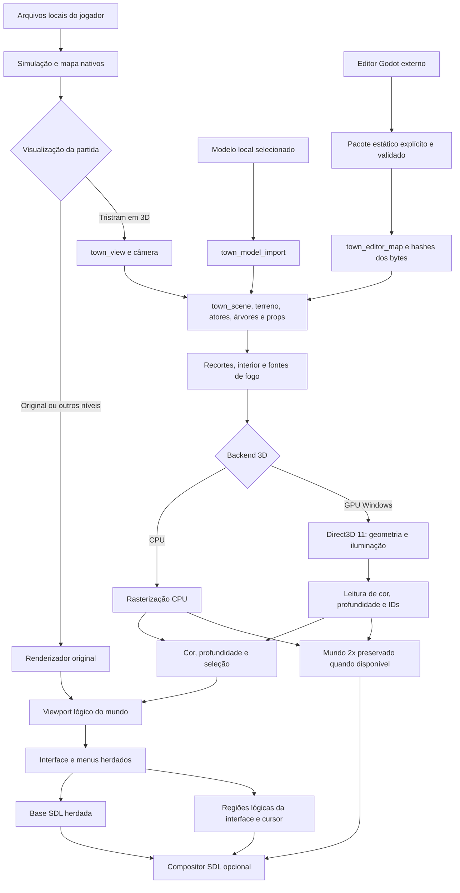
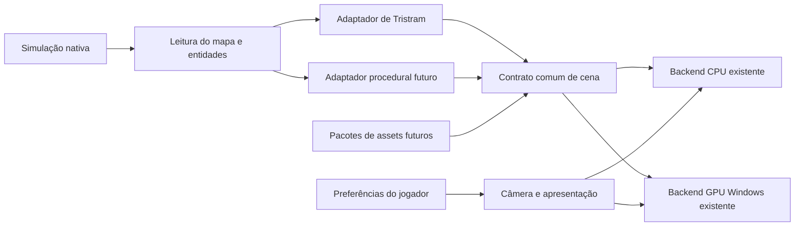
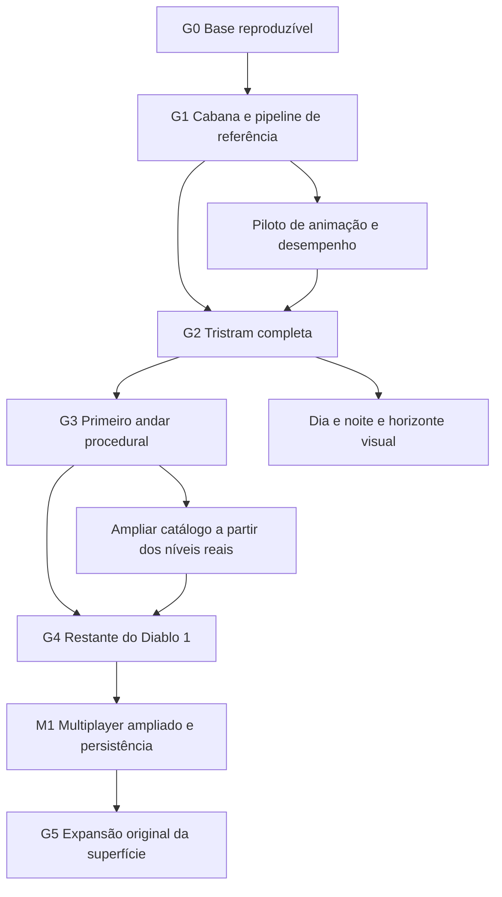
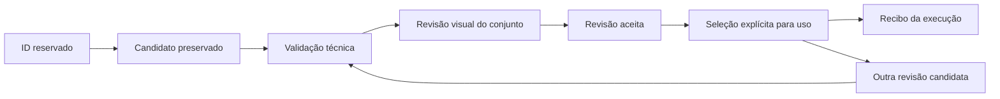

**R15 — chamas compactas/econômicas instalada e launcher verificado, 19/10/2026:** Pedido humano aplicado sobre R14 exata, sem selecionar WIP nem mudar assets. Source isolada `4b67f29e0b09f12d8d217371ae475fac43e3462948a1dd348aba0754ad317935`,841membros; normal `28da0ed096514a6a3a66090f0f6c4274bb8a4d353f7cdb5667531e5f713732e2`,9192960B. 315objetos auditados,2frescos/313bytecompatíveis nesta revisão incremental; três fresh do predecessor R15 retidos quando pertinentes. Corpo da chama Catedral .90→.70, aproximadamente22% menor queR14; brasas4→5 mantendo alcance/tamanho. Dois núcleos com offsets cruzados e tempos distintos, corpo laranja/ponta amarela; na representação econômica as línguas se fundem numa silhueta compacta, divisão sutil. Adaptive integration12passos, quota ceil(ROI/9) com chooser/budgets/fallback originais; reconstrução mantém ROI completa e profundidade de cada receptor. Caps, atenuação precisaR14, luzes/sombras reais, paredes/escadas/simulação/RNG/picking preservados.

`r15-candidate-runtime-r2` PASS no guard ORIGINAL: Source atual/fixture f3e38bd4/helperda23935a, hardware1920×1080, C1near/aproximação/F4, cache/paridade FULL-delta bitexata, três SaveMenu/leitor FULL/falhaOS preservando bytes, zero eventosfailure. ControlesGPU stride1/2/3/4/profundidade parcial/miss/near/cap e65536pares de atenuação PASS. Leitura real de receptores fora da ROI:498676pixels mudaram com luz/497443quentes/1217454com sombra; depth/picks/native/RNG iguais. Seis capturas de duas vistas/três tempos com chama inteira enquadrada e mudança temporal; revisão visual delimitada em `VISUAL-REVIEW-R1.json`. Âncora explícita e alternância de quota são observadores exclusivos da fixture, derivação exata autenticada; câmera do produto/perfil não alterada.

Comparação A/B intercalada na mesma Source/câmera/seed/tempo/ROI32256:7+7framesGPU, raios submetidos8064→3584 (55,6%menos), mediana do pass de fogo .79696→.55552ms (30,3%menor), prefix14MiB vs26MiB R14. O custo total do jogo ainda inclui CPU/readback/geometria; NÃO é ganho de30% no FPS global. `PERFORMANCE-COMPARISON-R1.json`/`FOCUSED-QUALIFICATION-R1.json` fixam medições e limites. Saídas recusadas anteriores preservadas; guard/Job240/own200 inalterados. Não é replay da partida humana nem qualificação de todos os andares.

Pacote `builds/Diablo3D-Otimizada-R15-r1`, perfil isolado copiado da R14 atual mantendo INI/Speed32/1920×1080/câmera2/FOV60/Zoom0/personagens/layout;298mounts/297efetivos selecionados exatos, zero trocas de assets, originais/R14 intactos. Launcher `D:/Diablo 1 3D/Jogar-R15-Otimizada.cmd`: CMD real PrepareOnly/ShowLaunchPlan/VerifyOnly PASS, EXE/Source/caps/data/cwd/GPUrequired/perfilD via UNC conferidos. Recibos `R15-INSTALL.json`/`R15-LAUNCHER-VERIFICATION.json`. Jogo não aberto automaticamente. Pronta para teste humano focado das chamas; frentes permanecem DRAINED durante teste. Próximo: feedback de aparência/desempenho real antes de ampliar escopo.

**R15 — novo pedido humano de fogo compacto/econômico e arte,19/10/2026:** Base exata R14 Sourceae367d2b/normal72caebd4 intacta; usuário pede chama menor, um pouco mais de partículas ascendentes, movimento cruzado, centro laranja/pontas amarelas e autoriza menor qualidade de exibição para desempenho. Fila delimitada em `diagnostics/flame-economy-r15-20261019-r1/SCOPE.md`; Root coordena/qualifica/entrega, Engine prepara somente candidato isolado OFFLINE. Preservar paredes/escadas R14, sombras incrementais R13, GPU/atenuação R14, assets298/297, perfil atual e simulação. Referência R14 mediu composição de chama.7118ms e sombra delta36.7511ms no caso focado: não atribuir toda lentidão ao volume ou prometerFPS por redução de raios. Investigar custo total, representação simples em camadas/línguas que se cruzam e trabalho da iluminação conforme evidência. Nenhum compilador/teste nativo até janela quieta/ACKDRAINED e guard original. Demais frentes DRAINED.

**R14 — instalada, launcher verificado e pronta para teste humano, 18/10/2026:** Root integrou a correção de parede/piso e o fechamento do recuo sem uso da subida, mantendo a reta de uma célula, base circular alinhada, mapa/SOL/RNG/trigger e assets selecionados. Source isolada `ae367d2bb4b6804ec234aedd7abc9e75cf0908c69e37f4a9cdfba5392c2e900e` (841 membros; cinco arquivos alterados contra R13), normal `72caebd4ebfb3055f54f9e2edbb308d7476334951d3b43df4f548829466800e6`/9191424B, 315 objetos auditados sem stale. Guard original inalterado; saídas recusadas preservadas. R13 continua intacta.

Candidato de grade econômica expôs falha real no C1 seed821362701, CSComposite/mask4; observador exclusivo da fixture individualizou mask32768 no quociente de atenuação. R4 causal usa perda relativa precisa entre prefixes monotônicos em vez da divisão direta; não remove checks nem supõe que mask32768 prove q0. Source3 atual passou controles GPU (65536 pares, zero violações), grade2/3, profundidade parcial, near plane, miss, cap e falhas controladas. `r14-candidate-runtime-r5` PASS: C1 hardware fresco, aproximação das chamas, F4, paridade delta/full das sombras e três SaveMenu reais/leitor FULL/falha OS preservando bytes. ROI pareada58564→47960, grade planejada11990 (1/4 da ROI atual), escala.90, duas luzes/42428triângulos dinâmicos preservados; contador rays/steps é CPU-only e permanece0 no caminho GPU. Não é medição de FPS prolongado.

`r14-recorded-runtime-r3` PASS na seed1586518162 NEW, não replay FULL humano. Duas seeds/seis capturas reais: parede frontal fecha o recuo e remove o retorno sem uso; contato piso/parede contínuo. Leitura de profundidade64amostras/64cobertas/zero faltantes (tolerância.15tile, não teste de cor). `VISUAL-REVIEW-R1.json` encerra a revisão visual delimitada; raw owner reports pendentes são preservados. Root corrigiu o próprio observer que comparava serial GPU depois de RAII invalidar a câmera; três checks frescos internos mantidos e nova execução passou, sem mudar produto. Fixtures full11ab428e/helper e417e02c e recorded de2888cc/helper21d3be6c correspondem à mesma Source3/normal. `FOCUSED-QUALIFICATION-R1.json` e `PERFORMANCE-COMPARISON-R1.json` fixam recibos/escopo. Pacote `builds/Diablo3D-Otimizada-R14-r1` instalado com 298 mounts/297 arquivos efetivos selecionados exatos, zero mudanças de assets; perfil físico atual da R13 copiado mantendo personagens/layout/INI/Speed32/câmera/FOV/zoom e origens/anteriores intactos. Launcher `D:/Diablo 1 3D/Jogar-R14-Otimizada.cmd`: CMD real PrepareOnly/ShowLaunchPlan/VerifyOnly PASS, EXE/caps/Source/data/cwd/GPUrequired/diagnóstico correspondentes, perfil D: confirmado via UNC. Recibos `R14-INSTALL.json` e `R14-LAUNCHER-VERIFICATION.json`. Jogo normal não aberto automaticamente. Entrega delimitada pronta para teste humano; frentes DRAINED durante esse teste. Sem promessa de FPS global nem de todos os andares.

**R14 bloqueio tecnico em tratamento — 18/10/2026:** UnionSource d13eb7081a463238da947592edb1c6cb451e9fb60768eed56679c58720c31d38 (841/838exatos/3arquivos), normal f2390f429b532bd83f5bebc94e519ceb2afb3af441f75b1f1d16c5ae2f698cc4/9189888B,315audit/2fresh313exact/caps9,compiles+linkPASS. NAO instalada. C1entry runtimeRoot r1+r2 falharam no HW mesmo aposTownPASS. Observer atual9db2ccf7/helper9f3807b9 (2TUsfresh+3reusadas SourceSDKbyteexactas) individualizou GPU: 'Fire volume shader reported an invalid ray or nonfinite result', kind2, prepareRefused0,FrameReady1,stage14,seed821362701/focus75,70/camera2. Logo geometria preparada passou; falha no transporte/reconstrucao volumetrico da gradeeconomica, nao atribuir a parede semprova. Source1/R13/outputs recusados preservados; originalguard inalterado. Linkr5 recusado mesmoexit0 por transientNT/EnumPIDsets mismatch; linkr5b emsaida novaPASS,nenhuma saidarecusadaadmitida. FonteSource2 de diagnosticoGPU/isolatedplane gates em preparacao OFFLINEpelaEngine,semcapsrelax/ignorarfailedray/falsePASS. CatedralR1congeladaDRAINED,todosoutrosDRAINED;Rootmantemjanela eprepara novaqualificacao.SomenteR13 segueentregue.

**R14 em preparo OFFLINE — novo relato humano, 18/10/2026:** Faixa preta no encontro piso/ultima parede (screenshot5cde2dc5), trecho recuado sem uso ao lado da subida a substituir por parede frontal continua (steering humano screenshotc1a3dd9c), e pedido explicito de chamas um pouco menores/mais economicas. Escopo delimitado em `diagnostics/cathedral-boundary-flames-r14-20261018-r1/SCOPE.md`, parent exato R13 Source73aa4d8c/normal8dbc73e4, anteriores/mounts/WIP preservados. Catedral prepara somente paredes/contato e Engine somente fogo em candidatos isolados OFFLINE; Root integra/testa/empacota sem implementacao concorrente de Catedral. Sem compilador/helper/GPU/jogo/Blender pelas frentes. Humano confirmou R13 fechada; antes de nativos guard ORIGINAL e ACK DRAINED global. Outros chats quietos. Falha ainda sem causa confirmada; nao chamar screenshot de prova de SOL/seed alterados.

**Chamas R13 — instalada e launcher verificado, pronta para teste humano, 18/10/2026:** Continuacao delimitada da R12; Root unico dono da fila/build. Source `73aa4d8c229c7ec2d990f06f5a3f7605df077ca49a8bc6796682a4c8d707eb61` em `diagnostics/flame-performance-r13-20261018-r1/candidate-source-r3/Source`,841membros/4arquivos modificados vsR12/837exatos. Atualizacao EXATA da sombra dinamica: historico proprio bounded16MiB, prova de identidade/luzes/layout/mascaras, uniao old+new das triangles alteradas, reuse apenas dos rays fora da uniao e full original em qualquer divergencia. BoxHit otimiza somente divisoes por +/-1 exatas. Sem reduzir resolucao/modelos ou alterar RNG/simulacao. Resets/recusas liberam caches. R2 rejeita history subcontado e oldvertices/UV invalidos; R3 renomeia comparator novo apos C2668 real de namespace importado. Revisoes/saidas recusadas preservadas. Guard ORIGINAL/Job240/own200/pins inalterados.

Normal `8dbc73e489bb93ea863ea4c36dc6efb6e0bfac7a0ff4c9048f8a6935ec0cd6a8`,9185280B,caps9atuais. Compile/link PASS,315TUs auditadas/4frescas/311bytecompativeis,zero stale/missing. Fixture`f973a74f1377954ab7bb51f2608f9142422609debf88fda330129075401a1580`/helper`731a6573ddd7d3444c59f4f9aa4a50c019c5eb860cc71950997ea797b6ebfba5`, Sourceatual/observedtownview so normaliza CRLF, conteudo exato. Compile/link e2execucoes guardadas PASS. Pose nativa alterada com RAIIrestore/witness/RNG iguais e comparacao delta/full na mesma camera/clock:49152rays=48339reuse+813recompute,2725824Bhistory. Builddelta13,5418/14,9734ms vsfull99,283/109,554ms (mediana86,346% menor). Frame97,4783/79,08ms vs160,727/164,77ms; threadCPU78,125/62,5ms vs109,375/140,625ms. Teste focado de mudanca de pose, NAO FPS prolongado do jogo inteiro.

`FOCUSED-QUALIFICATION-R1.json` e `PERFORMANCE-COMPARISON-R1.json`: shadowdepth/RGBA/indexed/depth/pick/smooth/key bitexatos nas2comparacoes reais;5capturas RGB bitexatas ao baselineR11. CPU Full/delta,mascaras/layout/luz/historymalformado/cap/undersizedbounds/6faces/BoxHit e tinyplanes PASS. C1ordinary/stationary/F4off/on com framesGPUfrescos,zero failureevent,volumes/luzes positivos e6acoes reaisSaveMenu/FULLreader/falhaOScontrolada preservandoarchive PASS. Nao reproduz a partida humanaC1 nem qualifica todos os andares. Pacote `builds/Diablo3D-Otimizada-R13-r1` montado:298mounts/297efetivos selecionados exatos,perfilR11atual copiado sem alteracao deINI/camera/FOV/Speed32/layout/personagem,anteriores intactos. Launcher `Jogar-R13-Otimizada.cmd`: CMD real PrepareOnly/ShowLaunchPlan/VerifyOnly PASS, EXE/caps/Source/pins/data/cwd/GPUrequired/diagnostico correspondentes. PerfilD fisico conferido por UNC, originaisR11/pacote anteriores intactos, jogo normal nao iniciado. Recibos `R13-INSTALL.json`/`R13-LAUNCHER-VERIFICATION.json`. Pronta para teste humano focado de desempenho; chats permanecem DRAINED durante teste.

**Chamas — R12 pontual validada, continuação R13 autorizada OFFLINE, 18/10/2026:** Pedido humano atual é otimizar a lentidão das chamas; não integrar árvores históricas R4/engine25B por mensagens de agente ou recência de arquivo. Root único dono da fila/seleção/build. R11 instalada permanece intacta. R12 Source`1e863fe772b90ae0493664e193b6b7aebf09a76b461fb5ee0fa19859a1f4bafe`, normal`ef4de14cf1198a3075c18871b842ac36e0b8efd31f3dfbb369066eb489e62737`/9163776B, caps9 atuais; somente2incs alterados/839membros exatos/zero assets. DoisTUs frescos/313objects byte-auditados sem stale. Guard ORIGINAL normalcompile/link PASS, outputs recusados preservados e não admitidos. Blender abriu durante uma tentativa; humano confirmou fechamento, nova saída separada passou. Execução de fixture exigiu mais tempo quieto APENAS no launcher próprio20s vs8s, sem mudar guard/limites/política/provaJob; justificativa `OWNED-LAUNCH-RETRY-REASON-R1.json`.

R12 `FOCUSED-QUALIFICATION-R1.json` e `PERFORMANCE-COMPARISON-R1.json` em `diagnostics/flame-performance-r12-20261018-r1`: matcher compara campos exatos sem vetor temporário no hit; keynear2,1685→0,8628ms(~60%). GPU RGBA/indexed/depth/pick/smooth/shadowdepth/key bitexatos vsfullrebuild;5capturas mesmas câmeras/RGB bitexatos; casosUV/mask/pose/door-key/reset/truncado e native/RNG PASS. C1ordinary/estacionário/F4off/on e3SaveMenu reais/FULLreader/falha controlada combytes intactos PASS. Porém quadro near75,2→81,8ms, demais tempos mistos/ruidosos; ganho global/FPS NÃO comprovado. R12 não instalada/anunciada como cura do desempenho geral; mantém-se como melhoria pontual congelada.

Próxima medição atual SourceR12: fixture970b005e…/helper1bbd9f10…, guard `r12-candidate-runtime-r2` PASS, reusa3TUs byte-exatos sem uso do macroFixtureClosure e recompila observador+diagstamp. `near-caster-domains.json`:42428dinâmicos =2817Prop+39607Actor+4Alpha; body11039/equipment28568/nativeActorQuad0, duasluzes. Props aceitos: sarco slot77=721, braziers106/108=1048cada. Assim93,35%Actor e67,33%equipment. Modelo completo preservado; CPUrebuild ainda caro. Não inferir estes números da partida humana ou chamar estatísticas somadas de camadas de duração atual.

Fila atual `diagnostics/flame-performance-r13-20261018-r1/SCOPE.md`: Engine autorizado APENAS OFFLINE para novo `candidate-source-r1/Source`, parent exato R12, atualização incremental EXATA dos texels cujos rays cruzam a união conservadora old+new da geometria/coverage alterada; fullBuild original em qualquer dúvida de epoch/lights/layout/chave/orçamento. Sem redução de modelos/resolução, cache temporal ou mudança de simulação. Root prepara fixture/guard/paridade/render com pose alterada e comparação full/delta pareada; SourceR12/ativos/masters/perfis/WIP imutáveis. Outros chats DRAINED. Antes de qualquer próxima execução nativa, Engine deve congelar e ACKDRAINED; todos sem IO/processos externos durante guard ORIGINAL. Não reabrir fila histórica por mensagens entre chats.

**Histórico — prioridade humana: desempenho das chamas reaberto, 18/10/2026:** Usuário relata novamente lentidão forte com as chamas novas. Escopo delimitado em `diagnostics/flame-performance-r12-20261018-r1/SCOPE.md`, base R11 Source1abb…/normaldff… intacta. Root coletou cópias passivas dos dois logs R11 e perfil atual em `human-evidence-r1`, origens sem alterações. Sessão9c85b1… contém GPU hardware1280×720, duas observaçõesC1, zero failureevents; dez amostras têm worldUs mediana157018 e recordUs64406/readback16599, incluindo primeiros frames caros. São amostras históricas não pareadas, NÃO FPS nem atribuição causal exclusiva ao fogo. Reabrir custo de preparo/volume/luz/sombras com medição atual e mesma câmera, sem regredir R11/arte/simulação.

Root mantém docs/evidência/fixture/guard/build/integração. Engine recebeu liberação APENAS OFFLINE para patch isolado de fogo em `engine-candidate-r1/Source`, sem editar WIP/SourceR11/assets/perfis. Outros chats seguem DRAINED. Nenhum jogo detectado na primeira inspeção; checagem definitiva deve ser do guard ORIGINAL antes de compilador/helper/GPU/Blender. Guard e orçamentos não mudam. Diagnóstico humanoC1 permanece pendente e deve ser preservado, mas pedido atual autoriza esta prioridade de desempenho. Próximo: causa de código, baseline atual e candidato medidos, gates pertinentes e launcher verificável; não apenas reduzir/remover efeitos nem anunciar otimização sem resultado.

**Histórico — R11 diagnóstico instalado e launcher verificado — 18/10/2026:** Entrega `D:/Diablo 1 3D/Jogar-R11-Diagnostico.cmd`, pacote `builds/Diablo3D-Diagnostico-R11-r1`. Source isolada1abb60806c370adfb6909cea397cf6ef4fea57947aa95349494c22af825567a7, normaldff0a9cb465d63d3e74df6261d78537c891d1cc5239de5b7d9f454c8b42b1c57/9161728B, capabilities9campos correspondentes. Cinco TUs frescas/310objects reusados com dependências byte-exatas; auditoria315objects/1726arquivos sem stale/missing. Guard ORIGINAL compile/link e gates atuais PASS, sem elevar limites ou admitir saída recusada. Quatro arquivos de produto mudados; zero assets selecionados mudados. Todo WIP e versões anteriores preservados.

Evidência `diagnostics/c1-persistent-diagnostics-r11-20261018-r1/FOCUSED-QUALIFICATION-R1.json`: transporte genérico/lazy-before-GPU/IO/identidade (4processos), instâncias independentes e opt-in explícito, sem consentimentoCPU inventado. Fixturef8345e78…/helper2777bdf2… usa Source atual: NEW→C1 ordinary publicou GPU, stationary e F4off/on distinguiram frame novo de retorno do wrapper; quatro witnesses preservaram estado nativo/RNG. Perfil Zoom0/FOV60/Camera2/Speed32. Três chamadas reais do menu: cursor recusado sem gravação, gravaçãoFULL confirmada pelo leitor nativo, falha sob lock exclusivo próprio com aviso de falha e FULLanterior intacto. Persistiram3eventosC1 e10save_action, sem failureevent. Imagens em `visual-r1`, RGBs idênticos aos BMPs capturados. Isto NÃO reproduz/corrige a partida humana, NÃO qualifica FPS prolongado, UI física ou todos os andares. Não declarar cura a partir do controleNEW.

Instalação/launcher em `R11-INSTALL.json` e `R11-LAUNCHER-VERIFICATION.json`: CMD real PrepareOnly/ShowLaunchPlan/VerifyOnly PASS, EXE/caps/Source/pins/data/cwd/GPUrequired/diagnóstico atuais; jogo normal não aberto automaticamente. Perfil novo `D:/Diablo 1 3D/profiles/Diablo3D-Diagnostico-R11-r1/profile`, origem física UNC R10 atual, somente Speed20→32 alterado no INI; câmera/FOV/zoom/layout/hero preservados, confirmação UNC d$ sem divergência de virtualização. Assets298montados/297efetivos exatos, cópia runtime20 selecionada, sem override antigo. R10/pacote/perfil físico original e saves confirmados intactos. Referência frontal da porta já entregue em `art-reference/cathedral-door-r1`, sem promoção de modelo.

**Fila/posse atual:** próxima ação é teste humano nesta R11 para capturar eventual recusa C1 com contexto persistente; coletar os novos eventos/save sem alterar origem se ocorrer. Frentes coordenadas mantêm propostas congeladas e DRAINED até mensagem explícita Root; janela reservada ao teste humano, sem nova execução nativa/Blender/compilação concorrente. Não acrescentar features/novos assets antes de fechar esse diagnóstico; tons de grama/caminho e geometria da Catedral continuam pendentes, sem rollback das seleções.

**Histórico — candidato R11 diagnóstico fechado — início de compilação reservada,18/10/2026:** Source isolada `diagnostics/c1-persistent-diagnostics-r11-20261018-r1/candidate-source-r2/Source`, closure1abb60806c370adfb6909cea397cf6ef4fea57947aa95349494c22af825567a7. Quatro arquivos mudados/837membros exatos/zero assets: CathedralR4(loggerhpp/cpp/TownView, header4e638…) +gamemenuR4bodye856…, preimages/diffs em INTEGRATION-R2.json. First/material/host/GPUknown jácalculados, dedup por contexto relevante e limites128/224. Instâncias Logger purosemSessionglobal; wrappersSessionexplicitoptin. Revisão Engine achou getter inicial aliased legacy diagnostics=true: nova flagprivada contextDiagnosticsEnabled=false até EnableSessionDiagnostics explícito preserva booleanlegado/default/preflight/firstfailure/Policy/cache e todos consumidores anteriores. Versão Sourcefb438… e preparadores anteriores NÃO compilados/nãoadmitidos, preservados por proveniência.

Cinco TUs normais serão frescas, flags individuais herdadas (incluindo políticaEH original do gamemenu), Source stampnovo e /Z7 no armazenamento debug;310bodies restantes dependem de auditoria byte-exata na Source atual. Plano `NORMAL-BUILD-GUARD-PLAN-R2.json`, saídas previstas `C:/Users/dougl/Documents/Codex/diablo3d-r11-build-r1/normal-r3`; ainda sem EXE R11. Toolenv restrito/pinado e filhos próprios suspensos, guard ORIGINAL inalterado. Root solicitaDRAINED às4frentes antesdosblocos nativos; duranteguard zeroIO/processosforaJob. Testes de transporte4processos, ordinaryC1off/on+witness e3ações reaisSaveMenu em perfilprivado preparados/congelados; ainda NÃOexecutadosnestaSource. Novo perfilproduto deverá usarorigemfísica atual/Speed32 explícito e caminho compartilhado semvirtualização. R10/caps/assets/perfis/saves/WIP/master/doorreference todos intactos; observabilidade e correçãodoaviso não são cura declarada da partida humana.

**Próximo candidato diagnóstico C1/menu — preparação seletiva,18/10/2026:** Root reservou `diagnostics/c1-persistent-diagnostics-r11-20261018-r1/SCOPE.md` sobre a422…/normal9cbb…; nenhuma normalR11 gerada ainda. Somente3arquivos Catedral(loggerhpp/cpp/TownView) finais revistos +1gamemenu Entornos bodye856…; guardar propostas antigas sem admitir por recência. Método Logger genérico serialize-only, wrappersSessionoptin/lazyOpenoriginal/limites; C1 ainda precisa camposFIRST/material/host jácalculados/deduprelevante para evitar nova rodada humana cega. Menu preserva únicaSaveGame, logarecursascursor/morte e sóavisasucessoquandoresultadoétrue (não equivale a archiveVerified). Headerdep mostra5TUsnormais afetadas:diablo/gamemenu/town_view/town_gpu/diagnostics;310outros sóreusar comprova deconteúdo igual. Core/transport/capability/realprivateSave/launcher atuais requeridos depoisdecompor. SourceWIP, assets298, todos fixesR10 e perfis originais preservados; próximo perfil novo deve usar origemfísica real eSpeed32 explícito, sem overlayantigo. Root único dono nativo; frentes OFFLINE até DRAINED pontual. Não declarar causa/fix humano por controleNEW quepassou.

**C1 — controle ordinary com perfil físico publicou3D; partida humana sem FULL,18/10/2026:** INC concreto da frente Catedral integrado APENAS na fixture `cathedral-r10-human-regression-20261018-r1/fixture-archive-route-r6`, closure2701a0bf…; helper49142104…/9049088B. Source/normalR10 a422…/9cbb… e seleções/perfis originais intactos. Guard ORIGINAL compile5TUs/link/runtime-r7 PASS. Duas tentativascompile-r6 recusadas antes de outputs por snapshotNT/PID; nãoadmitidas. Preparação VCvars foi capturada em ambiente restrito/pinado e restaurada no filho próprio em vez de criar helpers breves durante aquisição; flags/compilador/guard não mudaram. Filhos reais permanecem suspensos para prova Job antes de retomada serial. Todos recibos preservados, sem reusar saída recusada.

Reader nativo abriu a cópia física08b03ad6… em slotprivado1 e confirmou `HasFile("game")=false`, multiplayer0/spawn0: arquivo não tem entradaFULL, portanto sem LOAD/mapa humano neste teste. Não é diagnóstico de corrupção nem prova de por que Salvar não gerou FULL. Mantida sessão NEW nativa existente, sem carregar herói humano nem inventar campos: transiçãoWM_DIABNEXTLVL1 real/packets chegouC1 seed821362701 (gerador de teste554921), rótuloEXPLÍCITO NEWSEED_NOT_HUMAN_REPLAY. Zoom0/Speed20/FOV60/Camera2 reais mantidos. Duas observações via DrawWorldViewForDiagnostics→DrawGame ordinary publicaram3D hardware/RadeonRX570, enabled/eligible/active/ready1, fallback0, reasonPublished3D, GPUserial0→2→3, native/RNG witness exato em ambas. NÃO usar este PASS como correção/replay da partida humana, Catacumbas ou gameplay/FPS prolongado.

Evidência consolidada `cathedral-r10-human-regression-20261018-r1/ARCHIVE-ROUTE-RESULT-R7.json`; runtime `local4-release-20261014/execution/c1-archive-route-runtime-r7-79e56bc4e71c45b19df9362bd6f41520`; capturas `visual-archive-route-r7/case-entry.png` e case-stationary.png, conversãoBMP→PNG com pixelsRGB idênticos/inspeção visual. Defeito de formato do observer: quatro uint8bounds saíram como caracteres em JSONraw; originais preservados, normalização DERIVADA explícita e sem perda para16/96 com SHAraw, demais campos/rotas lidos e verificados. Próximo: observabilidade persistente da rota humana/primeira recusaC1, câmera/Enabled e entradaSave no normal isolado; distinguir menu/cursor/SaveGame e gates sem pedir repetição cega do salvamento. Notificação de sucesso incondicional do menu é defeito estático separado. Hero-onlyfalse recriaarchive, mas callers normais achados são multiplayer, não atribuir ao quitSP nem trocar política sem gate. Janela OFFLINE liberada às frentes após runtime, Root único dono da próxima execução. Relato humano foi “o jogo funcionou nas Catacumbas”; não presumir comprovação3D/nívelC1 a partir disso. Nenhuma buildnova corrigida ou feature instalada nesta retomada.

**C1 — observador físico compilado e leitura nativa concluída,18/10/2026:** Fixture nova isolada `cathedral-r10-human-regression-20261018-r1/fixture-physical-r4`, closureac3e23e4…, mantém observador town_view exato do produto e asserts do INI físico Zoom0/Speed20/FOV60. Usa DrawWorldViewForDiagnostics (DrawGame ordinary, semforceGeometry) e registra identidade monotônica GPU antes/depois, contexto/recusa/câmera/preferências. Guard original compile5TUs/linkPASS, helper70e14654…/9041408B; Source normal a422…/EXE9cbb…/assets e origens intactos. Primeira tentativa link recusou snapshotNT/PID inconsistente e não gerou outputs; repetição exata admitida. Runtime-r4 recusado por helper observado semprovaJobpositiva: nãoqualificado. Runtime-r5 filho próprio criado suspenso com Job herdado/handles próprios e tempo de observação resolveu o monitor, sem mudar guard: before/during/afterclear, ledger1identity/fatal0. Porém o teste falhou em gbValidSaveFilefalse depois de pfile_read_player_from_save do NOVO save físico08b03ad6…; parou antes de LOAD/C1, não prova cura/regressão3D nem corrupção do arquivo. Precisar distinguir gameausente/decode/header/multiplayer antes de chamar hero-only.

Execução preservada `local4-release-20261014/execution/c1-human-physical-runtime-r5-6237d25ca6584266bcae7c6390b5571d`, perfilprivado `C:/Users/dougl/Documents/Codex/diablo3d-r10-build-r1/runs/human-c1-physical-r5`. Próximo observador preparado pela Catedral OFFLINE: diagnóstico nativo do archive e, se sem FULL válido, NEW→C1 real com as preferências físicas, rótulo explícito NOVASEED/sem atribuir replay humano, rota ordinary+witness. Entornos revisa gates de FULL: menu mostra EMSG_GAME_SAVED mesmo quando pfilewritevoid recusa silenciosamente; risco estático achado, ainda não causa deste arquivo. Janela OFFLINE liberada às frentes, Root único dono nativo; não pedir ao humano repetir salvamento sem antes entender esta limitação. Nenhuma Source produto nova/build corrigida entregue.

**C1 — captura física após confirmação humana,18/10/2026:** Usuário informou que salvou e fechou, e que o3D funcionou nas Catacumbas; isto não comprova C1. Root encontrou divergência concreta de filesystem: processos empacotados Codex leem AppData pelo overlay LocalCache antigo, enquanto leitura UNC física `\\localhost\c$` mostra o perfil realmente escrito pelo jogo. Evidência nova imutável em `diagnostics/cathedral-r10-human-regression-20261018-r1/human-evidence-physical-r2`: single_0.sv86512B/SHA08b03ad6… de06:07:34UTC, INI5004B/SHA51e2b45b…; cópias antigas também preservadas, origens intactas. O diagnóstico anterior de hero-only aplica SOMENTE às cópias antigas do overlay, não a este novo save físico, ainda não lido pelo pfile. Console humano ficou vazio; logGPUd85b58… tem quadros hardware/completos até4200/shutdown4214, sem contexto de nível que prove C1. Nenhuma causa/fix/build nova declarada.

INI físico tem Zoom0/Speed20/FOV60/CameraMode2/Start3D1, distinto do overlay Zoom1/Speed32/FOV80. Helper já compilado bf600793… exige Zoom1/Speed32 na inicialização; não executar plano físicoR2 tal como preparado nem normalizar silenciosamente essas opções suspeitas. Próximo diagnóstico: fixture nova isolada que carregue e registre as preferências físicas reais (sem falsear zoom/câmera/seed e mantendo guard original), LOAD do save físico, contexto/refusal e imagem do caminho ordinário. Próxima versão humana ainda deve cumprir Speed32 explicitamente e preservar preferências atuais conscientemente, sem copiar overlay antigo por cima do perfil físico. Root recolheu apenas evidência/preparou plano offline nesta retomada; nenhum novo guard/runtime/compilador/jogo iniciado. Porta solicitada foi gerada como referência artística frontal em `art-reference/cathedral-door-r1`, sem substituir assets selecionados.

**C1 humano2D — captura concreta pronta e aguardando partida reproduzível,18/10/2026:** Usuário confirmou primeiro andar normal e permanência em2D. Root montou helper sameTU exataR10, fixturebf600793…/EXEba270c64…, compile/link pelo guard originalPASS, Source/normalR10/seleções/perfis originais intactos. Duas cópias de heróis foram lidas pelo pfile nativo; ambas retornam gbValidSaveFile=false (somente personagem, sem fullgame). As duas execuções pararam nessa asserção do diagnóstico e NÃO qualificam correção nem provam defeito do carregador. Sem seed/mapa completos, não atribuir o comportamento humano à NEW C1fixture padrão.

Atalho revisável `D:/Diablo 1 3D/Jogar-R10-Diagnostico-Catedral.cmd` usa a MESMA R10/normal9cbbf451… e captura console/stdout/stderr em subpasta human-repro única sob `diagnostics/cathedral-r10-human-regression-20261018-r1`, sem trocar Source, executável, assets, câmera ou preferências. PrepareOnly e VerifyCaptureOnly passaram pelo CMD real; captura de saída, bytes do pacote e plano confirmados, Root não abriu partida normal. Solicitado ao humano abrir esse atalho, reproduzirC1em2D, Esc→Salvarjogo e fechar, para recolher log e fullgame e executar LOAD isolado na mesma seed. **Janela agora reservada a essa reprodução humana, sem compilador/helper/GPU/Blender até confirmação de fechamento.** Próxima ação Root: snapshot dos novos log/save sem alterar origens, preflight e cópia privada, LOADguardado com contexto/refusal/material/epoch/bounds/câmera (forceGeometry=false), correção causal e novos testes/entrega; nenhuma causa ou build corrigida declarada.

**Reaberto após teste humano R10 — 18/10/2026:** Humano relata que o 3D não funcionou dentro da Catedral. Root prioriza a regressão sobre R10 Sourcea422bb97…/normal9cbbf451…, sem rollback de assets/otimizações nem paredes novas. Sintoma exato, andar e rota ainda em esclarecimento; não atribuir causa ao shader, arte ou save sem prova. Sessão humana72bfe7cb… foi copiada com INI e saves para pasta privada `diagnostics/cathedral-r10-human-regression-20261018-r1/human-evidence`, origens intactas. Log tem6quadrosamostradosGPUhardware/completos, não contém level/contexto/refusal e nenhumGPUerror; isto NÃO exclui fallback anterior ao backend nem prova C1. Catedral reserva revisãoOFFLINEeligibility/loader/toggle, Root único dono deexecução; diagnóstico oficial em `cathedral-r10-human-fallback-review-20261018-r1/OFFLINE-REVIEW.json`. Só diagnóstico/root aguardando contexto, nenhum patch/game/novo teste nativo iniciado.

Requisito visual novo: grama de substituição próxima da paleta da grama nativa; caminho novo no tom de terra já existente ao redor do Well. Tristram reserva amostras/cores e candidato material OFFLINE delimitado sobre R10; Entornos reserva continuidade futura nas fronteiras/horizonte, sem implementação concorrente. Plano humano: reconstruir todo chão/caminhos/água e relevo deformado em3D, arte2Dnativa como referência visual; mesma geografia, percurso, SOL e integração2D/3D precisam contratos/gates próprios por etapa. Não confundir novo requisito com conteúdo já entregue nem redesenhar mapa/selecionar assets/perfil R10 durante diagnóstico. Masters, revisões aceitas e todas melhorias existentes preservadas.

**R10 otimizada instalada para teste humano — 18/10/2026:** Abrir `D:/Diablo 1 3D/Jogar-Previa-R10.cmd`. Pacote `builds/Diablo3D-Previa-R10-r1`, perfil isolado `C:/Users/dougl/AppData/Local/Diablo3D-Previa-R10-r1/profile`. Source final isolada `diagnostics/diablo3d-performance-r10-20261017-r1/candidate-source-r7/Source`, closure `a422bb97ae62aadcb512c94b983c37e3ef339d309e5d8887e0d25951d4e91156`; normal EXE `9cbbf451a3979057766cbfe01aed4f4a08584e889bff8753cde13f957c7c4691`, 9.143.296B, compilado em `C:/Users/dougl/Documents/Codex/diablo3d-r10-build-r1/normal-r10/link`. Todos841 Source atuais verificados; 315 relatórios de dependência sem input Source/header obsoleto. Assets298montados/297efetivos selecionados, R9 humano, perfis/saves/preferências/Speed32 e masters preservados. Não fazer rollback nem integrar árvore antiga inteira sobre esta base.

Escopo: fogo limita composição opcional a65.536pixels; excedente mantém chama animada nativa, luz e sombras. Render mediano pareado na mesma câmera perto da chama R9 166,812ms → final73,5825ms (~56% menor), medição diagnóstica BelowNormal/afinidade1, **não FPS inteiro**; Town480,383→479,866ms não demonstra ganho geral sustentado. O antigo erro humano de readback não foi reproduzido exatamente no baseline controlado; não prometer cura universal. RGB authored deENV/horizonte/terreno/halo/props/Nature não sofre quantização prévia para256cores no caminho suave Unlit; testeGPU de5cores, white/black e testemunhos indexado/depth/pick/coverage passou. Tom/dither noturno deTristram já aparece emR9; céu distante preto no entorno e revisão artística geral permanecem pendentes, não confundir PASS RGB com aceite visual completo. Paredes e novo aspecto realista da chama/variedade geográfica ficam em incrementos separados.

Gate regional real expôs defeitos anteriores: Empty válido da pintura da estrada era Invalid; agora resultado tri-state/cacheowned resetado e consumido pelo dono congelado. Duas peças de cenário1053/1054 removidas legitimamente no norte recebem somente a exceção autenticada deHost para ground0. Preparação excedia128MiB:267.210.279B; nova121.521.133B (~54,5% menor no payload contabilizado), mesmo limite, zero assets trocados. São5.155 volumes imutáveis vazios dispensados,442 meshes/texturas fixas emprestadas de seus donos atuais,5volumes de evento aindaowned; cache canônico de chão evita decodificar todas as fachadas. Oracle comparou1.136peças/donors/controlos pixel/opacidade/dimensões/flags exatos com bloco legacy independente, UIDs/endereço estáveis,13entradas deTerrain/1.136ground/8shadow. HeadersTexture embutidos agora cobrados uma vez. Native/RNG/owner/epoch preservados. Dois defeitos regionais adicionais corrigidos: road.repeat=false para cobertura com worldUV (atlas ainda repete emworldXZ); campo Church com todas as7shells aperturadas e18luzes usa clones locais, descritores X/Z traduzidos uma vez e contados, sem duplicar emissão ou ativar novo shadow-builder regional.

Guard original inalterado: normal compile/link r10, fixture compile/link r9 e runtimes `r10-final-regional-runtime-r6`/`r10-final-core-runtime-r6` PASS no tuple final acima, fixture75780107…/helperac03e3ba…. Town→South→Town, RGB1280x720 não preto, donos/cache, Empty+Ready, cortes norte/controles, luzes locais, reset/reativação e native/RNG passaram; Town→C1→Town, câmera FreeOrbit realmente distinta perto/limite/dentro da chama, positivos/negativosGPU e comparação de cor também. Core strict=true/failedFrames0/positiveVolumes8/positiveLightingFrames26. Recibos, comparação e limites em `diagnostics/diablo3d-performance-r10-20261017-r1/FINAL-QUALIFICATION-R1.json`; instalação `diagnostics/consolidation-readiness-20261017-r1/PREVIEW-R10-INSTALL.json`. LauncherCMD real PrepareOnly/ShowLaunchPlan/VerifyOnly exit0: EXE, Source9fieldcaps, assets/perfil/data/cwd certos; principal não abriu partida normal. Isto é prévia otimizada com estes testes focados, não todos94grupos/níveis ou gameplay prolongado. **Janela nativa reservada ao teste humano; frentes podem preparar somenteoffline, sem compilador/helper/Blender/jogo até coordenação.** Automação excluída permanece excluída.

**R10 — fechamento em otimização de recursos, execução do coordenador — 17/10/2026:** Source mais recente isolada `diagnostics/diablo3d-performance-r10-20261017-r1/candidate-source-r4/Source`, closure `d6a5ba7e6cc151e08819683faa6113c97e2e8a5b56b04af0eda595cd590c12ae`; EXE normal `C:/Users/dougl/Documents/Codex/diablo3d-r10-build-r1/normal-r7/link/Diablo3D-engine-r10.exe`, SHA `9481f5498c668cc8568c5448b11dc5d0a11f12d06c46acd667d7671d7e333da0`, 9.139.200B, compile/link guard original PASS. NÃO instalado/pronto. R9 humano e todas as seleções/298 assets continuam intactos; paredes adiadas. Fogo limita ROI composto opcional a65.536 pixels e mantém sprite animado/luz/sombras no excedente. RGB authored de ENV/terreno/halo/props/Nature preservado em vetor próprio no caminho suave/Unlit, sem alterar testemunho indexado/depth/pick. Core real Town→C1→Town/near-fire/CPU mask/GPU RGB e negativos passou na closure anterior `6e57a2c7…`/EXE `83cb74de…`; NÃO usar como PASS da d6 ou sucessora. Mesma câmera R9→primeiro candidato mostrou167→57ms de trecho render mediano, não FPS inteiro nem comprovação de reprodução exata do antigo erro readback humano.

O gate adicional regional expôs defeitos anteriores à nova preparaçãoRGB: célula autenticada ground59,82 sem pixels de pintura era confundida com Invalid; cache Empty/Ready agora é explícito, owned/reset e lido após troca de carrier. Dois Scenery1053/1054 em56/57,10, legitimamente removidos para native0, eram exigidos como meshes não vazias; a d6 aceita apenas delta de Host autenticado, fonte0/pixels+opacidade válidos, identidade, assinatura e namespace corretos. AntesTown real confirmou altura0/solid0/meshes originais604/588/controles30/31,10, sem escrita em mapa/RNG. Depois dessas correções, o observador de d6 mediu `preview-draw-resource-budget`: **267.210.279B, SurfaceFrameFailed=0**, limite128MiB mantido. FixedMesh29.597.952B, FixedTex31.704.252B, Imports75.697.728B, ArchiveTex10.441.060B, NativeArtwork9.502.958B;5.602 volumes+20deltas. Não elevar limite, descartar arte ou desativar CPU/GPU. Entornos prepara skips de origMesh0/signature0 em Host+Draw e contabilidade sem contar headers embutidos duas vezes; Engine prepara compactação exata/compartilhamento de LUTs interiores, sem mudar cores/64 níveis/resolução. Ambas OFFLINE em pastas próprias, sem editar Source congelada; Root rebase seletivo, nova closure/EXE, testes atuais e instalação ainda pendentes. Não há release completa anunciada.

Guard original e ledger continuam inalterados. Ferramentas breves precisaram de criação suspensa de filhos próprios no Job para prova real, com retomada serial; /Z7 substitui apenas PDB de compilador /Zi nas TUs frescas, preservando /O2/ABI/EH e link /DEBUG:FULL. Nenhuma saída de guard recusado foi admitida. Um link de fixture temporária apontou para RSP antiga e recebeu PASS com0outputs: recibo explicitamente rejeitado como qualificação; referência corrigida, asserts de existência e dois outputs reais conferidos no link posterior. Fixtures separadas, projeção de World com stderr-only auditada, não produto normal. Auditoria de315 relatórios de dependência não encontrou bytes de Source/headers diferentes da closure mais recente. Root evita iniciar processos locais durante os próprios guards para não criar churn no intervalo CIM. Automação cancelada permanece excluída.

**R10 — prioridade humana: desempenho, chama próxima e cores de Tristram — 17/10/2026:** Novo relato após teste R9 aprova o resultado da iluminação C1, mas pede otimização: câmera próxima à chama escurece o quadro e reduz muito a fluidez; horizonte/aplicações de terreno têm cores divergentes. Paredes explicitamente adiadas. Reabre-se somente este defeito sobre Source R9 `a8f0fbc0…`/EXE `d533d097…`, sem rollback de assets ou integração de features novas. Inventário CIM inicial do coordenador não encontrou partida; guard original continua obrigatório para C++/link/helper/GPU. Root coordena/reserva execução serial; Engine faz patch OFFLINE isolado em `diagnostics/diablo3d-performance-r10-20261017-r1/engine-candidate/Source` (renderer fogo e seus .inc); Entornos revisa cores OFFLINE em `colors-review`, sem editar os módulos Engine/seleção. Catedral/Tristram sem mudanças de paredes/arte nesta entrega. R9 e perfil/pacote humanos permanecem intactos.

Sessão humana R9 `71118e8e4bdd40248326349a1c1f13e4` foi preservada em `diagnostics/diablo3d-performance-r10-20261017-r1/human-r9-evidence`; erro confirmado `invalid_gpu_input`/readback/frame1542, antes de quadro recusado, hardware volta a completar quadro1560. Amostras de preparação/envio também apresentam custo alto; não equivalem a FPS total nem demonstram por si só a causa da chama. Critério: reproduzir/medir casos equivalentes (longe/perto/limite próximo), preservar aparência/luz/sombras e native witness, nenhum quadro preto por cálculo opcional, comparar tempos a mesma resolução/configuração, conferir cor RGB/índice/névoa sem trocar texturas selecionadas; gerar prévia isolada posterior somente com evidência. Estado inicial: análise/patch em andamento, sem nova build/teste/ganho anunciado. Históricos abaixo preservados.

**Prévia R9 pronta para teste humano; frame real de Tristram confirmado — 17/10/2026:** Continuação delimitada do defeito humano da tela preta R8, sem novas features/seleções. Source normal R9 `a8f0fbc0738cdd13e5ad1a03d4b9e7cd0abab2985446645ec540416d988de418`, EXE `d533d09703a2d9367cec7e35f581ed85fac6a1847030dff1b0d77257ac943ecc` (9.131.520 bytes). Normal compile/link já PASS; renderer Town tinha índice opcional excedendo 131.072 triângulos (contagem observada 131.073), agora continua hide-none conservador, com epoch/revision/pick e limites obrigatórios mantidos. Assets selecionados continuam 298 montados/297 efetivos; admissão real selected optional manifest `1b40bf19…`, static `1e1d5894…`, world patch schema5 `9d14b0c1…`, 14 arquiteturas/18 luzes/4.225 células/4 rotas PASS; nenhuma integração R4 nova aguardada.

O principal retomou a janela após DRAINED Engine. Links fixture R6/R7 e conversão R1 foram preservados recusados por cvtres de vida curta sem prova positiva do Job. Conversão R2 cria apenas seu filho direto suspenso no Job herdado por 5 segundos, permite a amostragem real e o retoma: guard e ledger originais inalterados, PASS; cinco payloads de recurso byte-exatos no COFF x64, sem usar outputs recusados. Link usa somente esse COFF equivalente em vez do .res, mesmos demais objetos/flags. Teste mostrou a cena e expôs duas expectativas erradas do oracle: máscara pode ser vazia após recusa de índice sem alocação, e cobertura/RGBA já transferidas precisam ser verificadas em seus donos publicados. Clones oracle-r2/r3 preservam fixtures/falhas anteriores, Source do jogo intacta; oracle-r3 mantém no-hidden-owner, revisão/pick, dimensões, domínio da máscara/IDs, cor não preta e limites. Compilação/link/runtime fixture `6525a692…` e helper `0dbfbb35…` PASS no guard original (`r9-camera-runtime-gate-coff-r3-receipt.json`), frame1 D3D11 hardware AMD, GPU requerida/usada, sem WARP/raster CPU, cor/depth/pick completos; captura visual revisada em `C:/Users/dougl/Documents/Codex/diablo3d-r9-build-r1/runs/camera-r9-run-010/camera-visibility-r9-frame.png`. O writer JSON da fixture imprimiu currlevel uint8 como NUL: original e recibo intactos, derivado `.normalized.json` troca exclusivamente esse NUL pelo valor numérico 0, com regra/pins em `DIAGNOSTIC-JSON-NORMALIZATION.json`; corrigir o cast no próximo trabalho da fixture, sem repetir os testes já PASS por isso.

Entrega local `D:/Diablo 1 3D/Jogar-Previa-R9.cmd`, pacote `builds/Diablo3D-Previa-R9-r1`, perfil isolado R9 copiado do R8 fechado, preferências/Speed32 preservadas. Vinte membros privados autenticados/recuperáveis, demais assets selecionados e capabilities normais R9 conferidos. CMD real `-PrepareOnly` e `-ShowLaunchPlan` exit0, EXE/profile/data/diagnostics/cwd corretos; principal não iniciou partida normal. Recibo `diagnostics/consolidation-readiness-20261017-r1/PREVIEW-R9-INSTALL.json`. **Janela agora reservada ao teste humano; demais frentes sem compiladores/helpers/Blender/jogo até coordenação explícita.** Isto é prévia com teste focado real da cena, não release completa: fixture de integração ampla, gameplay prolongado/FPS e aceite artístico ainda pendentes. Automação excluída conforme pedido; não recriar. Adendos abaixo são históricos e não revogam este estado.

**Engine R9 — janela nativa transferida e fallback da câmera em validação — 17/10/2026:** Após defeito reproduzido na prévia R8 (`camera_visibility_unavailable`, frame 1, GPU/shaders já iniciados), o principal transferiu expressamente a janela nativa à Engine nesta data, com outros chats drenados e jogo humano fechado. R9 é candidato isolado sobre R8 (`ceae8ff98440ca2a4189d9ccb28aaacc892c40529add4fe86694e77240fe082d`): somente `Source/engine/render/town_view.cpp` altera a oclusão opcional Town para continuar com geometria visível e invalidação correta de pick quando o índice/query não estiver disponível; limites e preflight obrigatório da GPU permanecem. Aviso de diagnóstico protegido contra `bad_alloc`, sem alocação de máscara no fallback. Source closure resealada `a8f0fbc0738cdd13e5ad1a03d4b9e7cd0abab2985446645ec540416d988de418` (841 membros; 1 alteração). As duas TUs normais (`town_view.cpp` e `d3d_local_diagnostics.cpp`) passaram pelo guard original; link R9 com 315 objetos também passou (313 herdados+2 recompilados). EXE `C:/Users/dougl/Documents/Codex/diablo3d-r9-build-r1/normal-link-r2/Diablo3D-engine-r9.exe`, SHA `d533d09703a2d9367cec7e35f581ed85fac6a1847030dff1b0d77257ac943ecc`; sidecar R9 gerado somente após o link. Sem lançamento normal. Helper same-TU R9 (closure fixture `259d3135367abc71d8e1614f3256c47cb447cf9c6344f23fdc776a76729a1619`) compilado (5 TUs) e ligado com guard original em saídas R2/R3; runtime guard `r9-camera-runtime-gate-r8` inicializou SDL/GPU acelerada, carregou MPQ/CEL e NEW real, confirmando `currlevel=0`/Town. A admissão dos modelos estáticos e do world patch selecionados foi recusada (`actual architecture/static/schema3 world-patch admission, no fallback`) antes de `DrawTownView`; portanto não há frame/BMP nem qualificação R9. Evidência privada: `C:/Users/dougl/Documents/Codex/diablo3d-r9-build-r1/runs/camera-r9-run-007/checks.log`; recibo guard em `diagnostics/local4-release-20261014/execution/r9-camera-runtime-gate-r8-db96ad2cbae245cba36223b40f46b609/receipt.json`. Resultado encaminhado ao principal; aguardar composição R4 coerente e novo handoff antes de repetir o teste. Etapa visual posterior deve entregar chama reconhecível, luz quente real em paredes/chão e sombras geométricas, preservando assets e melhorias aprovadas; permanece fora da R9. Este adendo atualiza a fila operacional sem remover históricos abaixo.

**Prévia R8 corrigida entregue para teste humano — 17/10/2026:** shaderGPUfalhou porque HLSL usa identificadorreservado point. ProbeguardR1 reproduziu X3000; patch3identificadores pointLighting mantémcálculos; probeR2VS/PS S_OK/3416/197448B/semerrors. SourceproduçãoR8ceae8ff9/841membros/840exatos, normalTU101+127PASS,313objetosherdadosR7. LinkR1recusadoporprovaJobcvtres/parciaispreservados; retryR2somente3outputpaths+RSPpath novos passouguardoriginalsemalterações, normalEXE16908f44/9129472B/PDB4362fe3d. Pacote builds/Diablo3D-Previa-R8-r1, launcher D:/Diablo 1 3D/Jogar-Previa-R8.cmd, caps9fieldsR8, mesmos298assetsmontados/297efetivos e20privadosautenticados/recuperáveis. CMDreal PrepareOnly+ShowLaunchPlan exit0, perfil/data/diagnostics/cwdcertos eSpeed32. Tristram2Dpreparada/worldpatchpreservados; exeabertodiretamentesemargumentos tinhausadoperfildefault. Recibo PREVIEW-R8-INSTALL.json. Coordenadornãoinicioujogo; previewparaohumano, nãoreleasefullGPU/runtimequalificada. Testehumanotemapossedajanela; Engine/Catedral/Tristram/Entornosquietos. Fogo realistanovo é etapaPOSTERIOR emSourceR8, semmesclaagora.

**Defeitos humanos da prévia R7 delimitados — 17/10/2026:** screenshots mostram falhas de validação ENV/cabin e shader_compile_failed VS/E_FAIL; erroGPUreal na sessão do pacote, dispositivoAMD11_1 criado. CommandLine humana observada só EXE sem argumentos, portanto execução fora do launcher não montou perfil/mapa2Dpreparado. Seleção/worldpatch/arquivos atuais preservados, sem rollback comprovado. Launcher agora contém20cópias privadas autenticadas em runtime-scene e repõe todos membros de cena se divergentes, preservando bytes e recusando comjogoaberto. Funçõesexatas testadas emscratch:20ausentes+cabin1bytecorrupto recuperados,20hashes/backupPASS; CMDreal PrepareOnlyPASS, sem abrirjogo. Renomeada variável PROFILEautomática para previewProfileDirectory; causa histórica da divergência não reproduzida. Humano confirmou fechamentopara reparoGPU. Engine prepara probe nativoD3DCompileexato pelo guard original antes de patch; não liberar como3Dcorrigido até evidência. Novasfeatures continuam pausadas.

**Reparo delimitado do launcher da prévia R7 — 17/10/2026:** humano reportou divergência ENV na cópia do perfil. Leitura atual confirmou2109/6349404 em ambos mounts selecionados, pacote e perfil; erro histórico não se reproduziu e CMD VerifyOnly passou. Launcher agora repara somente cópia ENV divergente após autenticar pacote, preserva bytes anteriores e recusa reparo com jogo aberto; checks integrais mantidos, sem alteração Source/EXE/assets. CMD VerifyOnly real pós-patch exit0. Observado processo humano no caminho correto Previa-R7-r1; coordenador não abriu/fechou jogo. Evidência PREVIEW-R7-LAUNCHER-REPAIR-R1.json; validação runtime completa permanece pendente e novas integrações pausadas.

**Prévia solicitada pelo usuário antes de novas integrações — 17/10/2026:** usuário priorizou abrir/testar o desenvolvimento atual e dispensou preocupação com saves. Entregável local `D:/Diablo 1 3D/Jogar-Previa-R7.cmd`, pacote `builds/Diablo3D-Previa-R7-r1`, EXE normal R7 a5768541/Source82e5d67f, link normal original PASS. Copiados e verificados298assets montados/297efetivos da seleção atual; perfil isolado Previa-R7-r1 mantém preferências/Speed32. Entrada CMD real `-ShowLaunchPlan` exit0 verificou hashes e argumentos sem iniciar jogo. Recibo `diagnostics/consolidation-readiness-20261017-r1/PREVIEW-R7-INSTALL.json`. Esta é prévia humana, sem qualificação completa runtime/GPU. Novas integrações/compiles/fixtures ficam pausadas durante teste humano; código fixtureR8 fd9e4daa/planoR6 80ace7fd e falhas históricas preservados para retomada posterior. Não retroceder assets/Source nem anunciar release completa.

## Coordenação confirmada pelo usuário — 17/10/2026

**Formato de objeto ampliado apenas para Town da fixture — 17/10/2026:** batchR4 CPU000 ultrapassou parsing/types e falhou C1128 ao gerar o objeto em98,2s; guard antes/20durante/depois limpos e inputsUnchanged=true. Código/headers não mudaram: Sourceprod82e5 e fixture03bd13b5 preservadas. Sucessor R5 plano724a0a15 só acrescenta /bigobj aos dois town_bridge CPU/HW, com novos OBJ/PDB/deps/logs; outras92respostas/comandos exatos. Root verificou parser94 e delta em FIXTURE-BIGOBJ-R5-ADMISSION.json. Falhas/planos anteriores preservados, Job240inalterado e Town isolado; seguem pendentes os compiles94,link,execução dos gates,perfil/pacote/launcher.

**Continuação fixture R7 por três defeitos de compilação — 17/10/2026:** primeiro batchR6 falhou exit2/14,6s (receipt execution/fixture-r7-r6-batch-000-cpu-a383e34adb8a42ffa57c9fafe3e9b180). Diagnóstico mostrou include duplicado de town_actual_owner_suffix já presente no corpo observado e duas deduções clamp(uint16,int,int). Sucessor privado diablo3d-fixture-r7/code mantém1034membros e841Source observados idênticos, altera só include redundante da bridge e std::clamp<int> nos dois oráculos de HUD; comparações/limites/asserts preservados. Manifestf463693b/closure03bd13b5, planoR4 40409fca com94RSP remap exato e16batches novos; Root conferiu delta e parser94 em FIXTURE-R7-R4-DELTA-ADMISSION.json. Sourceprodução82e5 e normalEXEa576 permanecem. Sem teste runtime/instalação; guard original e deadline240 mantidos.

**Primeiro compile real da fixture e reparo de bindings R6 — 17/10/2026:** CPU000 code-r5 falhou em14,3s com C++ real (nomes/includes,declarações auto heterogêneas,Vec3,headers físicos duplicados e inc legado ausente); falha/outputs f913 preservados. Sucessor privado C:/Users/dougl/Documents/Codex/diablo3d-fixture-r6/code contém1034arquivos/closure df5c126f: seis arquivos de fixture ajustados e inc legadoLogo restaurado pelos bytes autenticados GateUnion; Source841 de produção e executável a576 intactos. Receitas Engine/Root e forwarders Entornos têm inversas/pins. Peer independente3aae971b fecha projeção,94RSP remap/flags/macros/SDKprimeiro-I,282outputs e16batches ordenados comTownisolado/stopfirsterror/Job240inalterado. Plano ce307510/admissão preparada em FIXTURE-R6-R3-BATCH-ADMISSION.json autoriza só compiles guardados, sem fabricar receipts porTU; Source/assets/fixtures/runtime/perfil/launcher ainda pendentes. Cópia de código,outputs e runroot privados em NVMe preserva todos originais D: e revisões selecionadas.

**Link normal R7 concluído após correção de I/O — 17/10/2026:** R2 passou no guard original, receipt fba369e7 e EXE a5768541/9.128.960B/PDB54cf218e/61.067.264B em C:/Users/dougl/Documents/Codex/diablo3d-r7-link-r2. Peer independente e1be898c/admissão8ed4be76 confirmam closure real:315OBJ/PDB e315referências PDB embutidas,42LIB/1RES,DEFAULTLIB recursivo,315receipts e todos578pinsC antigos. Plano1598pins sem herança Source/arte não lida no link;1396imutáveis do guard intactos. Source82e5/ordem/flags preservadas, três destinos novos, LIB controlada e630leituras seriais para cache antes do link. Job passou exit0/19,75s (eventos totais~28s), preservando timeoutR1 e parciais. Source/assets ainda dependem fechamento próprio; executável gerado não é release qualificada. Próximo: primeira TU real da fixture f9136b95 pelo plano R2 já admitido; depois demais compiles/link/gates/perfil/instalação, sem reiniciar315compiles normais.

**Link R7 interrompido por timeout de I/O; correção delimitada do fluxo — 17/10/2026:** os compiles101/179 R7 passaram e313OBJ R6 permanecem autenticados. O link R1 falhou aos240,5s pelo guard original, antes/57durante/depois limpos e inputsUnchanged=true; recibo74810a81 no diretório execution/normal-v5-r7-link-r1-c4c7c30de38f41cea7dd5185e019c7cd. EXE2MiB/PDB45.056B são parciais preservados, não instalados. A execução consumiu37min17s, incluindo rehash de6241pins herdados+1396originais no HDD. Reabre-se apenas preparação/link por esse defeito reproduzido: sucessor R2 mantém Source82e5,315OBJ/PDB e opções, resolve COFF DEFAULTLIB/PDB e restringe pins do stage ao consumo real/procedência, sem dispensar validação final Source/assets. Plano c0098372/report63f92a4f preparados para peer; saídas novas no SSD C: e leituras sequenciais dos630OBJ/PDB antes do linker. Guard original, limite240, prioridade/afinidade e revisões anteriores intactos. Nenhum novo link, teste de integração ou instalação concluído;94compiles da fixture code-r5 f9136b95 ainda pendentes. Root retomou a janela após DRAINED Engine; demais chats sem nativos.

**Link R6 concluído e correção lifecycle R7 delimitada — 17/10/2026:** link normal R6 passou no guard original (receipt `9c48e187…`), EXE `6fe44d3a…`/9.128.960 bytes, sem qualificação runtime ou instalação. Ao fechar os testes reais de FULLLOAD, Entornos e principal confirmaram o defeito CommitPreparedSurfaceWorldRestore→FreeGameMem(full) descartando CPU regional preparado antes do primeiro frame. Sucessor isolado R7 `82e5d67f…` preserva841membros/840exatos e altera somente LoadGame para usar FreeGameMemForLevel quando há restauração preparada, mantendo resetfull no legado. Peer físico do principal `FINAL-ENGINE-SOURCE-R7-MINIMAL-PEER-R1.json` (`44f79a17…`) confirma hunk/inversa, Source e opções dos dois compiles mínimos; plano guard `a7febe39…`/admissão `04d18bec…` prepara apenas101stamp+179loadsave,313OBJ herdados da auditoria R6. Execução depende de drain global e transferência expressa; não repetir315compiles. Gates FULLLOAD estritos preservados.

**Montagem concreta da fixture conjunta, continuação da fila — 17/10/2026:** após devolver a janela de link, reserva OFFLINE compartilhada por módulos privados: Engine fogo/core/sombras; Owner Input31/UI/SDK; Entornos sete famílias regionais e observador East; Catedral38+3gates; principal união, logo/loading, Specific19 e Ground/Road. Principal já compôs12corpos observados atuais sem sobreposição, com projeção byte-exata à SourceR7 (`OBSERVED-SOURCE-COMPOSITION-R1.json`, `a294ecc0…`), excluindo clones integrais antigos de scrollrt. `fixture-union-r1/code-r2/DISPATCH-UNION.json` (`59efaedc…`) contém187arquivos concretos, hunks C1 aplicados, SDK ainda em composição seletiva, roteamento por família/processo e plano VFS com SHA externo. São arquivos reais preparados, não testes executados: falta fechar SDK/headers/macros/closure, compilar/linkar fixtures e executar todos os gates na identidade R7 final, copiar perfil fechado recente/Speed32, empacotar/instalar e conferir launcher. Prefere-se processos separados exigidos pelos contratos; nenhum PASS anterior substitui esses resultados. R6/prévias, assets selecionados e WIP preservados; nenhum perfil humano acessado.

**315compiles fechados e link normal preparado — 17/10/2026:** R6 concluiu157novosPASS(101,159..314); somados158retidos são315OBJ/PDB/deps autenticados. Auditoria Engine `e2f87601…` e peer independente do principal `NORMAL315-R6-LINK-PHYSICAL-PEER-R1.json` (`63179b36…`) conferem315recibos/Source/outputs e92.167includes reais/1.673caminhos únicos,419headersSource byte-exatos à R6, doisconfigs selecionados e zeroheadersfixture/testes consumidos. RSP `e478220e…` mantém ordem/opções do targetnormal:299OBJ substituídos+16adicionados,42LIB e1RES preservados. Plano guardado real `NORMAL-LINK-GUARD-PLAN-R6-R1.json` (`6828a479…`), admissão `NORMAL315-R6-LINK-MAIN-ADMISSION-R1.json` (`1ad7b8c6…`),5377pins físicos, outputsEXE/IMPLIB/PDB novos e ausentes. Próximo passo é somente link pelo guard original na janela exclusiva; ainda não há executável qualificado, fixture/gates/perfil/pacote/instalação. Não tratar aprovação de preparação/compiles como build liberada ao humano.

**Continuação R6/include de save-slot — 17/10/2026:** R5 compilou101 e141..158 (19novosPASS);159/interfac.cpp falhou por gSaveNumber não declarado e erros de tipo em cascata. R6 closure `609b7dc7…` só acrescenta menu.h (declaração canônica), preservando841membros/840exatos, algoritmos de save/rollback e falha159/PDB/deps. Peer do principal `FINAL-ENGINE-SOURCE-R6-PHYSICAL-AND-INCLUDE-PEER-R1.json` (`0c310f71…`) fecha replay e158objetos compatíveis por Source/deps/receipts. Plano `normal-build-v5-r6/consolidated-r1/NORMAL-COMPILE-GUARD-PLAN-R6-R1.json` (`4e314a03…`), admissão `NORMAL315-R6-CONTINUATION-MAIN-ADMISSION-R1.json` (`dd229d94…`):157novosIDs(101stamp e159..314),3619pins literais e471outputs ausentes com pais existentes. R5 e revisões anteriores preservadas; execução serial exclusiva da Engine pelo guard original, sem link/perfil/jogo admitidos por esta etapa.

**Auditoria pós-compilação e preparação estática do link R6 — 17/10/2026:** a auditoria autenticou os 315 recibos guardados, objetos, PDBs e SourceDependencies da closure `609b7dc794c845c1cfa7bf0f8074f52ac0d95df5a6851bc9511e29e5c1212db3` (158 objetos retidos byte-compatíveis + 157 compilados em R6); os 3.619 pins do plano coincidem fisicamente. Os 315 readbacks cobrem 92.167 inclusões físicas e 1.673 caminhos únicos; 419 arquivos incluídos da Source coincidem em bytes com R6, não há header de fixture/teste consumido e os `config.h`/`SDL_config.h` usados coincidem com os pins selecionados. A resposta estática `NORMAL-LINK-R6-R1.rsp` reúne exatamente 315 objetos (299 slots herdados + 16 objetos declarados), preserva em ordem e bytes os 42 `.lib`, o `.res` e as demais opções herdadas, e direciona EXE/LIB/PDB para `normal-build-v5-r6/link-output-r1/`. Auditoria e plano: `NORMAL-315-POSTCOMPILE-AUDIT-R6-R1.json` e `NORMAL-LINK-PREPARATION-R6-R1.json`. O principal precisa admitir esse pacote antes de executar link; jogo/GPU/fixture/perfil/instalação seguem pendentes. A inspeção visual final do fogo como chama, iluminando paredes e chão com sombras reais, ainda depende dos gates no jogo. Nenhum link, jogo ou perfil foi acessado nesta preparação.

**Continuação normal R5 após erro141 — 17/10/2026:** R4 concluiu24novos compiles (101 e118..140), somados aos117retidos. O bloqueio transitório125 foi aquisição inconsistente de snapshots, sem processo negado ou spawn; tentativa posterior originalguard PASS, ambas preservadas. Falha C++141 revelou quatro erros reais de tipos/declaração: sentinela const sem inicialização, conversão TownLightVector→TownFireVolumeVec3, declaração de reset em namespace anônimo incompatível com definição e passagem Vec3 à projeção TownCameraPoint. Source R5 closure `588b5b16…` contém só os hunks mínimos em town_view.cpp e cathedral_fire_volume.inc,841membros/839exatos e CMake preservado; peer independente do principal `FINAL-ENGINE-SOURCE-R5-PHYSICAL-AND-TYPE-PEER-R1.json` (`a51689d1…`) fecha replay/tipos/APIs e autentica140objetos compatíveis por recibos/deps. Código do fogo/sombras e gates não foi desativado. Plano concreto `normal-build-v5-r5/consolidated-r1/NORMAL-COMPILE-GUARD-PLAN-R5-R1.json` (`90811be2…`), admissão `NORMAL315-R5-CONTINUATION-MAIN-ADMISSION-R1.json` (`5e934ff4…`), prepara175novos compiles(101stamp e141..314),3583pins exatos e525outputs ausentes com pastas existentes. IDs/saídas novos preservam todas revisões e a falha141/PDB/deps. Link, fixture e runtime continuam pendentes; a janela de execução é serial exclusiva, guard original inalterado, sem leitura de perfil humano.

**Retomada coordenada e correção mínima R4 — 17/10/2026:** após reinício dos chats, Engine, Tristram, Catedral e entornos retomam a fila existente, sem refazer entregas. A compilação normal R2 encerrou 118 estágios PASS (000..117), depois falhou em118 por dedução incompatível de `std::min(int,uint16_t)` no fallback regional DrawGame de scrollrt.cpp, herdado do Owner R3. Source sucessora `final-engine/candidate-source-r4/Source`, closure `25bb42b9…`, mantém841membros/840exatos e altera só duas chamadas para `std::min<int>`, RootCMake e guard originais intactos. Peer físico `FINAL-ENGINE-SOURCE-R4-PHYSICAL-AND-RECEIPT-PEER-R1.json` (`50b4dab5…`) autentica todos118recibos/outputs e117objetos compatíveis;101recompila por macro da closure,118refaz em saídas novas. Recibos não estavam ausentes: busca padrão omitia arquivos ignorados; caminhos literais e busca sem ignore os recuperam. Auditoria anterior permanece histórica. Plano guard-compatible `NORMAL-COMPILE-GUARD-PLAN-R4-R2.json` (`40ea788f…`), peer `NORMAL315-R4-CONTINUATION-PHYSICAL-PEER-R1.json` (`f1284eb2…`), prepara198IDsnovos/594outputs ausentes, cadeia101→118..314 e3070pins Windows exatos, sem mudar flags de templates. Faltam execução desses198compiles, leitura real das315dependências/configs, link, montagem/execução de todos os gates na identidade final, perfil fechado mais recente/Speed32, pacote/instalação e launcher. Esta etapa não qualifica runtime nem libera build ao humano; prévia preservada e demais chats somente RPC durante janela exclusiva da Engine.

**Coordenação principal — janela de compilação normal transferida à Engine, 17/10/2026:** Source Engine LAST já está materializada em `final-engine/candidate-source/Source`: 841 arquivos/closure `4a5d8619…`, peer físico `4cab57cb…`, 24 alterações e dez adições sobre a Owner R3, 807 arquivos atuais preservados incluindo os oito owners de controles. O plano normal físico `normal-build-v5/consolidated-r1/NORMAL-COMPILE-PLAN.json` (`9eda2ac7…`) tem 315 compiles novos, 315 CMD/RSP e 945 outputs ausentes. Admissão do principal `NORMAL315-COMPILE-PLAN-MAIN-ADMISSION-R1.json` (`673c8e12…`) autentica 1.828 pins, Source/config/inputs atuais e a cadeia linear de receipts. Uma leitura de processos imediatamente antes da transferência retornou zero jogos/compiladores/link/Blender pertinentes. Janela expressamente transferida ao chat Engine para os compiles normais seriais pelo guard original 0fbd, 240 segundos por estágio e política original de prioridade/afinidade; demais chats avisados para manter apenas trabalho offline. A autorização ainda não cobre link, GPU, jogo ou perfil. Nenhum compile PASS é anunciado por essa preparação; faltam os resultados reais, os 315 SourceDependencies/configs antes do link e todos os testes/instalação da build conjunta. Não repetir peers Source ou alterar flags por requisitos globais novos.

**OwnerInput v4 publicado — 17/10/2026:** `owner-stage/OWNER-STAGE-ENGINE-INPUT.json` (`8b287bb3…`, 234.283 bytes) foi emitido uma vez pelo emissor R3 `0db6f5ff…`, após peer do principal `3b905573…` e GateUnion R5/peer `e6381ad9…`/`d2d10397…`. São treze campos, quinze fases, dezesseis packets, Source831 `4002b157…` e predecessor parcial R3 `1bdb1b89…`; manifest final `9b0ef4a8…` e recibo de composição `a66140e3…` são arquivos reais novos, sem alteração dos bytes Source. A validação completa anterior à escrita conferiu Source nos endpoints e os 298 assets/66 diretórios. Os quatorze produtores têm código concreto revisado; Input31 exige quatro processos, 37 execuções/36 IDs, sem substituir por `all` diagnóstico. R4 do GateUnion permanece histórico: seu P2 de projeção incompleta da row Input foi fechado no sucessor R5, com 28 negativos e três regressões completas. Isso autoriza o consumo Source/normal-first pela Engine e não qualifica semântica, fixture pós-Engine, EXE, runtime ou instalação. Próximo: Engine LAST pelo writer revisado sobre estes pins, compilação/gates coordenados pelo principal e captura posterior do perfil humano fechado/Speed32; nenhum perfil ou nativo foi acessado nesta emissão.

**Coordenação principal — Source R3 física admitida para integração, 17/10/2026:** PHASE15 materializou `candidate-source-r3/Source`, 831 arquivos/closure `4002b157…`, com guardas de serviços de Town nos oito owners de entrada e cancelamento dos latches de botão antes dos filtros de soltura SDL/controle/toque. O peer `REGIONAL-TOWN-SERVICE-POLICY-R4-PHASE15-DELTA-PEER-R1.json` (`dbc7e00c…`) cobre deck bead6e38 e applier congelado 3ce69; `OWNER-SOURCE-R3-PHASE15-PHYSICAL-PEER-R1.json` (`3efd40f0…`) relê as três árvores Source14/R3/Phase15, confirma somente oito alterações, 823 arquivos alheios exatos, zero adições/remoções e CMake externo f033 preservado. Manifest R3 1bdb1b89, preservação 12e123fb, receipt 81bd1b51 e manifest de fase 9666d06c estão autenticados. R2/Source14 e propostas anteriores permanecem históricas; o slot de applier passou a 3ce69 e os bytes antigos 548 estão no draft versionado. Nenhuma compilação, execução nativa ou leitura de perfil decorre dessa admissão estática. Próxima etapa: fechar Input31 nos quatro grupos obrigatórios, GateUnion/input sucessores e Engine LAST sobre esta identidade efetiva, sem refazer os peers anteriores. A prévia humana segue preservada.

**Coordenação principal — Nature regional e emissor sucessor revisados, 17/10/2026:** peer `NATURE-REGION-R2-SOURCE14-STATIC-PEER-R1.json` (`cbc196d6…`) fecha a revisão estática do caso regional concreto com 13 verificações e 66 pins; preserva os quinze casos anteriores, usa evento/DoLoad/FULL reais e confere owners retidos em CPU, sem qualificar hardware regional. Peer `OWNER-FINAL-INPUT-EMITTER-R2-STATIC-PEER-R1.json` (`c210ff20…`) revisa o sucessor `46186f8a…`, três helpers, oito inputs Engine/Reader V4 e runtime R2; 27 regressões puras confirmam a recusa de NOT_PASS/NOT_A_PASS/BYPASSED e findings. Source R2, catorze fases, quinze packets, predecessor reservado e recipe histórica ef512 permanecem explícitos. Nenhum input final, compilação, native ou perfil foi executado por essas revisões. Próximo trabalho: fechar callbacks Input31/VFS e GateUnion, emitir o input real e materializar Engine LAST; manter a prévia humana e todas as revisões preservadas.

**Owner Source R2 / correção regional delimitada — 17/10/2026:** a escrita do driver Input31 revelou que `TryOpenDungeonWithMouse` admitia o carrier regional por usar `DTYPE_TOWN`, permitindo Hive/Grave por item/coordenada. PHASE14 aplica somente o early-return `IsSurfaceRegionActive()`; o ramo NativeTown permanece intacto. Novo destino autorizado pelo principal: `owner-stage/candidate-source-r2/Source`, 831 arquivos, closure `ada12ab2…`; manifest `OWNER-SOURCE-R2-MANIFEST.json` (`8f57fef0…`), preservação `c13e2699…`, fase `1af9d3e7…`. Peer independente `OWNER-SOURCE-R2-PHASE14-DELTA-PEER-R1.json` (`4192ea8e…`) conferiu replay/inversão, duas árvores físicas e 830 arquivos alheios exatos. Source831 anterior `9aaaf6cb…`, `c39f73de…`, `345c20e6…` e peer `f1c13af6…` ficam preservados nos próprios paths. O contrato Engine está sendo versionado para a nova raiz; RAM841 anterior não qualifica esta revisão. BuildUnion R2 teve peer declarativo `70abe0ae…`, sem flags/deps finais ou seleção de objetos. GateUnion R1 é inventário parcial; World16 R5, Input31, VFS frio, Nature regional e corrupção real do decoder recebem bindings/peers novos antes de OwnerInput completo. A revisão do emitter encontrou aceitação incorreta de status contendo “PASS”; corrigir em sucessor preservando `414c5510…`. Nenhum novo input final, compilação, jogo, perfil ou instalação; fechamento nativo permanece coordenado pelo principal após a prévia humana.

**Coordenação principal — peer da composição fechado, 17/10/2026:** `diagnostics/consolidation-readiness-20261017-r1/OWNER-SOURCE-APPLIERS-FINAL-PEER-R1.json` (`f1c13af6…`) confere os 13 appliers, 14 packets ordenados, 40 pins Python e a cópia física reservada: 831 Source/closure `9aaaf6cb…`, 832 arquivos de projeto incluindo o Root CMake externo `f033b9d7…`, declarado novo contexto não qualificado. A Source permanece byte-exata à PHASE13, sem remoções ou alterações fora dos owners declarados; históricos e WIP ficam preservados. O peer cobre Source/appliers/imports atuais e materialização, sem qualificar BuildUnion/GateUnion, futuro emitter OwnerInput, Engine V5, compilação ou runtime. Imports futuros devem autenticar toda a closure de dependências antes de executar receitas históricas; a revisão não retroage a ordem de verificação passada. Próxima sequência vigente: concluir bindings reais de build/gates e OwnerInput, aplicar Engine LAST por contexto seletivo sobre a Source atual, conferir inventário completo de compiles/dependências e qualificar Source/EXE/assets/perfil únicos. Native continua dependente do fechamento coordenado da prévia humana; não há leitura/cópia de perfil vivo nem confirmação extra pendente para o desenvolvimento offline.

**Source de todas as frentes Owner materializada — 17/10/2026:** após PHASE12 (renderer R4 `e35c15…`, CMake preview e headers reutilizados) e PHASE13 (quatro hunks Roadguard OWNED), `owner-stage/candidate-source/Source` contém 831 arquivos, closure `9aaaf6cb…`, manifest `c39f73de…`; preservação `345c20e6…`. A auditoria independente física das fases 01..13 (`56d008cb…`) confirma 754 arquivos do anchor exatos, 32 alterações declaradas, 45 adições, zero remoções ou alterações sem declaração. Renderer peer `38474be6…` fechou o P1 MIN, sem P1/P2 aberto no escopo estático. O `CMakeLists.txt` externo `f033b9d7…` é um contexto novo, copiado do WIP sem o editar, explicitamente não qualificado; não confundir com Source/CMake nem inventar igualdade histórica. A Source está em candidato interno, não em Engine input ou build entregue. Faltam o peer final dos appliers, inventários de build/gates e ligação real da factory Surface/World16/Road/VFS/UI; Engine LAST e compilação/runtime/instalação continuam pendentes. A factory de fixture deve consumir o único evento WM_DIABSURFACE já emitido e executar DoLoad original; a rota production existe. Nenhuma leitura/cópia do perfil humano ou execução nativa foi feita nesta composição.

**World R4 composto, renderer corrigido em preparação — 17/10/2026:** `owner-stage/PHASE-11.json` (`a1a9f29e…`) materializa 829 arquivos Source, closure `5e5c06bd…`; são 24 hunks em cinco owners, o novo header Cancel `6d7579…` e um hunk CMake Root com política de exceções por TU. As duas receitas World produzem o mesmo resultado antes do incremento CMake e 822 arquivos anteriores ficam byte-exatos. Peer R4 `08dda373…` não deixou P1/P2 aberto nos novos deltas; serializers nativos permanecem exatos. O companion FULL fica explicitamente histórico até a captura real anterior ao próximo Save/saída, com token preparado antes dos três writers/cópias, contexto exato no Commit/Fresh e Cancel após unlock inclusive em exceção parcial. Os 16 casos de runtime ainda exigem seus observers/factory reais; o novo NativeVFS observa assets e não substitui hooks de escrita/alocação. Renderer antigo `72814…` foi bloqueado por referências MIN incompatíveis; o novo deck `e35c15…` recusa esse caso antes de reencode e aguarda fechamento de peer/gates e composição PHASE12. Roadguard OWNED R4 tem quatro hunks rebaseados, ainda sem aplicação PHASE13. Nenhuma Source final/Engine input, compilação, teste nativo ou instalação foi concluída por essas fases. A prévia humana permanece preservada.

**Composição offline até PHASE10 — 17/10/2026:** `diagnostics/diablo3d-consolidation-20261017-r1/owner-stage/PHASE-10.json` (`b73b7783…`) materializa 828 arquivos Source, closure `1ee69ab3…`, preservando as fases anteriores. PHASE09 registrou o helper puro de vista prospectiva e o contrato OWNED congelado `11dfa161…`; PHASE10 aplicou os 32 hunks e um header World R3, com replay dos dois appliers byte-idêntico e 820 arquivos alheios exatos. Ainda não é a Source final para Engine nem recebeu C++/runtime. A revisão independente World R3 (`9f5fefa5…`) encontrou recaptura FULL fallível depois do cleanup irrevogável; R4 separado deve preservar o companion histórico autenticado, capturar estado real antes de qualquer próximo Save/saída de Town e cancelar drafts preparados em todos os aborts, após soltar StateMutex. Não reescrever R3 ou os recibos anteriores. Renderer/arte nativa OWNED, reset/adoção, cancelamento, correção do final da estrada e Engine LAST permanecem em fechamento. O novo Roadguard R2 cobre Ground, Fixed e Scenery, com pick inválido nas oito células visuais inclusive com horizonte desligado; é proposta seletiva preparada, ainda não aplicada à composição nem testada no jogo. A prévia humana e seu perfil permanecem preservados; nenhuma execução nativa durante essa prévia.

**Incremento da composição e correção de LOAD — 17/10/2026:** a fase atual é `owner-stage/PHASE-08.json` (`5d63af49…`), Source de 824 arquivos `d0e69793…`, ainda parcial, sem compilação ou runtime. PHASE07 aplicou os 31 hunks de input sem alterar os owners do World; PHASE08 compôs somente três hunks em `diablo.cpp`/`loadsave.cpp`. Defeito medido: no FULL LOAD, a admissão opcional de Nature acontecia antes da restauração final dos itens e grids salvos. Agora ENTRY_LOAD adia essa decisão até depois de todos esses dados e `RedoMissileFlags`; transições ordinárias conservam a decisão após os atores. A captura World R3 deve ocorrer depois dessa decisão final. O componente de assets foi materializado separadamente em `owner-stage/asset-stage-r1`: 298 arquivos/66 diretórios, todos os bytes/hashes relidos, ENV2109 nos dois mounts declarados. Isso é staging de entradas, não instalação ou prova de resolução VFS. Nenhum perfil humano, save, configuração, EXE ou MPQ foi copiado ou alterado. Faltam fechar o preflight frio com CEL/MIN próprios, contexto prospectivo e Halo, renderer/preview, correção visual da estrada, Engine LAST e todos os gates da build final. A prévia humana continua bloqueando execução nativa.

**Composição concreta offline — 17/10/2026:** `diagnostics/diablo3d-consolidation-20261017-r1/owner-stage/PHASE-06.json` (`de179176…`) registra 824 arquivos Source, closure `efa4d91e…`, em snapshot separado. Cadeia preservada: base qualificada Catedral R2 → nove owners de grama/caminho ainda não admitidos → módulos regionais/halo → Catedral R3 → World R2 → Specific R3 → Nature R6 → decodificação ENV/props com owners próprios. Nature prepara após a abertura norte e antes dos atores; admite após sincronizar a entrada nativa. As APIs frias de ENV/props recebem dados autenticados sem depender do mapa vivo. Nenhum desses novos incrementos foi compilado ou qualificado em runtime nesta composição. World R3 está corrigindo também uma incompatibilidade concreta de assinatura do resolver (três argumentos versus quatro), além de persistir a admissão real de Nature e a seleção específica; renderer/preview regional, correção do guard visual da estrada e Engine LAST continuam pendentes. Não misturar a falha de um pixel da costura Leste com o defeito separado de oito células visuais da estrada sul. A prévia Catedral em teste e o perfil humano permanecem intactos; nenhuma execução nativa até coordenação de seu fechamento. Assets finais exigem união por mount e resolução efetiva: ENV antigo copiado ao perfil pode sombrear o asset novo. Preservar todas as fases e usar o perfil humano mais recente somente após fechamento para a entrega consolidada.

**Tristram9 — build compilada, admissão recusada em runtime, 17/10/2026, 10:08 UTC:** os 23 objetos selecionados, os dois links e o manifesto normal passaram pelo guard original; Source `47ee3f51…` e fixture `1d711abe…` permanecem intactas. Normal manifestado `d40762db…`; fixture R6 `90995594…`. NativeR1/R2 recusaram antes da partida por literal Windows e diretório privado obrigatório; R3 preservou INI/Speed32 e usou suas dimensões reais 1280×720/FOV80, carregou NEW/Town e produziu frames reais, mas recusou a matriz herdada de costura 3D Leste antes da fábrica de grama. Os 70.193 owners esperados foram retirados sem falta ou excesso; um pixel não satisfez profundidade finita/pick inválido. Os 430.613 novos pixels mais próximos tinham corretamente pick inválido, não representam 430.613 falhas. Falta localizar o pixel e distinguir regressão9 de defeito legado; não remover casos ou tolerâncias. Receipt real fechado, inputs inalterados, bloco drenado 10:08:05 UTC; outros três gates não executados. Sem instalação/DELIVERY9 ou qualificação de grama/GPU. Investigação e acabamento Nature/Terra continuam offline. A pedido humano no principal, será oferecida a prévia Catedral R2 já admitida, com seu escopo explícito; nenhum novo nativo enquanto houver possibilidade de partida humana aberta.

**World — revisão do companion antes da composição, 17/10/2026:** implementação isolada do mapa visual persistente chegou a 38 checks estáticos e 26 casos Python, sem C++/MPQ/runtime. Revisão independente `diagnostics/surface-world-host-20261017-r1/town-visual-companion-r1/independent-review-r1/REVIEW.json` (`b752e593…`) confirmou dois bloqueadores: erro de captura ao sair de Town não chega ao caller antes de liberar o nível; cleanup de temporários durante LOAD precede validação de assets que ainda pode falhar. Reabertura delimitada R2 autorizada ao owner Host28, com preimagens R1, propagação de erro/transição deferida e restauração prevalidada/prealocada antes do commit. Legado puro, serializer nativo, Fresh, North e sweep R2 devem permanecer preservados. Esses defeitos pertencem ao World ainda não admitido e não qualificam nem invalidam por associação a prévia Catedral R2.

**Entornos — incremento regionalR2 e correção derivadaR3 em curso, 17/10/2026:** gerador único passou a GeneratorRevision2 para colisores autorados dos65objetos; H1/seed/XZ/GeometryRevision1 preservados. Sete Sourcelevels congelados em `surface-region-generator-r2/SOURCE-R2-COLLISION-FREEZE.json`, closure72c8911a…;65obstáculos/524componentes/3917pontos. A obstrução real das cinco portas foi corrigida em NOVO assetR3, removendo apenas120faces de duas pedras centrais por ruína;117.680triângulos totais/32.768triângulos dos65objetos, SHA2109d748…/6.349.404B, todos os triângulos restantes e masters/ENV29 exatos. Oráculos offline de portas/janelas/cercas/rotas e revisão independenteR3 passaram; C++/SOL/GPU/jogo não executados nesta R2. PlacementRevision2 conserva apoio na mesma triangulação, correção máxima0,568mm, separado de SceneContent3. Compositor e input têm hunks reais pinados; fechamento de ownershipWarrior em revisãoR2 e gates reais preparados. HALO visual com a mesma H e previewTown OWNED/companionCRC estão em implementação para eliminar fim visível do terreno e preservar a cidade no cold-load. Host28 é dono de captura/storage/transações/CMake; principal recebeu handoff e mantém a entrega final única. Nativo continuaTristram, entornos respeita quiets e trabalha offline nos intervalos. Registro responsável: `diagnostics/tristram-surroundings-20261016-r1/surface-region-generator-r2/HANDOFF.md`. Não atribuir as provas nativas29/Catedral/grama9 à exploraçãoR2.

**Tristram — grama/caminho em compilação e acabamento Leste em implementação, 17/10/2026, 08:42 UTC:** sobre a Catedral R2 entregue, o candidato isolado `diagnostics/tristram-atmosphere-exits-local28-20261017-r1/integrated-cathedral-r2-grass-r1` mantém Source `47ee3f51…` (nove owners; 779 arquivos alheios byte-exatos) e fixture `1d711abe…`. Seis módulos compilaram pelo guard original: material, GPU, TownView, Scrollrt, diagnóstico e controles. O diagnóstico passou após corrigir o doador de includes; a tentativa seguinte de cursor revelou caminhos com espaços sem aspas na receita R3. Falhas/receitas anteriores e seis objetos válidos estão preservados; R4 corrige todos os argumentos e dependências dos 17 compiles restantes, sem mudar Source, antes de novo bloco. Nenhum link, gate nativo, instalação ou entrega desta admissão foi concluído. O bloco drenou 08:41:37 UTC e liberou trabalho offline; Tristram mantém a janela nativa recebida expressamente da Catedral. Em incremento separado, os 27 grupos das bordas já têm asset real derivado e o consumidor compartilhado 2D/3D/terra Leste está em implementação; a imagem R4 continua estudo, não prova de terreno instalado. Preservar ENV29, 440 rochas removidas, duas células caminháveis por ponte, caminho do poço e quatro saídas. World/regiões, acabamento Nature/Terra e reintrodução específica de modelos têm gates próprios antes da build final consolidada.

**Recuperação de modelos — evidência Blender e limites, 17/10/2026:** os dois LOD0 de Adria/oficina foram reabertos em Blender por inspeção real e têm os três mapas incorporados, sem dependência externa exigida e com `.blend` byte-exato. Comparações LOD1 derivadas também executadas: Adria 5.134→5.116 triângulos (0,35%, GLB +16 B) e oficina 11.571→10.605 (8,35%, GLB −20.812 B). O alvo nominal de 75% não foi alcançado; costuras UV protegidas como bordas limitaram a redução. Nenhum ganho de FPS ou seleção artística foi inferido. O modelo texturizado de 5.134 triângulos não substitui o master geométrico de Adria de 3.491.844 triângulos. Masters e Meshy OFF permanecem preservados; escala uniforme/soleiras, atores e admissão NativeScene/SOL/CPU/GPU seguem pendentes. Recibos reais e handoff: `diagnostics/tristram-meshy-recovery-20261017-r1/ROOT-LOD1-AND-PORTABILITY-REVIEW-r1.json` e `LOD1-PORTABILITY-HANDOFF-r1.md`.

**Consolidação em execução — 17/10/2026, 08:43 UTC:** o humano renovou a ordem de corrigir a compilação e seguir até uma build com todas as frentes integradas, preservando alterações anteriores. A janela nativa pertence exclusivamente a Tristram, transferida expressamente pelo principal após a entrega interna Catedral R2 (`Source 3f0952ba…`, `DELIVERY a969e73c…`). A integração provisória de grama/caminhos `Source 47ee3f51…` preserva 779 arquivos byte a byte, modifica os sete declarados, acrescenta dois e não remove arquivos; bytes, hashes, tamanhos e membership foram conferidos independentemente em `diagnostics/consolidation-readiness-20261017-r1/SOURCE-LINEAGE-47ee.json`. Essa verificação não qualifica runtime, assets ou perfil. Seis compilações passaram pelo guard original, incluindo o diagnóstico após corrigir seu include PicoSHA2; a próxima falhou por caminhos com espaços e ThirdParty retargetados na receita. Tristram prepara receita R4 para os 17 compiles restantes e dois links, preservando os seis resultados válidos e todas as falhas; Source e fixture continuam imutáveis. O bloco drenou às 08:41:37 UTC e o trabalho offline foi liberado, sem transferir a janela nativa. Catedral R3 (altura/teto e ownership) passou no preflight seletivo em memória sobre essa Source, mas ainda precisa de fixture, admissão e rebase na última entrega real; Engine e Entornos seguem implementando seus consumidores e gates. Intermediários continuam internos: a entrega humana é a build consolidada após os testes conjuntos, com saves, layouts, Speed32, assets e revisões preservados. Backup cancelado não é dependência; não há confirmação humana pendente.

**Entornos — continuidade regional em implementação, 17/10/2026, 07:58 UTC:** Catedral interna entregue e principal transferiu expressamente a janela nativa a Tristram; seus dois jobs Blender LOD0 Adria/oficina passaram e drenaram07:49:54UTC, com offline liberado entre quiets. Geometria regional recebeu validator completo, apoio O(1) e12 verificações analíticas Python PASS; gates C++ reais de geometria/material preparados, não executados. Revisão do wrapper confirmou correção LUT64 e recusa de intensidade não finita. Compositor regional tem terreno, instantâneo/época, isométrica/perspectiva e apoio de câmera/atores em WIP; falta fechar gates/integração. Helper dos mesmos65 props kind1 da ENV29 está sendo implementado para continuidade Town→região, sem relocar vértices. Survey autenticado confirmou6 sobreposições visuais com estradas;2 também na faixa0,4–1,8m sobre o apoio. Todos65 footprints de colisão continuam desconhecidos; nenhuma AABB/seção foi convertida em SOL. Preservar GeneratorRevision1/H/seed e as entregas29/Catedral; rebase seletivo na última Tristram/Engine antes da admissão explorável. Nada desta preparação qualifica runtime regional, GPU, save/reload ou instalação. Registro responsável: `diagnostics/tristram-surroundings-20261016-r1/surface-region-generator-r1/BOUNDARY-CONTRACT.md`.

**Implementação regional explorável em curso — 17/10/2026:** humano no principal mandou concluir a implementação e a build reunida;29 visual não equivale ao mapa explorável. Entornos continua dono do único Region puro e dos consumidores regionais; Tristram28 assume World/loader/transições/save, conforme `diagnostics/tristram-surroundings-20261016-r1/surface-region-generator-r1/BOUNDARY-CONTRACT.md`/`.json`. Duas fontes Region28 preservadas por hash, nova `surface_region_geometry.*` com Build(constRegion&), apoio baricêntrico nos mesmos triângulos, materialKindsGrass/Road separado de guardBlocked, Region108 versus chunkvisual256 e UVmundo0 versus Horigem56;10 verificaçõesPython PASS, testesC++ preparados e não executados. Wrapper `surface_region_material.*` usa fábricas grass/soil originais28 com cache/epoch/publicação e UVoffset, sem nova arte. Gateways cursor/scrollrt reais em cópias29ff48 têm cinco hunks com aplicação/reversão offline exatas; TownView regional isométrico/perspectiva, atores/câmera/depth/pick/identidade estão em implementação sobre rebase seletivo29+grama28, sem tocar as origens. World28 tem codecCRC/versionado em código, storage/namespaces e hooks reais em curso; dono únicoCMake28 registra asTUs. Dados fluviais de cotas/fluxo/SOL continuam desconhecidos, exigindo survey e gates nativos antes de revisãoH; footprints de props serão medidos, não inferidos por cor. Nenhum C++/GPU/instalação/região jogável qualificado por essa preparação. Seguir até consumidores e transições reais, compilar/testar na janela coordenada posterior e consolidar, sem reaprovação humana por meroWIP. Quiet da Catedral prevalece sobre ferramentas offline; sua instalação drenou07:34:22UTC e liberou offline, reserva nativa continuaCatedral atéDELIVERY/transferência.

**Fila final consolidada confirmada pelo principal — 17/10/2026, 06:37 UTC:** o principal reconferiu DELIVERY29/EXE e confirmou expressamente a transferência da janela à Catedral. Ordem vigente: **29 → Catedral → Tristram → Engine → gate consolidado**. As referências anteriores à sequência mais curta ficam históricas; o humano receberá o pacote final consolidado. `FINAL-INDEPENDENT-QA-R6.json`/`.md` registra PASS independente dos pins, recibos, pacote e perfil29, com DELIVERY inalterada; outras frentes podem trabalhar offline até os quiets da Catedral, sem execução nativa concorrente.

**Engine29 concluída como base técnica interna — 17/10/2026:** `diagnostics/tristram-surroundings-local29-20261017-r1/DELIVERY.json` SHA256 `7b2c2acd0d07fb2b0907b1cbab2d2fe8f8fc4e16974e27343f5197ea36480f6e` registra pacote/perfil/launcher29 concluídos, sem abrir o jogo. Source final `candidate-source-r3/Source`, closure `ff48b33ce6d652410ec4bc63c0d1f19fdd0ca3c43a96fd653f653d38729f159e`; fixture6 `3f5047ca96c5f6f29269f4ca46aa8bd047cb7a48283854d030942248399a9e68`; normal qualificado4 `a2e65a8fe40043b5db3e05a2dafca819ca5495bf9cabee5ed00a12273e4750bf`. Uma cena comum em 2D/3D contém 117.800 triângulos/65 elementos, com árvores mortas, solo seco, pedras e cinco casas rurais em ruínas; variedade no mesmo cenário, conforme humano. Asset `tristram-surroundings-r2.d3denv` SHA `da59e872d8129e2933fad165e41a59e60cb47f4d807ea166c3743d3e1dee8491`. Correção seletiva da arte opaca426 na junção, sem alterar mapa/SOL/colisão/RNG; oráculo final independente antes de ON cobre as quatro bordas e distingue W/N sem426 visível. Guard original inalterado: core7076 reutilizado exato, FULL91.016, missing81 e instalação/reuso/recusa PASS; 2D real/CPU3D, F4/OFF/reset/OOB/oclusão/owners, cache3aberturas/193partes e UI6CPU passaram. GPU prolongado/FPS/arte360/save-reload integral continuam não qualificados. ZIP242.127.234B SHA `235a7b4a419aa7b8495ffc4987e58547dce4388510b3ff7fc836d4807a7fa4d4`, CRC/PE-PDB/tags7MP3DouglasPan PASS; 264 assets herdados exatos+1novo/R4 preservados. Perfil29 copia sete arquivos privados27 atuais, incluindo dois layouts, por bytes/mtime/membership/Speed32; alias Windows Store resolvido no wrapper novo e `FINISH-TRANSPORT-R7.json`, preservando script/plans/receipts pinados e origem. `HANDOFF-FINAL-29.md` contém evidências/limites. **Janela nativa drenada e transferida expressamente à Catedral** em `NATIVE-WINDOW-TRANSFER-29-TO-CATHEDRAL.json`; principal e Catedral receberam a mensagem. Próximo: Catedral rebaseia seletivamente nesta Sourceff48 definitiva, depois Engine/Tristram conforme coordenação. Por novo requisito humano no principal,29 é admissão INTERNA; o teste humano receberá a build FINAL consolidada, sem apresentar intermediárias como entrega total. Master15km, exploração/saídas/rios novos permanecem etapas próprias.

**Engine — integração solicitada, logo Esc/close FP-TP/loading EN,17/10/2026:** humano autorizou seguir com o principal, corrigir Esc e entregar fogo realista para teste, preservando o aprovado. Principal definiu29qualificada→Catedralqualificada→Tristramgrama/caminhos→engine→GATECOMBINADO de UMA closureSource/EXE/assets/perfil; entrega humana final única pelo principal, intermediários readyForUser=false.29entregue internamente e janela transferida àCatedral; engine sóoffline. LoadingR2 isolado7owners depende de fogo02a4, mantém históricosR1/fogo/logoa583; inglês/centro porglyphs/resize/clipping e observerdefaultnull antesPresent para readbackHWválido. IntegradorV2 ensaiado Python20owners(16existentes+4novos)/23passos, preservação770arquivosprovisórios, recusa drift/ambiguidade; nenhuma Sourceatual integrada/compilada. ABI-HANDOFF em diagnostics/engine-realistic-fire-20261017-r1: Tristram13regsgroundUv/bit32768 vsCS:b0próprio2256B; VS/PS/mesh/CS/cache finais precisam gate conjunto. Preparadores/fixtures concretos noINTEGRATION-BUILD-DELIVERY-PENDING.md, bindings/revisão/evidência raw emfechamento. GateEscTown/C1/closeFP/TP exige fonte-alvo positiva, AA/perfil/efeitos aprovados mantidos, chão/parede+sombra25B, ackGPUatual/timestamps/budgets, FP/depth/pick/recuperação/loading e regressão final. Runtime/instalação apenas últimaTristramENTREGUEapósCatedral+transferênciaexpressa+guardoriginal; assets/Speed32/saves/layouts preservados. Quiet pontual suspende processosoffline atéliberaçãoexpressa, semdependência debackup. NenhumPASSruntime/realismoentregue/FPS anunciado.

**Engine — candidatos offline para fogo mais realista e logoEsc,17/10/2026:** frente01a1476a prepara `diagnostics/engine-realistic-fire-20261017-r1` (Source02a4f8f0…;790arquivos/4alterados+4novos/782exatos) e `diagnostics/engine-logo-pause-rgba-20261017-r1` (Sourcea5834415…;786arquivos/8alterados/778exatos), ambos sobre29a4ae… PROVISÓRIA, sem tocar Source29/WIP/entregas/assets/perfis. Fogo: campo3D emissão/absorção/turbulência/cor/fumaça no braseiro realC1, energia/âncora/tempo da luz25B; computeGPU RGB após draws antesreadback, depth/pick/FP somenteleitura, confirmação do frame, fallbackindexado/RGB e CPUconservador, VS/PS/cache25A preservados+CSCPU2MiB próprio. LogoEsc: causa no caminho indexado pósSeal; receitaRGBA do asset original sobre backdrop materializado, alpha1x/UIposterior/cursorexato/fadefallback preservados; sete injeções próprias preparadas. Revisões estáticas e hashes/whitelists/applierPython em sandbox PASS, não C++/HLSL/GPU/runtime. Contratos/diffs/fixtures/oráculos/gates pendentes nosHANDOFFs locais; nenhuma build/instalação/aceitação visual ou FPS anunciada. Backup cancelado pelo humano NÃO bloqueia trabalho.29continua janela exclusiva e Catedral é a próxima conforme principal; engine segue offline e só recebe nativo por transferência expressa/guard original. Antesdeintegrar usar recibo da ÚLTIMA ENTREGUE (29 ouCatedralposterior), hunks seletivos/rebase comrecusa de drift e nova closure, sem copiarSourceantiga inteira/rollback de fixes/assets/saves/layouts/Speed32. Sombras gerais de atores/objetos continuam requisito posterior ao piloto,25B estrutural/portas preservada.

O chat DESENVOLVIMENTO DIABLO 3D (01a138ea-7963-7690-bf33-41ca80a14cf4) coordena escopo, dependências, integração e entrega. Responsabilidades confirmadas diretamente pelo usuário:

- Tristram (01a14760-d199-7fa1-b642-569f391aaf5a): cidade, posições, ambientação interna, grama e quatro saídas centrais.
- Engine (01a1476a-1481-7f73-a39b-f1e6fe450c8d): fogo, luz, sombras, carregamento e apresentação de cores; inclui investigação da logo do Esc.
- Entornos (01a147ba-4232-7523-8cd7-baff2245d227): horizonte e geração procedural além da cidade, com geografia comum 2D/3D.
- Catedral (01a1481a-bd3b-7e13-b442-339427527647): escadas, pilares, paredes e arcos; subida reta de uma célula, base circular centralizada e junção física dos pilares.

A janela nativa da engine29 foi drenada e transferida expressamente à Catedral após seus testes e instalação concluídos; a frente de entornos não tem execução nativa restante. As demais frentes preparam alterações isoladas e respeitam os quiets da Catedral. Tristram e entornos compartilham o contrato regional; entornos é o dono do gerador, sem duplicação de transições, retorno, seeds e persistência. A engine29 encerrada contém entornos visuais e correções UI admitidas; saídas exploráveis, Catedral e upgrades de fogo entram em admissões posteriores próprias. Preparação, compilação, teste, instalação e aprovação visual devem ser relatados separadamente; o principal consolida a build final para o teste humano.

**Correção humana de camadas do inventário/Esc —17/10/2026:** captura27 mostra grade sobre ícones e pede fundo cinza transparente leve; segunda captura pede remover linhas vermelhas também do menuEsc. Patch isolado em `diagnostics/hud-inventory-menu-layer-fix-20261017-r1`, base27 closure8aed47e…;6arquivos delimitados noPATCHSET. Causa: bordasR1 guardadas na camada authoredItemColors, composta após índices dos ícones nativos. Solução: underlayRGBA separado antes de conteúdo indexado e HD tantoCPUquantoGPU; cinzaRGB128 alpha24/255 nos slotsocupados, clipping/tema/fallback mantidos; painel/seleçãoEsc usam frameR1comum. Source27/pacote/perfil entregues intactos. Integração seletiva solicitada ao responsável29 antes de congelar; janela nativa exclusiva29, nenhum build/teste/helper desta correção executado aqui. Não anunciar como já instalado; aguardar recibo29 comSource/EXE/gatepróprios e revisãohumana.

**Engine27 entregue — 17/10/2026:** abrir `D:/Diablo 1 3D/Jogar-engine27.cmd`. Regressão humana26 de contorno reaberta e corrigida em candidato isolado: HUD/SDL coletado uma vez por frame/pick, teste barato de ownership antes do predicado de oclusão, sombra nativa dos monstros separada do sprite selecionável. Barra superior guarda a última interação de combate local (alvo ou agressor), troca por nova interação e some ao morrer; invalidação por nível/identidade/reciclagem, somente RAM. Molduras dos painéis reutilizam a arte R1 Inset da barra fixa, RGBA authored com recuperaçãoCPU; preenchimento colorido sob itens do inventário removido, ícones/grade preservados. Source8aed47e3800b1696de1067de1779b39ff9fad98371cfa7bfcb2f2063c853493d; EXE81bfc7b70e4087bfe23945ba369f3db668f5f91dec66266b94d727cfe87ef028. Guard original: core7076, nativo90027, instalação inicial/reuso/recusa, PE/PDB, ZIP/CRC/hashes PASS. Contorno614400pixels:1,69–10,86ms em quatro amostras; zero snapshotsUI no loop. Medição isolada não é FPS/gameplay prolongado; teste de foco usa notificações reais com identidades nativas, não despacho completo de combate. Perfil27 copia byte-exato INI/saves/stash/layouts atuais26, Speed32 e origem preservados. Sem autoabrir jogo. Assets264/músicaDouglasPan/25A-B/R4 preservados. Recibo `diagnostics/3d-selection-performance-health-local27-20261017-r1/DELIVERY.json`; revisão visual humana e GPU SDL prolongado pendentes. Janela27 drenada após instalação; entornos dual autorizado para próxima revisão seletiva sobre27, sem incluir Catedral23 nem novos portais28 nesta entrega.

**Regressão humana26 reaberta —17/10/2026:** contorno de itens/inimigos causa travamento percebido ao aparecer; captura mostra close-up3D e sombra2D contornada. Não reatribuir90000checksanteriores a performance de gameplay. Correção prioritária isolada em `diagnostics/3d-selection-performance-health-local27-20261017-r1`, base26Source7ed23e3f…; preserva25B/R4/HUDcinza/perfil26/saves/SOL/RNG e deixaentornos para próximaadmissão própria. Achado estático: SelectionPixelExposed26 consultava layout/HUD/minimapa/SDL porpixel e era chamado antes do teste barato deownership; candidato coleta regiõesUI uma vez e usa sóretângulos no loop. Novo requisito: barra superior do último inimigo de interação de combate local (atacado ouagressor), permanece semcursor até morte/troca de alvo, com invalidação porlevel/slot/seed semsave/RNG. PreparaçãoSource/novosgates emcurso, sembuild/install27. Fechamentoengine26 solicitado viaasync porqueguardoriginalexigepartidafechada. Próximo: fecharclone/gates de close-up+UI+combate/morte/trocadenível e validar/instalar pelo guard original; não iniciarentornos simultaneamente.

**Engine26 entregue —17/10/2026:** abrir `D:/Diablo 1 3D/Jogar-engine26.cmd`. HUD: molduras vermelhas de campos/slots/cabeçalhos substituídas por cinza com50%blend, controles preservados. Seleção3D: halo4pixels e contorno1pixel nativo para itens/inimigos, ownership/depth/alcance/SOL/RNG preservados e bloqueioHUD/painéis/minimapa/arma. Integração25B+2casasR4 autorizada fechada:14modelosmatched, exatamente2novos/12exatos e pontes2livres/2bloqueadas; masters/264assets/músicaDouglasPan/cache/brasas/luz-sombras preservados. Source `7ed23e3f49c0e2cf81b43e0301dd4260a3eed9366cf4a0fe8e458ad343ae9c35`, EXE `8ce1d90e91a599d34141e01018bf35d75553e3077fa965c3d7a80895d954ae75`. Guard original: core7076/integração90000checksPASS/R4+seleçãocold-warm/instalação-reuso-recusa/PE-PDB/ZIPCRC-hashesPASS. Novo perfil26 recebeINI/saves/stashatuais25 byte-exatos/Speed32, origemintacta; semautoabrirpartida. Recibo `diagnostics/3d-target-selection-20261016-r1/DELIVERY.json`, limites noHANDOFF: semfullSaveReload/gameplayGPUSDLprolongado/FPS/aceiteartístico360/PBRnovos. Catedral23 eentornosdual da próximaetapa NÃO foram integrados. Próximo: usuáriotesta26; entornos continuam contratoisolado/apósestaentrega.

**Engine — Source R3 integrada; executável e fogo/Esc no jogo pendentes, 17/10/2026:** Owner publicou Input-v4 real8b287bb3, FinalManifest9b0ef4a8/pred1bdb e FinalReceipta66140e3; admissão Source do principalca92c743. Sourcewriterfa3b/peer4e918 executado uma vez produziu final-engine/candidate-source/Source841/4a5d8619, sem replay52. Manifest52775940, receipt1fd6b0a2 e bundle21024e6b; peer físico independente principal4cab57cb confere todos841bytes/membership:24modificados+10novos/807Owner atuais exatos incluindo8guards, zero remoções. RootCMakef033 é842ºarquivo separado da closure Source. ReaderV5/8930/schemaa218/peer0d172 e bridge058a/cachea9a3/peera072 preservados. NormalR7/150f2b e coletorR5/4458 publicaram plano real315/9eda2ac7 (1279336B), reciboRootef3ef444, autoridade8c72ed23/contexto645b7ffd:299templates próprios+16COMMON novos/630RSP-CMD/zeroOBJreuso. Todos315contextos passaram preflight; flags/MP preservados e últimoEH validado separadamente. Diretórios históricos de busca5TUs/10ocorrências permanecem literais, mas qualquer headerfixture/teste consumido será recusado antes do link. Próxima ação: conferência do plano pelo principal → compilação/link pelo guard original após transferência expressa → perfil fechado mais recente/overlays de todos mounts → UI/fixture/gates e frames reais. Fila visual inclui Esc, fogo pertoFP/TP, mapa atualTristram e terraLeste/transição vegetação. Manter seamLeste1280×720/1pixel investigado sem relaxarassert/INI/resolução e pontes2células. Nenhuma compilação, leitura de perfil humano, guard, GPU, jogo ou instalação nesta integração; Source materializada não é build entregue. Preservados todosfixes/R4/assets/saves/layouts/Speed32/DouglasPan, budgets8/4/12/min6 e guard240s. Detalhes em `diagnostics/engine-realistic-fire-20261017-r1/INTEGRATION-BUILD-DELIVERY-PENDING.md`.

# Arquitetura e execução do Diablo 3D

**Catedral R3 — incremento offline coordenado após entrega R2,17/10/2026:** em `diagnostics/cathedral-continuity-offline-20261017-r3`, candidato próprio `rehearsal-r1/candidate-source/Source` closure `9278c006…` tem787arquivos/3alterados+headernovo/783byte-exatos/zeroassets sobre R2. Fixture própria `e0336a0e…` tem35membros (32herdados+3gates); revisões independentes do candidato e da fixture `7a039c60…`/`74e9e0bf…` PASS **somente offline**, incluindo Source/pins/includes/hunks/ordem/cache. OwnerR4 agrega os contributors NativeVisible atuais de instances+upperWallSources, valida ledger antes do prepass e só commita CLX após substituto real; transação limitada aos3membros tocados. Height conserva1.148triângulos e os2caps existentes do wall-pier, UVs e a colisão legada5,6m; novo teto FP/casters usa o caminho nativo comum. A fiada3,919999837875366m acima do arco3,808m é inferência geométrica da redline humana a40875e8, não uma cota fornecida pelo autor. Três expectativas visuais legadas foram atualizadas estritamente, preservando tolerâncias/topologia/porta positiva. Gates C++ de altura/teto, ledger e DRAW com máscaras controladas CPU/hardware estão escritos/revisados; **não compilados nem executados**. Preflight em memória sobre Tristram47ee/dd8b verificou788Source intactos e aplicação seletiva sem conflito, resultado9fce481d…/789apenas hipotético. A fixture provisória1d711 também passou nos hunks estritos em memória, com38membros verificados e todos os hooks frios/quentes/relatórios compatíveis (`FIXTURE-COMPATIBILITY.json`, c7f6871e…). Nenhum desses preflights emitiu candidato, fixture ou plano sobre a base ainda não entregue. Preparadores de build/admissão/entrega seguem em fechamento, sem plano nativo final; CORE7076 não exige hunk de altura. R2 permanece intacta; receitas C1/C2 comparadas sem promover N2. Janela exclusiva Tristram: rebase/fixture final na última entrega real e nova transferência/gates são obrigatórios. Automação removida por ordem humana; trabalho continua na fila do principal. `COORDINATION.md`/`NATIVE-GATE.md` registram escopo e limites.

**Tristram — revisão do recorte leste e recuperação Blender, 17/10/2026:** a solicitação humana de prolongar a faixa de terra cortada resultou na prancha `diagnostics/tristram-atmosphere-exits-local28-20261017-r1/well-entrance-r1/visual-current/planejamento-terra-leste-r4.png`, SHA `94bb57649dbe4fe1ad96a5d3e69378f865c07325963493b39b2d0fb8a3ef184e`: extensão para leste e transição irregular com grama; rios, caminho do poço, arquiteturas e três pontes de duas células livres preservados. É estudo proposto, ainda não terreno instalado. Após DELIVERY Catedral `a969e73c…` e transferência expressa do principal, Tristram assumiu a janela nativa. Dois jobs Blender LOD0 em cópias de Adria e oficina passaram pelo guard original e drenaram às 07:49:54 UTC; oito vistas foram inspecionadas. Arquivos em `diagnostics/tristram-meshy-recovery-20261017-r1/derived-candidates/recovery-r2`. Adria mantém 5.134 triângulos; oficina 11.571. Bounds/posições/UV/normais preservados; repack economizou zero bytes. Recuperação não é otimização, aceite artístico ou admissão no jogo. LOD1, atores, portabilidade dos BLENDs e gates próprios continuam em curso; política Meshy OFF e masters preservados. Nove Source grama/caminho seguem admissão própria sobre a última Catedral, sem World WIP.

**SurfaceWorld — implementação isolada em curso, 17/10/2026:** `diagnostics/surface-world-host-20261017-r1` conserva a base29 e importa Region/Geometry byte a byte do dono Entornos. Código real novo publica snapshot imutável da mesma malha, época, preflight/commit/rollback de viagem e integração separada no loader/eventos/triggers, com codec e namespace regional no MPQ nativo. Loader/save e writer staged são candidatos não compilados; falhas de I/O/cleanup, novo jogo, retorno e roundtrip precisam gates próprios antes de admissão. Não promover a Source antiga inteira sobre Catedral/Tristram/Engine nem atribuir colisão dos props, rios propostos ou exploração validada a esta preparação. Preferências de câmera/UI e saves nativos são autoridades preservadas.

**Catedral — admissão interna entregue, 17/10/2026:** `diagnostics/cathedral-stair-alignment-20261017-r2/DELIVERY.json` SHA `a969e73c47a305ad32dc080e0514c68ced87f8633df128be6e6f045311e5be31` conclui Source `3f0952ba…`/fixture `b7718d06…`/normal `67f1a9ed…`, quatro Source alterados, 782 preservados e zero assets. Guard original: oito compilações, dois links, core7.076, manifesto, FULL98.910, missing81 e instalação real/reuso/recusa de cena e payload divergentes PASS; EXE/PDB correspondentes. ZIP242.127.998B SHA `085731dc3a40909362bbf82a3be8e028e643f8419f630f84aa9dd6566b6734cc`, CRC/hashes conferidos;265assets finais29 e tags Douglas Pan exatos. Perfil isolado `Diablo3D-Catedral-r1/profile` recebe sete privados/data-path byte/mtime/membership exatos, Speed32, após recheck27==29==R7 e seleção29 por igualdade comprovada; origens intactas, sem abrir jogo. `HANDOFF-INTERNAL-CATEDRAL.md` documenta cadeia dos16stages, fixture própria a preservar e linhagem dos dois metadados avançados após instalação. **Janela expressamente drenada/liberada ao principal para transferência àTristram28**, em `NATIVE-WINDOW-DRAINED-CATHEDRAL.json`; último nativo07:34:22UTC. Esta admissão tem readyForUser=false; teste humano será na build consolidada. Backlog explícito: pilar isolado até arco e pisoC1 esverdeado herdados/testados; teto indicado, N1/N2, v2geral/arte360, save-reload integral/gameplayGPU/FPS pendentes. Principal orientou novo incremento Catedral offline separado, sem alterar a entrega4Source/0assets; integração somente após rebase na última admitida e novos gates/janela expressa. A automação Catedral foi removida por ordem humana, sem encerrar a conversa.

**Catedral — links, core e gates próprios PASS, 17/10/2026, 07:22 UTC:** candidato isolado `diagnostics/cathedral-stair-alignment-20261017-r2`, Source `3f0952ba…`, fixture `b7718d06…`, normal `67f1a9ed…`; quatro Source alterados e todos os 265 assets finais29 preservados. Pelo guard original: oito compilações, dois links, core **7.076**, manifesto, FULL **98.910** e negativo sem payload de entornos **81** passaram. A nova closure exercitou subida de uma célula/eixo circular, contatos reais entre triângulos dos dois apoios, arcos raw11/raw12, supressão CLX por owner atual, descida 3x3 TOTAL/abertura 1x2 e invalidação/reaquisição; capturas CPU e hardware próprias em quatro azimutes, sem atribuir comparação isométrica nativa à mesma câmera perspectiva. Gates herdados de UI/seleção/cache/entornos também executados nesta fixture. `NATIVE-STATUS.json` aponta recibos e resultados reais; processos drenados às 07:22:06 UTC. Próximo: pacote e instalação/reuso/recusas internos, perfil privado mais recente conferido no fechamento e entrega ao principal para Tristram → Engine → gate consolidado. Aprovação artística integral, save/reload completo, gameplay GPU prolongado, alturas/teto e FPS sustentado continuam pendentes; teste técnico não equivale à Catedral inteira aprovada.

**Catedral —8/8 compilações próprias PASS,17/10/2026:** candidato isolado `diagnostics/cathedral-stair-alignment-20261017-r2`, Source3f0952ba… sobre29ff48…, quatro Source modificados/782preservados/zero assets. Fixture própria32arquivos/b7718d06… derivada da FINAL29r6/3f5047ca…, com gate novo de escada/pilares/arcos/CLX/descida e lifecycle. Guard original inalterado aprovou quatro TUs de produção e quatro da fixture; último Job encerrado/drenado às06:59:03UTC. `NATIVE-STATUS.json` e receipts globais fixam os outputs; plano40546a39…/revisão geradaa69a027b…. A separação dos planos owners29r3/r4/r6, bibliotecas repetidas em ordem e aliases estritos da fixture foram auditados antes da emissão. Próximo: links/core/manifest e gates runtime/CPU/hardware próprios, depois instalação interna e perfil recente. Compilação não atribui à Catedral os91.016checks29 nem aprova aparência/FPS/gameplay. Principal coordena a versão final consolidada; respeitar intervalos offline reais e quiet pontual antes de cada bloco nativo.

**Janela transferida expressamente à Catedral —17/10/2026:** principal confirmou a entrega técnica interna29 e transferiu a janela nativa drenada ao chat exclusivo Catedral `01a1481a-bd3b-7e13-b442-339427527647`. Recibo real `diagnostics/tristram-surroundings-local29-20261017-r1/DELIVERY.json` SHA256 `7b2c2acd0d07fb2b0907b1cbab2d2fe8f8fc4e16974e27343f5197ea36480f6e`: Source finalff48b33c…, normalA2, fixture finalr6/3f5047ca…, assetda59…, FULL91.016/missing81/instalação-reuso-recusaPASS. Backup cancelado não é dependência. Catedral prepara candidato NOVO sobre essa Source, somente quatro hunks revisados/zero assets; preflight offline confirma quatro deltas e782arquivos preservados, sem atribuir os gates29 à nova closure. Adaptação/revisão dos preparadores próprios aos planos finais separados e fixture-r6 ainda em fechamento; nenhum compilador/teste nativo Catedral iniciado neste registro. Toda execução seguinte passa pelo guard original inalterado e quiet curto coordenado.

A admissão Catedral será **interna**: preservar29/27/25B/R4/UI6/entornos e seus assets, registrar gates/limites próprios e devolver a base ao principal. A versão humana final consolidada segue depois comTristram→Engine→gatefinal; não apresentar launcher intermediário como entrega total nem integrar WIP não testado para parecer completa. Antes do fechamento, conferir perfis27/29 por membership/bytes/SHA/mtime e aliasesWindowsStore, pois29nãofoi lançada como versão final humana: escolher a origem realmente mais recente, manter origens intactas eSpeed32, sem mesclar saves divergentes ou abrir jogo automaticamente.

**Tristram28 — variação somente nas bordas,17/10/2026:** novo pedido humano alterna capim alto, pedras, árvores e grama, com correção explícita “digo nas bordas”. `environment-plan/BORDER-VARIATION-r3.{md,json}` (JSONf5c6a2b1…) limita a mudança à faixa periférica: grupos irregulares e clareiras, com pedras pontuais novas agora autorizadas; não reativar440IDs de rochas removidas nem recriar anel uniforme. Interior,14arquiteturas, rios/extensões, caminho Well→Sul, quatro saídas e três pontes com2células livres permanecem preservados no estudo. Pedras/árvores futuras com volume de obstáculo exigem medidas, SOL e oclusão próprios, sem presumir colisão zero. Somente revisão do planejamento, sem novos Source/assets selecionados ou alteração da29. Decisão do principal para entrega única:29qualificada→Catedralqualificada→Tristram9arquivos→Engine(fogoCS/logo/loading)→gate combinado em UMAclosureSource/EXE/assets/perfil; intermediáriosreadyForUser=false. Tristram possui prefixgroundUv13registros/bit32768/coverage/cachebudget; engine possui CSb0 próprio2256bytes/bindings/readback/fallback, contrato único em fechamento pela engine. Não atribuir gates isolados à combinação. Próximo: concluir prancha perimetral e integrar somente pela fila final coordenada, preservando históricos e demais fixes.

**Prancha Tristram28 concluída —17/10/2026:** `well-entrance-r1/visual-current/planejamento-rios-ambientacao-r2.png` SHA256d087893d…(2200×1500) recupera os três cursos/ramais e a confluência leste atuais e distingue extensões tracejadas, cinco zonas de ambientação e caminho Well→Sul mantido. Inspeção visual da raiz/pins em ROOT-VISUAL-QA-r2.json43a1b680…; somente aceite de diagrama, não captura do jogo/implementação. Diagramas anteriores preservados com sidecarsSUPERSEDED. Extensões não cruzam a faixa principal no estudo; FloodFill/A*das quatro saídas, altura/fluxo/SOL/2D3D ainda exigidos antes da revisão geográfica. ENVIRONMENT-PLAN-ADDENDUM.json6edbcaa1… registra o gate e a fronteira global única com entornos. Próximo: entregar a prancha ao humano e pacote privado ao coordenador; nativo continua na fila vigente, sem incluir material/rios na29 congelada.

**Tristram28 — candidato selado e novo planejamento de rios/natureza,17/10/2026:** `diagnostics/tristram-atmosphere-exits-local28-20261017-r1/combined-patch-r1/PATCHSET.json` e05d1973… sela sete Source modificados/dois novos sobre27 qualificada,775alheios byte-exatos; diff80884e52…. Grama CC0 e terra autoral, mesma rota/máscara2D3D,152células/151máscaras não vazias subconjunto da opacidade atual,61,653m×2,916m Well→Sul, pontes intactas/zero gravações nativas. Aplicação/dry-run/reuso/recusa de drift/roundtrip Python PASS; revisão independente1a49beb8… aceita somente Source+coverage. Nenhum C++/GPU/Blender/jogo/instalação desta frente. CEL426/ordem e oclusão2D/F4/orçamento e lifecycle precisam de gates próprios. Novo pedido humano: prolongar o rio e ambientar áreas verdes vazias; `environment-plan/ENVIRONMENT-PLAN.{md,json}` c003408a… registra cinco zonas e recursosCC0 candidatos, sem downloads/seleção runtime. Ramal leste omitido na planta clara por filtro gráfico foi identificado com confluência real1157..1164: corrigir a prancha antes de usá-la. Extensões de rio são proposta geográfica separada, exigem SOL/2D3D e conectividade das quatro saídas; vegetação baixa não muda colisões. Entornos segue único dono gerador/contratoTRS1 global RegionId*108; sem duplicação. Detalhes/limites em HANDOFF-GRASS-ROAD-ENVIRONMENT.md. Janela nativa29 continua exclusiva/Catedral próxima; nenhuma inclusão tardia. Integração futura somente seletiva na última ENTREGUE, rebase/closure/recompilação de headers/novaTU, preservandofixes/assets/saves/Speed32. Próximo: concluir prancha corrigida e selar pacote privado, depois admissão coordenada.

**Entrada principal pelo poço e correção do mapa de referência — 17/10/2026:** o humano corrigiu a figura da frente Tristram28: o atlas histórico com rochas não representa o mapa atual. Deprecar essa composição como evidência de estado atual, preservando o arquivo histórico; reconstruir a planta a partir da cena27 efetiva, worldpatch schema5, visibilidade/supressão e transforms das14arquiteturas/R4. Novo requisito: caminho de terra do Well à borda mais próxima como entrada principal. Medição do modelo selecionado: centro físico(60.5,71.241691), lado sul mais próximo; manter as4saídas centrais e ligar ao acesso sul, cuja distância é apenas0.552m maior que a perpendicular até a mesma borda. Corredor completo de2células com entorno do poço preservado, sem cruzar edifícios/NPCs/água nem alterar as2células caminháveis das pontes. Preparação em `diagnostics/tristram-atmosphere-exits-local28-20261017-r1/well-entrance-r1`; imagem deve distinguir mapa atual e caminho proposto, sem atlas legado ou rochas já removidas. Pausa geral de backup foi expressamente revogada pelo humano no principal; não é dependência para desenvolver. Somente preparação offline nesta frente:29 mantém janela nativa, Catedral é próxima prioridade, sem alterações tardias na29. Próximo: selar corredor/material/preview correto e entregar patch delimitado; instalação/transições/runtime2D3D dependem de gates próprios e integração coordenada.

**Frente exclusiva Catedral — preparação offline em17/10/2026:** chat dedicado autorizado pelo humano, coordenado pelo principal `01a138ea-7963-7690-bf33-41ca80a14cf4`, sem implementação concorrente no principal. `diagnostics/cathedral-stair-alignment-20261017-r1/{HANDOFF.md,PATCHSET.json,OFFLINE-QA.json,NATIVE-GATE.md}` registra candidato `a972c6bac5240bcc2eb9a9614361c324684048cda7ebadc94574f1b71ae7382e`,786Source/4alterados/782exatos/0assets. Base29a4ae… é **PROVISÓRIA**, só admitida após entrega final29 e confirmação do coordenador. Reta2→**1célula**, eixo/socket juntos, circular original centralizada; arcos em âncoras nativas e CLX2D aposentada só pelo owner real. Os2apoios adjacentes usam a face física da base da malha selecionada, por translação sem escala: no casoanchor58,44, eixo59,44.5, reta58.5..59.5 e faces58.5/59.5; arcos57/61, sem arco no vão59. Descida **3×3 TOTAL**/buraco1×2 preservados byte-exatos. Hashes/recusa de hunks/oracle31.008amostras de vértices em4rotaçõesPASS **offline**, não execuçãoC++; referênciasSOL/MEGA/ART/triggers2seeds e planta antes/depois na pasta. Funções de desenho/fogo25B e demaisSource27/29 preservados. Achado separado23r2: alturas3.92/3.808m aplicadas como células emframe; hunks de altura/teto/asset **excluídos**, sem reabrir arte selecionada. Janela nativa exclusiva29; nenhum C++/helper/GPU/Blender/jogo/instalação desta frente. Próximo: revisar recibo final29/rebasear se necessário, receber transferência expressa e cumprir gate próprio pelo guard original inalterado, pacote/perfil recente/Speed32 e revisão humana. Altura do teto/parede, demais contextos de pilares e pisos por nível continuam rastreados; não inferir Catedral entregue por Source preparada.

Recibo complementar Catedral: `DELIVERY-OFFLINE.json` sela ZIP privado251.738B/SHA256 `15b9d7e43b853ece4aee049392878f7356db51a51fef23450b517c193a31c085`, CRC/hashes dos membrosPASS. Revisão independente sem bloqueador estático; `review-pier/contact-evidence.json` prova contato real entre triângulos dos dois modelos selecionados por23.966testes offline, ambos lados/float32/erro0nasfaces, sem depender somente deAABB. Repetir no gate nativo da própria closure; pacote selado continua candidato, sem build/instalação/aceite visual.

**Catedral retomada — ordem humana posterior17/10/2026:** backup CANCELADO e pausa de escritas revogada; não aguardar backup para preparar/revisar/rebasear. Heartbeat `catedral-concluir-vers-o-de-teste` ativo e atualizado, consulta coordenação e avança trabalho offline útil. Preparadores concretos próprios em `build-preparation/` (8TUs/2links, inclui diagnostics pela macro da nova closure), `fixture-preparation/`, `admission-preparation/` (core/manifest/native/missing pelo guard original) e `delivery-preparation/` (pacote/instalação/perfil/atalhoCatedral-r1). Preparadores não executam nativos nem alteram29; emissão/admissão final exige recibo da última build29 ENTREGUE, comparação4hunks/782alheios/0assets e transferência EXPRESSA da janela à Catedral. Janela segue exclusiva29 até gates/install/drenagem; nenhum nativoCatedral iniciado. A autorização humana já abrange concluir compilação/testes/versão jogável sem novos lembretes. Preservar versões entregues, fixes27/29, assets selecionados e perfil mais recente/Speed32; nenhuma cópia de Source antiga/completa por cima da atual nem rollback para obter PASS.

Fechamento da preparação retomada: `RESUME-HANDOFF.md` e `RESUMPTION-PREPARATION.json` reúnem os preparadores/revisões estáticas e fixture própria32arquivos, **ready:false**. A29r3 ainda mudará Source/payload por faixa preta reproduzida na junçãoTown/entornos; a4ae/a972/67c1/contagens786/265 são históricos, não valores finais forçados. Scripts agora leem manifests/closures/assets da última29 ENTREGUE dinamicamente; rebase aplica só4hunks em diretório NOVO e verifica cópias/inputs sem tocar Source antiga,29 ou arte. Testes próprios de escada/CLX/mesh/CPU/hardware isolado preparados e revisados, com reset após últimoassert legado dos baús; nenhuma execuçãoC++/GPU/jogo. NativeRunRoot é próprio e igual ao macro compilado; positivo usa assetsFINAL29 e negativo usa cópias isoladas semD3DENV, preservando29. Receipt.plan precisa casar exatamente com o plano do respectivo gate. Pacote/perfil mais recente/Speed32/atalho preparados por código; não existe instalaçãoCatedral ainda. Heartbeat continua, sem esperar backup, e execução aguarda somente fechamento29/drenagem/transferência expressa.

**Engine29 dual em execução — 17/10/2026:** após entregar27, o principal transferiu expressamente a janela nativa drenada à frente de entornos `01a147ba-4232-7523-8cd7-baff2245d227` para concluir a build jogável autorizada pelo humano. Candidato próprio `diagnostics/tristram-surroundings-local29-20261017-r1`; base final27 `8aed47e3800b1696de1067de1779b39ff9fad98371cfa7bfcb2f2063c853493d`, rebase seletivo dual auditado em `tristram-surroundings-integration-20261017-source27-r1` (8Source+asset comum67c1…, 16deltas27 preservados). Source29 inicial786files/closurevirtual6a8da56b… ainda sem compilação/gates/instalação. Novo defeito humano no principal: grade de inventário acima dos ícones e pedido de preenchimento cinza transparente leve; principal prepara patch seletivo para incluir antes de congelar29. Não reabrir arte/R4 nem integrar portais/mapa28. Frente28 permanece offline; toda execução C++/helpers/GPU/instalação29 passa pelo guard original inalterado. Próximo: fechar Source/fixture finais, compilar/gates dual e herança27, instalar pacote/perfil29 isolado preservando saves/configurações recentes/Speed32 e só então fornecer atalho para teste humano.

**Ambientação interna e quatro saídas autorizadas —17/10/2026:** usuário24 pediu melhorar grama/iluminação/horizonte atuais deTristram, distinguindo a frente deentornos alémcidade, e criar saídasN/S/L/O exatamente no meio de cada lado para o novo mapa procedural. Reserva24 em `diagnostics/tristram-atmosphere-exits-local28-20261017-r1` (rótulo de trabalho,não nova build entregue). Primeiro medir bounds/cardinais/4centros e rede caminhável real; preparar grama com cobertura/estradas/água/pontes protegidas, perfil de luz coerente e contrato funcional de destino/retorno. O requisito autoriza mudanças pontuais de caminhos/saídas, não apagar toda colisão nativa. N=(0,-1),S=(0,+1),L=(+1,0),O=(-1,0), confirmado TRS1/entornos;1célula=1,458m. Fontebase será27 qualificada, preservando seleção/HUD/R4/25B/perfil27 e rebase dual deentornos; não copiarSource26antiga sobre27. Main mantém janela27até fechamento;24avança sóleitura/Python/arquivosoffline, semBlender/C++/helper/GPU/jogo. Mapa procedural explorável ainda não existe noD3DENV1visual, precisa admissão nativa distinta comseed/ID/retorno/save/limites, coordenada com principal eentornos. Critério: candidato seletivo concreto deambientação e4conexõescentradas, provas cobertura/SOL/continuidadee transições, depois gates e instalação em closure conjunta própria. Não declarar quatroportaisprontos por apenasdesenhar quatroplacas.

**Integração dual de entornos entregue ao principal para a build seguinte — 17/10/2026:** concluída a preparação sobre Source26 final `7ed23e3f49c0e2cf81b43e0301dd4260a3eed9366cf4a0fe8e458ad343ae9c35`, com quatro arquivos existentes dos hunks rechecados exatos e os deltas de seleção/HUD/25B preservados. `diagnostics/tristram-surroundings-integration-20261016-r1/DELIVERY.json`, `PATCHSET.json`, `HANDOFF.md` e `NATIVE-GATE.md`; ZIP `Tristram-entornos-integracao-dual-r1.zip`14.331.328B/57membros/SHA `851552bafeedfc7254c1b3a2bce871b4e98d0bffdf5590306796c1bb9e24bff2`, CRC/hashesPASS. Whitelist8Source+1asset, mesmo D3DENV1 literal para2D/3D,108.148tri/32props da geografiaTRS1. Opção persistida conserva chave/default e aplica ao próximoframe; master15km/814features preservado e fora desta faixa. Provas pareadas em `preview/` são software, não frames do jogo. Revisão independente/formatos/limites/culling/projeção/applier preflight-reuso-recusaPASS offline; nenhuma compilação/helper/GPU/Blender/nativo/instalação desta frente. Pacote selado após conclusãoR8/instalação26 e enviado aos dois chats. Engine26 entregue NÃOcontém entornos. Principal manteve próxima etapa nativa para depois da avaliação humana26; esta frente não inicia build retroativa nem ocupa janela por inferência. Próximo: principal admite seletivamente em staging da revisão seguinte, cumpre novo gateCPU/GPU/2D/F4/OOB/oclusão/reset/performance/instalação pelo guard original e só então declara build jogável com entornos. Não altera mapa/SOL/RNG/colisão/entradas/NPCs/saves/rede/perfil nemR4.

**CasasR4 instaladas/qualificadas na engine26 —17/10/2026:** pedido24 de colocar2casas e conferir pela ponte atendido no pacote conjunto do principal `diagnostics/3d-target-selection-20261016-r1/Diablo3D-Windows-engine26-selection-r4`, atalho `D:/Diablo 1 3D/Jogar-engine26.cmd`. Source7ed23e3f…/EXE8ce1d90e…; guardoriginalR8global90.000checksPASS incluindoTown→C1→Town. R4frio/warm:14matched/2novas+12preservadas,391.269vérticesSource→placed,soleiras42,65.375/54,43.375 semerrodeaffine e medição±.15célula;3pontescom309/310bloq e311/312livres,2caminháveisporponte. Instalação inicial/reuso/recusaPASS pelo principal; perfilnovo engine26 preservaINI/saves/stashatuais25/Speed32,origemintacta,nenhuma partidaautoaberta. Raiz24 leu reciboR8/stdout e conferiu4arquivosR4nopacotefinal+3instaladosnoperfil: `runtime-placement-r4/INSTALLED-DELIVERY-READBACK-r4.json` SHA256 `4e05a8c39c0594c723263a5ac5f95ce1a5de907f1177b31e625900c7b5005d36`. Masters, Sourcecodec e assetsalheios preservados; Source22nãofoicopiada. R7warmFAILera spanemprestadodafixureatravésrefreshlegítimo; cópiasR8comprimeDraw+comparativoresolveramsemalterarresetprodução. SemnovostestesapósPASS. Entornos/Catedral23fora,paraetapaspróprias;PBRnovo/arte360/novasrotas-interiores/walkthrough/fpssustentadonãoqualificados.

**Patch dual dos entornos preparado para a fila seguinte — 17/10/2026:** `diagnostics/tristram-surroundings-integration-20261016-r1/PATCHSET.json` delimita8arquivosSource e1asset adicional. Hunks já combinados offline sobre a Source integrada do principal, preservando seleção/contorno/HUD/25B; não foi copiada Source antiga nem escrita a baseline alheia. `surroundings-dual-selective.patch` SHA `82be5d410a3ace4356f71eaa931e27cbf87239628f0c383a6826c5b0b9fdf1f3`. Asset comumD3DENV1 de5.806.408B/SHA `67c1b173404f75780ae0e52c2fa1c4c77186283d64c690fa4fa8e6bf36d4a9c3`,108.148tri/30.764ranges/32props preservados do estudo; ambos modos consomem a mesma malha, seed, cores e âncoras. Loader com SHA/limites/proteção/projeção compatível;2D intercala por célula/OOBpreclear e3D usa depth/pick/clipping existentes, sem mudarfarclip/fog. NovoCMake registra1TU; reset solta3D→2D→cena comum. Revisão independente de8hashes/9blocos críticos,12fixturesválidos/38inválidos/40.040oracles,2D864cenários/3D8vistas eapplytest isolado preflight/reuso/recusa PASS offline. Nenhuma compilação/helper/Blender/GPU/jogo nem instalação desta frente. Principal solicitou suspender análisesCPU pesadas durante gateR8/instalação; tudo pesado já terminou, somente documentação leve até liberação. R8 continua SEMentornos. Próximo: selar/entregar ao coordenador após liberação, rebase na closure final se necessário, então build/gates nativos próprios da próxima revisão pelo guard original. Arte volumétrica/far15km/expansão jogável continuam fora dessa primeira faixa; `HANDOFF.md` e `NATIVE-GATE.md` registram limites reais.

**Entornos autorizados para a próxima build dual — 17/10/2026:** usuário mandou continuar e alinhar com o principal para colocar entornos em2D e3D com a mesma geografia. Principal confirmou reserva APÓS a entrega/gate corrente de25B+R4+seleção+HUD, sem integração automática nessa build em fechamento. Frente prepara `diagnostics/tristram-surroundings-integration-20261016-r1`: pacote visual comum com SHA/loader transacional e adapters3D/2D, primeiro recorte próximo native[-48,160]² fora do protegido[-2,114]²,32features originais até200m e suporte externo até600m. Geografia/seed/IDs/escala do master permanecem, sem gameplay novo. Source principal ainda em teste: `diagnostics/3d-target-selection-20261016-r1/candidate-source/Source`; aplicar hunks seletivos após closure final, sem copiar Source25B/24 sobre ela. Só preparação offline nesta frente; janela C++/helper/Blender/GPU/nativo pertence ao principal. Correção reproduzida na auditoria: `ConfigureCamera` converte perspective farClip por1,458; default real320m e clamp real1024m, não466,56/1492,992m das entradas/recibos anteriores. Fog45..220 continua em unidades nativas (65,61..320,76m); GPU limita4096native. A errata preserva recibos anteriores e impede usar o horizonte15km como runtime pronto. Critério: pacote e patch revisáveis, mesma geometria/projeção nas duas vistas, paleta/oclusão/OOB/depth-pick/fallback/reset preservados, applytest e gates nativos posteriores na closure conjunta correta.

**Receita de gate R4 entregue ao principal —17/10/2026:** `runtime-placement-r4/tests/house_common_r4_actual_gate.inc`24 é snippetSAME-TU final20.220B/SHA0000064c… com14pins/2R4/12alheios,source→placed/UV/normais/soleiras/fundação,3pontes2livres/2bloq,frameCPU/buffers/witness/RNG; preparadooffline, não compilado/executado24. `PATCH-OLD-EXPECTATIONS.md` e `GATE-SNIPPET-HANDOFF-r4.json` registram alteraçõespontuais deexpectativas: manifestoSHA1a46e158… ecalibraçãoíndices4/7scale1/parede3,7179m(2,55células),demais12valores/static/worldpatchintactos. Não remover/afrouxar asserts. Principal recebeu snippets/patch fechados para sua geraçãofinal25B+R4+contorno+HUD50%; ele permanece dono decompilação/admissão/instalação epartida. Engine fechouoracleGLB→atlas com1.734comparações próprias semdivergências e todos triângulos colocados passam; os recibos específicos são a autoridade das contagens. Nenhuma qualificaçãojogável R4 anunciada nesta preparação.

**Entornos: primeiro candidato offline 2D/3D entregue — 16/10/2026:** frente `01a147ba-4232-7523-8cd7-baff2245d227` fechou inventário, contrato regional, 7 estudos volumétricos autorais (14 GLBs LOD0/1 + 56 sprites RGBA em 8 direções), 4 chunks externos correspondentes 2D/3D (512 tri), horizonte e 814 features determinísticas fora do envelope native[-2,114]². R1/8 vistas preservadas; auditoria encontrou erro de aproximação do relevo 142,18/230,03/593,60 m e bloqueou seus LODs para admissão. Master refinado r2 mantém H/seed/escala/814 transforms: 403.456 tri em 4 partes de 100.864, costuras posição/normal/cor bit-exatas; readback independente GLB/1.613.824 amostras máximo15,094350m/p95=1,214304m, critério offline passou, não limite global/popping/runtime. ZIP privado `diagnostics/tristram-surroundings-20261016-r1/Tristram-entornos-2D-3D-candidato-privado-r1.zip`, 28.385.038 B/153 membros, SHA256 `c82bd6560ffd546eeafbb05d54db1802b87aaaf4ef9ed69d96670692f75f5d7b`; CRC e hashes dos membros PASS. `HANDOFF.md`, `DELIVERY.json`, auditorias e `INTEGRATION-CONTRACT.md` locais registram seleção=false/instalação=false. Nenhum Blender/C++/helper/GPU/jogo, Source, perfil, mapa/SOL/RNG/colisão/NPCs/entradas/saves/rede alterados; casasR4/conversor/manifestos24 e engine25B preservados. 26 payloads CC0 e41 fontes rechecadas, sem novos downloads. Kit próximo ainda simples; florestas/densidade/padrão de cor, 8 vistas do refino, horizonte2D completo/CLX, água/estradas e 7 biomas exploráveis continuam pendentes. Farclip25B default466,56m/máx1.492,992m e codecs com vínculo112² permanecem intactos: GLB15km não é runtime pronto. Próximo: coordenador recebe contrato seletivo, mede borda real e delimita admissão visual pequena nos DOIS modos no renderer existente; gameplay da expansão tem etapa/gate próprio. Janela nativa/build conjunta continua exclusiva do principal.

**Patch casasR4 pronto para gate conjunto —16/10/2026:** `diagnostics/tristram-placement-local24-20261016-r1/runtime-placement-r4/ASSET-PATCH-DELIVERY-r4.json` SHA256 `d6d495a0d80a0e95e55d17d546812b17995d773d22dbb9e52cd504ce0bd834be` sela4arquivos seletivos:2novosD3DVIS1/manifesto/receita. Gillian46.757tri SHAe266ab1a…; norte69.805tri SHA0b29601f…; UVrepeat subdividido/atlas1548×1032 com5basecolors512byte-exatos+interior, normaisporface, semPBRnovo. Todosfaces serializadas+colocadasfloat32 PASS;2fragmentosUVnorte deáreaposta0 removidos, masters/origfaces preservados comtolerância registrada. Engine auditou4files/before-after/12outrosblocos/16runtimeRows/static/worldpatch/extraction PASS. RootPythonapplytest:whitelist4/preflight/reuso/recusadivergência-parcial PASS. Soleiras42,65.375/54,43.375 comincerteza±.15célula, payloadGLB/1.458,pivot0/scale1; ponte309/310SOL1 e311/312SOL0 preservada nas3ocorrências. Principal recebeupatchconcreto para aplicarno seu staging25B+contorno e executar gate integrado/instalação;24nãoexecutounativo nemeditouperfil/Sourcealheia. Candidato dearte/runtime emadmissão, nãoentregajogáveljáqualificada. Snippet deasserts pontual em preparação para o fixture do principal.

**Novo chat deentornos criado porpedido humano —16/10/2026:** `Criar os entornos e o horizonte de Tristram`, ID `01a147ba-4232-7523-8cd7-baff2245d227`, local no mesmoprojeto; briefinghumano preservado byte-exato em `diagnostics/tristram-surroundings-20261016-r1/briefing-humano-original.txt` SHAc4877aaf… . Frente conjunta24/principal, começaofflinecomhorizonte3camadas/biomas/continuidade regional e representações2D/3D coerentes. Não duplica casas/renderer, nãoabreexpansãojogável/SOL/nativos porcenáriovisual. Principal mantém janela/gates e coordena futurasbuilds; casaR4 segue sua fila atual.

**Entornos dual2D/3D — requisito humano confirmado, 16/10/2026:** usuário reforçou nesta frente que é preciso criar2D e3D e mandou continuar. Uma única geografia/seed/IDs/âncoras deve alimentar malhas e sprites isométricos64×32; F4 futuro não recria região nem muda gameplay. Kit e primeiro terreno/horizonte são candidatos offline em preparação, sem CLX/integração nativa ou expansão jogável declarada. Preservar as reservas/limites da entrada de entornos abaixo e coordenar a admissão das duas representações com o principal.

**Entornos de Tristram — reserva autorizada, 16/10/2026:** novo chat `01a147ba-4232-7523-8cd7-baff2245d227`, criado por pedido humano via “Corrigir mapa e posições de Tristram”, prepara a camada visual de bordas/horizonte e contrato regional determinístico na pasta isolada `diagnostics/tristram-surroundings-20261016-r1`. Briefing humano integral preservado em `briefing-humano-original.txt`; distribuição por direção é interpretação artística, não geografia canônica comprovada. Frente delimitada: inventário → candidato visual offline nas mesmas coordenadas/câmeras → recibo/hashes/limites e handoff seletivo ao principal. Cidade manual/SOL/colisão/RNG/simulação/entradas/NPCs/saves/rede não mudam; expansão explorável é requisito futuro com gate próprio. Reservas casasR4/conversor/manifestos24 e Source25B preservadas. Principal `DESENVOLVIMENTO DIABLO 3D` mantém compilação/helper/C++/GPU/Blender/janela nativa e build conjunta; esta rodada é somente leitura/Python/arquivos offline. Coordenação enviada aos dois responsáveis. Critério inicial: arquivos reais revisáveis, proveniência, geografia contínua, camadas próximo/intermediário/distante, orçamento/LOD e evidência analítica sem alegar execução/admissão runtime.

**Integração humana das casasR4 autorizada —16/10/2026:** usuário pediu colocar as duas casas no mapa e conferir alinhamento pela ponte, reafirmando somente2quadrados caminháveis. Continuação da fila24, sem refazer arte aceita:24 prepara offline conversãoD3D completa/atlas/UV/normais e manifesto seletivo de2instâncias com origemna soleira, escala uniforme e prova na mesma câmera; engine25B audita contrato. Base qualificada25B `aa8a84a945d37084f95c82e72011b854c8d5a308caf89f2981942ef8845ebd54`. Principal mantém posse nativa e dono deexe/perfil/gates/entrega conjunta em `diagnostics/3d-target-selection-20261016-r1` (25B+contorno ainda em testes). Outputs24 em `diagnostics/tristram-placement-local24-20261016-r1/runtime-placement-r4`; sem helpers/C++/Blender/GPU24, sem substituir Source22/264assetsalheios/perfil25. Ponte309/310bloqueadas,311/312livres; antigas translaçõesdeproxies não são encaixeR4. Seleção/install/gate integrados serão registrados somente após aplicação real.

**IntegraçãoR4+engine25B autorizada para fechamento no principal —16/10/2026:** novo pedido humano explícito neste chat da engine: coordenar integraçãoR4 deTristram com25B, testar no jogo e entregar build atualizada, com fechamento no chat `DESENVOLVIMENTO DIABLO 3D`. Pedido e artefatos exatos encaminhados ao principal, dono do candidato integrado/janela nativa/entrega final; esta frente faz auditoria offline de compatibilidade e preservação, sem build concorrente. R4ZIP conferido novamente:25.337.945B/18membros/CRC válido/SHAdb8b0057…;25A/B já qualificadas permanecem base. Integrar seletivamente modelos/manifestos e seleção/contorno em curso, sem copiarSource22/24/WIP, deformar masters ou reatribuir PASS antigo ao merge. Preservar perfil25 mais recente,Speed32,input/alcance/SOL/RNG/saves,loading/cache/brasas/luz-sombras,músicasDouglasPan e assets aprovados fora das duas casasR4. Evidência de runtime/entradas/ponte2livres/CPU-GPU/depth-pick/roundtrip e closure final ainda pendente; autorização de integrar não é declaração de build pronta nem aceite artístico automático.23r2 e natureza continuam escopos separados até gate/admissão próprios.

**BlenderR4 entregue/janela devolvida ao principal —16/10/2026,23:27:09Brasília:** rodada expressamente liberada após25B:2processos Blender background exit0,zero remanescentesWin32. Salvos2masters.blend/GLBPBRR4 e2masters de revisão com6rendersCPU960×720/16samples;∧centralizado/maisàfrente, grade da porta central/tamanho igual, folha de madeira/grão e ferragens separadas. Root e auditor revisaram6PNGs; readbackGLBPBR23.968/35.256tri,15PNG incorporadas/variante, posições/bounds iguais ao intermediário;80tri retriangulados separados de deformação. ZIP `diagnostics/tristram-placement-local24-20261016-r1/Casas-Tristram-Blender-r4.zip`,25.337.945B/SHA256 `db8b00574beb66169cc1ba996572e3d60d41bf7398b2609468d3486636fa7c2c`;18membros CRC/readback PASS. Recibo `models/authored/tristram-house-common-r1/BLENDER-DELIVERY-r4.json` e `HANDOFF.md`/`INTEGRATION-HANDOFF.md`24 atualizados. Nenhuma seleção/runtime/C++24 ou instalação. R3.1/ZIP/masters anteriores preservados. Janela devolvida expressamente AQUI ao principal para seleção/contorno3D/integração seletiva sobre25B, preservando25A/B e perfil25; nenhum próximo Blender/helper/nativo24. Zero hunksC++24, não copiarSource22. Conversão/encaixe uniforme/admissão/entradas/SOL/depth-pick/360°/GPU/FPS ainda pendentes; pacote de autoria, não build conjunta.

**Engine25B validada e entregue ao coordenador —16/10/2026,23:22:** candidato técnico `diagnostics/engine25b-cathedral-fire-shadow-20261016-r1`, base25A aprovada, Source `aa8a84a945d37084f95c82e72011b854c8d5a308caf89f2981942ef8845ebd54`, normalEXE `0a5db8bfeee6d7f8a26935d9c018082d53c808a3a0d78daf161ea46c23d53d44`. Luz difusa RGB de até4fontes reaisC1(braseiro/SKFIRE), sombras geométricas da estrutura/portas finais com máscarasUV,6faces64² por fonte/cache/invalidação; index/depth/pick/alpha/SOL/RNG/simulação preservados. Guard original:core24739/cacheCPU42/cachehardware24/fogoGPU4697/nativo89161/instalação-reuso-recusa PASS;4ângulosC1 CPU antes/depois roundtrip e hardware960×640 com luzOFF/sombraON/sombraOFF,36BMPs.264assets/defaults/cena/helper/músicas25A exatos;INI/saves/stash atuais25 copiados byte-exatos a perfil separadoSpeed32, origem preservada. ZIP235.618.431B/SHA8b861b03…;PE-PDB/CRC/hashes/tagsDouglasPan conferidos. Sem novo launcher, partida normal ou publicação. Brasas/cache/loading25A mantidos; fase técnica própria, não build conjunta23/24 nem aceite artístico/FPS/gameplayGPU/portas reais em movimento. `HANDOFF.md`, `DELIVERY.json`, diff e `visual/fire-light-shadow-comparison.png` no candidato. Janela24→25B recebida;25B drenada17/10,02:22UTC e devolvida ao principal, que coordena próxima rodadaBlender24R4/seleção3D e integração seletiva. Não copiarSource22/24 sobre25B; aplicar seleção/contorno do principal por hunks e novo gate na closure conjunta.

**Seleção/contorno3D em preparação —16/10/2026:** novo pedido humano para facilitar cursor em itens/monstros e restaurar linha de seleção nativa no3D. Candidato isolado `diagnostics/3d-target-selection-20261016-r1`, base25A aprovada, header puro e hunks `town_view.cpp`. Margem pequena nos pixels visíveis, mesma seleção/cor nativa; preservar alcance, simulação/RNG/SOL/saves e cache/brasas25A. Janela nativa25B respeitada; apenas preparação offline, sem PASS/build/entrega. Integração futura seletiva sobre25B validada, sem sobrescrever seu trabalho.

**Correções humanasR4 Tristram24 —16/10/2026:** após os rendersBlenderR3.1, usuário pediu centralizar grade/janelinha no eixo da porta e conferir mesmo tamanho; definiu portas sempre de madeira, algumas com detalhes de ferro. Também marcou com cruz o centro do telhado, pedindo∧mais à frente. PrepararR4 isolada: centrosX corpo0(curta)/±2células(longa), centroide do recorte na água útil, grade centrada e tamanhos iguais, madeira com grão/metallic0 e ferragens separadas. Preservar todosR3.1/ZIP/masters anteriores/seleção. SomentePython enquanto25B possui a janela; novos mastersBlender dependem de próxima coordenação. Regra de madeira vale às futuras portas sem sobrescrever assets selecionados por conta própria. Nenhuma seleção/runtime/build conjunta feita.

**Janela24 devolvida à engine25B —16/10/2026,23:05:24Brasília:** quatro processos Blender background concluíram com exit0; conferência Win32:zero Blender24 remanescentes. Transferência expressa enviada aos chats engine25B/principal; nenhum próximo Blender/C++/helper/nativo24. Salvos2masters.blend/GLBcasasr3.1+8vistasCPU,2masters de revisão de câmeras+4vistasCPU, referênciaBlender de pontes2livres e swatch PBRnatureza2rendersCPU. Requisito humano∧rústico aplicado nas3aberturas; aparência continua candidata, sem mudança de seleção/runtime ou build24. Só recibos/ZIP/docs offline restantes nesta rodada. `INTEGRATION-HANDOFF.md`24 informa zero hunksC++, duas translações de manifesto ainda não selecionadas e assets preparados; integração futura seletiva preserva25A/perfil25. Engine25B detém agora a janela pelo guard original.

**Janela Blender24 em execução —16/10/2026,22:55Brasília:** principal drenou23 e transferiu expressamente a janela para rodada curta Blender background/CyclesCPU. Cena de referência r2 com ponte2livres e swatch PBRnatureza foram salvos; masterscurta/longa r3.1 estão sendo salvos/renderizados. Requisito humano∧rústico aplicado, sem caixa de janela. Nenhum C++/helper/jogo/runtime24 executado. Engine25B aguarda a devolução expressa após drenagem de todosBlender24; coordenação confirmada com as duas frentes, integração futura por patch/asset seletivo preservando25A e perfil25 mais recente. Não iniciar nativos concorrentes.

**Integração coordenada25A/25B/Tristram24 —16/10/2026:** pedido humano explícito de alinhar engine e correções de Tristram para levar a build ao chat `DESENVOLVIMENTO DIABLO 3D`. Ambos os responsáveis foram avisados e24 confirmou alinhamento. Base conjunta preservará25A entregue/aprovada e perfil/saves/prefs atuais25;25B continua candidato sem gates/entrega e23r2 continua pendente. Tristram24 confirmou zero hunks C++ (Source byte-exata22), dois campos `translation` apenas offline e arte r3.1/recursos em revisão, sem runtime24 pronto. Não copiar Source22/24 sobre25A/25B nem promover assets por data; integração seletiva com closure e gates próprios sob comando principal. Contratos exatos em `diagnostics/engine25b-cathedral-fire-shadow-20261016-r1/INTEGRATION-CONTRACT.md` e `diagnostics/tristram-placement-local24-20261016-r1/INTEGRATION-HANDOFF.md`. Janela ainda24;25B aguarda transferência expressa/drenagem. Esta entrada registra coordenação, não declara uma build combinada já existente.

**Feedback humano engine25A / Catedral23 em espera técnica —16/10/2026:** humano relatou `Jogar-engine25.cmd` funcionando muito bem e carregando rápido; preservar esse carregamento aprovado nas próximas integrações, sem inferir aprovação de25B/sombras. Catedral23r2 Source7c17d538 compilada, mas gate completo interrompido repetidamente por identidade de fixture sem prova de Job; sem PASS global/instalação/entrega23 e guard intacto. Detalhe `diagnostics/cathedral-wall-formation-local23-20261016-r1/VALIDATION-BLOCKED.md`. Janela23 drenada para Blender24 e depois engine25B. Saves/prefs atuais25 devem ser preservados na futura integração23+25A; não substituir25A pela candidata23 pura.

**Correção humana abertura de telhado Tristram24 — 16/10/2026:** humano rejeitou a frente retangular das aberturas r2: “é só um V ao contrario”, enviou marcações nas três ocorrências e close original, depois esclareceu “é uma abertura do teto não é bem uma janela, é algo rustico e antigo”. Produzir r3 isolada da família já reservada: duas abas de palha formando∧, vão triangular escuro no próprio telhado, remover caixa/frente de janela convencional. Uma abertura Gillian e duas norte; preservar r1/r2, masters e seleção/runtime. Referências humanas byte-exatas em `diagnostics/tristram-placement-local24-20261016-r1/human-roof-aperture-20261016-r1/feedback.json`; preparação Python avança, sem Blender até liberação23. Este requisito supera a descrição anterior de janela de mansarda e motiva a nova revisão.

**Tristram24 — casas intermediárias preparadas, 16/10/2026:** família existente `tristram.arch.house-common`, curtaGillian/longanorte em `models/authored/tristram-house-common-r1/intermediate-geometry-r2`:23.756/34.808triângulos,25mapas próprios512² e scripts Blender revisados. R2 corrige tampa traseira de mansarda; r1 preservada. Componentes/readback/normais/UV/arestas/volume PASS; oito vistas Python e comparação original/sobreposição/novo na mesma projeção/escala revisadas. Massas e soleiras são comparáveis, mas regularidade, junções e aparênciaPBR permanecem revisão de arte; não seleção ou entrega24. Nenhum Blender, helperC++/teste nativo, perfil/save, runtime ou master anterior alterado. Scripts de montagem e swatchnatureza prontos; a execução Blender aguarda liberação expressa dos gates23. Detalhes/limites no `HANDOFF.md` local24 e recibo de preparação da família.

**Engine25B autorizada — 16/10/2026:** usuário pediu continuar o fogo iluminando de fato paredes/chão C1 e produzindo sombras geométricas reais. Novo candidato isolado `diagnostics/engine25b-cathedral-fire-shadow-20261016-r1`, base25A entregue (`22a64e1b…`); não modificar25A nem23/24/WIP. Reserva desta frente: módulos de luz/sombra e integração no renderer somente no próprio candidato; preservar cache VS/PS/brasas/loading/baús/música22/masters/arte/SOL/simulação/RNG/saves/Speed32/input/preferências. Critério: luz difusa RGB com atenuação/oscilação da fonte real e oclusão fonte→superfície por geometria do mesmo frame/portas, budgets e invalidação/reset explícitos; imagens ON/OFF/oclusor e medição CPU/GPU sem alegar PBR/FPS. Inspeção/preparação agora; janela nativa pertence à sequência Catedral23/Blender24, transferência25B solicitada ao coordenador e ainda pendente. Todo C++/helper/GPU pelo guard original após liberação explícita.

**Engine25 técnico entregue — 16/10/2026:** abrir `D:/Diablo 1 3D/Jogar-engine25.cmd`, candidato/perfil próprios derivados da base22 entregue; Source `22a64e1b6fdd8ecc5251c3b79d5105943bf68550edce5feb1069a6cc697b2c27`, EXE `8286ae82880599b18ed4011e7e8aab12d3022bd6f7e31838fc8a2239f67437f1`. Brasas RGB determinísticas/frame-local, até32fontes/128partículas/65.536pixels candidatos, depth/FPmask do mesmo quadro; índice/depth/pick e witness nativo integral preservados em8vistas C1 ON/OFF congeladas antes/depois do roundtrip. Cache CPU VS/PS175.200B entre resets GPU integrais: hardware Begin21.100,056ms frio→25,436ms recriado,2compiles/2hits e5buffers32×24exatos; não é tempo total de loading/FPS. Contrato58601/cacheCPU42/hardware24/nativo88886/instalação-reuso-recusa/PE-PDB/ZIP-hashes/tags7artistas+2compositoresDouglasPan PASS, pelo guard original.264assets/defaults byte-exatos22; INI/saves/stash atuais22 copiados byte-exatos a perfil separado, antigos preservados. Nenhuma partida normal aberta/fechada, habitual substituído ou publicação. Brasas discretas seguem Smooth3DLighting; controle separado, gameplayGPU/FPS/aceite artístico pendentes. Luz/sombras pontuais novas C1 permanecem25B; existentes preservadas, sem PBR novo. Não inclui correções23/24. [Contrato da engine25](ENGINE25-FIRE-CACHE.md), recibo `diagnostics/engine-fire-loading-local25-20261016-r1/DELIVERY.json` e comparação real em `visual/fire-comparison.png`. Janela nativa devolvida à Catedral23; próxima engine25B: visibilidade fonte→superfície C1 delimitada, com budget/invalidação e gates próprios.

**Tristram24 — ponte e recursos preparados, 16/10/2026:** referência r2 selada em `diagnostics/tristram-placement-local24-20261016-r1/REFERENCE-DELIVERY-r2.json`, com duas células livres311/312 e duas bloqueadas309/310 por ponte; Python/readback/CRC, sem execução Blender/nativa. Sob aprovação humana,26payloads oficiaisCC0 de LeafyGrass/GrassMedium01/FarmlandOvercast foram adquiridos e verificados (57.380.823bytes), com proveniência/licença em `local-assets/tristram-nature-approved-r1/acquisition.json`. GLB de grama derivado compõe alpha oficial corretamente, preserva17meshes/24.730triângulos e todos26originais; revisão independente PASS. Ensaio de piso admite12ocorrências estáveis e recusa8divergências da referência histórica; não é aparência/PBR instalado. Soleiras originais Gillian/norte medidas±0,15célula e candidato offline de duas translações pronto; demais alinhamentos ainda em auditoria. A engine25 devolveu a janela; aguardamos conclusão dos gatesCatedral23 e liberação expressa para Blender24. Ver `HANDOFF.md` local24; nenhum save/perfil/master/seleção/runtime alterado.

**Janela engine25 devolvida — 16/10/2026, 22:33:40 Brasília:** compilação, contrato58601, cache CPU/hardware e gate nativo88886/instalação terminaram pelo guard original. Coordenador Catedral23 avisado da devolução efetiva; não há próximos C++/helpers/GPU desta etapa. Somente ZIP/documentação/perfil offline em finalização. Próxima posse: Catedral23; Blender24 após coordenação. Reserva e preparação abaixo ficam como histórico, não bloqueio atual.

**Continuação Tristram24 aprovada — 16/10/2026:** usuário confirmou que somente duas células da ponte são caminháveis e aprovou continuar, incluindo os recursos prontos apresentados. Preservar SOL nativo:309/310 bloqueadas,311/312 livres; quatro células-fonte da arte não significam quatro abertas. Aquisição oficial dos candidatos CC0 Leafy Grass, Grass Medium01 e Farmland Overcast autorizada, com masters/licença/autoria/hashes em `local-assets/tristram-nature-approved-r1`; sem alterar seleção/runtime por preparação. Refinar grade/passabilidade e preparar comparação Blender e casas comuns. A janela ativa está reservada para engine25: nenhuma execução Blender/C++/helper/GPU desta frente até coordenação/liberação; preparação de scripts/dados e aquisição podem avançar. Aprovação dos recursos não é alegação de integração ou validação de desempenho.

**Tristram24 — referências de grade prontas, 16/10/2026:** `diagnostics/tristram-placement-local24-20261016-r1/REFERENCE-DELIVERY.json` sela dois GLBs editáveis para importar no Blender: grade112/3pontes/13vínculos/NPCs (1.198 triângulos) e cópias exatas de13arquiteturas22 fora da Catedral (9.821 triângulos), materiais diagnósticos. Readback GLB/medidas/UV/normais/índices/hashes PASS; 12.288 índices de pixels opacos das3pontes coincidem exatamente com o atlas original na mesma projeção. Não é correção ou entrega24 do jogo. Source778arquivos/pacote333arquivos22 intactos; sem escrita em saves/perfis/masters, sem Blender/build/helper/teste nativo executado. Pesquisa CC0/MIT concluída, sem downloads/seleção de grama ou implementação de efeitos. Próximo: janela coordenada da Catedral para inspecionar Blender e qualificar montagem/entradas; depois casas faltantes e terreno conforme ordem humana. Arte nova, interação, GPU/FPS e aceite visual pendentes.

**Janela nativa engine local25 — 16/10/2026:** usuário confirmou explicitamente neste chat: “Sim; a janela está reservada para a engine”. Compilação e gates25 passam exclusivamente pelo `guarded_fixture.py` original, um estágio por vez; reservar C++/helpers/GPU para esta frente até registrar a liberação. Não executar concorrente com23/24/Blender. Escopo25A: brasas RGB determinísticas e cache CPU de bytecode VS/PS entre resets GPU; iluminação/sombras C1 novas continuam etapa separada, sem alegar conclusão.

**Ordem humana Tristram — 16/10/2026:** alinhar primeiro os quadrados nativos e os vínculos de cada objeto, usando as três pontes como régua; em seguida elaborar no Blender as casas ainda provisórias; depois preparar grama/natureza e pesquisar neblina, sol, nuvens e horizonte. Auditoria offline24 confirma registros das pontes (66,12), (72,46), (24,68), peças309..312 e blocos2×2; célula(i,j) tem centro(i−0,5,j−0,5), lado1,458m, sem aplicar deslocamento global às arquiteturas. Diagnóstico de affine/casas, inventário e fontes CC0/MIT em `diagnostics/tristram-placement-local24-20261016-r1/`; nenhuma correção de runtime ou seleção artística promovida. Chão novo respeitará estradas/água/travessias e contratos existentes em GROUND-MATERIALS-HD.md; pesquisa de efeitos será coordenada com engine25. Execuções nativas/Blender aguardam janela da Catedral23, sem interferir em seus arquivos.

**Reserva engine local25 — 16/10/2026:** requisito humano explícito de partículas de fogo, iluminação produzida pelo fogo, sombras e carregamento mais inteligente. Frente técnica isolada `diagnostics/engine-fire-loading-local25-20261016-r1`, base entregue local22 (`830b3937…`), sem promover WIP ou assets. Dono: chat delegado engine; arquivos reservados somente no seu `candidate-source/Source/engine/render/` e fixtures/documentos próprios. Primeiro delimitar efeitos determinísticos e gargalo restante após responsive17/cache-baús16; preservar GPU na thread dona, identidade cor/depth/pick/época, budgets e reset/dispose. Música22/Douglas Pan, arte/masters, simulação/RNG/SOL/saves/Speed32/input/preferências preservados. Catedral local23 e Tristram local24 não serão editados. Inspeção/preparação autorizadas; compilação/helper/teste nativo ou GPU somente após liberação explícita da janela ocupada pela Catedral e pelo `guarded_fixture.py` original. Critério: candidato revisável, medições comparáveis, comparação visual e limites por recurso; código preparado não equivale a build/entrega nem a PBR/sombras de ponto completos.

**Prioridade humana de arte Tristram — 16/10/2026:** neste chat delegado, o usuário pediu elaborar no Blender e esclareceu começar pelas casas ainda sem modelo elaborado. Reserva delimitada `models/authored/tristram-house-common-r1`, ID existente `tristram.arch.house-common`, variantes Gillian (uma mansarda) e norte (duas), atualmente proxies de 212 triângulos na closure22. Preparar masters editáveis, materiais próprios, referências nativas e revisão; nenhuma seleção/instalação automática. Pepin, cabana leste, Catedral e candidatos históricos preservados. O diagnóstico de posicionamento local24 permanece para montagem posterior, sem patch de runtime promovido. Não concorrer com janela nativa da Catedral23; modelagem/render coordenados com a frente principal.

**Reserva Tristram local24 — 16/10/2026:** defeito humano reabre somente a montagem de casas/cenário/entradas/caminhos/marcos em Tristram, relatados fora de posição. Frente isolada em `diagnostics/tristram-placement-local24-20261016-r1`, base entregue local22 (`830b3937…`), sem usar WIP principal. Responsável: chat delegado Tristram. Escopo: vínculos nativos, coordenadas/pivôs/transforms e evidência no mesmo enquadramento; preservar assets/masters/revisões escolhidas, SOL/simulação/saves, Easy Listening/Douglas Pan, Speed32 e preferências. Não alterar Catedral/escadas/paredes nem o candidato local23 da outra frente. Análise/edição primeiro; qualquer build/teste/helper C++ exige liberação explícita da janela da Catedral e `guarded_fixture.py` original. Critério: candidato concreto com posições/entradas/interação verificadas e limites visuais registrados; sem autoabrir partida normal ou encerrar jogos. Reserva acrescenta o defeito autorizado à fila existente, sem substituir as demais frentes.

**Local23 em investigação —16/10/2026:** defeito humano reabre formação visual C1: fileiras paralelas de arcos/pilares nos dois lados, cantos e cadência junto à subida; requisito topo junto aos arcos e possível subida de uma célula com frente semicircular centrada. Candidato isolado `diagnostics/cathedral-wall-formation-local23-20261016-r1`, base22. Descida3x3TOTAL, arte selecionada, música22, SOL/simulação/saves preservados. Ainda sem build/entrega. Local22 aberta; fechamento solicitado antes dos gates.

**Local22 entregue —16/10/2026:** abrir `D:/Diablo 1 3D/Jogar-local22.cmd`. Duas novas faixas Easy Listening paraTristram fornecidas pelo humano, TPE1/TPE2/TCOM DouglasPan em copias runtime sem recompressao/payloadMP3identico; masters preservados. Sequencia nativa IDs7 alterna1->2->1 aoEOF, primeira06.mp3; IDs5/6fixas, IDs0..4/antigas preservados. Perfil separado/defaultINI MusicTheme2Town7, outros ambientes mantêm escolhas efetivas e musica50/SFX90/Speed32. CPU88708/selecao-nativo-indice0,1,0,1/arquivos-novos/fallback/IDslegados/WASD/geometria/piso e instalacao/PE-PDB/ZIP-hashes/7artistas+2compositoresDouglasPan PASS. Arte/loading21 preservados; saves atuais21copiadosbyte-exatos. Source `830b393773e34b6bbee6702f548c134dd0ac2a82c49ba847a95a27e961b7ab90`, EXE `d31342ead742d6a2933d0918c21e31abc85189aced59243f68fef5ea1f2f1da7`. Escuta artistica/EOFreal audivel/GPU/FPS pendentes; sem autoabrir partida/publicacao. Recibo `diagnostics/tristram-easy-listening-local22-20261016-r1/DELIVERY.json`. Proximo: escuta humana local22.

**Local22 em preparação —16/10/2026:** novas músicas Easy Listening deTristram fornecidas pelo humano, autoriaDouglasPan nas tags e começar por elas. Candidato `diagnostics/tristram-easy-listening-local22-20261016-r1`, base21; masters preservados, áudio sem recompressão, IDs antigos0..4 mantidos/novos5-7 para2fixas+sequência, perfil/defaultThemeCustomTown7. Versões antigas permanecem. Gates seleção/decoder real/EOF e pacote/perfil separados pendentes; arte/loading/input/SOL/saves preservados.

**Local21 entregue —16/10/2026:** abrir `D:/Diablo 1 3D/Jogar-local21.cmd`. Piso C1 cinza esverdeado:relações RGB42/48/44 medidas em referência,4materiais somente C1, luminância/relevo/UV/masters preservados e dominância verde após paleta testada. Confirmação humana:3x3quadrados é área TOTAL de9células incluindo beiral,4apoios e entrada. Abertura central1célula larga×2profunda,8degraus e mureta em U1,55m com frente aberta. Profundidade mantida para conferência humana; não declarar3x3como buraco. Downrevision4/boundsx-z3x3/recorte1x2/alinhamento do trigger; mesmo módulo em todas as descidas admitidas da Catedral1. Subida/SOL/trigger/simulação/saves/loading17/masters preservados; cor de4pisos C1 corrigida. CPU88694/WASD4direções/cache/recusa atômica/instalaçãoMPQ-only-reuso-recusa/PE-PDB/ZIPCRC-hashes/5tagsDouglasPan PASS. Quatro vistas reais CPU da descida em C1/retorno conferidas. Source `460f2b9e1a37ff7738c39c620bf7ffbee68e8b26ee5c3e557de2529a052314be`, EXE `39c8f4925329bb5dcc2c8099e5d7c9deaef2b957b42161744fe281a64566e3d8`. Saves atuais17 copiados byte-exatos a perfil próprio. Local19 superada antes de entrega pela confirmação3x3. GPU gameplay/FPS/360fisico/aceite artístico pendentes; sem autoabrir partida/publicação. Recibo `diagnostics/cathedral-stairs-floor-local21-20261016-r1/DELIVERY.json`. Próximo: revisão humana local21 e profundidade.

**Local21 em correção —16/10/2026:** novo requisito humano piso C1 cinza esverdeado, tom castanho atual pertence à referência de outro nível. Candidato `diagnostics/cathedral-stairs-floor-local21-20261016-r1`, base20 isolada. Mantém confirmação3x3TOTAL para escada/4apoios/beiral/entrada, abertura1larga×2profunda; corrige apenas4materiais de piso C1 por relações de cor medidas42/48/44, preserva masters/relevo/UV/outros pisos/loading/input/SOL/saves. Local19/20 não entregues; link20 recusado por identidade efêmera cvtres, evidência preservada/guard intacto. Próximo: gates nativos/4vistas/cor/instalação e entrega única.

**Local20 em correção —16/10/2026:** confirmação humana:3x3 é a área TOTAL de9quadrados incluindo muretas/apoios/entrada, não o buraco. Local19 não empacotada/entregue, superada pelo requisito. Candidato `diagnostics/cathedral-stair-3x3-local20-20261016-r1`, base19 isolada; corpo total3x3células, descida1célula larga×2profunda, quatro apoios e beiral em U frontal aberto. Profundidade da abertura preservada, ainda sujeita à conferência humana. SOL/trigger/simulação/saves/loading/arte preservados. Próximo: gates/4vistas e pacote próprio.

**Local19 em correção —16/10/2026:** desenho humano esclarece largura deuma célula de descida, não mega2x2; profundidade ainda em conferência humana e deve permanecer2células atuais. Reabrir somente largura/recorte/alinhamento do trigger/beiral, candidato `diagnostics/cathedral-stair-width-local19-20261016-r1`, base18. Preservar simulação/SOL/trigger/saves/loading/arte. Nenhuma partida aberta detectada; seguir gates e vistas4ângulos. Ainda sem entrega.

**Local18 entregue —16/10/2026:** abrir `D:/Diablo 1 3D/Jogar-local18.cmd`. Descidas da Catedral1: um mega2x2/4células, oito degraus dentro da abertura; recorte/socket reduzidos e contorno visual alto dos6megas nativos substituído por mureta em U de1,55m, capas de pedra e cilindros de mármore R19 reutilizados com escala uniforme70%. Mesmo módulo/regra em todas as instâncias; subida conserva lance deum mega e frente semicircular. SOL/trigger/simulação/saves preservados; piso visual não amplia área caminhável e câmera conserva geometria técnica. CPU88694/WASD4direções/cache/recusa atômica/instalaçãoMPQ-only-reuso-recusa/PE-PDB/ZIPCRC-hashes/5tagsDouglasPan PASS. Quatro vistas reais CPU da descida antes/depois do roundtrip C1 conferidas. Assets local17 byte-exatos, loading/shader17 byte-exatos com gate Win32 anterior retido, saves atuais17 copiados a perfil separado. Source `e303ba29c0842fa209ad857ef9cb0c0615f007524aef0f6fc233034d1688e8dc`, EXE `720641486afd23e192efd067a31c5ad05a54db8545c14ac4906708c4ac8d3844`. GPU gameplay/FPS/360°físico/aceite artístico pendentes; sem autoabrir partida/publicação. Recibo `diagnostics/cathedral-stairs-local18-20261016-r1/DELIVERY.json`. Próximo: revisão humana local18 e defeitos específicos.

**Local18 em correção —16/10/2026:** defeito humano reabre escadas: descida local17 com2quadrados/poço comprido e paredes altas; requisito ummega2x2 por abertura, degraus dentro e mureta baixa ao redor. Candidato `diagnostics/cathedral-stairs-local18-20261016-r1`, base local17. Corrigir geometria/recorte/socket/apresentação do miniset, preservar SOL/trigger/simulação/saves/arte restante/loading17. Usuário confirmou partida fechada. Próximo: gates e revisão das vistas da descida real; ainda sem entrega.

**Local17 entregue —16/10/2026:** abrir `D:/Diablo 1 3D/Jogar-local17.cmd`. Defeito Windows Não está respondendo: D3DCompile em worker, SDL principal atende mensagens e apresenta até10Hz; barra de etapas nativas reais e indeterminada animada durante shader. Teste Win32 WM_NULL durante6s em3resoluções, shaders reais VS/PS (PS26,252s/214apresentações), quit retido/exceção/restauração PASS. Apoios R19 de topo reto também nos cantos/junções do grafo, centro deduplicado e proteção de braseiros; isolada R20 raw15 preservada. CPU88542/WASD4direções/cache/recusa atômica/instalaçãoMPQ-only-reuso-recusa/PE-PDB/ZIPCRC-hashes/5tagsDouglasPan PASS. Arte byte-exata local16 e saves atuais copiados a perfil próprio, anteriores preservados. Source `b2f612806921dced1d868a843dfb1263dd1b2c061d7166803dcaa2a00127f44b`, EXE `337f4d9320d8913a6935f42b93eba9e2a6b0afa63b6756abce962e9aad54a6f8`. GPU gameplay/FPS/360°/tempo total físico/aceite artístico pendentes; sem autoabrir partida/publicar. Recibo `diagnostics/loading-responsive-local17-20261016-r1/DELIVERY.json`. Próximo: revisão humana local17 e defeitos específicos.

**Local17 em correção —16/10/2026:** defeito humano local16: janela deixa de responder durante D3DCompile PS, requisito de barra de carregamento. Candidato isolado `diagnostics/loading-responsive-local17-20261016-r1`, base local16; separar compilação CPU do atendimento SDL principal, progresso nativo real e barra indeterminada quando duração desconhecida. Arte/input/áudio/saves preservados. Ainda sem build/entrega; fechamento da local16 solicitado antes dos gates. Evidência e limites em HANDOFF.md desse candidato.

**Local16 entregue —16/10/2026:** abrir `D:/Diablo 1 3D/Jogar-local16.cmd`. Coluna isoladaR20: só parte superior elevada a3,808378935m, igual ao arco; fuste1,927m/Ø62cm/base/coroamento4faces preservados. StairsUp: lance2×2células/um mega(2,916m lado), quatro degraus semicirculares à frente; descida/SOL/trigger/simulação/saves preservados.193peças de baús byte-exatas agrupadas em3pacotes com hash total+componentes e commit atômico; só cópias soltas do novo pacote retiradas. Biblioteca imutável retida apenas entre níveis, estados de slots/paleta/GPU limpos; reset completo/NEW/saída liberam. C1→Town→C1 confirmou3opens/193decodes constantes; tentativa negativa adicional recusou última peça divergente e preservou modelos existentes. Loading real limitado10Hz; benchmark SDL193avisos antes193apresentações extras, depois0na rajada, sem alegar tempo total físico/GPU. Source `5a2c7460ad2098d08f18c3b75e8e3c1858f877e6b545fd3e66ff7f53d9830a4c`, EXE `af971ce9ba8d3ab29c7fa6c32951844e62e58914e0324efc2d1c444bed6cd8eb`, ZIP `b430fae2151d7763177df3e1638ea82dffd21b9f8a70285c4c477211ade106f2` (226799709B). CPU88488/WASD4direções-keyup/braseiros/coluna-altura/stair-bounds/cache/recusa atômica/UI3res-instalaçãoMPQ-only-reuso-recusa alterada/PE-PDB/ZIPCRC-hashes/cinco tags Douglas Pan PASS. Dois saves atuais local15 copiados byte-exatos e preferências50-90/Speed32 preservadas em perfil separado. Masters/WIP/Godot/versões anteriores preservados; vistas CPU de coluna/escada parcial conferidas. Física vertical do jogador, SOL conservador mantidos; GPU/FPS/tempo total físico/360°/aceite artístico pendentes. Sem autoabrir partida/publicação. Recibo `diagnostics/cathedral-stairs-loading-local16-20261016-r1/DELIVERY.json`. Próximo: revisão humana local16 e defeitos específicos. Este recibo sucede a preparação abaixo.

**Local16 em preparação —16/10/2026:** requisitos humanos reabrem topo da coluna isolada (alinhar altura ao arco, manter fuste), escada C1 (lance ocupa um mega2×2 células/um quadrado, frente arredondada) e demora de carregamento. Candidato `diagnostics/cathedral-stairs-loading-local16-20261016-r1`, base local15. Diagnóstico:193peças de baús em193arquivos; reset de nível descarta biblioteca; loading força apresentação a cada aviso. Agrupar bytes exatos em3pacotes com hashes de cada peça, cache de modelos imutáveis somente entre níveis e cadência de tela limitada; medir aberturas/carregamento e testar invalidação/animação/nativeWASD/saves. Masters/local15/áudio50-90/input/braseiros/Godot/WIP preservados. Partida local15 aberta: compilação/gates aguardam confirmação humana já solicitada. Próximo: ajustes e validação do candidato; sem entrega/aceite inferidos.

**Local15 entregue —16/10/2026:** correções humanas de música50%/SFX90%, WASD FP na Catedral, pilastras duplicadas/sobre braseiros e coroamento isolado em paredes. Abrir `D:/Diablo 1 3D/Jogar-local15.cmd`. Som50/90 no C++/defaultINI/perfil separado com preferências mais recentes e dois saves local14 copiados byte-exatos. Nova pressão de WASD retoma captura suspensa sem remover gates de foco/UI/aquisição; eventos→parser→ProcessPlayers e keyup em C1 passaram nas4direções. Coluna isolada part8 somente raw15 no centro uma vez; grafo SOL não cria coroamento; apoios part6 com alvenaria superior reta R19-r2, mármore/baseR17 preservados. Guard de OBJ_L1LIGHT/piece269 mantém braseiros sem apoio/arco sobreposto; corpo/chama nativos verificados. Source `2846ced90d0397f8715e4939cc9721388dba96887c3316ae9101ab2f2dfa6bf2`, EXE `3a4e2559bfd94ac334a1a3d4c8c655277d9083c6d3db3cae02eec5d86257e06f`, ZIP `b8eaf50969697b0548306701c7938e1cd358ed1127e012ebe3979cd2cb2e0e9d` (226851019B). CPU87417,9assets pacote/C1 TP-FP→Town/identidade-centro-dedup/braseiro/áudio/instalaçãoMPQ-only/reuso/recusa alterada/PE-PDB/ZIPCRC-hashes/cinco tags Douglas Pan PASS. Inspeção detectou e corrigiu UV esticada R18 antes de entregar; R19-r2 atlas2048² mantém256px/material. Loading13/materiaisR15/Godot/masters/WIP/perfis anteriores preservados. Captura física/GPU/FPS/360°/aceite artístico pendentes; SOL conservador não amplia piso caminhável. Sem partida autoaberta/publicação. Recibo `diagnostics/cathedral-placement-input-local15-20261016-r1/DELIVERY.json`. Próximo: revisão humana local15 e defeitos específicos. Este recibo sucede a preparação abaixo.

**Local15 em correção —16/10/2026:** defeitos humanos reabrem local14: junções técnicas viraram colunas isoladas, coroamento isolado sobre paredes, possíveis braseiros encobertos e WASD FP na Catedral sem movimento; novo requisito música50%/SFX90%. Candidato isolado `diagnostics/cathedral-placement-input-local15-20261016-r1`, base local14. Separar identidade nativa de coluna do grafo SOL, centrar/deduplicar coluna real, topo reto na parede, preservar OBJ_L1LIGHT e conferir eventos/packet/parser/movimento C1. Cilindro R17Ø0,62m até1,927m, materiais R15/loading13, masters e saves anteriores preservados. Usuário confirmou partida fechada. Próximo: implementação delimitada, testes nativos reais, pacote/perfil próprios; ainda sem entrega/aceite.

**Local14 entregue —16/10/2026:** autorização humana explícita de engrossar o cilindro para cobrir o apoio quadrado, mantê-lo até cabeça do personagem e aplicar parede fina no centro. Abrir `D:/Diablo 1 3D/Jogar-local14.cmd`. Modelos Blender R17: cilindroØ0,62m (antes0,41), topo1,92737878m, base quadrada0,78m/imposta0,68m; anteriores preservados. Términos/cantos usam pilar autoral completo; paredes opostas do grafo SOL convergem ao eixo visual de12cm, com deduplicação de capas/arcos/pilares. Portas próximas conservam linha para compatibilidade. SOL/câmera continuam conservadores e nativos: chão visual exposto não significa nova área caminhável. Source `da0e295ee877ee8f840736269ad7c2ccdb13da683635e032a7480ac21c002ffb`, EXE `0ec7f5540b69b9acdc7bbd2ee240259c531f92494a9ff5f8afe45c4735713cac`, ZIP `11d78b452ebc840c483d59a6bcddcbe16c46b520df457578e86c1c861ecee8a9`. CPU 87103 checks, modelos9hash-pinned pelo pacote, parede centrada/modelo largo/TP-FP→Town, instalação MPQ-only/reuso/recusa cena alterada PASS. Loading13 byte-exato preservado; PE/PDB/ZIPCRC/todos hashes/cinco tags Douglas Pan conferidos. Dois saves local13 copiados byte-exatos a perfil próprio, original preservado. Capturas coluna/C1/FP/grade atuais conferidas; GPU/FPS/360°/aceite artístico ainda pendentes. Sem partida autoaberta/publicação. Recibo `diagnostics/cathedral-thin-wall-local14-20261016-r1/DELIVERY.json`. Próximo: revisão humana da largura e montagem local14; não reabrir outros componentes sem defeito. Este recibo sucede a preparação abaixo.

**Local14 em preparação —16/10/2026:** fotos humanas reabrem montagem da Catedral1: bloco quadrado sob o pilar, mármore curto e alvenaria grossa. Candidato `diagnostics/cathedral-thin-wall-local14-20261016-r1`, derivado local13. R16: pilar autoral inteiro nos términos/cantos, cilindro até cabeça do Warrior(~1,927m), lâmina fechada fina no eixo da parede. Loading, materiais R15, masters/Godot/WIP e versões anteriores preservados; SOL/IA/RNG/portas/saves/teto mantidos. Usuário confirmou local13 fechada. Próximo: modelos, ambas as faces/términos com personagem, compilação/gates/package próprios; sem aceite artístico inferido.

**Local13 entregue —16/10/2026:** abrir `D:/Diablo 1 3D/Jogar-local13.cmd`. Logo autoral centralizada; legenda final somente “Carregando...”, módulo/operação/arquivo lógico reais. Hooks OpenAsset/importação/shaders incorporados; worker publica cópia e SDL principal desenha. Sem arquivo HLSL externo fictício ou porcentagem simulada; não é alegação de engine inteira reorganizada. Materiais R15 com relevo visual pré-calculado de altura/normal no RGB, não normal mapping dinâmico; alvenaria inferior recuada14cm, retornos fechados com UV próprio e sem divisões nas arestas internas compartilhadas. Source `1d3843b57f1da65dccab5c245a81c6195fefbaaac663b5e7f95f99a44e55e60c`, EXE `093ad3ae84772c19b06e5911f5a2f5a8585add8707c42da220527fb7168adeee`, ZIP `1065847d3f94e4f73349600787534aab8981a0424b77a488b873523a3b03879a` (226433934B). CPU 87100 checks, admissão dos9assets pelo pacote sem props no perfil, C1 TP/FP→Town, tela SDL software em3resoluções/restauração/worker/teardown e instalação MPQ-only/reuso/recusa alterada PASS. Capturas atuais C1/FP/coluna/grade/loading revisadas; PE/PDB, ZIPCRC/todos hashes, cinco tags Douglas Pan PASS. Dois saves local12 copiados byte-exatos ao perfil separado; anterior/Godot/masters/WIP preservados. Recibo `diagnostics/startup-loading-local13-20261016-r1/DELIVERY.json`. Sem autoabrir partida ou publicação. GPU/FPS/travessia/360° e aceite artístico continuam pendentes. Próximo: revisão humana local13 e defeitos específicos. Este recibo sucede o estado de preparação abaixo.

**Local13 em preparação —16/10/2026:** requisito humano reabre apresentação do carregamento: logo Diablo3D centralizada, legenda final somente “Carregando...”, módulo/operação/arquivo real. Módulo loading_ui isolado copia status dos workers e desenha apenas no thread SDL principal; OpenAsset/modelos e shaders incorporados têm hooks reais. Nada de arquivo HLSL fictício ou porcentagem inventada. Requisito adicional: relevo visual das pedras/tijolos e fundo de alvenaria recuado sob arcos. Candidato `diagnostics/startup-loading-local13-20261016-r1` deriva local12; materiais R15 altura/normal/albedo/roughness1024 e relevo pré-calculado no RGB para renderer atual, não normal mapping dinâmico. Recuo fechado14cm é geometria de apresentação, não SOL. Masters R14, local12, Godot e Source WIP preservados. Compilação normal inicial e fixture SDL em3resoluções passaram; revisão final de legenda/materiais e gates/package ainda pendentes. Primeiro teste UI teve asserts desabilitados e recusa por vida curta do helper: preservado sem qualificação; r2 recompilado com asserts ativos, apresentação repetida/restauração/worker/teardown conferidos. Usuário fechou local12 após bloqueio do guard. Próximo: concluir compilação final, conferir capturas e entregar candidato com saves separados; sem alegar engine inteira reorganizada, GPU/FPS ou aceite visual.

**Local12 entregue —16/10/2026:** chãoR14, alvenaria contínua, arcos/pilares, coluna isoladaR13 e grades3D aplicados na Catedral1 em candidato isolado. Source `ed433a39ecee2d3db6ee0a99b957821c98b4d052ec0549846903f2c997176691`, EXE `4ec991c8ba59179b58641ebed2ec663493727b78ca9b819943c77ce07eae23e0`; abrir `D:/Diablo 1 3D/Jogar-local12.cmd`. CPU87098 e carregamento dos nove assets pelo pacote sem props no perfil PASS; instalação MPQ-only/reuso/recusa cena alterada PASS. Capturas C1/coluna/grade conferidas; perfil próprio Speed32 com dois saves local11 copiados byte-exatos, anterior preservado. PE/PDB, ZIPCRC/hashes e cinco tags Douglas Pan conferidos. ZIP SHA `b3054172a5321082d52b0db795deb11aa7bc7d89ae6d56dadafadb3aaa2e02a6`. Evidência `diagnostics/cathedral-authored-local12-20261016-r1/DELIVERY.json` e HANDOFF.md; patch completo inclui dois novos inc. Masters/Godot/WIP preservados; runtime albedo/paleta nativa, sem PBR pleno. GPU/FPS/360°/aceite artístico e colisão conservadora permanecem pendentes; sem publicação. Próximo: revisão humana local12 e correções específicas. Este recibo sucede os estados pendentes de R13/R14 e integração abaixo.

O objetivo é reconstruir **o Diablo 1 inteiro em 3D**, permitindo alternar a visualização na mesma partida. Tristram é o primeiro ambiente de validação. Depois vêm o primeiro andar procedural da Catedral, os demais ambientes, personagens, monstros e efeitos. A ordem definida é concluir e estabilizar esse jogo completo, depois desenvolver o multiplayer ampliado/mundo persistente, e só então a expansão original, priorizando a superfície. Diablo 2 foi cancelado e fica fora deste roadmap.

Este é o guia operacional do desenvolvimento. Antes de iniciar uma mudança, o responsável consulta a etapa ativa, os contratos e a fila abaixo; ao concluir, registra o resultado e a próxima ação. O [roadmap](ROADMAP.md) descreve os recursos desejados; este guia determina suas dependências e o que permite avançar. As instruções para os agentes estão em [AGENTS.md](../AGENTS.md).

## Estado de execução

**Integração Catedral autoral local12 em teste —16/10/2026:** autorização humana explícita de concluir R14 e aplicar no jogo. Candidato isolado `diagnostics/cathedral-authored-local12-20261016-r1`, base local11;9assets hash-pinned (4chãos, parede, arco, pilar, grade, colunaR13). Novo dono de apresentação no host observa IDs/época/geometria nativos; posiciona decoração em pares de paredes intactas e famílias nativas explícitas, excluindo portas próximas. Chão usa recorte visual por limite2,4m/UV mundial/hash estável; parede contínua em coordenadas físicas. Reset/paleta/recuperação resident usam lifecycle existente; sem SOL/AI/RNG/saves alterados. Importação albedo+D3DMESH1, não shader PBR do Blender; masters/PBR preservados. Primeiro compile corrigido por conversão explícita Vec3, preservado sem PASS. Compilação/gates/empacotamento ainda pendentes; não é entrega ou release pronta. HANDOFF.md registra contratos e limites. Local11 permanece intacta.

**Catedral arte R14 —16/10/2026:** usuário pediu chão no Blender com cor da imagem/textura inteligente, parede contínua e exemplo de grades. Candidato `models/authored/cathedral-environment-r14`: chão modular2,4m com4variações PBR512², paleta amostradaRGB75,66,55 e bordas periódicas compatíveis; seleção espacial apenas demonstrativa, sem sistema no runtime. Parede sólida contínua8,748m atrás de três arcos, tijolos maiores lateralmente~45,2×13,2cm entrepostos nas duas faces; grade vazada de barras/travessas em ferro escuro. Master e três GLBs separados; altura do chão via normal map (height fornecido, não displacement no GLB). Sem integração/build/save alterado; arte/encaixes/SOL/CPU/GPU e desempenho pendentes. ColunaR13 e revisões anteriores preservadas.

**Coluna isolada arte R13 —16/10/2026:** usuário pediu terminar o ajuste da coluna sozinha com as referências agora disponíveis. Candidato separado `models/authored/cathedral-column-r13` preserva base/mármore/imposta da R12 e refaz coroamento quadrado4faces fechado, mais compacto (corpo1,05m/placa1,24m; inferidos), com placa plana superior com juntas. Variante de estudo com topo2,277m, não escala definitiva do runtime ou altura do teto. Núcleo verifica arestas2faces, contagens4lados em geometry-review.json; renders de frente/verso ortográficos30° para revisão. R12 não substituída, sem integração/build/save alterado; gates de escala/colisão e aprovação integral continuam pendentes.

**Referências Catedral1 organizadas —16/10/2026:** pedido humano de extrair fotos de todos os níveis da página TASVideos9396 e voltar a concentrar na Catedral1.17imagens originais vinculadas à página baixadas/verificadas localmente (níveis1–16+câmaraLazarus), resoluções/hashes/URLs em `references/cathedral-tasvideos-9396/manifest.json`; índice README e revisão LEVEL-01-REVIEW.md. ImagemC1visualmente inspecionada,947×1155px; é a vista geral enviada pelo usuário. Referências fora dos assets/builds/publicação, sem atribuir autoria deste projeto. R12 continua candidata: coroamento isolado precisa comparação de perfil/proporção; seleção por centro dos tijolos acima dos arcos deixa vãos a fechar por corte de contorno. Próximo escopo na fila: corrigir essas duas partes e comparar no ângulo nativo antes de integrar; outros níveis arquivados sem novo desenvolvimento. Nenhum modelo/EXE/save alterado nesta coleta/revisão.

**Arcada arte R12 —16/10/2026:** revisão interna do render R11 detectou padrão senoidal regular demais para o envelhecimento pedido. `models/authored/cathedral-arcade-r12` mantém proporções/coroamento4faces da R11 e troca a textura por manchas de ruído interpolado em três escalas com pequenas falhas dispersas. R11 preservada como tentativa, sem aceite artístico atribuído. Prévia/modelo editável apenas, nenhuma integração ou alteração de saves.

**Arcada arte R11 —16/10/2026:** novos requisitos humanos: aduelas mais quadradas, tijolos da parede maiores e retangulares, cores falhadas com aspecto antigo. Candidato `models/authored/cathedral-arcade-r11`:24aduelas/arco, parede~35,2×13,2cm entreposta, textura autoral de manchas/grão/falhas com UV variada por peça e imagens empacotadas/GLB. Estudo do coroamento central recebe alvenaria nas quatro faces em lugar do placeholder em cruz, conforme pedido anterior. Mármore/base/imposta preservados; arte R11 não é nova build local11. Sem integração/seleção automática; fidelidade, encaixes/colisão/gates ainda pendentes.

**Arcada Catedral R10 —16/10/2026:** pedidos humanos de material/detalhe: fuste é mármore branco/verde, tijolos acinzentados da imagem e peça reta no topo do cilindro. Candidato `models/authored/cathedral-arcade-r10` incorpora R9 mármore contínuo autoral com textura PNG empacotada/GLB, imposta quadrada0,49×0,49×0,08m em B e cor sRGB92,84,98 amostrada da referência (método/limites no README). Arcos começam acima da imposta, preservando ápices; base/parede cegas mantidas. Cor aparente não é albedo físico medido. Revisões anteriores preservadas; prévia fora do jogo, sem promoção de seleção, build ou saves.

**Arcada Catedral R8 —16/10/2026:** requisito humano reforçado: não afinar coluna acima de B, mas fazer o próprio arco descer até B e iniciar o cilindro só abaixo. Candidato `models/authored/cathedral-arcade-r8` remove transição quadrado→círculo/capitel alto da R7, restringe cilindro à base..B1,049m e estende as aduelas até B, preservando ápice, base quadrada e alvenaria entreposta/painéis fechados. Dimensões inferidas; revisão visual em prévia geral/detalhe, sem integração/seleção automática. Revisões anteriores preservadas; materiais/encontros/gates pendentes.

**Arcada Catedral R7 —16/10/2026:** usuário detalhou A/B e corrigiu a base por desenho: cilindro reto de diâmetro constante até B, apoiado diretamente em um único bloco quadrado baixo; escadinha da R6 rejeitada. Candidato `models/authored/cathedral-arcade-r7` usa base0,62×0,62×0,18m inferida e cilindroØ0,41m até B~1,049m, transição curva acima. Tijolos entrepostos/parede traseira da R6 mantidos, revisões preservadas. Prepara vista geral/detalhe para revisão, sem integrar no jogo ou qualificar fidelidade integral.

**Arcada Catedral R6 —16/10/2026:** usuário corrigiu grade quadrada/alinhada da R5 e exigiu parede atrás do arco cego. Candidato `models/authored/cathedral-arcade-r6`: tijolos retangulares~27,4×9,4cm com meia peça alternada nas fiadas do painel/encontros, núcleo sólido atrás dos painéis cegos e tijolos na face traseira. Módulo de passagem explicitamente separado continua aberto. Pilar curvo em pequenas peças e pé quadrado preservados. Sem integração ou aceite automático; versões anteriores preservadas. Materiais/encaixes/estrutura central/gates pendentes.

**Arcada Catedral R5 —16/10/2026:** esclarecimento humano: base do pé quadrada. Candidata `models/authored/cathedral-arcade-r5` incorpora tijolos pequenos/juntas da R4 e substitui todos os anéis inferiores por degraus quadrados. Fuste permanece cilíndrico acima da base. Render anterior R4 interrompido apenas no Blender de propriedade deste chat para incorporar correção; revisões preservadas, sem dois renders concorrentes, sem alterar jogo/seleções/saves.

**Arcada Catedral R4 —16/10/2026:** usuário rejeitou aspecto liso/grandes blocos da R3. Nova candidata `models/authored/cathedral-arcade-r4` mantém curva com tijolos pequenos e juntas alternadas até o cilindro inferior,14fiadas~10cm no fuste/transição,26aduelas/arco e painel recuado com blocos menores. Dimensões inferidas, materiais/encaixes ainda candidatos. Revisões anteriores preservadas; sem integração/seleção automática ou nova build.

**Arcada Catedral R3 —16/10/2026:** usuário pediu curva suave até o final. Candidato `models/authored/cathedral-arcade-r3` remove o degrau/gola intermediária da R2 e faz transição contínua da seção quadrada superior para o cilindro inferior, com interpolação suave. Interpretação visual ainda sujeita à revisão; R1/R2 preservadas e nenhuma integração no jogo. Mesmas pendências de materiais/encontros/UV/gates.

**Arcada Catedral R2 —16/10/2026:** correção visual humana da R1: corpo quadrado do encontro dos arcos deve descer até aproximadamente metade do pilar, com trecho cilíndrico somente abaixo. Candidato Blender separado em `models/authored/cathedral-arcade-r2`; gola intermediária~1,09m e trecho quadrado superior, R1 preservada. Montagem deduplica peças coincidentes. Sem integração na local11, materiais/encaixes finais e aprovação visual continuam pendentes.

**Modelagem modular da Catedral iniciada —16/10/2026:** requisito humano muda a próxima tarefa de arte: modelar em3D os arcos repetidos/painéis recuados e pilares arredondados do primeiro calabouço, incluindo terminações e estruturas centrais de quatro lados. Estudo autoral Blender em `models/authored/cathedral-arcade-r1`, com master editável, GLB e render de revisão; extensão superior separada. Não alterar seleção/registro Tristram nem integrar automaticamente na local11. Materiais e proporções ainda são candidatos, não fidelidade aprovada; encontros finais, UVs, colisão, integração procedural e gates permanecem na fila após revisão do estudo. Nenhuma build/jogo/save modificado por esta modelagem.

**Local11 entregue para teste humano —16/10/2026:** `D:/Diablo 1 3D/Jogar-local11.cmd`; correção do defeito local10 descrito abaixo. Source193c885cb9d238941ac4c39688429c53dbda2611fc5e24d2de346bce5841b44a, EXE64c2b2d0c0b4956fc0d398b45ec225d8837cf23eac2b4060bb44076ad8aa3b85. Posições desenhadas das paredes superiores agora chegam5,60m; cabeçalho visual fica somente2,80..5,60m. Capturas C1 TP/FP revisadas mostram arco/porta antes cobertos. Native NEW CPU87083 checks PASS, com12 triângulos de uma porta real visível e verificação por canto de igualdade das alturas físicas/texturizadas; não equivale a traversal ou hardware. Instalação vazia MPQ-only19arquivos/reuso/recusa de alteração PASS; ZIP219294244B SHA256f83a34b7821dd3b7e6c074730710f85cb4144b5460885993853ca60d13d30978, CRC/hashes e PE/PDB conferidos,5MP3 com artista Douglas Pan. Perfil local11 separado com dois saves local10 copiados byte-exact, originais intactos; sem autoabrir jogo. Primeiro link bloqueado por guard de identidade, r2/link final PASS sem afrouxar guard. Mesma cena e métrica1,458 da local10, nenhum ajuste de simulação. `diagnostics/door-ceiling-render-20261016-r1/DELIVERY.json` e HANDOFF.md. Sem release pública; GPU/FPS/gameplay manual continuam pendentes. Próximo na fila: teste humano local11 preservando a partida.

**Defeito humano local10 reabre encaixe da masmorra —16/10/2026:** screenshots mostram alvenaria cobrindo o vão da porta e faixa preta entre parede e teto. Causa confirmada no caller de desenho: materiais nativos usam `FrameTriangle.textureVertices` como posições visuais, enquanto a local10 deslocava/convertia somente `vertices`; cabeçalhos ainda subtraíam2,8m das posições visuais. Gate anterior verificava bounds físicos e não qualificou a representação desenhada; suas alegações de encaixe visual ficam superadas pelo defeito humano. Correção isolada `diagnostics/door-ceiling-render-20261016-r1`: deslocar ambas representações no segundo andar e converter ambas na passagem física→grid, sem alterar valores UV, métricas1,458, proporções aprovadas, mapa/IA/saves. Novo gate mede teto e cabeçalho nos próprios vértices usados no desenho; ainda em compilação/teste, sem nova entrega ou release pública neste registro. Usuário fechou local10 explicitamente; nenhum processo humano encerrado.

**Local10 entregue para teste humano — 15/10/2026:** `D:/Diablo 1 3D/Jogar-local10.cmd`; ZIP219294911B SHA256 `613283d2fb30c2c4198b41c91a641e489deef94eb53bad171e1a3bf9ea87188c`, CRC/todos os hashes conferidos, PE/PDB correspondente e5 músicas com artista Douglas Pan. Perfil `Diablo3D-local10-grid90-upper` separado, dois saves fechados da local9 copiados byte a byte, originais intactos. Jogo não iniciado automaticamente. Entrega detalhada em `diagnostics/dungeon-height-grid90-20261015-r1/DELIVERY.json`; somente DIABDAT.MPQ externo. Sem publicação pública nesta rodada. Escopo e limites da candidata abaixo continuam válidos.

**Local10 — candidato isolado, 15/10/2026:** requisito humano sobre a local9 aprovada: células 10% menores, paredes/teto da masmorra dobrados, arco/porta somente embaixo e alvenaria sólida no andar superior. Source congelada `3b49c7334d8307a7ed4708fa306bbb00b255f64f75b4dda501a276cf454f702b`, EXE `bcb7551ec835b8a2f0d789e44d5b0a2d8363d9fa367cf92891e3ab4c7cd54aa0`; evidências em `diagnostics/dungeon-height-grid90-20261015-r1`. Métrica1,458m/célula, Warrior~1,93m; compensação uniforme das14 arquiteturas preserva suas dimensões físicas aprovadas e âncoras nativas. C1 parede/teto5,60m; upperWallSources retém grafo estrutural anterior aos recortes das portas; parede superior e cabeçalhos sólidos recebem materiais nativos e colisão visual de câmera, sem duplicar arco/folha em cima. Cache/regiões mantêm donos e lifecycle do Adapter; alturas são convertidas após amostragem UV. Native NEW CPU87046 checks PASS, incluindo porta real visível39,34 (12 triângulos do cabeçalho no intervalo2,8..5,6m), TP/FP C1 e retorno a Town; instalação limpa somente MPQ/reuso/recusa de cena alterada PASS19 arquivos. Posicionamento junto à porta ocorreu somente na fixture/perfil descartável por API nativa de luz/visão. Rodada inicial tinha porta ausente (checked0) e não qualificou cabeçalhos; recibo final `local10r3-native-test` substitui essa evidência. Primeiro link bloqueado por prova de job de cvtres; recompilação/link r2 PASS sem afrouxar guard. Tile do monstro parado não apresenta offset falso: centro nativo mantido; reduzir células reduz distâncias físicas10%, sem mudar IA, alcance/dano ou posições/saves. GPU/FPS, contato visual de combate, travessia manual, colisão nativa das construções reposicionadas e18 efeitos Godot seguem pendentes. Original/Godot/seleções/local9 preservados. Não é release pública; próxima ação na mesma fila: teste humano da local10, sem promover qualificação automática a aprovação visual.

**Local9 entregue localmente — 15/10/2026:** defeito humano reabre proporções: construções grandes e portas enormes tanto em Tristram quanto na masmorra. Jogar-local9.cmd; diagnostics/human-scale-20261015-r1/DELIVERY.json. ZIP219292602B SHA43f6da047853c0fa9af1b545caf9a40a2e4c2a6b2ecef6b2de722ee255a1dc9b. Source7686047b/EXEa6a30501. Chão1,62 e Warrior1,927m mantidos. Corrigida conversão física ausente nas portas próprias da masmorra, CPU/GPU/bounds/dobradiça uniformes: folha2,398828m antes aparecia3,886m; arco2,798633m. Alturas de paredes/teto/colisão visual da câmera convertidas após texturas; UV/source-space e piso X/Z preservados. Encaixe da alvenaria acompanha largura física do arco. Onze instâncias Town recalibradas por referência humana: paredes maiores2,6–2,8m, parede da cripta2,35m, borda do poço1m; porta marcada da cabana~2,05m preservada. Não confundir parede/altura total com vão pintado medido. Masters/axes/Godot intactos; mapa/SOL/seeds/NPCs/missões/saves nativos preservados. Native NEW CPU86882asserts (65536texels),14modelos/UV/proporção, FP/TP/pontes/taverna/poço/perímetro e transição real Town→C1→Town com frame C1 CPU PASS. Instalação vazia MPQ-only19arquivos/reuso/recusa, ZIP CRC/hashes, PE/PDB,5MP3artista Douglas Pan PASS. Falhas de link/caminho e medição sem offset de fundação da catedral preservadas, não contadas como PASS; r2 normal/r3 fixture finais guardados. Perfil local9 separado com duas partidas local8 copiadas byte-exact, originais preservados, sem jogo aberto automaticamente. Helper local8 reutilizado byte-exact, estático/patch nativos iguais; sem release pública. GPU/FPS/interação física de portas/colisão nativa das construções redimensionadas/18efeitos não qualificados. Próximo: review humano local9; preservar sessão aberta. HANDOFF.md registra contratos e limites.

**Local8 entregue localmente — 15/10/2026:** novo requisito humano substitui fileira de pedras por futura cerca/entorno procedural; agora liberar terreno existente com grama. Jogar-local8.cmd; identidade em diagnostics/town-open-surroundings-20261015-r1/DELIVERY.json. ZIP219289431B SHA216ebb4fcf477f505c3e7e04cbb7e1eab68bab09799e128f0cbd42f26dc25294. Schema5 exato3269objetos/4225células auditadas:4131alterações nativas,2828novas células de grama na faixa preta426 dentro2..109;72grupos periféricos adicionais removidos,440total/61protegidos preservados.94células da margem extrema têm apenas limpeza visual3D; colisão nativa intacta, sem promessa de passagem ou limpeza clássica nessa margem. Grafo conservador conecta toda nova faixa ao spawn; PosOkPlayer real em5amostras externas PASS. Chão1,62/casas/poço/bridges/Godot selecionados local7 preservados. Native NEW CPU86835asserts (65536texels), FP/TP/taverna/pontes/poço/proporções e instalação limpa MPQ-only19arquivos/reuso/recusa PASS sob guard original. Primeira tentativa bloqueada por timeout de aquisição de snapshot, preservada; segunda em perfil novo PASS sem afrouxar política. ZIP CRC/hashes, PE/PDB,5MP3artist Douglas Pan PASS. Perfil local8 novo com duas partidas local7 copiadas byte-exact; originais preservados, jogo não aberto. Cerca/procedural não implementados; sem release pública nesta iteração. GPU/FPS/gameplay manual/colisão de casas reposicionadas/18efeitos pendentes. Próximo: review humano local8, preservar sessão se aberta. Detalhes e limite de margem em HANDOFF.md.

**Local7 entregue localmente — 15/10/2026:** Jogar-local7.cmd; ZIP219099879B SHA f9b7029b1a6294c59c42ba21252d7970880e400946e344e92de4d088ce2dc5db, Source/EXE em diagnostics/town-proportions-perimeter-20261015-r1/DELIVERY.json. Chão1,62 mantido;13 arquiteturas reduzidas uniformemente1/1,35/reposicionadas por entradas/interação, poço preservado. Patch exato369objetos/1183células,368grupos de pedras removidos (362 adicionais), fileira externa72grupos e61grupos protegidos de prédios/NPCs/missões mantidos. Sem novo caminho de terra. Native NEW CPU71714asserts/FP/TP, proporções/topologia/UV, grama/SOL, clássico antes/depois/replay, taverna/pontes/poço PASS;65536asserts são comparação de texels. Após liberação explícita Panvia04:27:42UTC, instalação vazia MPQ-only19arquivos/reuso/recusa PASS pelo mesmo guard. ZIP CRC/hash de todos arquivos, PE/PDB e artista Douglas Pan em5MP3 PASS. Perfil local7 separado preservado, duas partidas copiadas de local6 sem alteração dos originais; jogo não aberto automaticamente. Sem release pública desta iteração. GPU/FPS/gameplay físico/colisão de edifícios reposicionados e18efeitos Godot não qualificados. Próximo: review humano desta candidata, preservar sessão se aberta; estados de bloqueio abaixo são históricos.

**Local7 candidata — 15/10/2026:** requisito novo de Douglas: manter chão aprovado da local6, corrigir casas grandes/posições e retirar aglomerados periféricos também no modo clássico. Candidata isolada diagnostics/town-proportions-perimeter-20261015-r1. Métrica1,62 preservada;13 arquiteturas em escala uniforme1/1,35, pivôs/reposição por referência de entrada/interação, conjuntos taverna/ferraria tratados juntos; poço/masters/axes autorados do Godot intactos. Schema4 limita a composição exata369 objetos/1183 células;368 grupos de pedras removidos no total (362 adicionais à local6),72 grupos completos de borda e61 grupos em áreas protegidas preservados. Hipótese comunicada: fileira externa, sem novas pedras ou caminho de terra. Native NEW CPU/FP/TP, escala/topologia/UV, grama+SOL1183células, clássico antes/depois/replay, taverna/3pontes/poço4estados PASS71714 asserts (65536 são igualdade de texels). Link de fixture com cvtres sem prova de posse foi bloqueado e preservado; console diagnóstico refeito sem ícone inútil, guard PASS, sem afrouxar guard. Instalação r1 detectou receita comparando baseline3107 em vez da geração D463; receita corrigida com prova byte a byte contra a cena testada. r2 bloqueada ANTES de executar por compiler Panvia. HOLD de compilação/helpers/gates até liberação explícita da janela Panvia, depois repetir mesma instalação MPQ-only r2, empacotar e entregar. Sem PASS de instalação limpa ou release pública neste ponto. Teste local preparado: Jogar-local7.cmd,19arquivos idênticos à cena validada nativamente e duas partidas copiadas de local6 para perfil local7 novo; launcher PrepareOnly real PASS verificou pacote/cena/MPQ, sem helper/jogo. Recibo manual explícito, sem simular PASS de instalação limpa; DELIVERY-LOCAL.json. Se Douglas abrir local7, preservar sessão e perfil vivo. GPU/FPS/gameplay físico/colisão das casas reposicionadas e18efeitos Godot não qualificados. Source WIP/perfis/saves/Godot originais preservados.

**Local6 pronta para teste humano — 14/10/2026 (fechamento 15/10 UTC):** requisito novo do Douglas: importar sete casas salvas no Godot, corrigir camada das três pontes e aumentar mais35% sobre local5 (1,20→1,62m/célula). Candidata isolada em diagnostics/bridge-grid162-20261014-r1; Jogar-local6.cmd. Snapshot Godot22caadd1 preservado, sem editar master: transforms das casas importados (inclui escalas autoradas), origem da arquitetura compensada relativamente ao Ground para manter chão/pontes na grade nativa. MIN309–312 desenhados no plano do tablado, sem relevo genérico duplicado, preservando pixels/picks/SOL/caminhos nativos. Taverna382/385/386 restaurada mantida. EXEacc6984f/Source8c66536a,6TUs novos + link/manifest/PE-PDB PASS. Native NEW CPU FP/TP, escala/câmeras/equipamento,3pontes, taverna classic e poço4estados PASS (65.816 asserts,65.536 são igualdade de texels, não casos independentes). Instalação limpa MPQ-only19arquivos/reuso/recusa de cena alterada e ZIP CRC/hashes PASS. Duas partidas copiadas byte a byte de local5 para perfil local6 separado; antigos saves/Source WIP preservados. GPU/FPS/gameplay físico/colisão de edifícios movidos e18efeitos Godot não qualificados. Jogo não aberto automaticamente. Publicação PT/EN concluída: https://github.com/douglasopan/diablo-3d/releases/tag/v0.1.0-preview.local6-tristram.grid162 ; fonte30317f1aa e site/devlog e59e05b87. Download anônimo idêntico ao ZIP,37testes site PASS/1skip e84HTML conferidos. Próximo: teste humano na mesma fila; sem nova lane de gameplay durante partida.

**Local4 Tristram publicada e em teste humano —14/10/2026:** release https://github.com/douglasopan/diablo-3d/releases/tag/v0.1.0-preview.local4-tristram.full1 . ZIP217784904B SHA400f15625d2f6d950c01e93dad2428343a4791cab8e1a97fbaf884308f3644ee, EXEffd8d95e/Sourcec433. Instalação MPQ-only/cena histórica19:05,19 arquivos/14 arquiteturas/18 fontes/25 células/4 rotas PASS. Warrior Town CPU TP/FP desenhado; poço4 estados, conjunto130 checks. Cache candidato2023 checks/16 cold/48 passagens PASS; reprodução original INCONCLUSIVE. Input C1 FAIL RefreshLiveFrameRefused; GPU/FPS/gameplay físico não qualificados,18 efeitos Godot pendentes. Fonte pública c957ab57c, docs PT/EN/sitefbfe5ac25;38 testes de site37PASS/1skip,82HTML verificados. Douglas abriu manualmente novo pacote PID8148: preservar partida, sem compilers/gates/GPU/UI/input. Local3/saves/Godot atual preservados. Recibo task-11/handoff/LOCAL4-PUBLIC-DELIVERY-20261015.md; evidências diagnostics/local4-release-20261014. Próximo na fila: investigar C1/reprodução/hardware fora da sessão humana; nenhum teste futuro automático agendado.

**Continuação local da candidata c433 — 14/10/2026,23:35 UTC:** pedido explícito para continuar Retomar build Diablo3D. Receita original finish15 concluída sem editar produção:15 objetos novos +128 preservados, link e identidade PE/PDB PASS. EXE SHA256ffd8d95e0a610c7e64c04b0b7f4076b8064666af1cf969c33203ecbb3d1e533d. Recibos em task-11/handoff/runtime-fixes-r4/compiler-finish15-root; RUNTIME-LOCAL-CONTINUATION-20261014T2335.md registra pins/limites. Nenhum jogo/GPU/input/saves alterados. Binder Input emitiu somente RSPs. Próximo na mesma fila: capability/perfil isolado e gates cena/cache/poço/input, depois pacote. Novo EXE compilado não equivale a nova release ou gameplay validado; iluminação histórica nativa autorizada e18 efeitos Godot pendentes preservados.

**Tristram selecionada distribuivel com apenas DIABDAT.MPQ - 14/10/2026, FULL4:** corrigido o requisito humano que a FULL3 nao atendia: incluir a cena pronta da local3. O preparador interno isolado recupera do MPQ local a base D463 exata, aplica os 20 bytes de edicoes e reproduz os 19 arquivos cardinal R2 com os mesmos hashes, preservando geometria/transforms/UVs/identidades. Loader real matched14 arquiteturas/25743 objetos/1349 texturas, architectureFallback=false; WorldPatch aplicado13 celulas/4 rotas. EXE0f4d, Source24080 e Warrior TP/FP preservados. Nao distribui arquivos estaticos/paleta originais; os tres RGB arquitetonicos proprios sao byte-identicos aos recursos R17 ja publicos. ZIP extraido, primeira preparacao/reuso/preservacao/recusa de cena alterada PASS; download anonimo conferido. Release e textos PT/EN: https://github.com/douglasopan/diablo-3d/releases/tag/v0.1.0-preview.local3-tristram.full4 . Fonte publica0dc1e1681, site/devlog46f26c103; comprovantes em `diagnostics/tristram-full-local3-20261014-r1/`. Nenhuma janela/input/gameplay/save ou otimizacao de desempenho; teste manual e desempenho pendentes. Lane CPU de Panvia respeitada apos ACK; apenas empacotamento/documentacao. Fila existente e edicao humana Godot preservadas.

**Projeto e pacote completo local3 FULL3 publicados - 14/10/2026:** repositorio publico atualizado com o nucleo congelado local3, ferramentas, editor, conceitos, packets e master selecionado do Warrior. WIP separado em `snapshot/workspace-20261014`. Release https://github.com/douglasopan/diablo-3d/releases/tag/v0.1.0-preview.local3-full3; ZIP completo inclui executavel/bibliotecas/recursos R17/Warrior/Clock, sem junction ou runtime privado externo. Exige somente DIABDAT.MPQ original. Download anonimo conferido byte a byte; pasta extraida, preparo/reuso de perfil e preservacao de configuracao PASS. Novo gate de gameplay dessa montagem publica NAO executado; teste manual e desempenho pendentes. Cena cardinal privada nao distribuida; Tristram usa dados nativos do jogador. EXE/source nativa local3 preservados, sem patches de performance ou partida iniciada. Fonte publica remove harness de caminho absoluto e preserva resolve_target_link_dependencies. Detalhes: `diagnostics/release-local3-20261014-r1/complete-project-publication.json`. Fila de desenvolvimento permanece a mesma.

**Checkpoint local3 preservado e download técnico publicado — 14/10/2026:** fechamento solicitado explicitamente pelo usuário antes de continuar o desenvolvimento. Fonte privada congelada `24080e8900d695f9c88f9d3ad417917499d8103f`, EXE `0f4d9290c0589cbee3eb6c22791f373d4a1b67dd618b97e3bfb5a86637f9bd6c` e ZIP fino `d897b2623af520ba0d6d19ffe445f1d085f7916a7e5292674094221edd55eed6` preservados sem otimizações WIP. [Release com binários, fonte correspondente, instruções e hashes](https://github.com/douglasopan/diablo-3d/releases/tag/v0.1.0-checkpoint.local3); download anônimo verificado byte a byte. É pacote técnico, não instalador completo: exige runtimes privados selados e assets R17 externos; DIABDAT.MPQ sozinho não basta. A R17 pública anterior permanece separada.

Montagem local qualificada: Warrior Light Town/C1 TP/FP com rig/pose/olhos/braços compartilhados, Short Sword/Buckler, HUD R4, cena cardinal de staging e GPU requerida. Gates finais: Warrior CPU2.301, TP158, HUD29.263, SDK8.272 e RX57033.393 checks; desempenho pendente, com médias estacionárias ocultas Town214,85ms/C1176,02ms, sem equivaler a FPS de gameplay. Novo devlog PT/EN e duas capturas automatizadas publicados. Checkpoint privado de fonte/histórico, cena/Warrior/assets e recibos em `D:/Diablo 1 3D/diagnostics/release-local3-20261014-r1/private-checkpoint`; manifesto da preservação na pasta responsável. Nada de MPQ, saves ou mapas/modelos privados foi publicado; nenhuma partida, foco, input ou exportação Godot foi iniciado para a publicação. Próximo na fila existente: diagnóstico e correção pontual da gravação CPU da cena com comparação antes/depois e regressão HUD/Warrior/câmera, mantendo a local3 intacta. Estados abaixo são históricos e não qualificam outra closure.

**Prévia integrada CPU observada em gameplay - 14/10/2026, local2-cpu-preview:** a frente local DESENVOLVIMENTO DIABLO 3D observou janela DevilutionX e Douglas jogando Tristram em primeira pessoa com Warrior 3D, mãos, Short Sword, Buckler e HUD em 05:57:51 UTC. Fonte privada `d3b4892656d1c8a86a92ca28e9bb0651dd9d221c`; EXE normal MSVC Release, versão `1.6.0-dev-Release-d3b4892`, SHA256 `d44536b8f9ec550add0efeac2ffc2935b7532daee6627c4a7cf97ad14457e9c1`. Esta revisão tem caller real do Warrior Light no host Town/Catedral1; o registro local1 sem caller abaixo é histórico. CPU PASS2013/49 capturas; evidência física da frente local em `diagnostics/local-control-warrior-20261014-r1/delivery.json` e `live-warrior-FP.png`.

Launcher isolado: `C:/Users/dougl/Documents/Codex/2026-10-13/task-11/Diablo3D-Windows-candidate-20261014-local2-cpu-preview/Iniciar-Build-Candidata.cmd`. Perfil novo, CPU/GPU=0 e Speed32; runtime privado de cena cardinal staging e três actor packets separados, sem consumir a edição humana Godot. Última observação confirmou jogo PID48240/launcher37520 aberto para Douglas. Não encerrar, reiniciar, escrever perfil ou executar GPU/testes pesados concorrentes sem nova coordenação. CPU é prévia de diagnóstico, não entrega final GPU. O único teste GPU completo desta revisão atingiu timeout120s no primeiro DrawView; nenhuma qualificação GPU ou FPS sustentado. Correção R4 de cache selada em três arquivos, ainda pendente de integração e prova real no hardware. Prioridade humana atual: GPU funcional.

Pendências relatadas: FP deve usar olhos do mesmo rig/pose mantendo animações; TP ataque/interação E; painéis HUD com descompasso entre resize, conteúdo e hitboxes; lentidão direcional na Catedral ainda sem causa comprovada. Correções isoladas, sem rewrite ou simplificação de assets. Modularização posterior incremental: HUD, Tristram fixa, entorno procedural e dungeons, com contratos/testes separados. Tristram manual não é regenerada; exportação canônica permanece suspensa. Entorno nativo está em staging, não incluído nesta prévia. [Estado corrente e limites](<C:/Users/dougl/Documents/Codex/2026-10-13/task-11/INTEGRATED-CURRENT-HANDOFF.md>).

**Build sucessora Windows entregue isoladamente — 13/10/2026, 2026.10.13-local1:** pedido humano de nova build retomado após `systemError` do chat principal. Executor confirmado `DOUGLAS_PAN / Windows x64`. Source congelada de `clean-base/devilutionx-c1-r1`, HEAD detached `dac104babfb6187415432f428ac2516747ffc154` + alterações locais: 20 arquivos novos e 18 alterados sobre a Source correspondente R17. EXE normal recompilado MSVC Release, SHA `5091102a3aad177af50264a490ea567352c0cdfc92af32edca39364ffd8f41aa`; nenhum C++ de produção editado nesta retomada. Paths do CMake/harness rebased somente na cópia. Build habitual, Source e assets originais preservados; sem release pública.

Candidato em `C:/Users/dougl/Documents/Codex/2026-10-13/task-11/Diablo3D-Windows-candidate-20261013-local1/Iniciar-Build-Candidata.cmd`, perfil próprio Speed32/GPU/smooth/terceira pessoa, assets R17 locais por junction. ZIP binário separado, sem MPQ, saves ou packs, SHA `693e48b2c484dc7585c8825b79d3da816b4e4bf8810739aa23daa5dc9f8b98a3`. Gates do snapshot: nativo106.749, câmera875, loader49/33 recusas, GPU256 PASS na RX570 sem WARP. Smoke normal chegou ao renderer Direct3D/áudio do menu e ficou vivo30s; sem handle de janela observável, input físico, QA visual ou FPS sustentado; só o processo de teste foi encerrado. **Warrior 3D continua sem caller do host**, e resources.cpp não está no CMake normal; não anunciar piloto jogável. Próximo continua G2/pilotoG3 Town+C1 conforme fila existente. [Handoff e evidências](<C:/Users/dougl/Documents/Codex/2026-10-13/task-11/HANDOFF-BUILD.md>).

**Warrior — pacote composto e transporte de equipamento verificados, 13/10/2026:** a Short Sword real agora tem pegada direita composta aos onze clips de pegada esquerda. O novo BODY `48106d5b7d95…9863d` conserva 52 joints, 68 nodes, 13.627 vértices/11.039 triângulos e textura 2048². O avaliador C++ real passa 11.502 poses/keys, oito direções explícitas, quatro endpoints de transição com payload exato e três recusas atômicas; mínimoY −0,000621194427367. O mapa de índices é novo: death0/block1/fire2/lightning3/magic4/idle5/walk6/attack7/hit8/entry9/exit10; o host deve resolver o ledger, sem reutilizar ordinais R2. Recibo `diagnostics/warrior-composed-bundle-20261013-r1/DELIVERY.json`, SHA `2f5118f3…26283`.

O endpoint final de morte é bitwise estável em 65 repetições. **Hold em tempos arbitrários permanece FALSE:** a amostragem interior e a última key/clamp normalizam o quaternion em caminhos distintos, com diferenças máximas da ordem de 6,4e−8. O contraexemplo foi preservado, sem editar o avaliador nem anunciar delta zero. A próxima ligação do host deve fixar `seconds=2.0` no estado terminal, mantendo a pose final; este teste não qualifica o dispatcher/interrupções nativos ou a apresentação jogável.

Novo `actor_attachment_resource.hpp/.cpp` no checkout candidato reaproveita o transporte D3DMESH2 com bounds antes de alocação, partes próprias e commits atômicos. Short Sword (`6a64e13b…35971`) conserva 11 partes/6 materiais; Buckler (`45c84d2a…bc738d`) conserva 27 partes/4 materiais. O gate verifica exatamente os **94.248 cantos** dos triângulos, posição/normal/UV/COLOR_0/tangentes e metadados de material, mais refusals: 24 checks PASS com BODY atual. A preparação de frame conserva COLOR_0 linear separado do material. Captura Idle e sockets locais desse smoke são sintéticos; os dois recursos não têm imagens embutidas. Não é prova de pegada calibrada, material renderizado, PBR, admissão ou gameplay. Recibo `diagnostics/actor-attachment-transport-20261013-r1/DELIVERY.json`, SHA `26df7b92…e42a61b`; falhas iniciais de link e nomes de ossos da fixture permanecem registradas.

O clipping de câmera conserva/interpola COLOR_0 nos seis planos e na amostragem com correção de perspectiva, recusando componentes não finitos/fora de [0,1]. Cor branca constante permanece exatamente neutra; posição/UV/projeção/depth são idênticos com/sem atributo nos casos verificados. Gate passa **875 checks**, incluindo os 253 contratos anteriores de câmera, duas projeções e referência affine independente. Recibo `diagnostics/actor-color-clip-20261013-r1/DELIVERY.json`, SHA `1a441981…07c522`. Esta geometria é sintética; não prova desenho do actor no mundo ou CPU/GPU parity.

O dono `PlayerActorPresentation` foi preparado separadamente: captura/admissão, frame completo e referências de materiais ficam em snapshot próprio; falha ou stamp antigo recusa tudo. Sua fixture passa 62 checks com Player/parser reais e positivos sintéticos de manifest/gear/material. A extensão GPU de COLOR_0/RGBA LUT está no responsável do renderer, ainda em validação. **Próximo na mesma fila G2/piloto G3:** ligar loader/materials/presentation em Town+C1, validar iluminação/picking/default smooth, interrupções/transições e cadáver terminal com equipamento retido/drop, então entregar candidato privado jogável a Speed32. A build pública R17 e as seleções/masters continuam preservados; NPCs → itens/armas → Catedral1/monstros → Catedral2 seguem a ordem humana, com texturas/prévias em paralelo e os demais requisitos ainda abertos.

**Warrior — eventos nativos ligados e ressurreição verificada, 13/10/2026:** o candidato `clean-base/devilutionx-c1-r1` agora observa carregamento/liberação, criação/init/unpack/join, equipamento aninhado, morte e ressurreição por `PlayerActorLifecycle` e scopes nos donos nativos. Unpacker falível só confirma seu valor final; recursos/câmera/foco não resetam a época nativa. Defeito reproduzido: após drop vazio e retorno vivo com inventário/gráfico iguais, o witness antigo persistia. `BeginResurrection/EndResurrection` exige origem/conclusão reais, HP fixed-point vivo e activation nova; smoke com Player real passa 110 checks.

Gate com NEW/NetInit/DoLoad/LoadGame/transições Town+C1, StartPlayerKill retained/drop, ApplyResurrect, parser/UnPackNetPlayer e FreeGameMem reais passa **106.749 checks**, execução pass4 em `diagnostics/player-actor-native-hooks-20261013-r1`. Closure de 775 arquivos Source/gate permaneceu idêntica durante a execução, com 437 assets R17 e perfil novo Speed32. Probe GPU hardware Radeon RX570 em TP/FP passa sem WARP/CPU raster fallback; não prova FPS sustentado ou apresentação do Warrior 3D. Leituras preservam simulação/RNG/ocupação e tokens antigos são recusados. Falhas preparatórias foram da fixture (join de prontidão e limites de comparação de arquivos); logs preservados, sem alterar guards/simulação. [Contrato e limites](studies/universal-modder/PLAYER-ACTOR-LIFECYCLE.md).

Biblioteca de pegada esquerda concluída: onze clips, 11.551 poses incluindo todas as keys, seis gates densos PASS, nonfinger local delta zero, tradução/escala/canais restantes preservados. Clamp explícito em walk/entry/exit; morte mantém corpo e dois sockets em 244 amostras até +2s. Mapa `diagnostics/warrior-left-grip-library-20261013-r1/CLIP-MAP.json` SHA `e7b90b63…ae94aa`, recibo final `eea62103…fc691`; principal conferiu os onze hashes/gates atuais. Não equivale a colisão triângulo-triângulo, anatomia/pressão, PBR ou cobertura nativa. Great Sword é surrogate; a Short Sword original tem geometria candidata, mas suas primeiras pegadas foram recusadas e a receita direita específica está em andamento.

Próximo na mesma fila: fechar Short Sword/dedos direitos, compor pacote e transições/interrupções, ligar apresentação/material/paleta/picking e validar o Warrior jogável privado em Town/C1. Sprites, revisão pública R17 e masters/seleções permanecem intactos. NPCs, primeira pessoa com arma/hit, movimento, criador, materiais e demais famílias continuam abertos; o objetivo completo não foi reduzido a estes testes.

**Warrior — equipamento, frame composto e emissão nativa corrigida, 13/10/2026:** o broquel R2 agora tem receita de pegada esquerda com 15 rotações locais, mantendo malha/rig/textura, braços/punho/root, traduções e escalas. Idle, ataque e caminhada passam invariantes e os cinco dedos têm proximidade <0,002 em 0/0,5/1; nenhum dos vértices amostrados de dedos/palma fica dentro do cabo. Isto não prova todas as interseções entre triângulos, anatomia ou contato em toda a interpolação. Socket canônico `70815a34…` desloca a fonte `(0, .055, .018)` em relação ao anterior, com rotação/escala preservadas; recibo `diagnostics/shield-grip-20261013-r1/DELIVERY-GRIP-FINAL.json`. O principal revisou a vista palmar e corpo completo: mão envolve o cabo, mas acabamento/anatomia continuam candidatos.

A morte R3 foi corrigida para esse encaixe: o candidato antigo com o novo socket falhou em −0,006206675 e foi preservado. A nova revisão limita rotações de LeftArm/ForeArm/Hand a 12°, mantendo o restante e o cadáver final. GLB e C++ reais passam 1.031 fases/keys: escudo mínimoY +0,000214239, corpo +0,000195272, espada +0,089791198; 145 amostras finais têm delta zero. Vinte renders passam canvas, e queda/cadáver frontal/perfil foram revisados também pelo principal. Recibo `diagnostics/death-shield-contact-20261013-r1/socket-grip-r2-revalidation/DELIVERY-DEATH-SHIELD-R3.json`; GLB `be574d936938…`, D3DACTR1 `9a4efa0da70a…`. A pegada finger-only ainda precisa ser composta a essa morte e revalidada; o gate do socket anterior não foi reutilizado. A composição de todos os clips está na mesma frente, em `diagnostics/warrior-left-grip-library-20261013-r1`, sem nova seleção ou pacote runtime.

`actor_player_frame.hpp/.cpp` prepara corpo e todas as attachments da mesma pose antes de qualquer desenho. Cada parte conserva material/UV/índices; sockets recebem o mesmo fit uniforme/footpoint/yaw e normais usam inverse-transpose. O orçamento agregado de corpo+equipamentos é 100.000 vértices/300.000 índices. Comparação independente GLB/C++: 400 casos (dez clips, cinco fases, oito direções), delta máximo de matriz 4,76837e−7 e vértices 9,53674e−7; 11 checks cobrem recusas de payload completo, orçamento, body-only e um controle sintético de normal sob escala não uniforme. Esta grade usa captura Idle sintética e não prova dispatcher/combate/timing das ações. Recibo `diagnostics/actor-player-frame-20261013-r1/DELIVERY.json`, SHA `b3b3dc70f54f…`; geometria anterior revalidada em `diagnostics/actor-geometry-20261013-r2`. Ainda não há ligação ao renderer, material/paleta, picking ou lifecycle do host.

**Defeito de emissão reproduzido e corrigido:** o corpo exato de `DoSpell` emite em `AnimInfo.currentFrame == _pSFNum`, ao contrário de `DoAttack`, que usa `_pAFNum-1`. A captura estava um frame cedo; agora publica `_pSFNum` sem alterar a simulação. O harness do corpo nativo extraído passa 52 casos/896 chamadas com zero divergências após a correção; baseline falha preservada. Recibos `diagnostics/native-spell-marker-20261013-r1` e `r2`, SHA R2 `635288345028…`. A regressão com Player/AnimationInfo/captura/parser reais foi recompilada: oito checks, 7.700 comparações de fase e 18 ticks repetidos passam, sem mutação do Player. Recibo `diagnostics/native-capture-regression-r8/DELIVERY.json`, SHA `8bfa0af4027c…`. Não equivale a execução integral do jogo ou emissão real de efeitos; o warning C4530 herdado do wrapper source-exact e logs esperados de preview ficaram registrados.

`ClosedSwordShieldPilot` exige as 18 chaves completas do recorte, identidade Short Sword/Buckler, transições/interrupções e dois estados de equipamento na morte. A releitura nativa mostrou que algumas mortes derrubam os itens e zeram `_pgfxnum` inteiro: corpse com equipamentos retidos exige witness próprio, enquanto drop confirmado prepara body-only e bindings vazios. O gate isolado passa 133 checks, incluindo 22 positivos **sintéticos** e 96 recusas atômicas; o pacote real incompleto continua recusado. Recibo `diagnostics/warrior-pilot-admission-20261013-r1/DELIVERY.json`. O host ainda precisa gerar witnesses reais de ativação/época/equipamento/drop e carregar inputs somente dos bindings admitidos.

Próximo na mesma fila: terminar composição da pegada/morte em todos os clips, identidade da Short Sword inicial (a espada isolada de estudo não a qualifica), interrupções reais e encaixe de apresentação nos dois mundos. O candidato de Short Sword está reservado à frente em `diagnostics/starter-sword-20261013-r1`. Depois vêm os gates da partida/build privada; as metas restantes do objetivo, NPCs, primeira pessoa, movimento, criador, materiais e demais famílias continuam abertas. Release R17, sprites, masters/seleções e perfis permanecem intactos; este incremento não criou uma build normal nem publicou assets.

**Warrior — preparação de geometria e próximo marco do piloto, 13/10/2026:** `actor_player_geometry.hpp/.cpp`, no checkout candidato `clean-base/devilutionx-c1-r1`, prepara uma malha animada própria por frame a partir da fração capturada, escala uniforme, footpoint e direção nativos. Mantém UVs/índices e evita o cache GPU de meshes estáticas imutáveis. Compilação MSVC e harness C++ passam 20 checks: uma fase de idle em oito direções, com 13.627 vértices por direção; deltas máximos de posição 2,93011e−7 e normal 1,30834e−7, além de recusas atômicas de identidade/fase/fit/índices inválidos. Foi corrigida uma mistura float/double somente no teste. Recibo `diagnostics/actor-geometry-20261013-r1/DELIVERY.json`, SHA `097d7b4eb6bb`. Ainda não há ligação ao worldrenderer, material/paleta, picking, lifecycle ou gate da partida; não é uma nova build.

A saída terminal caminhada→guarda R1 também foi entregue: extremos exatos, 1.025 fases GLB e C++ sem penetração além da tolerância, mínimoY C++ +0,000029005 e 72 renders com corpo/arma. É one-shot a partir de walk.phase=1; não resolve interrupções em fases arbitrárias. Fontes e limites em `diagnostics/universal-modder-20261012/warrior-walk-exit-r1/DELIVERY-EXIT-R1.json`; a biblioteca R2 continua preservada. A política isolada `warrior_actor_admission.hpp` passa 52 checks, mas seu modo Gameplay exige a cobertura global de 450 combinações, enquanto DiagnosticAction jamais autoriza substituir sprites. Recibo `diagnostics/warrior-admission-20261013-r1/DELIVERY.json`; strings de revisão e gerações fornecidas pelo caller não são autenticação automática de aceite/freshness.

**Próximo marco na mesma fila G2/piloto G3:** Warrior light com equipamento inicial SwordShield, cobrindo todas as ações desse recorte em Town e Catedral 1, seguido de candidato jogável privado. A biblioteca completa de classes/equipamentos pertence a G4; o requisito global de 450 combinações não deve substituir o marco delimitado do piloto. Ainda é necessário implementar uma admissão específica, com domínio fechado e evidência de 18 chaves de ação (nove por ambiente); trocar para equipamento fora dele recusa integralmente a apresentação 3D. Diagnósticos atuais não viram aprovação nem ativação por ação isolada.

O escudo inicial agora tem candidato de geometria, mas pegada esquerda permanece aberta. Uma prova densa do socket em dez clips revelou mínimoY −0,059078996 na morte, fora da tolerância −0,002: nova dependência de equipamento, sem invalidar a prova anterior do corpo/morte R6. Fechar pegada/contato do escudo, identidade dos itens, transições e interrupções reais; depois conectar os dois caminhos de apresentação, paleta/luz, pausa, NEW/load/troca de nível, picking e combate a `Speed=32`. Em paralelo podem avançar autoria de NPCs coerentes e texturas/prévias de repetição; produção em série usa a pipeline validada. Viewmodel/confirmação de hit, movimento opcional e criação personalizada seguem os contratos de `docs/studies/universal-modder/INTEGRATION.md`. Sprites e release R17 permanecem ativos.

DLSS permanece estudo posterior à medição e estabilidade do renderer. A [documentação NVIDIA de 22/09/2026](https://developer.nvidia.com/blog/whats-new-for-game-developers-dlss-5-with-3d-guided-neural-rendering-nvidia-ace-updates-and-new-rtx-kit-capabilities) apresenta DLSS 5 como etapa de neural rendering para iluminação/materiais, usando cor e vetores de movimento, em RTX 50. Isso motiva pesquisa futura de integração e controles artísticos, não comprova compatibilidade, ganho ou aparência no nosso renderer. A qualidade-base de assets, iluminação e geometria continua sendo uma entrega própria.

**Warrior — biblioteca de candidatos R2 e captura de magia, 13/10/2026:** dez clips compatíveis agora compartilham uma malha/rig/textura: guarda, caminhada, ataque, reação ao golpe, três conjurações, postura de bloqueio, morte e entrada na caminhada. A união compara geometria/pesos/IBMs/imagens resolvidos e preserva exatamente as poses das fontes. O pacote D3DACTR1 `550df3ed8521` passa 1.025 amostras por clip no loader/avaliador C++ real; o pior chão é −0,000621194, dentro da tolerância −0,002. A morte permanece imóvel no trecho final, com delta zero na grade C++ a partir de fase 0,86035, e não retorna à guarda. Recibo: `diagnostics/universal-modder-20261012/warrior-clips-bundle-r2/DELIVERY-BUNDLE-R2.json`. Estes valores usam o espaço do asset, não uma escala física já calibrada no jogo.

Raio e magia também foram exportados e revisados frontal/perfil; os dois passam chão/retorno em 1.025 poses C++, e a arma fica acima do chão. A captura agora identifica Fire/Lightning/Magic por `Player::getGraphic()` e `executedSpell`, com metadados nativos reais: 78 checks sobre 36 magias, inclusive fila/seleção conflitantes e falha atômica para IDs inválidos. A regressão foi recompilada com as fontes atuais: 7.700 comparações de fase e 18 ticks repetidos passam. A seleção foi provada por extração exata das funções nativas em harness isolado; isso não equivale ao aplicativo completo. Recibos em `warrior-cast-variant-evidence-r1`, `native-cast-selection-r1` e `diagnostics/native-capture-regression-r7`.

A mistura direta guarda→caminhada foi recusada por penetrar −0,017114 no chão. Uma entrada específica passa após refinar 20 keys de contato: começo igual à guarda, fim igual à caminhada, restante do ciclo preservado e chão −0,000573154 em 1.025 fases. O primeiro candidato e o canvas cortado permanecem para diagnóstico; o canvas corrigido, com escala/origem constantes, passa 72 renders em oito direções. Entrada é one-shot e não pode reiniciar a cada tile; dispatcher/transições reais ainda não conectados. Recibo: `warrior-walk-entry-r2/DELIVERY-ENTRY-R2.json`.

A morte R6 tem queda completa, corpo apoiado e pose final mantida, com revisão de oito direções e arma preservada na mão. A postura de bloqueio ainda não tem escudo nem pegada esquerda qualificados. A auditoria de admissão confirma que o Warrior inicial usa escudo, morte zera o nibble de arma e conjuração em Town remapeia gráficos; também identifica dois caminhos de desenho, paleta distinta da Catedral e GPU imutável. Não selecionar apenas por Sword no frame corrente nem ativar cobertura parcial. Evidência: `warrior-death-r6/DELIVERY-DEATH-R6.json`, `warrior-block-posture-r1/DELIVERY-BLOCK-R1.json` e `warrior-runtime-admission-audit-r1/ADMISSION.md`. Próximo na mesma fila: equipamentos/escudo/ranged/armaduras e transições, admissão nativa, apresentação CPU/GPU e gates jogáveis. Sprites continuam ativos; nenhuma build normal, registro ou publicação foi alterada.

**Warrior — conjuração candidata fogo/raio/magia R1, 13/10/2026:** GetPlayerGraphicForSpell nativo confirma três gráficos por MagicType. guard_cast_candidate.py cria três gestos próprios de mão esquerda com IK limitado braço/cotovelo, palma orientada pelo basis real da mão, preparo/release/recuperação; direita/pegada/pernas/root/mesh/material intactos. Seiskeys, release plateau inclui13/19; não emite projétil/dano/mana. GLB de cada variante passa layout/prefixo/reach/motion/ground/retorno; erro de alcance<4,3e−7 e ground0,000195238. Fire exportado D3DACTR1 diffuse-only explícito 68nodes/52joints/53tracks/11039tri/texture2048; C++ loader/EvaluateActorPose em1.025 fases ground0,000195272,motion0,239980593,endpoint0 PASS. Prévia frontal de Fire em release revisada; raio/magia ainda sem export/revisão visual. ActorPlayerClipTime recebe authoredEmissionPhase, ancora somente Spell/nativeEmissionFrame, recusa combinação impacto+emissão/loop/ação errada sem alterar output; 16checksC++PASS incluindo regressões de ataque/socket. Não é conexão no host: captura já lê marker, mas seleção do gráfico e dispatcher/worldrenderer ainda pendentes. Recibo diagnostics/universal-modder-20261012/CAST-DELIVERY-R1.json. Sprites seguem ativos, nenhuma build/registro/publicação alterada. Próximo: revisar/exportar raio/magia, seleção gráfica nativa, block/death/equipamentos/transições e gates jogáveis.

**Warrior — reação ao golpe candidata R1, 13/10/2026:** guard_hit_candidate.py autoria recoil breve de tronco/cabeça e recuperação à guarda com5keys; sem modificar pernas/root/finger grip/comprimentos/mesh/textura. Locais fora do tronco/cabeça delta4,45e−16, 129 fases+keys GLB ground0,000195238, motion0,056602741, endpoint0; layout/prefixo source preservados. Export D3DACTR1 diffuse-only explícito 68nodes/52joints/53tracks/11039tri/texture2048. Avaliador C++ real em1.025 fases ground0,000195272, motion0,056573249, endpoint0 PASS; pequenas diferenças dos máximos vêm do pico authored0,15 não coincidir com a grade uniforme nativa. Arma ground mínimo0,619427 em1.025 fases+pico, PASS; proximidade dos cinco dedos ao cabo mantém-se em0/.5/1. Prévia frontal do pico0,15 corpo/arma e pegada revisada; não aceite direcional/colisão/anatomia/gameplay. Ferramenta de prévia agora aceita fases explícitas para não omitir picos curtos. Recibo diagnostics/universal-modder-20261012/warrior-guard-hit-r1/DELIVERY-HIT-R1.json; EXE de prova congelado. Idle/walk/attack/hit têm candidatos, não cobertura completa nem integração normal. Próximo: block/cast/death/equipamentos/transições e validação jogável; sprites seguem ativos, nenhuma build pública/registro alterado.

**Warrior — repouso em guarda 3D candidato R1, 13/10/2026:** revisão das 25 animações locais não comprova clips adequados de magia/morte; nomes não viram cobertura. guard_idle_candidate.py autoria respiração real sobre pose de guarda/pegada R4: somente rotações Spine/Spine1/Spine2/Neck/Head, sem root motion, escala, comprimento de ossos ou repetição de still. 49 keys/2,5s de autoria, timing nativo ainda separado. 129 fases GLB: máximo deslocamento8,33838e−3, endpoint0, mínimoY0,000195238, locais fora do tronco/cabeça delta4,44e−16; layout/prefixo source preservados. Export D3DACTR1 diffuse-only explícito, 68nodes/52joints/53tracks/11039tri/texture2048; loader/EvaluateActorPose C++ efetivos em1.025 fases: motion0,008338387, endpoint0, ground0,000195272 PASS. Superfície do cabo mantém proximidade dos cinco dedos em0/.5/1. Prévia frontal de corpo/arma no meio da respiração revisada; não aceite direcional/anatomia/colisão. Recibo diagnostics/universal-modder-20261012/warrior-guard-idle-r1/DELIVERY-IDLE-R1.json e EXE de prova congelado no mesmo diretório. Nenhum worldrenderer/registry/build jogável modificado; sprites continuam. Próximo: transições idle/walk/attack e revisão direcional/arma; completar hit/block/cast/death antes de ativação.

**Warrior — contato real do cabo e caminhada R4, 13/10/2026:** auditoria de falanges distais contra triângulos reais do cabo (bounds explícitos, distância não assinada) mostrou que o sourceGrip anterior estava alto/próximo à guarda: dedos R3 a 6–15mm da superfície mais próxima. Socket R4 reposiciona o ponto de referência no centro do cabo vermelho sem alterar a pose da mão. Nos cinco dedos há vértices a menos de 2mm do cabo em guarda/meio/fim; mínimos 0,071–0,519mm. Isto comprova proximidade, não ausência de penetração. Mesma receita local de dedos reutilizada na caminhada após igualdade exata de skeleton/mesh/material; prévia revisada mostra pegada mantida. 129 fases: delta local fora dos dedos ataque 3,0716e−8/caminhada 4,2635e−8 e chão do corpo preservado. Arma conferida em 1.025 fases por clip, mínimoY ataque0,584498/caminhada0,253879, PASS. Masters/layout/prefixo binário preservados; dois testes analíticos da distância superfície PASS. Descoberto extras de procedência da caminhada com SHA da referência de ataque: ferramenta corrigida e derivado warrior-grip-provenance-fixed.glb muda só esse campo, binário idêntico, recibo PROVENANCE-REPAIR.json; original preservado. Entrega em diagnostics/universal-modder-20261012/weapon-socket-calibration-r4/DELIVERY-R4.json. Não é aceite de colisão/anatomia, integração worldrenderer ou build nova. Próximo: cobertura completa idle/hit/block/spell/death/transições do Warrior e export/validação direcional dos candidatos com pegada antes de ativar 3D; sprites seguem ativos.

**Warrior — pegada candidata R3, 13/10/2026:** defeito de dedos abertos tratado em derivado privado finger-only. Ajuste livre R1 deformou falanges e foi recusado visualmente; R2 limitou flexão a hinges mas mostrou cabo perto demais do pulso. R3 desloca socket à base dos dedos/plano da palma e mantém mesma orientação de lâmina; prévias frontal/lateral mostram mão envolvendo cabo, com anatomia/contato ainda parciais (targets de indicador/anelar/mínimo distam 12–17mm). Não aprovar só porque solver convergiu. 129 fases conferem delta máximo local fora dos dedos 3,07162249e−8 e ground−0,000557309; documento confirma nodes/meshes/skins/materials/textures/images/samplers/scenes e prefixo binário source exatos. Ferramenta tools/art_studio/weapon_grip_candidate.py; recibos diagnostics/universal-modder-20261012/warrior-grip-r3/receipt.json e INVARIANTS-AND-REVIEW.json. Nenhuma seleção/build/runtime alterada; sprites continuam. Próximo: ajuste individual de flexão/polegar e contato com cabo, validação dos anchors na caminhada, então demais ações Warrior e gates jogáveis.

**Warrior — calibração de arma e prova de socket R2, 13/10/2026:** o GLB local great sword contém cinco representações da arma; o candidato isola componentes inteiros de uma espada, preservando master/materiais/texturas e sem confirmar identidade de item ou selecionar no gameplay. Prévia conjunta corpo/arma com z-buffer foi revisada em guarda e golpe: arma acompanha a mão, mas os dedos permanecem estendidos; pegada ainda é defeito aberto. Referência independente GLB e loader/EvaluateActorPose/ActorPlayerAttachment C++ efetivos comparados em 1.025 fases: máximo delta de matriz 3,632158041e−7, endpoint exato Δ0, PASS. Ferramentas weapon_socket_reference.py/weapon_socket_smoke.cpp e recibo diagnostics/universal-modder-20261012/weapon-socket-native-r2/DELIVERY-R2.json registram fontes e limites. Não é integração no worldrenderer, aceite de pegada, seleção artística ou nova build; sprites permanecem ativos. Próximo: fechar dedos com pegada coerente sem alterar master, validar caminhada/ataque e completar idle/hit/block/spell/death/transições antes dos gates jogáveis.

**Warrior — captura nativa somente leitura R6,13/10/2026:** AnimationInfo recebe sampleRenderPhase(progress128) semalterar processamento/combate/save/layout da classe; captura distribuição/carry e fração visual pelo estado nativo. PlayerActorCapture compila com Playerreal, lê ações/direção/equipamento/frames/markers/época e registra Source/CMake.11checks aritméticos e11bindingchecksPASS; harness com setters/processAnimation/getFrameToUseForRendering reais passa7700comparações (frames16/20,delay1/2,skip−1/0/2,flags0/1/2/4/7,frações0..128), mais18ticks repetidos. Teste amplo revelouprévia lógica negativa com distribuição ativa; corrigido para respeitarframe exibido, nãoforçar0. Logs nativos de elapsed−128 nafixture depreview preservados; primeira falha SDLmain do harness corrigida somente no teste. Objeto animationinfo compilado isolado com warningC4530 herdado de flags/log, semnova buildnormal. Recibo NATIVE-CAPTURE-DELIVERY-R6.json inclui hashes. Não conecta ainda worldrenderer nem selecionaWarrior3D: faltam arma/grip e conjunto completoidle/hit/block/spell/death/transições/gatesgameplay. Próximo: calibraçãoarma e cobertura das ações, mantendo sprites e objetivo ativo.

**Warrior — recuperação de guarda e componentes C++ R5,13/10/2026:** attack_settle.py deriva recuperação smoothstep final25%, preserva windup/golpe primeiros75% com máximoΔ3,985e−8; endpoint volta exatamenteà guarda (Δ0 no avaliadorGLB e C++).1025fases ground−0,000621235/C++−0,000621194 dentro−0,002.40renders8direções5fases/canvas/coberturaPASS,32 imagens distintas pois início/fim iguais; sheetfrontal/perfil inspecionado. D3DACTR1 exportado 68nodes/52joints/53tracks/11039tri/texture2048, perfil diffuse-onlyexplicit/masters intactos. Source candidato recebe headerpuro actor_player_binding.hpp: amostra por identidade/framesnativos, marcadorvisual deimpacto semdano, socket porbone comTRSuniforme/erroatômico.11checksC++PASS e8PythonPASS. Inspeção AnimationInfo::RepeatedAction e player.cpp reveloucarryde recuperação do ataqueanterior: helper usa displayedFrame e fração nativa explícita quandofornecida; não inventa fraction de clock. Adaptador de fração distribuidanativa e conexãoPlayerhost ainda pendentes; nenhumpersonagem3Dliberado/gameplay/build modificado. GreatSwordGLB local apenasinspecionado (hash2da976ab3935,9525tri), semseleção/associação a equipamento nemgrip aprovado. Recibo diagnostics/universal-modder-20261012/warrior-attack-settle-r5/DELIVERY-R5.json. Próximo: fraçãoADL/capturaPlayer, calibrarweaponGrip/socket, estadoscompletosWarrior e gatesjogáveis. Objetivoativo, spritesnativos mantidos até conjunto correto.

**Warrior — contato corrigido em candidatos R4,13/10/2026:** walk8/attack20 agora preservam master/mesh/textura/rig, correção somente rotação em cadeias das pernas/pés; poses checkpointadas, export somente52joints ponderados corrige crash de terminal semrotation.6testesPASS incluindo regressão de exportação/reabertura. Auditoria independente1025fases e loader/EvaluateActorPose C++ efetivos compilados em harnessisolado passamground: walkY−0,000573154 (C++−0,000573099), attackY−0,000621235 (C++−0,000621194), tolerância−0,002 preservada. Walk diferençaendpoint0,00057538; attack0,0951444 exige transição à guarda, não loop. Cada clip D3DACTR1 68nodes/52joints/13627vertices/11039tri/53tracks/texture2048; marcador opcional vazioFB_ngon removido só derivado, bytes geom/tex/anim intactos; specular omitido explicitamente no perfil diffuse-only, masterPBR intacto.80renders8direções5fases/canvas/coberturaPASS; front/perfil inspecionados sem grande distorção nova, não aceite integral/anatomia/foot-lock. Recibo CONTACT-DELIVERY-R4.json inclui hashes exatos do source/harness, sem atribuir prova a EXE R17. Nenhum runtime/gameplay/registry/build/publicação mudou. R3 walkfalhaexport preservada; attackR3 encerrado por defeito comprovado do mesmoexportador e substituído porR4, não por timeout. Próximo: transição guarda/ataque, mão/socket/arma, sincronização nativeActionFrame e demais estados completos; sprites seguem ativos. Objetivo continua ativo.

**Warrior — correção de contato em execução,13/10/2026:** audit129fases localiza penetração na sola/tornozelo/perna direita e ponta do pé, bind apoiado. tools/art_studio/foot_contact.py aplica correção rotacional limitada12° em thighs/knees/feet/toes, sem elevar quadril/global ou mudar mesh/comprimentos. Testes skin/IBMs + arte passam5; primeira execução recusada por homogeneous coord omitida, corrigida antes de qualquer output. Dois jobs atuais exec10879/PID3896(walk8) e exec96087/PID25220(attack20), handles vivos/CPU confirmados; output walk-contact-r3/attack-contact-r3 ainda sem resultado. Não reiniciar por timeout: re-pollar esses handles. Recibo privado CONTACT-WORK-20261013.json. Nenhum runtime/build/seleção alterado; sucesso do solver não provado. Próximo: término, readback de poses interpoladas, continuidade/apoio/joelho/arma e timing nativo; objetivo ativo.

**Warrior — diagnóstico de animações,13/10/2026:** continuidade do objetivo humano fechar experiência jogável. Auditoria efetiva de25clips do GLB humano local identifica índices0/1 com pouca excursão de mãos/pés, nomes não comprovavam ataque/caminhada. Nova prova usa walk.001 índice8 e ataque índice20; todos52joints mapeados, bind/mesh/material/bytes preservados. Pose bind Warrior mínimoY≈−2,67e−8 confirma chão correto; clips retarget ficam−0,00545177/−0,00983019, portanto defeito temporal e não offsetfixo.80renders/8direções/5fases passaram cobertura/canvas; sheets frontal/perfil inspecionados mostram marcha e preparação/golpe/recuperação reais. Semarma/aceite de contato/anatomia/timing; candidatos recusados pelo gateground vigente. Nenhum Source/runtime/asset selecionado/build alterado. Recibo diagnostics/universal-modder-20261012/GOAL-PROGRESS-20261013.json e auditoria warrior-donor-motion-audit-r2.json. Próximo: contato/IK em derivado, sockets e fases de ações nativas, mantendo sprites até conjunto correto; objetivo permanece ativo.

**Universal Modder / criador / movimento — estudo e ferramentas,12/10/2026:** pedido humano de recorte/transparência/registro, texturas/repetição, personagens reutilizáveis, NewGame personalizado, movimento livre, armaFP e hitconfirm. `tools/art_studio` entregue: prep comum de frames/alpha, preview textura3×3, NPCmorph CC0 e retargetprobe reaproveitando pipeline existente;3testesPASS/masters intactos. MakeHuman core data pinado importado como fonte de autoria (163ossos/zero clips; loader96, não runtime). Warrior r3 preservado; donorlocal65joints/25clips corresponde aos52joints do alvo reparado. Probes walk/attack movimentos reais preservam mesh/textura/bind mas falhamground≤−0,002; attack24renders válidos ainda não demonstram golpe semanticamente correto. Gameplay continua sprites. Catálogo navegável132notas upstream em docs/studies/universal-modder/games.html. [Contrato e estado](studies/universal-modder/INTEGRATION.md), README tools/art_studio. Novo requisito registra modo clássico/custom (aparência, atributos,itens,desbloqueios), sem UI/save mutation entregue; movimento contínuo/viewmodel/hitconfirm ainda em estudo, não presentes na R17. Próximo: corrigir contato/classificação/açõesWarrior e adaptar NPC ao mesmoestilo; candidato isolado dos sistemas player/UI com gates nativos. Recibos diagnostics/universal-modder-20261012. Não selecionar novo modelo nem reabrir retarget rejeitado anterior sem este novo donor/requisito.

**Distribuição R17 — 12/10/2026:** pedido humano de liberar download oficial/Panvia. Release `v0.1.0-early-access.r17` publicada em https://github.com/douglasopan/diablo-3d/releases/tag/v0.1.0-early-access.r17. ZIP Windows x64 189483255 bytes, SHA256 `57b600786a8cda6debb52137199af3480c0770cd7353f439be79d6b905161676`, 471 arquivos, mesmo EXE82cc84f5d6b9. Sem MPQ/saves/pack HD de terceiros; launcher escolhe DIABDAT.MPQ externo e perfil LOCALAPPDATA/Diablo3D/profile; runtime MSVC app-local. VerifyOnly, PrepareOnly/preservação em perfil isolado e validador ZIP real Panvia passaram. Panvia baixou/qualificou ZIP público e inventário; aplicação no catálogo aguarda sessão administrativa humana/MFA recente, sem contorno nem Jogar automático. Fonte correspondente .tar.gz e licença Sustainable Use/avisos/créditos anexos; DamnationX referência estudada. Site isolado commit49e1832 adiciona /download/ PT/EN e releases.json; build70páginas/verify72HTML e testes passaram, Pages publicado com sucesso; readback HTTP200 /download/ e /en/download/ e SHA256 de releases.json conferidos. Recibo privado `diagnostics/distribution-r17-20261012/PUBLICATION.json`. Próximo: sincronização administrativa Panvia após login/MFA humano; esta publicação não qualifica demais andares nem partículas.

**Fogo sobre crânios integrado — R17,12/10/2026:** OBJ_SKFIRE recebe modelo texturizado; rotação rígida29,4494° por plano de apoio, escalauniforme0,9, trêscontatosY0 e todos vértices acima do chão,10955faces/UV preservados. Material COLOR_0 convertido em texturaRGBderivada1254², masters intactos. Chama nativa separada em cache próprio, remove ossos antigos por cobertura real (canvas tempadding); contatoY0,11219 na cavidade. Native raio5/colisão/SOL/animação/saves/RNG preservados. EXE82cc84f5d6b9, prévia `versions/diablo3d-preview-82cc84f5d6b9-skull-fire-r17`,438arquivos VerifyOnly. GatePASS125743 com4vistasGPU/CPU, chama em3frames/cobertura não vazia e witness/restauração/saveLoad/R16/R15/R14. Seed usada não contém sala de esqueletos: fixture privada conserva emissor nativo e substitui temporariamente sprite/corpo/piso; restauração conferida, nenhum objeto injetado na build normal. Captura final chama visível conferida; falhas anteriores semsala e recorte removendochama preservadas. [Contrato](own-art-pack/SKULL-FIRE-RUNTIME.md), recibo diagnostics/skull-fire-integration-20261012-r17/DELIVERY.json. Aprovação humana/FPSsustentado/andares posteriores pendentes; sem promoçãohabitual/pública/Panvia. Próximo: revisão humana e fila atual; efeito de fogo por partículas, separado de emissor/simulação e com orçamento por qualidade, registrado após conversa humana.

**Textura do fogo sobre crânios — 12/10/2026:** GLB humano human+skulls sem textura/UV. Textura de osso envelhecido gerada com imagegen a partir da referência humana; derivado privado `local-assets/own-art/props/skull-fire-user-r1/skulls-textured-r1.glb` adiciona UV xatlas259charts e PNG1254² embutido. 10955triângulos/posições/normais/transforms originais exatos; duplicação de vértices só para seamsUV. Centro escurecido por cor de material interpolada nos vértices, PNGmaster intacto; roughness0,9/metal0, sem fogo pintado. Readback passou e duas vistas da mesh renderizada conferidas. Recibo `diagnostics/skull-fire-texturing-20261012-r1/TEXTURE-RECEIPT.json`. OBJ_SKFIRE reservado como vínculo nativo pretendido, integração/runtime/chama/luz e gate do jogo ainda pendentes. Build R16 intacta; esta entrega é GLB texturizado para revisão, sem seleção artística integral/publicação. Próxima ação da fila: aplicar corpo e chama nativa ao OBJ_SKFIRE após esta preparação.

**Braseiro fonte de luz01 — R16,12/10/2026:** GLB humano metal+brazier Clone1 vinculado ao corpo do OBJ_L1LIGHT/piece269, admissão existente Catedral nível1. Master/UV/textura1024 intactos, escalauniforme1,4,1048faces válidas de1058 (dezdegeneradas excluídas só derivado). Chama/frame nativos ancorados na tigelaY1,38, raio5/SOL/ocupação/mapa/RNG/save/comandos intactos; fallbackcorpo nativo semasset. Material paleta→RGBsuave R14, nãoPBR/albedoRGB pleno. EXEfea1921da46f, prévia `versions/diablo3d-preview-fea1921da46f-brazier-light01-r16`,437arquivos VerifyOnly. GatePASS125712 com4vistasGPU/CPU, chama original em3frames, witness/restauração dafixture e regressãoR15/R14/saveLoad. [Contrato](own-art-pack/BRAZIER-LIGHT01-RUNTIME.md), recibo diagnostics/brazier-integration-20261012-r16/DELIVERY.json. Revisão privada, semaceitehumano/FPS sustentado ou promoçãohabitual/pública/Panvia. Próximo: revisão humana do braseiro e fila existente; extensão do limite/qualificação dos demais andares permanece pendente.

**Arcos das portas — R15, 12/10/2026:** defeito humano reabre geração de alvenaria junto às portas da Catedral. Reserva visual 3×3 (um quadrado ao redor da célula da porta), altura 2,8, corta paredes/encontros e recua seus términos em todos os estados Left/Right; exclui acabamento procedural ArchFrame 11/12 cujo centro pertence à reserva e CLX antigo na vizinhança imediata quando kit próprio carregado. Assets/escala/texturas R14 intactos; SOL/mapa/comandos/saves nativos preservados. EXE `cf852f25769b`, prévia `versions/diablo3d-preview-cf852f25769b-door-arches-r15`; gate PASS125683 inclui vão livre por geometria, ambos sentidos, fechar/abrir/bloqueado, picks, CPU/GPU e iluminação suave R14/save-load. Recibo `diagnostics/door-arch-clearance-20261012-r15/DELIVERY.json`; capturas frontais/topo/RGB, logs intermediários preservados. Build isolada para revisão humana, sem promoção habitual/pública/Panvia. Próxima ação: conferência visual humana do recuo nas portas reportadas; fila geral e qualificação dos demais andares permanecem.

**Iluminação suave do 3D — R14, 12/10/2026:** requisito humano reabre bandas/quadrados de luz. Composição ARGB8888 separada do HUD, intensidade/cores por pixel, campo nativo visual bilinear, penumbra PCF contínua e céu/névoa graduais; opção gráfica Smooth 3D Lighting ON/persistente/aplica próximo frame. Imagem indexada de recuperação, depth/picks, simulação/raios/SOL/RNG/saves preservados. Bases/masters/assets R13 intactos; não PBR pleno. EXE77996c8571df, prévia `versions/diablo3d-preview-77996c8571df-smooth-lighting-r14`,436arquivos VerifyOnly. GatePASS125731 inclui RGB real Town/C1 CPU-GPU,1291cores, plano com>240intensidades e salto<=2/255, UI preta por cobertura/fade, imagem indexada idêntica, budgets/reset e recursos R13. Clock diagnóstico captura portas sem custo de PNG afetar a fase; jogo normal mantém SDL350/600ms. [Contrato](SMOOTH-3D-LIGHTING.md), recibo diagnostics/smooth-lighting-20261012-r14/DELIVERY.json. Perfil privado Town/Speed32/terceira pessoa/entardecer. Sem aceite humano/FPS sustentado ou promoção habitual/web/Git/Panvia. Próximo: revisão humana da iluminação e fila existente.

**Casa do healer humana — R13,12/10/2026:** cabin2GLB aplicado somente a Pepin/IDtristram.arch.house-pepin. Três nós/transforms/UV/textura1024/master intactos; escalauniforme8/yaw90/centro(50.4,79),1986faces de1989 (2degeneradas+1colapsada em precisão world removidas somente do derivado). Entrada para+X junto a Pepin; pintura/envelope e SOL/interação/RNG/saves nativos. EXE27507ae55fb7, prévia `versions/diablo3d-preview-27507ae55fb7-healer-house-r13`,436arquivos VerifyOnly,1assetnovo; recursosR12/R11 e outros modelos intactos. GatePASS125446 com4vistasGPU/3fases/CPU,Pepin visível/pick+handler,witness/reset e baús/portas/props/HUD/C1/saveLoad. Código sem modelo mantémproxy PASS125431. [Contrato](own-art-pack/HEALER-HOUSE-RUNTIME.md), recibo diagnostics/healer-house-20261012-r13/DELIVERY.json. Perfil privadoTown;visitarPepin. Seminterior/animporta novos,aceitehumano/FPSsustentado ou promoçãohabitual/web/Git/Panvia. Próximo: revisão humana e fila existente.

**Outros baús humanos — R12,12/10/2026:** dois GLBs adicionais integrados: reforçado Chest2/TChest2,82partes/3687tri/45tampa; madeira Chest3/TChest3,45partes/4086tri/23tampa. Baú R6 nos tipos1 preservado. Masters/UV/texturas/materiais/triângulos intactos, escalauniforme1, hinge600ms/105graus/final mantido, corpo fixo; nenhuma mudança de loot/armadilhas/SOL/saves/RNG. GLBs animados separados e127derivados pinados porhash. EXEe3f8a6edd8a4, prévia `versions/diablo3d-preview-e3f8a6edd8a4-chest-variants-r12`,435arquivos VerifyOnly. GatePASS125431 inclui quatro tipos2/3 normais/armadilha, GPU/CPU/closed-mid-final-hold,witnessrestaurado e recursosR11/R10/R7; código sem novos assets mantémR6fallback PASS125330. [Contrato](own-art-pack/CHEST-VARIANTS-RUNTIME.md), recibo diagnostics/chest-variants-20261012-r12/DELIVERY.json. Perfil privado entra emTown; entrar naCatedral para revisar. Sem aceitehumano/FPSsustentado ou promoçãohabitual/web/Git/Panvia. Próxima ação: revisão humana e fila existente.

**Catedral de Tristram e dia/noite R11 —12/10/2026:** requisito humano amplia igreja1.9x uniformemente (escala22.8), mantendo entrada(25,28.39707), nativeSOL/gatilho e master4464tri/UV intactos. Graduação azul-cinza no material; entrada e duas janelas frontais recortadas/recessos inferidos com vermelho. Configuração gráfica manual Day/Evening/Night, entardecer padrão, persistente/aplica próximo frame; LUTs/horizonte/névoa escurecem mundo3D, UI/C1 preservados. EXE0486ef5c4228, prévia `versions/diablo3d-preview-0486ef5c4228-town-lighting-r11`, assetsR10 iguais/308arquivos. GatePASS125329 com escala/âncora/recorte,4ângulosGPU,3fases+CPUnoite/noitemaisescura,witnessnativo,portas/props/HUD/saveLoad; VerifyOnly308. [Contrato](own-art-pack/TOWN-CHURCH-LIGHTING-RUNTIME.md), recibo diagnostics/town-lighting-20261012-r11/DELIVERY.json. Sem ciclo automático/interior integral/FPS sustentado ou aceite humano; colisão continua nativa. R10/habitual/web/Git/Panvia intactos. Próxima ação: revisão humana e fila existente.

**Portas e arcos da Catedral — R10, 12/10/2026:** os dois GLBs fornecidos por Douglas substituem a folha e a moldura das portas L1 na apresentação 3D. A folha gira 90° em 350 ms, abre/fecha suavemente e mantém o estado final; portas bloqueadas ficam abertas. Estado, colisão, visão, sons, comandos e saves continuam nativos. Originais/UV/texturas1024 preservados; escalas uniformes 2.4/2.8, 7389 faces na folha (uma face degenerada excluída somente do derivado) e 6876 no arco. Dois buffers residentes são compartilhados pelas instâncias GPU; warm sem reupload. EXE127ff633c9cb, prévia `versions/diablo3d-preview-127ff633c9cb-doors-r10`,308arquivos. Gate PASS125319 com portas reais nas duas orientações, pick da folha, open/close/blocked, CPU/GPU, witness nativo por desenho e todos recursos R9/R7 retestados. Mesmo código sem novos modelos mantém fallback: PASS125186. Perfil privado carrega Tristram; entrar na Catedral para revisão. [Contrato](own-art-pack/CATHEDRAL-DOORS-RUNTIME.md) e recibo diagnostics/doors-integration-20261012-r1/DELIVERY.json. Falha inicial da fixture (trecho sem portas) e erro de include do gate preservados; nenhum assert relaxado. Revisão visual humana, FPS sustentado e andares posteriores continuam pendentes. Sem promoção habitual/web/Git/Panvia. Próxima ação: revisão humana do kit e fila existente.

**Igreja/cabine humanas de Tristram R9 —12/10/2026:** novos GLBs recebidos nesta fila. Igreja4464tri/1024texture escalauniforme12/centro(25,22.4), cabine4187tri/1024 escalauniforme5.6/yaw90/centro(71.45,68.875). Masters/UV/texturas preservados, IDs tristram.arch.cathedral-exterior e tristram.arch.cabin reutilizados nos manifestos privados; seleção pinada por hash, revisão humana pendente. Igreja antiga projetava paint das células25,29 e25,30 na porta; somente esse paint é ocultado quando novaigrejaimporta, sem alterar gatilho/mapa/SOL. Cabine nova usa exterior fechado, sem os cortes/interior específicos do master Meshy antigo; política MeshyOFF mantida. EXE76b27287137c, prévia `versions/diablo3d-preview-76b27287137c-town-buildings-r9`,306arquivos;PASS125217 com4vistasGPUpor modelo,witnessTown/RNG,reset/transições/fullsaveLoadTown e R7materiais/props/UI. Perfil sintético NativeLoadGate abre emTown. SourceR7/header08bf também recompilados no build global normal; recibo diagnostics/church-integration-20261012-r1/DELIVERY-R9.json e snapshot source-r9. R8intermediária com sobreposição preservada,nãoentregue. Sempublicação/Panvia ou FPSinterativo sustentado; colisãonativa e silhuetaautoral não são geometria idêntica. Próximo: revisão humana dos encaixes e fila existente.

**Piso e paredes próprios R7 — 12/10/2026:** pedido humano de aplicação concluído na prévia local `versions/diablo3d-preview-8496b3b7ee7c-materials-r7`, EXE `8496b3b7ee7c`, pack `5336b93ec2085` com 1.448 entradas e os 1.446 payloads da R6 preservados. Piso r1 CLX128×128 compartilhado antes do fallback por peça; parede r1 CLX64×128 somente Masonry+SolidMasonry antes das courses, mantendo Bake/luz, geometria/recortes e cache8MiB. Masters RGB1254² e revisões anteriores intactos; LOD indexado com seams originais, sem RGB/PBR pleno. Gate próprio PASS125186 inclui consumo dos pixels exatos, CPU/GPU, luz uniforme/per-pixel, warm/reset, orçamento raw+lit e witness mapa/SOL/atores/loot/RNG; R6 baú/barril/cadáver/caixão/logo/HUD retestados. Mesmo código com pack R6 ausente dos novos materiais: fallback PASS111634. VerifyOnly304 sem iniciar jogo, perfil sintético Speed32/FOV80 separado; sem promoção habitual, Git/Panvia ou aceite visual humano anunciado. A execução foi transferida pelo principal após R6, sem writer/build concorrente. [Contrato e limites](own-art-pack/C1-MATERIALS-RUNTIME.md); recibo `diagnostics/own-art-c1-material-apply-20261012-r1/DELIVERY.json`. Próxima ação: revisão humana da R7 e fila existente; demais andares/animações próprias/teto/arcos continuam pendentes.

**Baú humano R6 —12/10/2026:** GLB66partes/2994tri preservado;31partes da tampa/ferragens agrupadas em hingeX(0,0.330,−0.313), abertura−105graus/600ms e final mantido. Corpo35partes fixo,escalauniforme1,footprintnativo1célula. OBJ_CHEST1–3/TCHEST1–3 seguem estados/loot/trap/som/RNG nativos; apresentação observa fechado→aberto,save aberto entra final sem repetir. Reset visual descarta cache por slot/tile/tipo; relógioSDL somente visual. EXEedaa8d9a2851,prévia `versions/diablo3d-preview-edaa8d9a2851-chest-r6`,304arquivos;PASS111.634 hardware/capturas fechado/início/meio/final/hold+witness nativo, R5+caixão/logo/HUD retestados. Arte indexada,nãoPBR. Sem aceite humano ou publicação; recibo diagnostics/chest-integration-20261012-r1/DELIVERY.json. Próxima fila: consumo e gate dos materiais próprios r1 preparados pela frenteC1.

**Fragmentos e cadáveres R5 —12/10/2026:** requisito humano reabre restos de barril R4 e billboard de cadáveres. GLB938tri passa a fragmentos rígidos determinísticos por célula/frame, caem e mantêm estado terminal; sprite nativo apenas explosão ativa. Cadáver dCorpse usa plano XZ fixo e direção nativa da morte, sem seguir câmera. EXEb259fda99232, prévia local `versions/diablo3d-preview-b259fda99232-barrel-corpses-r5`,238arquivos VerifyOnly; gate Tristram/C1 PASS111.610,3ângulos e witness nativo/RNG. Sem aceite visual humano ou publicação. Recibo diagnostics/barrel-integration-20261012-r1/DELIVERY-R5.json; Source congelada source-r5. Próximo: baú GLB humano com tampa articulada; materiais próprios r1 preparados pela frenteC1 entram na mesma fila após props.

**Barril integrado R4 —12/10/2026:** GLB humano 7partes/938triângulos convertido semredução,resoluçõesoriginais mantidas,escalauniforme1/footprint1célula. Intacto→mesh;quebra/explosão/restos→sprite/frame nativo,DrawBarrelNativeBreakEffect separada para futura troca artística;nenhuma alteração BreakBarrel/dano/loot/RNG/colisão. [Contrato](own-art-pack/BARREL-EFFECT-CONTRACT.md). EXEe2456cbf377c,prévia `versions/diablo3d-preview-e2456cbf377c-barrel-r4`,238arquivos,PASS111.594 hardware+normal/explosivo1/2/terminal+witnessrestore. R3caixão+R2logo/nível/HUD preservados. Arteanimada heróis/NPCs continua sprite,semDamnationX;C1paleta/nãoPBR,e defeitoandaresposteriores pendente. Recibo diagnostics/barrel-integration-20261012-r1/DELIVERY.json;sem promoçãohabitual/pública/Panvia.

**Caixão integrado R3 —12/10/2026:** GLB humano convertido em body1362/lid461triângulos D3DMESH1 semredução, texturas2048/1024 preservadas. CenaC1 substitui somente OBJ_SARC visual; yaw+90/escalauniforme2/centroowner(x,y−0.5) respeitam footprint2células. Tampa−X0.36progress/_oAnimFrame1..5,folgaY0.0064 para interseçãoherdada+0.016aberta; frame5mantémtampa parada. Native interações/loot/SOL/RNG intactos. GPUC1 usa texelspaleta/luznativa,semPBRcompleto; tentativaalbedoTown foi recusada InvalidInput e preservada,semexpandirbudgets. Importsfixadosporhash/reset+cachepaleta. EXE4fe0f467cd56,prévia `versions/diablo3d-preview-4fe0f467cd56-sarcophagus-r3`,231arquivosconferidos,PASS111.564 comhardwareestados1/3/5/5/5+witnessrestaurado. FalhafixtureMissilesderivados apósmudançacâmera resolvida compriminganteswitness,semrelaxarassert;BMPpaletacapturacorrigida. R2logo/nível/HUDpreservados,spritesheróisNPCs,nãoDamnationX. Artelotesestáticoseandaresposteriorescontinuampendentes;semnovapublicaçãoGit/Panvia. Recibo privado diagnostics/sarcophagus-integration-20261012-r1/DELIVERY.json.

**Caixão GLB humano —12/10/2026:** arquivo `stone chest 3d model.glb` recebido,2partes/1823triângulos; corpo/tampa rígidos identificados. Derivado privado `local-assets/own-art/props/sarcophagus-user-r1/stone-chest-lid-slide-r1.glb` adicionaOpen/Close somente tampa (-Z0.18,folgaY0.008),geometria/UV/texturas preservadas,skin humanoide herdado removido no derivado;original intacto. Footprint solicitado2quadrados (proporção2×1),escalauniforme. Readback canais/buffers passou;QAvisual solicitado àfrenteC1. Tempo0.60s depreview,não clocknative. Integração OBJ_SARC1→2–4→5 ainda pendente,sem instalação/seleção automática.

**Logo/botão de nível — R2,12/10/2026:** defeito humano reabre marca na prévia semHD: removerpacktambémretiravaRGBA própria. Pacote independente de3logos/720frames contémsomente marca; compositornão depende defundofotográfico. Botão/textonível entram na regiãoHUDde encaminhamentomouse; testesdirectosanterioresnão provavamdispatcher. EXE42883d5f7f19,prévia `versions/diablo3d-preview-42883d5f7f19-own-logo-r2`,PASS111.539 comSDL real/capturalogosemfundo e DOWN/UPrealnível. Duasfalhasfixturepreservadas(handlernãoinstalado;expectedempty confundidocomerror),sem relaxarcomportamento. SemDamnationX;spritesnativos,regressãoSOLreturnandaresposteriorescontinuaaberta. Caixãoarcadasr1rejeitado;novoestudor2usaOBJ_SARCnativo,aguardarevisão,sem modelo/seleção/qualificaçãodistribuição.

**Prévia nativa local — 12/10/2026:** pedido humano de testar o estado atual. Versão `versions/diablo3d-preview-d33d3aa9f3fc-native-r1`, EXE H25 `d33d3aa9f3fc`,228 arquivos conferidos,sem pack DamnationX,heroes/NPCs sprites nativos. Gate específico Tristram/C1 PASS111.508 (NEW,reentrada,save/load,GPU,escadas,câmera,input,loot,resize). Gate amplo anterior falhou no witness SOL/geometria retorno2→1;falha preservada,andares posteriores NÃO qualificados. Arte própria nova segue masters,não integrada. Prévia não é release pública/instalador/Panvia.

**Pack próprio para distribuição — direção humana de 11/10/2026:** concluir a frente de arte própria na nuvem (`01a12deb-9f8d-751c-ac49-8a1ac93d9031`) e não usar nem exigir importação do HD DamnationX. Inventário inicial e critérios em [contrato de distribuição](own-art-pack/DISTRIBUTION-CONTRACT.md). Instalação deve incluir nosso pack, sem Python/conversores; dados originais do usuário permanecem separados. Produção iniciada não é pack completo nem release pronta. Reutilizar conceitos existentes, validar animações/slots e manter aprovação/geração/integração distintas. H23 humana preservada; scaling H25 passou 195.053 checks, não instalado; fonte H26 tem qualificação específica pendente. Fundo personalizado removido no candidato H25 por pedido humano. Teto mais alto e arcos arredondados são requisitos novos ainda não implementados.

**HUD, escadas e input — H23, 11/10/2026:** continuidade explícita dos ajustes acumulados e novos requisitos de defaults/loja/janelas. Na base isolada, escadas sobem/descem centradas no footprint nativo 2×2; recorte de paredes/joins reserva voo e entrada, sem alterar mapa/SOL/gatilhos nativos. H15 câmera TP aprovado visualmente por Douglas e preservado. Novo perfil Windows inicia 1280×720, todos os booleanos de Gameplay e mods disponíveis usam default ON; coleta de poções usa limite8. Valores explicitamente salvos continuam prevalecendo, exceto Store UI fixada em Visual Grid por pedido humano. GPU 3D default ON. A grade da loja e pausa usam skin R1; cinza sólido removido da seleção/menu. Seletores do menu recebem tradução entre paleta do arquivo e paleta ativa.

Inventário/personagem/missões/feitiços/loja/baú usam arraste pelo título. Estado visual pertence ao perfil (`hud-windows.layout`), separado de save/nível; mudança de PrefPath invalida posições/drag, bounds se limitam à tela. Mouse UP encerra/salva o gesto sem ação mundial. Mapa maior tem posição independente e botão clássico/janela; mudança de modo mantém mapa ativo e exploração. **Ainda não há escala/redimensionamento completo do conteúdo nem z-order livre de todas as telas:** não anunciar sistema completo de janelas responsivas. Próxima ação mantém essa pendência e cobertura restante do pack na mesma fila, sem reabrir câmera aprovada.

Logo original de Douglas conserva240 frames/8s; RGBA do master remove ordered dither. Pack `eab2d3262d59`,1.461.770.289 bytes,454 recursos/12.591 frames; 2.198 imagens/2.205 arquivos seguem importados. Fonte de água `tfountn` ligada em128px conforme objdat; r3 incorreto de96px não entregue. Logo menu/título/pausa ligado ao pack, cache RGB limitado8MiB; composição main-menu ligada ao frame/Surface e reset, pausa à receita do painel. Capturas SDL reais conferidas sem pontilhado. Fontes HD indexadas e terreno Town/variantes sem slot ainda não foram ativados; não declarar todas as imagens em uso ou renderer mundial RGB.

H23 normal `8a9796915cba`, PASS195.047: escadas up/down sem parede/join no pocket; TP em16ângulos; drag/reabertura inventário/mapa; mapa/inventário recapturados elegíveis a ações; shrine visível mantém captura/ações e erros nativos continuam modais; botão/texto de nível recebem down/up e abrem painel sem gastar pontos; magia RMB segurada repete em ticks/parsers nativos, muda mira, consome mana e cessa ao UP; demais loader/NEW/reentrada/save/load/GPU/UI/RGB/loot nativos. H22 falhou na fixture, cuja inspeção só admitia ataques XY; H23 adicionou corpos tipados SPELLXY/XYD/ID/PID apenas na prova de magia, sem ampliar permissões dos outros testes. Arte privada, nenhuma promoção web/habitual ou publicação de binário/pack. Revisão `versions/diablo3d-hd-8a9796915cba-h23/Iniciar-Diablo3D.cmd`; loja/menu/foco físicos, sessão prolongada/FPS e cobertura integral continuam sem aceite humano. Selagem/entrega têm seus recibos privados; Source/EXE/sprites não foram promovidos ao repo principal.

**Câmera de terceira pessoa na Catedral — H15, 11/10/2026:** requisito humano reabre a política de câmera: paredes entre câmera e herói devem ser ocultadas visualmente, sem zoom brusco. Na Source isolada, terceira pessoa reutiliza a política de atravessamento visual de Tristram; primeira pessoa conserva a política anterior. A máscara da Catedral usa identidade de instância, não região inteira, mantém pisos/escadas e objetos interativos, e é invalidada por revisão geométrica/apresentação; reset/dispose libera o índice. Color/depth/pick recebem a mesma exclusão de módulos. Nenhum SOL, mapa, ator, RNG ou colisão do personagem foi alterado. Build normal `86b3f62d5eec`, mesmos assets H12; H15 PASS194.123 inclui 16 ângulos com nenhuma varredura de arquitetura para aproximar o boom, posição desejada preservada e testemunho nativo intacto. Resultado técnico não substitui aceite visual humano; máscara usa geometria disponível no frame, não revela regiões não exploradas. Revisão separada `versions/diablo3d-hd-86b3f62d5eec-h15/Iniciar-Diablo3D.cmd`. Habitual/web intactos. O candidato também contém ajustes de input em andamento para ações com painéis recapturados, repetição esquerda/direita, mensagens de shrine não bloqueantes e botão de nível; o gate anterior de input passou, mas ainda falta matriz específica desses novos casos. Ícones/logo/menu ESC e abertura/alinhamento das escadas continuam pendências visuais relatadas, sem anunciar correção.

**Mouse com mapa/inventário — H13, 11/10/2026:** defeito humano: mapa bloqueava captura e painéis abertos impediam retomar look. A Source isolada remove o bloqueio global de mapa grande e separa abertura da UI da retomada deliberada da câmera. Máscara de painéis pertence à sessão FP; mudança de máscara/mode, foco indisponível, suspensão ou gesto de UI invalida a autorização de look sobre painéis. Abrir mapa/inventário libera cursor; clique fora de HUD/painéis retoma captura sem fechar a interface. O clique é consumido, inclusive no drain diferido, sem ataque/click-walk acidental. HoldItem, foco, modais, seleção de cursor, época e guards nativos continuam bloqueando quando necessário. Nenhuma preferência de câmera é resetada para liberar o mouse.

Normal `cb9d2fce00f0`, mesmos assets RGB H12 (`8991ee91bca7`). H13 PASS194.058: abertura/retomada com inventário preservado, mapa aberto durante captura e delta relativo alterando yaw, ausência de comando no clique de retomada, foco e demais gates C1/UI/RGB/render/input. Plataforma/foco simulados, não teste físico. Revisão em `versions/diablo3d-hd-cb9d2fce00f0-h13/Iniciar-Diablo3D.cmd`; normal/Sources separados, habitual/web intactos. Próxima ação: teste humano da captura e fila existente. Não anunciar alteração de gameplay por trás de painéis: esta política autoriza look.

**Correção de UI H12 — 11/10/2026:** requisito visual da H8 reabriu apenas fontes/cinto/inventário/magias. Tipografia nativa restaurada; RGBA de origem preservado em frames 4x, composição RGB no HUD e itens usáveis do inventário, com recuperação indexada e cache RGB de 8 MiB por pack. Normal `05bc397f3b78`, novo pacote `8991ee91bca7`, todas as 2.198 imagens importadas, 450 recursos/11.855 frames ligados. H12 PASS194.017: readback SDL real exibiu 777 cores no ícone e quatro itens RGB no DrawInv; capturas conferidas com fonte fina/ícones legíveis, mais gates nativos C1/render/input. Mundo e recuperação continuam indexados; inventário conserva geometria lógica; não afirmar renderer inteiro RGB nem FPS sustentado. Revisão em `versions/diablo3d-hd-05bc397f3b78-h12/Iniciar-Diablo3D.cmd`; próxima ação: teste humano dessa revisão e fila existente. Detalhes/contratos em [HD-SPRITE-PACK.md](HD-SPRITE-PACK.md).

**Correção H8 e importação completa — 11/10/2026:** reconstruído o pacote dos masters para corrigir índices Town/L1 e rampa TRN das fontes. Novo container `7f235d4be574`, 1.039.830.636 bytes, inclui todas as 2.198 imagens de origem (2.205 arquivos), sem decodificar o acervo na inicialização. 494 recursos/11.493 frames têm ligação direta; variantes sem ligação continuam registradas, não anunciar todas ativas. H8 passou 139.322 checks delimitados e captura do mesmo payload corrigido foi conferida com label branca. Mesmo EXE458c20bbae45, arte nova; continua render indexado, não 24/32 bits. Revisão em `versions/diablo3d-hd-458c20bbae45-h8/Iniciar-Diablo3D.cmd`. Próxima ação: revisão humana e completar correspondências restantes; qualidade RGB plena continua lacuna. Detalhes em [HD-SPRITE-PACK.md](HD-SPRITE-PACK.md).

**Defeito visual H6 reproduzido pelo usuário — cores/fontes, 11/10/2026:** prints da Catedral mostram manchas vermelhas/ciano, posterização e fontes amarelas saturadas. O importador usou índices da metade variável da paleta de Town em recursos usados em L1, além de quantizar fontes RGB sem o contrato TRN 192–207. Reabrir somente a conversão do pacote: candidato novo deve usar códigos compartilhados para arte mundial e rampa nativa para glyphs, sem reutilizar payloads defeituosos. Isso corrige interpretação de índices, mas não constitui render true-color; pipeline 256 cores continua uma limitação explícita. Usuário autorizou encerrar jogos e descartar saves de teste durante esta fase, sem novas confirmações. Não alterar masters nem revisões selecionadas.

**Substituição gráfica entregue para revisão local — H6, 11/10/2026:** a Source isolada agora resolve CEL/CL2/CLX/PCX pelo novo `assets/d3d-sprites.art` antes de acessar imagens originais. O candidato normal **458c20bbae45**, em `versions/diablo3d-hd-458c20bbae45-h6/Iniciar-Diablo3D.cmd`, usa 494 recursos/11.493 frames HD, incluindo 213 pisos da Catedral. Escolher Um jogador → NativeLoadGate → Carregar jogo; perfil sintético separado Speed32/FOV80/GPU/labels ON. H6 passou 139.322 checks delimitados: sprites/UI/piso sem MPQ montado, TRN por proprietário, NEW/reentrada/save/load, materiais, GPU TP/FP, LMB segurado mirando no ar, nomes nativos e coleta E. Checkpoint com 737 Sources e 1.704 arquivos protegidos; launcher VerifyOnly com 229 arquivos. Arte ausente mantém recurso nativo, UI/volumes usam resolução lógica atual, billboards usam 3x; **não afirmar toda arte substituída nem toda UI HD**. Nenhum Source/WIP promovido no repo principal, binário/arte publicado ou perfil humano alterado; R26/habitual/web intactos. Detalhes e lacunas em [HD-SPRITE-PACK.md](HD-SPRITE-PACK.md). Próxima ação: revisão humana da H6 e mesma fila da Catedral. Andares2–4/Rei seguem sem nova qualificação integral (falha R30 no retorno do setlevel e access violation R31 sem HD preservadas). Os adiamentos HD nos checkpoints históricos abaixo foram revogados apenas pelo requisito novo seguinte.

**Novo requisito humano — pacote gráfico na inicialização, 11/10/2026:** Douglas autorizou retomar HD e pediu uma substituição real dos recursos gráficos: resolver os sprites pelo novo arquivo desde os loaders, sem carregar a imagem original para depois cobri-la. O pacote já extraído `damnationx-hd-b2c457645f39` é a fonte local; a pasta web é o programa. Implementar primeiro o índice/container e substituição dos recursos presentes, em candidato isolado, mantendo animação, dimensões lógicas/pivôs, cobertura, iluminação e simulação nativas. A conferência encontrou 2.035 clips (11 NPCs, 1.704 variantes/animações de monstros e 320 clips do Guerreiro), 115 clips de objetos, 48 de itens e 8.525 frames de UI. **Não há Ladina/Feiticeiro nem todos os biomas/efeitos nesse pacote**: registrar cobertura e lacunas, sem inventar correspondência ou declarar o jogo inteiro substituído. Carregamento por recurso, sem decodificar todos os atlases (~25,7 GiB) na inicialização. R26/perfis humanos continuam intactos; nenhuma distribuição de arte privada autorizada por esta integração local. Este pedido revoga apenas o adiamento de HD; Shift/stamina e as demais frentes mantêm seus próprios estados.

**Incremento ativo após teste humano da R26 — 11/10/2026:** Douglas confirmou que a revisão funcionou bem e reproduziu um defeito: LMB segurado deixa de repetir quando a mira FP sai do chão. Corrigir o cancelamento ligado à ausência de pick sem permitir alvo através de paredes, comandos em frame/época antigos ou ação após soltura/foco/UI. Na mesma fila, o pedido humano repassado pela coordenação amplia a Catedral normal aos andares1–4 e restaura nomes nativos dos itens projetados em3D, com configuração/identificação/oclusão nativas. Rei Esqueleto é setlevel L1 e exige gate próprio; Bone Chamber(L2), Poisoned Water(L3), outros biomas e Hellfire não entram por associação de missão. Preparar um novo candidato separado; R26 entregue e saves humanos continuam preservados. Reusar a ponte de labels existente, sem duplicar sistemas ou frentes.

**Checkpoint operacional — 11/10/2026, America/Sao_Paulo, revisão 2026.10.11-r2:** a publicação documental r1 foi concluída em `cc768ac25adc2dc37bac0019a897ae236b6fdace`. Na mesma exceção/fila, a base limpa foi compilada e o candidato **4391a5 / R26** entregue em revisão local separada. O [mapa de código](CODE-ARCHITECTURE.md), a [auditoria](CODE-AUDIT.md) e o [checkpoint por build](CHECKPOINT-2026-10-11.md) distinguem Source, fixture, EXE normal, entrega e aceite visual. Nenhum Source/WIP foi promovido no repo principal, nenhum binário público foi publicado, e HD/Shift/stamina permanecem adiados. Rascunho Reddit PT/EN continua sem envio automático.

**Resultado atual e próxima ação:** R26 passou **245.750 checks** delimitados de loader/reentrada/save/load, marcas do mapa após composição, recusa/recuperação, coleta E pelo protocolo nativo, combate segurado/solto em ticks reais TP/FP, inventário/foco simulado e render hardware. Materiais comuns/teto próprio/escadas e candelabro fechado com chama ancorada estão no candidato. `versions/cathedral-clean-4391a5b65af7-r26/Iniciar-Review-Catedral.cmd` passou VerifyOnly com 228 arquivos; perfil separado Speed32/FOV80/Zoom1 e herói sintético NativeLoadGate. Escolher Um jogador → NativeLoadGate → Carregar jogo. EXE normal ainda sem sessão física/gameplay/FPS sustentado; revisar portas/gatilhos/alvos e a matriz UI/captura. Habitual, preview337eba e saves humanos intactos; 1.704 arquivos protegidos conferidos. Não confundir a fixture sem janela com essa sessão de jogo ainda pendente.

**Exceção em andamento ampliada pela direção humana:** concluir a adaptação **visual inteira do primeiro andar normal da Catedral**, em base limpa/isolada sobre DevilutionX, preservando nossa câmera/WASD/movimento/UI/Town e toda autoridade nativa. R26 implementa materiais comuns/teto próprio/escadas e suporte volumétrico dos candelabros, com comparações delimitadas; ainda falta revisão humana do conjunto e da matriz restante de arcos/grades/portas/detalhes/luz/lifecycle/controles. Contagem de checks não é aceite visual nem FPS de gameplay. HD e Shift/stamina ficam preparados e **adiados**. As outras frentes e a finalização anterior permanecem em HOLD. O guia existente continua a fila; não há novo plano concorrente.

**Regressão relatada na mesma entrega:** sumiço de marcações no mapa e maior recusa/retorno do 3D precisam ser resolvidos antes de promover a base limpa. A [auditoria de procedência](CODE-AUDIT.md#reported-regression-and-provenance) conferiu em leitura os 228 arquivos do preview, hash/launcher, deltas Source e diferenças de perfil. Automap/câmera/input/HUD próprios permanecem na Source pinada; isso não comprova composição final ou estado da sessão humana. O log não registrou o primeiro episódio de recusa. Próximo candidato exige recuperar capacidades anteriores, mapa com contrato separado de câmera/input/movimento/HUD e reprodução controlada por perfil/época; não apenas declarar preview parcial. Nenhum save humano foi aberto, restaurado ou alterado; as configurações foram consultadas em leitura, sem alterações nessa auditoria de regressão.

**UI e ações entre ambientes — requisito humano na mesma fila:** a consulta factual mostrou flags/layout nativos e headers/fechar próprios, com `InitMainPanel` somente em firstflag e resets de recursos visuais separados; não há serviço completo de posição/foco persistente nem prova de recriação por andar. [CODE-ARCHITECTURE.md](CODE-ARCHITECTURE.md) registra os callers e a separação incremental proposta reutilizando input/actionmap/cursor, player/movimento, câmera, ações/dano, UI, ambiente/cena, cache e saves. Novo requisito: poder animar ataque em Tristram sem ferir/matar NPC friendly e sem novo PvP. Ainda não implementado: parsers e carregamento da arte de ataque nativos excluem Town; exige delta limitado de ação/animação e política de dano/projétil, preservando E/talk, imunidades, colisão, entrada e cadência. Gates futuros incluem Town↔Dungeon, NEW/load, posição/visibilidade/foco de UI e Speed 32; não reescrever controles por andar.

**Direção final humana — desenvolvimento do jogo em espera, 10/10/2026 (Brasília):** Douglas determinou priorizar **THEPAN.ART/sites**. Preservar Source/WIP, patches, builds, assets, candidatos, configurações e saves. Não iniciar novas frentes, expandir gameplay, executar testes do jogo ou instalar candidatos durante essa pausa. O fechamento da partida não revoga essa direção; a retomada exige novo pedido explícito. A única entrega de encerramento autorizada é **documentação GitHub + README**, com proposta, tecnologias, estado por build, execução e convite público a desenvolvedores humanos, inclusive colaboração assistida por IA condicionada a revisão/testes. Publicar somente `README.md` e este guia após revisão de diff/segredos; Source/CMake/Packaging, payloads, saves e candidatos privados ficam fora do commit. Não criar devlog para cada ajuste menor nem chamar alteração visual de novo sistema de loot.

**Exceção humana delimitada — 11/10/2026:** adaptar somente a apresentação/construção das masmorras, materiais/geometria, lifecycle necessário e E para interação/clique segurado para ataque parado, em candidato isolado e reversível. Preservar nossa Tristram, câmera, WASD, UI/TAB/cursor, assets, colisão, comandos, simulação, RNG e saves. Não importar o monolítico/renderer CPU/movimento/UI/Town da referência. Bússola fora desta entrega. Demais frentes e finalização/release anterior continuam em HOLD; nenhuma instalação/publicação de binário antes da validação. O estudo e a adaptação em andamento podem receber créditos documentais públicos ao autor. Não há novo plano concorrente: este incremento atende os defeitos existentes de materiais/paredes e continuidade do piloto da Catedral na fila vigente.

**Histórico anterior ao R26:** o candidato privado usa baseline Source b775 preservada, sem sobrescrever WIP. Método `GetTexture` da referência foi adaptado para materiais quadrados de piso e faces completas das paredes primárias, com cobertura independente e nosso pipeline de cena/GPU. Passaram 69.638 checks puros e 32.114 de loader/desenho CPU em quatro ângulos por estado observado: NEW, full save/load, reentrada Town e 1→2→1. Depois, a fixture de input real passou 40.037 checks de DOWN/UP/parsers e guards de interpolação no TP/FP; quatro frames de hardware passaram na RX 570, sem WARP/fallback CPU. Esses gates anteriores não completavam E/loot/portas/alvos/combate segurado/foco/UI, revisão visual ou FPS sustentado. R26 e seus limites estão no resultado atual acima. O segundo andar e a web não foram promovidos. Detalhes e atribuição em [DUNGEON-REFERENCE-ADAPTATION.md](DUNGEON-REFERENCE-ADAPTATION.md). Continuar a mesma matriz funcional/visual da Catedral e só depois a compatibilidade web; não retomar outras frentes por arrasto.

### Checkpoint operacional da pausa

Esta tabela identifica o estado atual. Os registros datados abaixo e documentos de componentes conservam histórico; rótulos antigos de “instalação atual”, Home/câmera e modelos não substituem este checkpoint.

| Build / preparação | Estado real | Pendência / limite |
| --- | --- | --- |
| Windows `b775621618640cc3f2e3a6f3c440c92d90cb67933a7a3a938d6b89b8c71d12f3` | Instalado no `Iniciar-Tristram.cmd`, três aliases iguais. HUD R4 e piloto do primeiro andar normal preservados. Meshy OFF recusa 14 vínculos antes de carregar os modelos. | Treze vínculos arquitetônicos usam substitutos anteriores; Ogden usa sprite nativo. Masters/revisões preservados. Load/reentrada pode recusar o frame 3D; arte integral e FPS sustentado não comprovados. |
| Preview experimental `337eba48556513d00ad6fc88d5c7f6a58620c41a1ece3f532182fac034acc057` | R3 pisos/paredes entregue em pasta versionada com perfil e 228 arquivos de payload pinados. | Congelado durante teste humano; não contém E/ataque R4 nem novo teto. Relatos de aparência/câmera continuam em investigação. Perfil ficou Speed 20 versus habitual 32; não foi alterado silenciosamente. |
| Candidato normal R4 `ed0e0ad8566d3c113810bcea50981769ef612eea262a2efd71a821a41e3d17fb` | Compilado; fixtures nativas de loader/input e hardware fornecem evidência delimitada. | Não instalado. EXE normal sem sessão completa qualificada; gates de interação, visual e FPS pendentes. Teto FP provisório usa material de piso, sem conclusão artística. |
| Base limpa `clean-c1-r1`, normal `4391a5b65af771947082e0c48c5db5a5ebd7ef155745afb63e50b774adaa83a2` | Compilação limpa e fixture R26 PASS245.750; entregue em versão local separada com 228 arquivos pinados e perfil sintético Speed32/FOV80/Zoom1. Camadas iniciais: upstream `dac104babfb6187415432f428ac2516747ffc154` +186 deltas; 11 caminhos Source ajustados por defeitos delimitados. | DELIVERED_ISOLATED_REVIEW_NOT_HABITUAL_INSTALL. Normal EXE ainda sem gameplay físico/FPS sustentado; portas/gatilhos/alvos e aceite humano pendentes. Closure735 Source selada; não é refatoração/minimalidade concluída nem release do jogo inteiro. |
| HD local / run-stamina | 2.206 arquivos HD extraídos em área privada; preparação de 213 pisos/adapter não compilada. | Nenhum pack/adapter HD integrado nas versões acima; Shift/stamina sem nova implementação. Ambos adiados após a prioridade Catedral/documentação. |
| Checkpoint `win-b77562161864-assets-c5b32ee3c8e2` | EXE e 227 assets copiados/selados; `VerifyOnly` conferiu 228 arquivos e retornou antes da engine. | Checkpoint local privado, sem partida executada, correção de load ou release pública. Não abrir partidas simultâneas. |
| Web R12 | Bundle local, política Meshy OFF verificada; importação/IDBFS, Tristram/HUD e troca de vista exercitados. | `http://127.0.0.1:8765/` somente no PC configurado. Travamento/desempenho pendentes. R13 que desativa o piloto está congelado e não deve ser servido. |
| Hotfix mínimo Windows `621ec3bc87242f8888abd7a80be2651ded3ba681a777de993ebf721041e7de65` | Compilado, não instalado. Gate de itens passou 139 checks com parsers nativos `SaveItem/LoadItem` e `SaveLevel/LoadLevel`: timing zero restaurado válido passa no candidato e falha na baseline. | Não cobre NEW/LoadGame completo, transições reais ou seed humana. Bootstrap `DoLoad` tem duas TUs compiladas; faltam dois compiles, link e execução. Input contextual expôs precondição falsa da fixture TP; fixture R4 corrigida não executada. Combate/targets e input R4 não entregues. |
| Famílias procedurais ampliadas | Composição privada de 738 arquivos/35 blocos e headers preservada; adaptadores/gates preparados para 16 andares base e quatro níveis especiais. | Sem entrega ampla compilada/instalada; fixtures sintéticas/preparação não comprovam famílias, lifecycle, imagem/pick/depth ou desempenho. Hellfire não incluído automaticamente. |
| Outros candidatos UI/câmera/web | Preparações privadas preservadas: olhar livre TP, estado Jogar/UI, arraste/resize e botão Tela cheia. | Não promover por data ou preparação. Fullscreen tem somente check sintático JS; testes de navegador/resize/HUD/captura pendentes. |

### Documentação técnica por etapas

| Etapa | Implementado / testado | Proposto ou incompleto |
| --- | --- | --- |
| Mapa e Tristram | Mapa, seed, SOL/colisão e simulação nativos continuam autoridades. Cena visual/editor Godot usam IDs/revisões; horizonte/fog provisórios existem. | Fidelidade do conjunto, terreno, material, orientação, interiores e posicionamento. Meshy OFF é retirada reversível, não reconstrução concluída. |
| Renderer e 3D procedural | C++/DevilutionX → cena visual → CPU ou D3D11 → composição SDL; Catedral normal de nove regiões com materiais nativos. Web separado usa Emscripten/WebGL2. | Load/reentrada, faces/grades/objetos, oclusão geral atrás de casas, residência/streaming e LOD. Medições de passes não são FPS de gameplay. Godot é autoria externa, não migração da engine. |
| Primeira/terceira pessoa | Modos de gameplay, tecla configurável, pitch/zoom, default terceira; captura FP tem gates técnicos. Home restaura terceira; F4 compara nativo. | Todas as interações/alvos, altura ocular/horizonte e olhar livre TP. Captura simulada não comprova input físico. |
| Controles | Bindings configuráveis e movimento/cadência nativos preservados. | LMB somente ataque parado e guard de S privados; input R4 não está em b775. W-UP falhou na fixture que trocou TP→FP antes do clique; observer comprovou a precondição falsa, mas a fixture corrigida precisa execução. |
| HUD e interface | HUD HD principal, handlers nativos, menus/músicas/idioma/créditos e geometria responsiva com instalação/recibos. | Painéis/arraste/resize e outros estados aguardam promoção. Ajustes visuais não são novo loot/mecânica. Preservar transparência aprovada do inventário. |

**Backlog visual registrado, sem implementação nesta pausa:** somente no menu **ESC**, remover fundo cinza/opacidade e centralizar navegação ESC/Settings. Nas linhas **Graphics/Audio**, preservar valores alinhados; não centralizar tudo indiscriminadamente. A transparência atual do **inventário foi aprovada** e permanece intacta. Não redisparar essa tarefa a outro executor. Pesquisa de canais de colaboração comunitária pendente; o convite público no README não representa convites individuais ou frentes iniciadas. Na retomada, usar a fila existente e distinguir implementado, testado e proposto antes de publicar grandes marcos no devlog.

**Registro histórico: partida local reaberta — 10/10/2026, 23:38 (Brasília):** o guard detectou uma nova execução de `build/devilutionx-tristram-v4.exe`, PID 20872. A continuação do bootstrap recusou antes de novos compiles/link/runtime; nenhum processo foi encerrado. Naquele momento, execuções e instalação voltaram a HOLD até uma janela sem partida, com preparações privadas ainda permitidas. Essa autorização anterior foi substituída pela direção final de pausa acima. O principal pediu aviso de fechamento uma vez; Douglas confirmou depois que fechou o jogo. Nenhum teste ou instalação foi retomado por esse fechamento. Os aliases b775 e a web R12 permanecem instalados. No gate de controles, o observer real R3 mostrou que o caso TP usava distância 0, sanitizada para 0,5: a roda trocava TP→FP, mudava a época e cancelava a caminhada **antes** do LMB. O caso FP passou o STOP, e o LMB preservou o estado já cancelado no caso TP; essa falha não comprova regressão do jogo. R4 da fixture usa TP 32, exige modo/época/propriedade estáveis, fixa o alvo STOP antes de `ParseCmd` e acrescenta draw real antes do flush; ainda não executada. Os asserts não foram relaxados. O bootstrap completo compilou duas TUs com sucesso e parou no guard de includes: faltava somente um header histórico, admitido por identidade anterior em `actual-bootstrap-include-admission-r1/ADMISSION.json` SHA `cba218f4127d640fab714c541695b8d3157a64025bec3b4e33c58c8e585fa035`. Os dois OBJs e a falha original foram preservados; dois compiles e o link continuam pendentes.

**Janela de validação retomada — 10/10/2026:** a coordenação transmitiu nova confirmação humana: o navegador travou e Douglas o fechou; o local já estava fechado. O principal conferiu ausência de processos do jogo e executou quatro compilações e o link normal do hotfix mínimo: candidato `621ec3bc87242f8888abd7a80be2651ded3ba681a777de993ebf721041e7de65`, 6.774.784 bytes, recibo `diagnostics/hotfix-load-input-20261010-r1/normal-build-preparation-r1/build/execution.json` SHA `bcc364bd93f9d09769e3c09186e329a1bcc0cfed24ee3996539a764951205c71`. Ainda não foi instalado. O gate de itens executou os parsers reais e passou **139 checks**: timing zero restaurado recusado pela baseline e aceito pelo candidato; negativos e atores continuam estritos, com witness de estado nativo/arquivos sintéticos preservado. Full NEW/LoadGame e visitas reais continuam pendentes. O wrapper privado original tinha namespace final incompleto; R2 acrescentou somente esse fechamento, conservou a falha e reutilizou os dois OBJ live já compilados. Um guard conservador encontrou PID 11524 reciclado por `node_repl.exe`; R2 passou a verificar a identidade atual dos aliases do jogo, sem encerrar processos. Evidência: `diagnostics/cathedral-load-refusal-readonly-20261010-r1/ground-item-timing-private-r1/gate-root-repair-r2/EXECUTION-RECEIPT.json`. Nenhuma janela de jogo visível ou GPU foi aberta. O gate de input real contextual ainda está em validação; a primeira compilação identificou chamada de API incorreta na fixture (`WalkingDistance` livre em vez do método), preservada para reparo isolado. Preparação de testes não é falha comprovada do jogo.

**Desempenho web, requisito humano durante o teste — 10/10/2026:** investigar se R12 mantém toda Tristram residente, se submete objetos fora da visão e se reconstrói/upload a cena a cada quadro. A coordenação existente conduz somente leitura de código/recibos/counters durante a partida; não abrir auditor ou executor concorrente. Douglas pediu não desenhar fora da visão nem atrás de casas e liberar recursos desnecessários. Separar frustum/chunks/distância, oclusão conservadora e residência CPU/GPU: ocultação por parede não é resolvida somente pelo frustum. Proposta posterior precisa orçamento de regiões/cache, margem/prefetch e descarte de inativos/distantes com referências corretas de texturas compartilhadas, sem thrashing por giro. Simulação, NPCs, itens e colisão invisíveis permanecem ativos nativamente. Reutilizar estudos OpenLara/batching existentes; não importar outra engine inteira. Após a partida, comparar o mesmo percurso e câmera com draws, tempo e memória, giro/reentrada e ausência de popping/oclusão indevida. Meshy OFF já instalado não comprova que a residência seja o gargalo; implementação e ganho continuam pendentes.

**Requisitos humanos adicionais na mesma fila — 10/10/2026:** o retorno masmorra → Tristram → masmorra na mesma partida também perdeu o 3D. A investigação deve cobrir reentrada e restauração de nível, além de `LoadGame`; `LoadLevel` também restaura itens, mas o defeito de timing ainda não foi demonstrado como primeiro motivo da sessão humana. Douglas ampliou a proposta experimental para todos os andares do Diablo base e níveis especiais, com visuais provisórios: verificar compatibilidade de Catedral/Catacumbas/Cavernas/Inferno, ativação idempotente, invalidação/rebind, entrada/subida/descida/load e limites de recursos antes de promover cada família. Hellfire não está automaticamente incluído. Remover somente o gate do primeiro andar não satisfaz essa entrega; incompatibilidades devem ter motivo explícito, sem anunciar fallback nativo como 3D bem-sucedido. O especialista procedural mantém a auditoria/candidatos privados; o principal continua único responsável por Source, build e instalação.

Personagens humanos defeituosos de Tristram devem usar temporariamente sprites nativos, preservando modelos/seleções históricos e a política Meshy OFF; não reativar Ogden pesado ou importar texturas Meshy. A causa das piscadas ainda precisa de witness. O mesmo owner de câmera prepara olhar livre com mouse em terceira pessoa no estado Jogar, associado ao personagem e às regras de yaw/pitch/zoom/oclusão atuais; TAB/I inventário libera o cursor UI, enquanto M mapa sozinho não impõe essa troca. Clicar fora de HUD/painéis retorna a Jogar consumindo esse clique de transição, com captura web confirmada por gesto ou recusa segura. A frente HUD conserva pan de mapa por setas, acrescenta pan interno por mouse/zoom, movimento da janela, resize do conteúdo e botão voluntário Centralizar jogador; bússola/escadas somente já descobertas, por andar/seed, sem revelar áreas desconhecidas. Esses recursos permanecem preparados ou planejados, sem nova instalação. Douglas respondeu OK ao pedido de fechamento, e a consulta confirmou zero processos locais. Em seguida a coordenação transmitiu novo teste web: preservar R12 e seus cinco arquivos servidos; compilações, runtime e GPU permanecem em HOLD durante essa sessão. Não há nova pergunta de aprovação da intenção de aplicar: ela já foi autorizada.

**Composição privada das correções — 10/10/2026:** `diagnostics/hotfix-load-input-20261010-r1/PREPARATION.json`, SHA `eacc20d8d92811371b50d706ccbf3d1eb3c36f611e17a966463bcc7c71a37c08`, reúne nove deltas em 734 arquivos Source congelados: guards Meshy OFF, item com timing zero válido, input R4 LMB/S, getter da intenção 3D e sprites humanos temporários de Tristram. Naquela preparação, ainda não havia sido compilada ou instalada; a compilação posterior do candidato mínimo está registrada no checkpoint acima. O gate de itens preparado usa os parsers reais `SaveItem/LoadItem` e `SaveLevel/LoadLevel`, sem acessar save humano; NEW/LoadGame completo e reentrada real continuam pendentes. A receita normal e o gate de dispatch real foram preparados nas frentes privadas, sem executores concorrentes; os resultados posteriores e pendências constam no checkpoint acima.

O principal também aplicou os 35 blocos sequenciais únicos do especialista procedural em **outra cópia privada**, preservando o candidato mínimo anterior: `diagnostics/hotfix-base-dungeon-composition-20261011-r1/PREPARATION.json`, SHA `2fdef3597906403b6deacf4b3cbb54fcb17e7bfa78741dfd307c852d1909c955`. São 738 arquivos, quatro headers novos e nove paths alterados em relação ao hotfix privado. O bloco Hash/item foi conservado byte-exato; o input passa a consultar intenção de contexto das famílias independentemente de frame pronto. Isso é integração de fontes, não cobertura dos 16 andares/quatro quests, reparo comprovado da sessão humana ou instalação. Os gates de lifecycle, imagem/pick/depth e primeira recusa detalhada continuam necessários. Source produtivo, bundle R12, saves, perfis, assets e launchers não foram alterados por essas composições.

**Checkpoint versionado criado sem iniciar jogo:** a preferência humana agora autoriza um CMD específico por versão. `versions/win-b77562161864-assets-c5b32ee3c8e2/Iniciar-Diablo3D-b77562161864.cmd` fixa o EXE b775 e 227 assets em cópias independentes (78.148.697 bytes de payload); o launcher habitual permanece intacto. Revisão estática independente passou 1.222 checks e o principal executou somente selo/cópia e `VerifyOnly`, que confirmou os 228 arquivos e retornou antes de abrir engine. O verificador confere 231 possíveis overrides de assets no perfil compartilhado, mantendo settings/saves vivos; divergência recusa o startup. Recibo privado `diagnostics/browser-port-20261010-r1/VERSIONED-CHECKPOINT-DELIVERY-20261011.json`, selo SHA `ca5adac937a57120c92c4ceb957154b65827c8ff17e4074c5a9a01db7c7b0bbf`. Não é a correção pendente de load/reentrada, nem prova de gameplay/FPS do novo caminho. Nenhuma segunda partida foi aberta.

**Bloqueador humano após o hotfix, 10/10/2026:** `b7756216…` melhorou Tristram segundo Douglas, mas carregar uma partida existente às vezes mantém a masmorra em 2D; um personagem novo nesta mesma build entrou em 3D. O log atual do PID 11524 confirma quatro recusas `RefreshLiveFrameRefused` na seed 1733614229, focos válidos 49/46, 48/47, 56/51 e 67/53, antes de qualquer tentativa GPU. Preservar a partida aberta; não fazer rollback global, regenerar modelos ou reescrever saves. A triagem encontrou um contrato incompatível: itens restaurados podem ter `ticksPerFrame=0` com sprite/frame nativos válidos, enquanto o fingerprint 3D rejeita esse estado. Há patch privado em preparação, ainda sem witness do save humano ou correção instalada. A próxima entrega deve verificar esse caso e o dispatch real de mouse: em primeira e terceira pessoa 3D, clique no mundo somente ataca parado, sem andar/coletar/interagir; `E` interage e WASD movimenta. UI/chat consomem cliques, o modo 2D original e modos diagnósticos ficam preservados. O conflito legado de `S` com magias precisa veto apropriado no modo WASD. Não tratar as novas regras como implementadas em `b7756216…`. HUD móvel/redimensionável, novos atalhos/estado UI/Jogar e armazenamento seguem candidatos separados, dependentes do hotfix; nenhuma aplicação concorrente nos caminhos compartilhados de input.

**Retirada Meshy e HUD instalados — 10/10/2026, 21:55 (Brasília):** após Douglas confirmar que fechou jogo local e navegador, o mesmo **Iniciar-Tristram.cmd** recebeu o executável `b775621618640cc3f2e3a6f3c440c92d90cb67933a7a3a938d6b89b8c71d12f3`, 6.798.336 bytes; os três aliases têm os mesmos bytes. Dez políticas OFF cobrem os nove perfis existentes e os assets comuns. Os 14 vínculos Meshy comprovados (13 arquitetônicos e Ogden) são recusados antes do carregamento pesado: a cidade usa os substitutos simples anteriores e Ogden usa o sprite nativo. Os GLBs, masters, payloads e seleções históricas permanecem como referência para refazer os modelos; 685 arquivos protegidos conservaram hash, tamanho e data, e a árvore de masters conservou tamanho/data. Os dois launchers e os 25 catálogos foram preservados; só os três EXEs, dez políticas e dois campos do recibo derivado mudaram, com backups. Nenhum processo foi encerrado. Recibo privado: `diagnostics/browser-port-20261010-r1/retirement-installed-20261011T005516Z-56340cf1b57843e4a02b7c477a51fa60/receipt.json`, SHA `bf96b18b72a25813524f3ae4efd228568149c2248908eed7210bafb4fcdd535e`.

O novo EXE também promove o HUD R4 já integrado e validado. Os gates de input/HUD/minimapa/bootstrap são reutilizados por compatibilidade explícita; o gate corrente dos 14 arquivos reais passou 361 checks. Uma compilação normal de TownView e o link de 295 entradas conservaram o HUD e o piloto procedural da Catedral. A conferência corrigiu um include omitido do domínio privado por identidade histórica exata, reutilizando o mesmo OBJ e preservando a falha original. A pedido de Douglas, o mesmo CMD abriu a build instalada às 22:00:50 de Brasília: único PID 11524, hash `b7756216…`, perfil habitual e dados GOG; o log confirma o fundo do menu 1672×941. Recibo privado `RETIREMENT-OPENED-20261011.json`, SHA `5bcd45c9f35f429a42eb3272a39e8572694fe3795ac65cdb3d14c5a743aacb1f`. Isso prova abertura/asset do menu, sem controle da tela, gameplay, aprovação visual, FPS ou correção do load. Web R12 continua servida sem alteração; os bytes da política OFF foram conferidos dentro do pacote de dados e os 251 preloads não incluem modelos privados, MPQs ou saves. O R13 que desativava todo o piloto foi congelado sem instalação e **não deve ser servido**. A construção Catedral em Tristram é distinta do renderer das masmorras, que permanece habilitado. Próxima ação na mesma fila: investigar o primeiro motivo da recusa de frame ao carregar a cópia de um save problemático; o diagnóstico atual ainda não prova causa nem correção. Controles, identificação da build e armazenamento seguem seus contratos, e Scenery permanece em HOLD; nenhum modelo foi regenerado ou reduzido.

**Port web — medições e candidato delimitado, 10/10/2026:** nosso checkout compila com Emscripten 6.0.12/WebGL2, sem pthreads. Importação legítima local, IDBFS, Tristram/HUD, F4 e restauração da partida foram observados no Chrome/RX 570. R9→R10 reduziu a mediana local de `DrawAndBlit` de 1.369,7 para 1.073,4 ms (21,6%); repetição R10: 1.058,7 ms; R11: 1.046,1 ms. São coletas pausadas de cerca de 25 s na mesma pose/save/resolução, sem prova de FPS sustentado ou tempo puro da GPU; listas de comandos variam ligeiramente. Perda controlada do contexto em R11 preservou SDL e recuperou quadros GPU após OFF/ON, sem mudar o save. Restam aproximadamente 19,6 mil chamadas: **hipótese delimitada em HOLD**, reaproveitar o caminho residente de Scenery em perspectiva, com atribuição por classe e gate completo de cor/pick/depth antes de medir. R12 compilou, com opção experimental desligada por padrão; paridade e ganho ainda pendentes. Douglas iniciou o teste local em `http://127.0.0.1:8765/`; o navegador isolado do principal foi fechado e o bundle permanece estável durante essa partida. A retirada Meshy precede qualquer gate Scenery ou nova medição; não reduzir malhas; detalhes em `docs/WEB-PORT.md` (documento local ainda não publicado neste lote).

**Suspensão reversível Meshy — carregamento validado, 10/10/2026:** política web identifica somente os 14 vínculos comprovados (13 arquitetônicos + Ogden); masters/seleções/Tripo permanecem preservados. Gate corrente passou 361 checks com os arquivos reais. Candidato Windows privado `1bcb8aaaf129c83786bc57576641eb930b00e7450f04045866a1db16e72fc235`, 6.733.824 bytes, transpõe somente os guards para a closure instalada `56e112ab…`, sem promover HUD. Seu gate nativo confirmou tiny 227 e real14 361/21 Finds/21 Opens, com os 15 arquivos selecionados restaurados e hashes/datas intactos. Dois erros factuais do wrapper (tiny 226 e manifesto único no ciclo de três fases) foram reconciliados por fonte e traces completos, preservando os recibos falhos e sem repetir a execução. R3 `64b721e2…`, peer `800d40f8…`: validação de carregamento/metadados, sem qualificar pixels, colisão ao vivo, FPS ou instalação. Os três aliases Windows continuam `56e112ab…`; nenhuma publicação, geração ou API. Evidências privadas em `diagnostics/browser-port-20261010-r1/`.

**Nova prioridade humana — navegador, 10/10/2026:** a coordenação autorizada transmitiu o pedido explícito de Douglas para colocar o nosso projeto atual no navegador, reaproveitando o DevilutionX. O checkpoint acima encerra a integração Source em andamento; a fila ativa passa a toolchain/configure/build Emscripten do checkout atual, backend GPU WebGL2 compatível com TownGpu e runtime web com arquivos legítimos locais/persistência. A versão Windows instalada, saves, assets selecionados e todos os candidatos do editor permanecem preservados. NativeR5/Capture2/Save/Apply do Map Builder ficam adiados, não concluídos nem descartados; gates Windows não qualificam WASM. Nenhuma demo upstream é tratada como nosso port. Estado e critérios estão no documento responsável `docs/WEB-PORT.md` (documento local ainda não publicado neste lote); a etapa web é requisito novo registrado nesta mesma fila, sem plano concorrente.

**HUD R2 — checkpoint validado e Source integrado, 10/10/2026:** 43 arquivos foram promovidos da árvore privada R4 após conferência de 33 bases existentes e dez paths novos, com backups; title/credits/PT-BR WIP e renderer da Catedral ficaram intactos. Candidato Windows privado `897677264cb21425465b3d95827ca0aa73ebca74311811ed23527fbc16839201`, 6.792.192 bytes. Correções adicionais: clique absoluto pendente não atravessa a abertura de um painel; roda não muda câmera durante DOWN nativo/UI sem o UP correspondente. Gates reais delimitados: input 5.950 checks, HUD 44 quadros via RenderPresent/33.350 checks, minimapa da Catedral 481 checks/16 poses da seta/quatro reflows. Bootstrap de 13 processos anterior foi reutilizado por compatibilidade explícita. Política estrita de requests full HUD passou 146 nomes observados; dois requests de fallback de idioma do Dungeon foram revisados separadamente, preservando unknown automático. Revisões independentes sem bloqueador de binding; não são prova de FPS/GPU física/input físico/aprovação artística. O habitual permanece `56e112ab…`, pois a nova prioridade web abaixo substituiu a instalação deste candidato. Evidência privada `diagnostics/hud-r2-root-integration-20261010-r1/`, incluindo os dois relatórios R4 e recibo da promoção; checkpoint `diagnostics/browser-port-20261010-r1/checkpoint-before-web/CHECKPOINT.json`.

**Paredes opacas e cantos do candelabro corrigidos — instalado em 10/10/2026, 04:26:03 (Brasília):** o mesmo **Iniciar-Tristram.cmd** usa SHA-256 `56e112ab6869f8446e1a106257da3de4b2770e01f94327f31323ae331a078779`, 6.728.192 bytes; três aliases idênticos. A arquitetura do primeiro andar normal da Catedral agora é desenhada opaca no 3D, conservando os metadados de visibilidade 2D e a cobertura real de portas/grades/CLX. A supressão técnica admite nós originais de fonte única 269 corroborada por `OBJ_L1LIGHT`; junções com paredes reais e fragmentos continuam visíveis. Gates novos: 141.139 checks estruturais sintéticos; oito quadros nativos CPU e oito hardware RX 570 sem WARP, com todas as cores comparadas e depth/pick amostrados a cada 16 pixels. A baseline original falhou no caso de transparência e o candidato passou; o estado nativo foi restaurado. O objeto do renderizador é exatamente o mesmo nos gates e no EXE, com 287 inputs de link R4 preservados e revisão independente sem bloqueadores. São testes delimitados, sem prova de FPS sustentado, pose humana exata ou arte completa. A instalação conservou 639 arquivos de conteúdo/configuração/saves/assets por bytes/tamanho/data, 25 catálogos e dois launchers; mudou somente os três executáveis e dois campos do recibo derivado, com backups e zero processos encerrados. O jogo privado r10 fechou normalmente antes desta instalação; ZIP/kit r10 permanecem congelados com o renderizador anterior, e sua UI de avisos não foi promovida ao habitual. Recibo privado `diagnostics/cathedral-3d-wall-feedback-20261010-r1/DELIVERY.json`; instalação `0c015146…`. Próxima ação na mesma fila G2/piloto G3: revisão visual humana deste reparo, integração sequencial do HUD R2 já recebido e interações/editor nos seus contratos. Nenhum asset regenerado ou custo de API.

**Conferência das seis frentes solicitada por Douglas — 10/10/2026:** conversas, pacotes, Source/grafo, recibos e aliases conferidos. Câmeras/horizonte e primeiro andar normal procedural estão integrados; a limpeza da taverna e a ponte/editor anteriores também foram aproveitados. O novo HUD R2 (43 deltas) e o novo consumidor/layout2 do Map Builder permanecem privados, sem integração/build/instalação. O gate Godot recém-executado passou parser dos 17 scripts e 90 de 91 checks; falha na detecção de alteração de textura ficou com seu owner. A revisão posterior Document executou 7/9; faltou SHA na prova da fixture, Texture não foi executado e a janela terminou na recusa. Sem retry paralelo nem promoção. Itens têm 193 conceitos candidatos em 135 imagens, zero modelos/ícones finais desta produção instalados; nove artes iniciais estão públicas, demais imagens principalmente locais. Interações FP posteriores estão em pacote separado de sete arquivos, dependentes do HUD. O Site retorna publicação verificável: commit `5bc0b1f3`, Pages concluído e cinco páginas atuais byte-exatas ao artefato. Não tratar toda entrega recebida como instalada. Relatório privado consolidado `diagnostics/chat-delivery-alignment-20261010-r1/ALIGNMENT.md` e evidências por frente. Mesma fila: defeitos físicos da Catedral → HUD R2 → interações/editor nos seus contratos; nenhum plano paralelo ou regeneração de assets.

**Distribuição experimental — candidato privado r10 com avisos UI, 10/10/2026:** o principal integrou somente title/credits/header/PT-BR e compilou dois TUs em candidato separado, EXE `7671552d…`, 6.736.896 bytes. Gates nativos CPU/software: 10.205 checks de créditos/avisos e 2.865 do título; rodapés cabem, todos os quadros da logo terminam antes deles e a faixa dos créditos Blizzard/Smacker ficou byte-exata. Hellfire sem assets foi SKIP; não é teste de gameplay física/FPS. ZIP r10 `bcfc3f3f…`, 251.571.762 bytes/292 membros, manifesto `3e9197b4…`; kit correspondente `6de95c53…`, 737 membros. R9 foi preservado e corrigido apenas na redação herdada do README, sem recompilar; R8 continua histórico. Os 50 checks de instalação R8 são reuso explícito de scripts/defaults idênticos. Auditoria independente confirmou objetos/fontes/ZIPs de r9 e encontrou esse único defeito documental. A versão habitual R4 `1fe70560…`, perfil, saves e assets permanecem instalados. Pagamento/titularidade estão confirmados diretamente; não há nova pergunta de plano. O teste humano privado r10 fechou normalmente (exit0), preservando 52 arquivos e reportando os dois defeitos da Catedral corrigidos no incremento acima; controles completos/menus/seletor não foram aprovados. O pacote privado r10 continua congelado com seu renderizador anterior. Windows limpo/Panvia e disponibilidade pública de fontes/kit seguem pendentes; nenhuma publicação/URL/qualificação foi feita. CPU de compilação foi liberada para o único owner Panvia; Windows24 precisa nova distribuição da UI local, pois Hosting não a atualiza. HOLD vídeo e fila G2/pilotoG3 preservados. Estado privado: `diagnostics/installer-20261010-r1/root-handoff.json` e `STATUS.md`.

**Distribuição experimental — preparo privado r8, 10/10/2026:** o principal congelou o snapshot e o ZIP r8 com o mesmo EXE R4 `1fe70560…`, 13 modelos arquitetônicos + Ogden e cinco músicas selecionadas. Manifesto `1de62665…`; ZIP `f16cb3d6…`, 251.565.480 bytes, 292 membros relidos por hash. Os 40 checks do instalador + dez de entry/boundaries passaram nessa revisão. Fontes/configurações/objetos e receita de relink LGPL foram reunidos em kit privado original correspondente; relink original e reconstrução das duas bibliotecas com alteração de teste passaram em cópias separadas, sem instalação ou prova de gameplay. Menu nativo, criação de herói separado e início parcial de Tristram foram observados; o manager retornou exit 0 e os 49 arquivos protegidos conservaram bytes/hash/data. A interrupção de Computer Use por Esc não permite inferir intenção humana, e não houve retomada da tela. Controles completos, Catedral, seletor/cancelamento, máquina limpa e Panvia ainda não foram testados. Avisos UI estão preparados, não integrados: o único próximo delta da distribuição é title/credits/header/tradução, com gate nativo e kit/manifesto correspondentes ao novo EXE antes de qualquer release. Gerações pagas foram confirmadas diretamente pelo titular, sem nova pendência de pagamento/plano. Não há URL pública, qualificação Panvia ou mudança no instalado/perfil/saves/seleção; HOLD do vídeo e a mesma fila G2/piloto G3 permanecem. Estado e passos privados em `diagnostics/installer-20261010-r1/STATUS.md`, `NEXT-STEPS-R8.md` e `root-handoff.json`; não anunciar preparação como release.

**Nomes de itens, grades e suportes de luz da Catedral instalados — 10/10/2026, 00:50:47 (Brasília):** o mesmo **Iniciar-Tristram.cmd** usa SHA-256 `1fe70560e8eb50509ddb440deccba7d1afd0f7ae6dcb6027b2ae06d3379018d6`, 6.734.336 bytes; recibo `compiled-final-r4.json`, SHA `6d6e3ee178b5a97ef27b43023a354ea04a5505407e53cc52d9cbff9705cc09dd`. Core de legendas passou 253 checks/14 quadros/três GPU/seis PNGs; FPP passou 3.851 checks totais, incluindo 47 do companheiro em três quadros CPU e um gesto com serviços físicos simulados. Captura física, coleta e HUD completo não foram comprovados.

O subgate de paredes publicou 12 quadros/seis hardware RX 570 sem WARP e concluiu 1.231.352 verificações de regras. Travessas RAW35/36 passaram 566 checks por orientação, com 84 triângulos e 177 rejeições negativas cada. O domínio conhecido passou 2.901.936 checks/28 colunas/14 macros/11 relatórios, com 286.720 comparações de cor e 145.408 de operação. O estrito permanece `UNSUPPORTED`: histogramas completos das quatro chaves próprias confirmaram ausência de texel bruto 255 coberto, sem nova decodificação. Unidade sintética 0/255 passou 44.300 checks, sem ser positivo nativo. A admissão delimitada mantém `strictSuitePass=false` e os registros estritos intactos.

O padrão suporta a substituição visual conhecida RAW35/36 e supressão técnica peça 269+OBJ_L1LIGHT; demais faixas, doadores, alturas/silhuetas e materiais permanecem aproximações. Luz 15 preta pode ser o resultado nativo correto. Não há promessa de toda Catedral perfeita, outros andares, correção de todo fallback ou ganho de FPS. Detalhes em [3D-ITEM-LABELS.md](3D-ITEM-LABELS.md) e [CATHEDRAL-CONTINUITY.md](CATHEDRAL-CONTINUITY.md); mesma fila G2/piloto G3.

A instalação trocou somente os três executáveis idênticos e dois campos do recibo derivado (`executable.sha256`/`recordedUtc`); 639 arquivos de conteúdo, configuração, saves e assets conservaram bytes/tamanho/data. O inventário incluiu 640 arquivos contando o recibo derivado. Os 25 catálogos e dois launchers permaneceram intactos; há backups, zero processos encerrados, nenhum payload de assets ou operação paga. Recibo privado `diagnostics/item-labels-20261009-r1/install-preparation/installed-20261010T035047Z-34cf23dbd66a424f9da9f49b1e82e2c2/receipt.json`, SHA `0d710e4b476eb72766651d7c367f9faa54c212806c99e1ef9c6d8c3bdb7010ae`. Envelope final de gates `diagnostics/item-labels-20261009-r1/final-gates-r4.json`, SHA `f68b6405d7bf26664c2bd64454ef723ecc24ebdce87431d0285f6ebe882a4e2a`, com associação por fontes/objetos/grafo aos testes, sem alegar execução integral do EXE da partida. Próxima ação: revisão física deste incremento no primeiro andar; depois integrar sequencialmente o candidato HUD R2 já congelado. Editor/captura real dos 13 vínculos, interações de primeira pessoa e ampliação artística continuam em seus responsáveis e contratos existentes, sem duplicação de writers.

**Roadmap reconciliado — 9 de outubro:** novo requisito da coordenação autorizada acrescenta multiplayer ampliado e persistência entre o jogo completo e a expansão, preservando os IDs G0–G5 e o trabalho em andamento. M1 registra essa dependência no mesmo plano: meta exploratória de 50–100 jogadores, respawn/reset de loot, objetos/contêineres saqueáveis e estoque de NPCs como pré-requisito; 30 minutos é apenas exemplo configurável a definir/testar, não padrão ou recurso entregue. Nomes/níveis, balões de chat e amigos pertencem à fase futura. [ROADMAP.md](ROADMAP.md) e README distinguem instalado, QA pendente e planejamento; o Site mantém tradução e publicação PT/EN a partir dessa fonte. Esta reconciliação muda somente documentação, sem nova build, configuração, seleção de assets ou instalação; a entrega executável abaixo continua vigente.

**Câmera de gameplay e continuidade da Catedral instaladas — 09/10/2026, 21:16 (Brasília):** o mesmo **Iniciar-Tristram.cmd** usa SHA-256 `7896a85320d3cf71c6f9cef357bb7f29640dfd6f7a1b85ba92dbb165c279eb44`, 6.624.256 bytes; aliases v4/quality/godot idênticos. Menu e K oferecem terceira/primeira pessoa, conectadas pela roda; Home restaura terceira na sessão, F4 alterna nativo/3D. A arquitetura local de Tristram que contém/obstrui o olho fica temporariamente oculta e volta ao sair. A âncora comum de 1,7 é provisória; árvores, props, resíduos, Catedral e calibração por classe não entram nessa ocultação v1. As revisões de assets selecionadas, simulação, colisão, saves e configurações foram preservadas.

Uma causa real da Catedral→2D foi reproduzida: a admissão cobrava tela inteira por transparência, embora a GPU copiasse regiões. O orçamento agora soma as caixas realmente emitidas, preservando 2.048 overlays/512 MiB. A baseline recusou dois de oito casos no limite 258; o candidato publicou oito de oito na RX 570, chegando a 408 overlays/19.556.601 bytes, sem rasterização CPU/WARP. Foco `[53,64]`, seed `4241511855`, FOV 80, yaws diagonais; fixture parcial e AA efetivo 1×. Não se alega pose humana exata, gameplay integral ou FPS.

Gates atuais: GPU de câmera R9 **89 checks/seis quadros** (três GPU, três controles CPU, replay e recuperação), admissão sintética **3.428/nove frames**, nativa **2.095/oito casos**. Sete buffers sintéticos e seis saídas nativas comuns byte-exatos. Os dois desvios de profundidade do R5 foram classificados especificamente como cobertura de borda, sem ampliar tolerância .001. Helpers 121, input 3.792, settings 60.944, câmera CPU 232/22 quadros e observabilidade Catedral 121 são resultados anteriores reutilizados com compatibilidade explícita; não foram apresentados como novas execuções. Build R4 e contrato de oito coberturas foram verificados antes da instalação.

A instalação conservou os **50 arquivos atuais de conteúdo do perfil** por bytes/tamanho/data, renovando somente o recibo derivado do launcher; 25 catálogos e dois launchers intactos, backups dos três executáveis, zero payload de assets, processos encerrados ou operação paga. O inventário anterior ao último teste foi recusado; a nova referência coincide exatamente com os 51 arquivos protegidos durante o R5, preservando o save atual. Recibo privado `diagnostics/camera-follow-root-integration-20261009-r1/install-preparation-r2/installed-20261010T001552Z-34e91bce3347499fa5f5e0133c2e4422/receipt.json`, SHA `136cdca5cae0db7be3099639b228683b28790d02fd209ffa7e198da19b18a1d0`. Teste pela entrada habitual. Próxima ação da mesma fila: revisão física da continuidade, investigação separada de `RefreshLiveFrameRefused` e composição nativa das paredes por peça/face; depois ampliar o piloto. Detalhes em [GPU-RENDERER.md](GPU-RENDERER.md), [CATHEDRAL-CONTINUITY.md](CATHEDRAL-CONTINUITY.md) e [TRISTRAM-HORIZON-CAMERAS.md](TRISTRAM-HORIZON-CAMERAS.md). Os registros abaixo conservam o histórico das versões anteriores.

**Retomada de dois pilotos concretos, 9 de outubro:** o pedido humano de continuar o jogo antecipa a integração de um personagem existente e de um recorte pequeno do primeiro andar da Catedral, sem exigir arte perfeita de G1/G2. A frente de Personagens prepara Ogden com rig e idle já baixados; a frente de Procedurais prepara nove regiões próximas do mapa vivo, usando os módulos e consumidores privados aceitos. O principal aplica sequencialmente os patches, resolve o ponto comum em `town_view`, compila, valida e instala pelo launcher único. Não há geração paga, upload ou nova seleção automática de masters neste incremento.

**Ogden com rig e idle instalado, 9 de outubro, 14:16 (Brasília):** o mesmo **Iniciar-Tristram.cmd** usa agora SHA-256 `4dc510aac42ea81c86cdeb34a03593f5ecc9666c6e3a4af32505b9ee245fdb27`, 6.411.776 bytes, com aliases v4/quality/godot idênticos. A instalação acrescentou somente o pacote e a seleção exata de `tristram.actor.ogden/default`, revisão `ogden-idle-transport-r1-20261009`; preservou 44 arquivos existentes de conteúdo/tamanho/data, renovando depois somente o recibo do launcher. Os 12 vínculos arquitetônicos, a cabana leste, iluminação, configuração e saves ficaram intactos. Backups disponíveis, nenhum processo encerrado e nenhuma operação paga. Recibo privado `diagnostics/actor-procedural-integration-20261009/installed-20261009T171627Z/receipt.json`, SHA `75213b5dfdc4c0ce48212fb69cc01809ac6e64b19440225f656fb220954bd2c6`. Duas tentativas de preparo com ambiente incompleto foram revertidas e preservadas antes da instalação final verificada; o launcher não foi alterado.

O principal integrou o pacote congelado `4b634777…`, cinco módulos e hooks no relógio da simulação nativa. Passaram 194 verificações do helper/clock/candidato, 246 de loader/pose/composição e **1.348 verificações do desenho nativo offscreen**, sem falhas. O gate final produziu 20 PNGs: oito CPU solicitada, 11 GPU Radeon RX 570 sem WARP e um quadro deliberadamente descartado. Conferiu os 13 imports arquitetônicos reais, 333 chamadas de `ProcessTowners`, pausa/interpolação, picking/depth, recusas de pacote/seleção/estado, descarte da captura GPU parcial sem redraw CPU, recuperação na GPU e Home byte-exato. Evidência privada `ogden-render-root-r3/ogden-idle-evidence.json`, SHA `559555e796b1c1ccdd0abeb5094f82b04a3ccdf1345457b18196172fef690a36`, dentro do diretório acima. A primeira execução do renderer foi preservada como incompleta: duas cópias de teste exigiam separador final no override path; a correção atingiu somente a fixture.

O idle autoral mantém quatro segundos, sem esticá-lo para a sequência original de 16,65 segundos. Esse é um protótipo técnico: diffuse RGB 2048, skinning CPU, sombra nativa simples e yaw fixo; materiais PBR, sombras da malha animada e outros clipes ainda não estão implementados. O teste offscreen não prova gameplay física, diálogo, loop externo de pausa, FPS sustentado nem aprovação artística integral. Os demais atores continuam em volumes de sprites.

**Revisão humana e prioridade do herói, 9 de outubro:** Douglas aprovou a aparência do Ogden instalado e identificou o idle genérico semelhante ao herói. Esclareceu que o NPC não repete comandos de andar/atacar; a leitura do pacote confirma o clipe `Armature|Idle|baselayer`, sem ligação ao input/animação do jogador. A aprovação visual parcial conserva o modelo; o comportamento/animação ainda precisa de gestos próprios da referência nativa. Douglas aceitou deixar essa correção de idle na fila e pediu ver o herói em 3D. A mesma frente de Personagens prioriza o Guerreiro: ao abrir essa etapa havia referências e sprites, sem GLB/rig/clipe confirmado. O handoff privado do Guerreiro foi recebido em `diagnostics/characters-rigs/tripo-warrior-submission-20261009/r1/handoff.json`, SHA `8db7d49862691ef59533f858b90dccf5452a5136c0847073e8381f5de6299d7d`: variante light-unarmed, rig de 52 joints ponderados, diffuse 2K, 11.039 triângulos e zero clipes. A derivação corrigida mantém os masters e exige ainda compatibilidade da extensão `FB_ngon_encoding`, transporte/binding nativo e animações. Não anunciar idle, caminhada ou ataque inexistentes; não repetir geração paga. O herói ainda não foi integrado ou instalado. Após a avaliação local inicial, Douglas instruiu diretamente aquela frente a fazer como Ogden e usar agora Tripo; o principal verificou as mensagens humanas por `read_thread`. Essa autorização recente permite o fluxo Guerreiro r3 → modelo → rig pela Tripo, com um responsável único e identidade/custos registrados; não amplia orçamento de outras gerações, autoriza duplicações ou promove automaticamente o resultado. Não substituir um morador pelo herói. Runtime, build e instalação continuam sequenciais com o principal; a frente procedural segue em paralelo preparando fontes privadas.

**Catedral procedural — piloto técnico instalado, 9 de outubro, 15:54 (Brasília):** a mesma inicialização **Iniciar-Tristram.cmd** usa agora SHA-256 `87a441706d378d3583346023e53218c936304897900b6f610ad576e9830e21e5`, 6.525.440 bytes, aliases v4/quality/godot idênticos. R1/R2, recuperação de alocação e correção do enum de missão inativa foram integrados em 21 fontes/CMake; build 07 passou, com `/EHsc` efetivo em `town_view.cpp` e `town_gpu.cpp`. O piloto desenha nove regiões próximas no primeiro andar normal da Catedral. A entrada normal e F4 utilizam os hooks existentes; outros andares e níveis de missão continuam nativos. Piso/parede usam geometria e cores técnicas simples; texturas finais, cobertura artística completa e desempenho de gameplay ainda precisam de trabalho. Ogden e as seleções de Tristram foram preservados. A instalação trocou somente três executáveis, com backups e nenhum processo encerrado; preservou 48 arquivos do perfil por conteúdo/tamanho/data e renovou somente o recibo derivado do launcher. Recibo privado `diagnostics/actor-procedural-integration-20261009/cathedral-install-preparation-r1/installed-20261009T185440Z-df9c76ab375e49d4bbe9be905ecdea15/receipt.json`, SHA `d85d7f1e04d613f66e6edf5db5cf2f3d98ff1f086b926d99ad032e4a4dec7fe7`. Build congelada em `diagnostics/actor-procedural-integration-20261009/cathedral-combined-build-r4/receipt.json`. O recibo histórico R1 de 922 checks/22 PNGs permanece distinto dos novos gates do principal.

A frente procedural entregou R2 `475cd3ee…`, com paleta nativa 0–15, TRN, blend destino/origem e transparência técnica no backend GPU. Passaram 86.037 verificações de paleta, 1.424 de cobertura e 189.109 de frame/SOL/portas. A alocação tardia foi corrigida pelo suplemento `38119d3d…`: descarta o quadro parcial, limpa picking/HD/caches e permite retry imediato na GPU. O gate isolado do backend passou 8.359 checks/27 frames, 14 publicações e 13 recusas; imagens em códigos de paleta, sem aprovação artística. O mapa real passou o gate R3 de quatro falhas, depois repetido seletivamente no build 07 porque duas fontes de elegibilidade/captura mudaram. O enum global de missão inativa continua intacto, e somente o DTO capturado é canonicalizado; os consumidores recusam DTOs de missão. O gate final R4 na RX 570 sem WARP passou 157 verificações do harness, 188 seletivas e 93 de alocação: nove enums inativos aceitos, nove ativos recusados, 42 recusas de consumidores, uma transição de freshness, um DrawGame residual GPU real e quatro controles/falhas/retries, três warm e um cold. Sete PNGs e witness local de 290.243 bytes ficaram consistentes; nenhum RNG/mapa/SOL/TransList nativo foi alterado. Recibo `cathedral-native-root-execution-r4/execution-receipt.json` SHA `88753d266b8a6aa1f85f743b411ab21ff0cc9ef4b0f5fb9eccacf0f58040cc35`, checks SHA `45b4655c1b7df864208d339fcc1282957ba9e7f265cc84b090ab2371b84a5a23`, no diretório privado acima. Inicialização parcial com atores nativos staged e cenário parado: não comprova AI, save/load físico, gameplay, HUD, qualidade final ou FPS. A regressão justificada de Ogden passou as mesmas 1.348 verificações e 20 PNGs byte-exatos com o gate anterior; não foi repetida após a alteração exclusiva de contexto da Catedral. Próximo passo: testar a entrada física, movimento/combate/transições e medir o orçamento antes de ampliar o piloto e sua arte.

**Catedral — materiais nativos e otimização instalados, 9 de outubro:** o pedido humano de aproximar o primeiro andar do original reabriu somente os materiais do piloto e o custo da transparência. **Iniciar-Tristram.cmd** agora usa SHA-256 `929a78f6c15d7e642225c11bc035462c5d93009a87786165eddf9d48746be652`, 6.559.744 bytes, com três aliases idênticos. Build 09/r6 passou; sete fontes foram alteradas/adicionadas. A instalação trocou somente executáveis, preservou 48 arquivos de conteúdo/configuração/saves por bytes/tamanho/data e renovou somente o recibo derivado do launcher. Nenhum processo foi encerrado, nenhum payload instalado e nenhuma operação paga realizada. Recibo privado `diagnostics/actor-procedural-integration-20261009/cathedral-textures-perf-20261009/install-preparation-r1/installed-20261009T203355Z-d68943889fb9424d85a1fff7b3861eca/receipt.json`, SHA `386b08a5ffd6b681b9b24243eb6a45c5896225e80c7d654d05e8a4e7b16a0587`.

O piso usa CEL/MIN já preparados pela engine, bitmap nativo 64×32 e cobertura independente; o footprint visual corrigido fica separado da malha física original. Alvenaria usa faixas nativas orientadas por face/fonte SOL, com cisalhamento e inversão separados da coluna MIN; madeira vem de um pequeno patch do CLX da porta. Materiais repetidos, doadores, caps e faces sem referência continuam **aproximações**, sem afirmar fachadas, alturas, arcos, escadas ou detalhes finais. Picking mantém seus bindings nativos; a cobertura visual do piso muda deliberadamente em relação ao quad técnico antigo. Cache separado de Tristram: 72 entradas/162.304 bytes de pixels+coverage no recorte testado, sem novas decodificações nos quatro redraws mornos. Limites 512 entradas/8 MiB, sem eviction nesta etapa; esgotamento exige fallback nativo até reset/novo epoch, dependência antes de ampliar o orçamento do andar.

O gate material passou **168.022 verificações**, comparando 81.152 texels com os rasterizadores nativos reais, dois pisos assimétricos adjacentes, paredes perpendiculares, joins, madeira fechada e cold/warm/epoch. Oito publicações RX 570 sem WARP, sete capturas com geometria forçada, witness nativo exato de 290.243 bytes e física estável dentro do candidato. Porta aberta não estava presente na fixture: sua operação não foi testada. Recibo `cathedral-native-texture-root-execution-r1/execution-receipt.json`, SHA `2752fc9fe5c96039b568f2cfe5cc4e50bcd663a9a10631b19e025d2011bc57e3`. O gate de contexto/alocação separado passou 157+188+93 checks e quatro falhas/retries imediatos na GPU sobre o novo build (`cathedral-native-root-execution-r5`, recibo SHA `cdd24a31702b05d107a6a60ecb82c2da868331d9c541dcf81b0ae605bb80d507`). Ogden/Tristram repetiram 1.348 checks e 20 PNGs byte-exatos, sem alterar seleções.

A transparência agora copia somente a área conservadora de cada triângulo, preservando ordem, shader, LUT, profundidade, seleção e os limites anteriores. A/B isolado: nove buffers completos/1.334.272 pixels de cor/pick/depth byte-exatos. A/B nativo do backend: 12 PNGs idênticas. Na versão texturizada final, seis poses/qualidades, cinco warmups e 20 amostras por caso mantiveram GPU real e zero uploads mornos de texels/LUT. Medianas do custo do renderer: perto sem AA **13,42→10,27 ms**, longe com AA2x **77,73→65,86 ms**; os demais casos e p95 estão em [GPU-RENDERER.md](GPU-RENDERER.md#catedral-materiais-nativos-e-cópia-regional--9-de-outubro). O quadro frio inclui criação de recursos; os 1.131 ms históricos não eram FPS estável. Estas medições excluem gameplay, HUD/apresentação e preparação nativa externa; não prometem FPS sustentado. Evidência `cathedral-textures-perf-20261009/textured-comparison-r1.json`, SHA `25e70d64ea281927da184c20b402bf6c1b588a41160930f375dd8b3483e9c563`, no mesmo diretório privado. Próximo passo da mesma fila: testar entrada/movimento/combate/transições e portas na partida, revisar formas/detalhes no primeiro andar e medir comandos/readback/cache antes de ampliar os níveis. Home continua usando o desenho original; não comprova fidelidade da geometria.

**Catedral — revisão humana e continuidade, 9 de outubro:** Douglas relatou que o primeiro andar está funcional e até jogável nesta fase, mas em alguns trechos caminhados a visão volta de 3D para 2D e as paredes não correspondem à composição original. Um segundo teste humano também mostrou outra seed em 3D, sem informar seu ID. São relatos de gameplay, sem equivaler a QA integral, aprovação de todas as paredes ou cobertura de outras seeds. O defeito reabre somente continuidade do piloto e materiais por peça/face; criaturas e objetos interagíveis ficam preservados. O executável correto `929a78f6…` e os três aliases foram conferidos. As nove regiões são selecionadas novamente em torno do jogador, portanto sair do recorte inicial não é uma causa comprovada de fallback.

A triagem confirmou que a alvenaria seleciona somente a primeira faixa MIN superior utilizável, retifica 32×16 e a repete; em falta de faixa usa doadores 4/0 por eixo. O oracle anterior valida esses texels transformados, sem provar fachada completa, faixas de altura e detalhes. A causa específica da volta ao 2D ainda não foi reproduzida: recusas precoces de preparação/desenho perdem o motivo detalhado ou retornam antes do trace final. O log real da sessão registrou um episódio de capacidade do cache GPU seguido de recuperação, mas não contém andar/posição/horário por linha e não comprova esse evento na Catedral. Host-cache, proveniência, freshness, capacidade de texturas GPU e admissão de overlays são candidatos distintos, sem atribuição automática ao relato. O humano respondeu diretamente que não consegue identificar o ponto; não repetir a pergunta, e preparar diagnóstico limitado antes da recusa precoce. Evidência privada somente de leitura: `diagnostics/cathedral-gameplay-triage-20261009-r1/receipt.json`, SHA `87c3e8610189a9d3919d9774b7c2c13ced5421573b50849f410983d708206352`; sete fontes estáveis, aliases identificados e subset seguro do log live, sem execução de jogo/build/GPU, escrita no perfil, encerramento de processos ou operação paga.

**Próximo incremento da fila procedural:** o mesmo especialista prepara diagnóstico/repro privado e bases reservadas; o principal conserva Source/CMake/build/GPU/instalação/Git/guia. Primeiro registrar causa/contexto de recusas e reproduzir uma rota curta de movimento/troca de região/porta; corrigir a causa comprovada sem publicar um quadro parcial inválido. Em paralelo ao diagnóstico, revisar o vínculo de cada face com peça/coluna/faixa MIN e referência nativa, distinguindo faces conhecidas de aproximações para partes não vistas, sem trocar por doador incorreto. Validação proporcional: witness da simulação, rota reproduzível, correspondência de materiais e cache morno; não duplicar gates amplos nem gerar novos assets. A partida observada em execução foi preservada. O novo requisito de câmeras abaixo não interrompe esta prioridade.

**Catedral — diagnóstico de continuidade instalado, 9 de outubro, 18:48 (Brasília):** o mesmo **Iniciar-Tristram.cmd** usa agora SHA-256 `2ff14e24d597a667c794c82f448b218d37a44d9833409efff6ba2d6432dbe89a`, 6.573.056 bytes, com aliases v4/quality/godot idênticos. Duas fontes acrescentam observação antes das recusas, sem mudar políticas de fallback, câmera, geometria, materiais ou limites dos caches. Registra seed, posição inicial/atual, etapa, peça/eixo/coluna quando disponíveis e estado GPU anterior à limpeza. POD sem alocação, logger protegido e frequência limitada; preparação aceita nunca anuncia recuperação, e só publicação completa registra `Published3D`. O retorno indevido durante gameplay continua aberto: nenhum ponto físico foi reproduzido nem causa específica atribuída. Detalhes e coleta em [CATHEDRAL-CONTINUITY.md](CATHEDRAL-CONTINUITY.md).

Build separado passou e foi congelado em `diagnostics/cathedral-gameplay-triage-20261009-r1/compiled-r1/receipt.json`, SHA `8f9542e24c0bd36a7f0f1627309b7bcb29b646fee725edc34ecaabf576ecaf2d`. A revisão independente não encontrou bloqueador. Gate CPU: **121 verificações**, oito recusas reais de `new`, três preparações aceitas sem falsa recuperação, duas linhas SDL e falha de formatação contida. Gate GPU: **196 verificações**, somente BeforeOpaque/BeforeReadback warm, dois retries imediatos e quatro linhas SDL de falha/recuperação na Radeon RX 570 sem WARP nem redraw CPU3D. Cor lógica/HD2× byte-exata com os controles, picking/depth exatos em um probe real; witness nativo de 290.243 bytes intacto. Receipts CPU `cpu-gate-r1/execution-receipt.json` SHA `8cb5c7755bc9f847cfac49c1ec578dce7613b3bfbdada8648087afbdd88bf0a5` e GPU `gpu-gate-r1/execution-receipt.json` SHA `9eaa079408eca2e4a67cb8057f50863c8046562ed8b4342d1efb109442026463`, no diretório privado acima. Uma seed, inicialização parcial com atores staged; não comprovam gameplay completa, perdas físicas do device ou FPS. Nenhuma suíte ampla foi repetida. A instalação preservou **49 arquivos atuais do perfil** por bytes/tamanho/data, renovou somente o recibo derivado e trocou três executáveis com backup, sem payload, encerramento de processo ou custo pago. Recibo `install-preparation-r1/installed-20261009T214803Z-77202c29d25a45fb99d001946be3c9b7/receipt.json`, SHA `b5f3240f12209c12cf4855a527762de54d1e69a16bfad368b06369482180630a`.

O mesmo runner reconstruiu uma única vez o frame do Snapshot/Scene corrente após controle GPU saudável: identidade/contagens conferidas com o diagnóstico publicado, witness e todos os contadores de textura intactos. Ledger privado: 846 triângulos, 192 cutaways, 72 materiais preparados e 24 doadores, zero ausências/divergências de vínculo. JSON validado em 273.686 comparações estruturais, sem afirmar fachada completa, pixels visíveis, frame interno ou submissão GPU de cada face; pose não especificada. Ledger `gpu-gate-r1/run-01/native-material-ledger.json`, SHA `36880e11e889c2e93cd496f02f4c76ccb09abbd6b716694e80c28daf4710faf0`. A mesma frente procedural recebeu esses dados para preparar a correção de camadas/UV por peça e face, preservando orçamento e colisão. Próxima ação de continuidade: coletar o novo trace antes de outra inicialização e reproduzir a classificação observada; não repetir a pergunta sobre posição que o humano já não soube informar.

**Catedral — causa de recusa observada na partida, 9 de outubro:** o log posterior ao diagnóstico instalado registra 27 recusas GPU e 28 adiamentos por orçamento de transparências, na seed `4241511855`. Em Full HD, a admissão ainda multiplica o número de overlays pela tela inteira; os 512 MiB permitem apenas 258 overlays, embora o renderer já emita cópias regionais conservadoras. O host-cache permaneceu abaixo do limite nesses episódios. Isso confirma um caminho real da troca 3D→2D, sem classificar a recusa inicial opaca de refresh. Evidência privada `diagnostics/cathedral-continuity-copy-budget-20261009-r1/receipt.json`, SHA `e69c9fb248285ed75cc5163fd05ee713f72b575c7092275e85a51653d370646e`. Naquele checkpoint a correção mínima e o gate GPU estavam pendentes. A entrega atual acima contabiliza as caixas emitidas, preserva os limites e concluiu os gates; os recibos de falhas e resultados históricos permanecem separados.

**Upstream — revisão isolada, 9 de outubro:** a autorização humana encaminhada pela coordenação permite aproveitar correções úteis sem sincronização cega. Os commits oficiais `bf574c9b74f1d718b0bcee15d648b20a8bfc927c` e `a45c53bd5994c87ab75a433867ce3d724cbf4e0f` foram obtidos e analisados somente para leitura. Party portraits corrige divisor de mana máxima zero e TRN/offsets de retratos multiplayer; é útil, requer loader e seis tabelas juntos e não equivale ao defeito de cores na seleção de herói. Tártaro tem catálogo parcial e requer acrescentar `tt` à lista explícita de empacotamento. Nenhum desses patches foi aplicado ou instalado nesta revisão. Integração mínima e teste específico ficam na fila do principal, com autoria/licença herdadas e sem tocar candidatos de HUD/câmera. A janela CPU de uma thread foi liberada para finalizar o vídeo horizontal privado antes de novas rodadas de engine.

**Câmera — duas vistas e obstrução local, novo requisito de 9 de outubro:** Douglas pediu somente terceira pessoa acompanhando o personagem e primeira pessoa no ciclo/interface de gameplay, conectadas pela roda do mouse. A aproximação segue o eixo cabeça/olhos calibrado por classe/altura; o limiar próximo entra em primeira pessoa e afastar retorna à terceira. Outros modos saem do ciclo de gameplay, conservando ferramentas de diagnóstico necessárias. A câmera deve continuar seguindo e atravessar o cenário; objetos que a contêm ou obstruem ficam temporariamente ocultos somente para o jogador local e voltam ao sair. Colisão/comandos do personagem e visibilidade compartilhada/multiplayer permanecem nativos. O candidato privado único foi recebido em `diagnostics/camera-follow-visibility-20261009/r1/candidate-handoff.json`, SHA `43791700bb4c3682f379e575803483acb6bb9395382f0ec00cfd92c44120d227`, com 11 arquivos/19 blocos reservados. Exige rebase por blocos em `town_view` para preservar o diagnóstico recém-instalado, compilação e validação proporcionais; não copiar a fonte inteira. V1 oculta somente arquitetura local de Tristram, sem árvores/props/resíduos/Catedral e sem calibração real por classe. Pedido humano de aplicar está autorizado; integração sequencial pelo principal após a prioridade atual e a janela do vídeo, sem nova pergunta. O pacote estava somente preparado naquele checkpoint; a integração e instalação atual estão registradas acima.

O requisito visual adicional deste incremento é comparar a paleta das estruturas e a proporção da Catedral exterior com o original, casas e personagem. A frente existente de Modelos prepara somente um candidato privado baseado nessa evidência; preserva perfis, masters, composição aceita e os resíduos da taverna já corrigidos. A revisão visual não autoriza reduzir malhas arbitrariamente ou bloquear o pequeno teste procedural. Capturas offscreen e ilustrações CPU existentes continuam identificadas como tais, sem serem anunciadas como gameplay da versão instalada.

**Novas frentes por pedido explícito de Douglas, 8 de outubro — montagem de Tristram e piloto procedural:** as capturas humanas da taverna mostram uma parede isolada e uma pedra entre a fachada esperada e a construção aplicada. O defeito reabre a composição dessa instância, sem justificar regenerar seu master. O chat **Map Builder — montagem e revisão de Tristram** (`01a11e8d-b03c-7ca3-9389-14b6df0d721c`) assume a revisão de posicionamento, orientação, escala uniforme e identificação dos resíduos, começando pela taverna. Reutiliza o editor, o snapshot, os IDs e a ponte Godot existentes; salvar/exportar não promove aprovação nem altera colisão. A geração de arte permanece com a frente de Modelos.

Douglas também pediu começar agora os níveis procedurais com um especialista dedicado. O chat **Níveis procedurais — especialista em Catedral 3D** (`01a11e8d-0494-76d0-9dbb-d362fb54b2df`) inicia o piloto do primeiro andar da Catedral em paralelo a Tristram. Esse novo requisito antecipa a preparação de G3; não conclui G1/G2. A primeira entrega é um adaptador privado do mapa vivo e um conjunto modular técnico com fixtures de seeds, salas, corredores, cantos, portas e escadas. Gerador, mapa, SOL, RNG, simulação e saves nativos permanecem autoridades. A arte técnica de validação não é arte final. Não há nível 3D instalado ou validado nesta abertura de frente. Integração produtiva, build compartilhado, instalação, Git e este guia continuam com o principal; fontes compartilhadas são preparadas em cópias privadas com reserva e hashes. Nenhuma geração paga é autorizada por este incremento.

**Taverna — resíduos corrigidos e instalados, 9 de outubro, 00:44 (Brasília):** o principal integrou somente a supressão de 20 células da fachada nativa antiga e de uma pedra com identificação exata de quatro tiles. Os dois D3Ds selecionados, master, proporções, texturas, iluminação, mapa, SOL e atores foram preservados. O replay próprio repetiu 113 verificações por variante, 54 comparações e oito ângulos; as imagens nativas e os snapshots de arquitetura/mapa ficaram byte-exatos, e os resíduos desapareceram. A baseline sem modelo e os demais casos de loader foram revisados nos recibos do responsável, sem nova execução desses casos pelo principal. A suíte ampla conserva uma falha histórica de footprint da Catedral em ambas as versões; não foi declarada aprovada.

Instalado no mesmo **Iniciar-Tristram.cmd**, SHA-256 `6f6c6c15bbffc67b0dcf27e7fbdc741a3aa31a1159f124ab55fe3a6709fca72f`, 6.334.464 bytes, aliases v4/quality/godot idênticos, backups e zero processos encerrados. Os 44 arquivos do perfil preservaram conteúdo/tamanho/data na instalação; o preparo posterior mudou somente `runtime-baseline-receipt.json`. Recibo privado: `diagnostics/tristram-map-builder-20261008/root-review-20261009/installed-20261009T034437Z/receipt.json`. Código publicado em `feb9ca77e73e66c2cc209af51ca9bb9b3504e6c1`, somente dois arquivos e 27 linhas adicionadas. Sem nova execução GPU, benchmark de FPS, teste físico ou aprovação artística integral. Próxima ação: confirmar a composição na partida e continuar a revisão dos demais objetos com o Map Builder. O addon ainda não foi ativado: a revisão encontrou divergência de identidade entre snapshots e estado aplicado antigo após falha; a frente prepara R2 privado, incluindo preservação dos demais vínculos na aplicação por item.

A revisão privada R2 do Map Builder foi recebida em `diagnostics/tristram-map-builder-20261008/tool-r2/handoff.json`, SHA `68e5099e3e7007ac805e069cc98b0df451f0ba57db8e9615eb70e8389974020b`. A revisão independente somente por leitura conferiu os cinco candidatos/bases/patch e 21 evidências, sem novo bloqueador: vincula identidade completa, limpa estados antigos em falhas e aplica um item preservando os outros 11, com lock/revalidação e rollback de bytes. Os recibos do responsável distinguem 66 checks core, 117 callbacks headless, 55 negativas mais cinco de autoridade, 37 de ponte hermética e 32 comparações C++; o principal não reexecutou essas provas. O addon continua desativado, sem nova instalação, revisão artística ou prova de GPU/FPS. Próxima ação dessa frente: gates próprios delimitados e integração da ferramenta, preservando a taverna já entregue.

**Piloto procedural entregue para revisão, 9 de outubro:** o especialista congelou 35 inputs no manifesto privado `diagnostics/procedural-cathedral-20261008/reports/handoff.json`, SHA-256 `261925806df299479bfbf9bb75f3baf5c5880e4292ada3795c7cb4bbffe5cfe3`. O principal conferiu a identidade desses inputs e do patch, sem executar os testes nesta passagem. O responsável reportou 22 snapshots nativos de duas seeds, 1.267.379 verificações do adaptador e duas cenas privadas salvas/reabertas no Godot. São evidências técnicas privadas, sem nível instalado ou jogável. Permanecem pendentes a classificação visual completa dos tiles, os encaixes — incluindo uma parede técnica que encobre parte de uma porta aberta —, luz/transparência e integração ao runtime existente. O contrato e os limites históricos estão no documento local `docs/PROCEDURAL-CATHEDRAL.md`, ainda não publicado neste lote; os contratos atuais estão em [CODE-ARCHITECTURE.md](CODE-ARCHITECTURE.md). Próxima ação: revisão independente do pacote e fechamento desses casos em uma nova revisão privada, preservando o gerador e o pacote congelado.

A frente procedural também entregou uma revisão privada dos encaixes em `diagnostics/procedural-cathedral-20261009-doorfit-r1/reports/handoff.json`, SHA-256 confirmado `b8c6778890591d892d218dd9a631eef2fda16bc326896e67ec015bfc4769df0f`. A revisão independente, somente por leitura, conferiu 143 inputs, o ledger de 237 cenas e a preservação dos 35 inputs anteriores; não encontrou novo bloqueador no núcleo do recorte. O código e os logs cobrem 76 snapshots e 24 ciclos nativos, abrindo uma porta por vez; os casos entre regiões são sintéticos, e parte do batente continua visível. Isso não equivale a nova execução pelo principal. Foi identificado um bloqueador nos consumidores antigos: o glTF guarda escala apenas em metadados e tem uma paleta insuficiente para os módulos novos; o importador Godot ignora escala e não recusa schema desconhecido. O especialista recebeu a próxima entrega delimitada: novos exportadores privados compatíveis com schema 2, escala/proveniência e bounds conferidos após salvar/reabrir, preservando os pacotes congelados. Nenhum módulo procedural foi integrado ou nível habilitado na partida.

A nova revisão privada dos consumidores schema 2 foi recebida em `diagnostics/procedural-cathedral-20261009-consumers-r1/reports/handoff.json`, SHA `a06195d7d98efb171ef996f217da3ab818a3d12a8649aae6ecce4ba23a1c7650`. A revisão independente somente por leitura confirmou 459 inputs/cópias, 270 saídas, os pais 35/143 e o ledger anterior de 237 registros, sem divergência. Os recibos do especialista cobrem 85 glTF reabertos, 85 cenas Godot salvas/reabertas, 40 recusas de entrada e oito recusas de saídas adulteradas; são cenas nativas reutilizadas e casos sintéticos identificados, sem novo gerador ou gameplay. Escala efetiva, 16 módulos, proveniência e bounds por vértices transformados estão consistentes. Foram encontrados dois bloqueadores no exportador Python isolado: aceita revisão positiva desconhecida e permite fragmento com `sourceInstanceId == id`. Godot e o verificador glTF independente já recusam ambos, protegendo os 85 resultados finais; as negativas de entrada ainda não os incluem. Auditoria privada `root-review-20261009/audit.json`, SHA `9f6ca395adc9f89033d04f587dcb86888a4ebfc55dcbee37fadcf71c51b30bdc`. Esses dois defeitos motivaram a revisão mínima R2 dos contratos e negativas correspondentes descrita em seguida. Nenhum consumidor ou nível foi integrado; serialização técnica não comprova arte, luz, GPU, desempenho ou nível jogável.

O especialista entregou em seguida consumidores R2, manifesto privado `diagnostics/procedural-cathedral-20261009-consumers-r2/reports/handoff.json`, SHA `156da1bda7971e21ad93db2d10b8184b8fef9ad5c3cffecb68d2cc2a6557fc0c`. O delta declarado é somente a recusa das duas identidades inválidas no Python, com quatro novas mutações negativas. Reportou 24 entradas recusadas antes de criar saída, quatro recusas adicionais no Godot inalterado, um controle Godot válido e 85 glTF/BIN reexportados/reabertos, com 170 arquivos byte-exatos com R1. Godot e verificador permanecem inalterados; não repetiu os 85 casos Godot sem mudança. Os 226 inputs e 179 outputs R2 incluem oito saídas inválidas deliberadas da baseline, explicitamente separadas. A revisão independente do principal, somente por leitura, concluiu sem bloqueador: conferiu os 226 inputs/cópias, ledger 179, pais preservados, 170 arquivos idênticos e as 24 recusas antes de criar saídas, em 2.870 comparações de identidade sem divergência. Auditoria privada `root-review-20261009/audit.json`, SHA `a535a06c89b3bb2e70361c5077b4a8289cc3d80bd825c9c68e96d3b3aa1a15ab`. Os consumidores/testes não foram reexecutados pelo principal. O contrato privado está aceito; nenhuma integração, arte final, gameplay ou execução GPU é anunciada. Próxima ação: delimitar o gate de integração do piloto na fila existente, preservando os pacotes e sem edição concorrente de Source/CMake/build.

**Remapeamento de movimento — R2 instalado, 9 de outubro, 01:35 (Brasília):** a revisão de R1 encontrou o primeiro S após gamepad escapando para magias pela ordem de classificação do dispositivo. R1 foi preservado e recusado; a frente de câmera entregou R2 privado, manifesto `d4fde9f8bf340eb28a61af1e4324eaa24b62605a51ff2c4865b4469306a458dc`. Após revisão independente, o principal conferiu as 16 bases e os cinco arquivos novos, integrou a proposta completa preservando EOL/dependência idêntica e acrescentou somente um include de teste e quatro conversões explícitas de texto exigidas pela compilação. Release compilou/vinculou. Passaram 5.341 verificações de input puro, 60.944 de configurações, 3.792 de runtime, 29 de colisão, 946 do HUD e o gate separado de câmera com 24 PNGs CPU/GPU offscreen. Recibo técnico corrigido `diagnostics/movement-keymapping-20261008/root-review-20261009/technical-gates-r2-02.json`, SHA `956faf552c6ab9fc06b6393c555839b2a04908feb45b8f511689b38f2bdb07e5`; revisão 01 preservada.

O menu principal real passou **3.324 verificações** em português/inglês e 640×480/1920×1080, incluindo conflitos, captura, solturas/repetições, Escape, desassociação e reset completo/parcial. Quatro pares escritor/leitor confirmaram persistência pelo INI sem regravação na leitura. A fixture privada 03 corrige dois pressupostos do diagnóstico anterior — acesso a campo privado e suporte inexistente de Return —, sem alterar produção. Recibo final `final-gates-r2-01.json` no diretório acima, SHA `49f8ea09924d683403e5c6ddc1f3541383c718aecfefc19e5c0f4a64be7ecdd7`. Duas ações efetivamente editadas e oito IDs/defaults conferidos; idioma carregado do INI, sem clique de troca. As 20 capturas indexadas não incluem o fundo RGB final. Duas amostras PT-BR foram inspecionadas; instruções/descrições nativas longas podem recortar em 640×480. Input/runtime simulam os serviços físicos SDL; nenhuma prova de input/foco/Alt+Tab físicos, gameplay humana ou FPS sustentado.

Instalado no mesmo **Iniciar-Tristram.cmd**, SHA-256 `1a037ebe62c0db0048d7538a53796e8b1aa42ec954dcd7863f6090b5b4e27adc`, 6.348.800 bytes, três aliases idênticos, backups e zero processos encerrados. Os **44 arquivos do perfil** preservaram hash/tamanho/data; o preparo posterior mudou somente `runtime-baseline-receipt.json`. Recibo privado: `diagnostics/movement-keymapping-20261008/root-review-20261009/installed-20261009T043543Z/receipt.json`. Publicado em `a4a87d20e58781395ed33bda6f9298c71aa589ad`, 20 fontes e o documento responsável, preservando o índice/trabalho das demais frentes. O Site publicou o devlog PT/EN em `152ed186a`, preservando os fatos e limites; o responsável reportou 72/72 verificações públicas. O principal conferiu o commit, sem repetir os testes do site. Detalhes em [TRISTRAM-FIRST-PERSON-INPUT.md](TRISTRAM-FIRST-PERSON-INPUT.md). Próxima ação: validação interativa pelo launcher único; o HUD exclusivo permanece em gate privado separado. A frente de Configurações recebeu o defeito visual compacto para investigar uma proposta privada mínima, sem writer concorrente de captura ou Source; essa proposta foi pausada pelo novo pedido humano de auditoria da qualidade das malhas.

**Limpeza nominal concluída, 9 de outubro:** os sete executáveis históricos foram decididos por caminho, consumidor, tamanho e SHA. Foram reciclados individualmente `devilutionx-tristram-door-window.exe`, `devilutionx-tristram-v3.exe`, `devilutionx-tristram.exe` e `devilutionx.exe`, todos em `build/`: **23.268.864 bytes permanecem recuperáveis na Lixeira**. Foram retidos os três `devilutionx-tristram-v4-before-{animated-logo,lighting,meshy-review}.exe`, **17.775.104 bytes**, com consumidores históricos concretos. Não houve exclusão permanente, esvaziamento/enumeração da Lixeira ou alegação de espaço livre recuperado.

A prova própria criou, reciclou e restaurou nativamente um único descartável de 169 bytes no disco D, mantendo caminho, ID e SHA. O primeiro callback recebeu sucesso não zero `0x00270008`; o helper antigo o interpretou incorretamente como falha e comparou o pai físico com a pasta virtual. Os recibos anteriores foram preservados, e a recuperação só ocorreu depois de resolver o item virtual pelo caminho físico exato e conferir identidade, origem e verbo `undelete`. O novo operador nominal foi revisado independentemente por leitura, compilado e passou preflight sem mutação; cada uma das quatro execuções teve processos conferidos novamente, callback/PIDL durável, bytes/SHA/FileID/propriedades originais e `undelete` habilitado, além de ausência do caminho antigo. Nenhum processo foi encerrado. Cada item tem recibo e PIDLs próprios para recuperação; não foi restaurado e reciclado novamente para fabricar prova.

As **32 testemunhas protegidas** — launchers, quatro executáveis atuais, três backups, controles/cache do build e 21 fontes/dependência da entrega — e os **44 arquivos do perfil habitual**, incluindo saves e caches de modelos/mapa, ficaram idênticos em bytes/tamanho/data. Os demais modelos, masters/LODs, assets, áudio, fontes, bibliotecas, objetos, perfis e diagnósticos ficaram estruturalmente fora da allowlist, sem nova hashagem integral dessas árvores. O iniciador único e o executável atual `1a037ebe…` foram preservados. Recibo final privado: `diagnostics/build-cleanup-20261008/root-review-20261009/root-cleanup-final-01.json`, SHA `d5c86a969a5bd5ea26e595c387f51bc05a6938f3904acbff6739edad00eab622`. Limpeza encerrada; não ampliar os alvos sem nova decisão nominal.

**Complemento da limpeza, 9 de outubro — somente a build atual na pasta operacional:** o novo pedido humano de manter a versão mais atual reabriu nominalmente apenas os três backups antes retidos. `devilutionx-tristram-v4-before-animated-logo.exe`, `devilutionx-tristram-v4-before-lighting.exe` e `devilutionx-tristram-v4-before-meshy-review.exe` foram reciclados individualmente, somando **17.775.104 bytes recuperáveis**. Não houve dependência corrente ou processo desses executáveis identificado; os antigos auditores que os usavam como testemunhas continuam históricos, com recibos intactos, e não devem ser repetidos com os pressupostos antigos. A promessa de localização do backup da logo no README da raiz foi atualizada para o recibo recuperável; as referências às auditorias antigas foram preservadas. A operação nativa comprovou SHA/tamanho/FileID, propriedades de origem, PIDLs duráveis e `undelete` habilitado por arquivo, sem executar restauração. Os **101 arquivos protegidos**, **44 arquivos do perfil** e os **quatro itens já reciclados** ficaram iguais em bytes/tamanho/data; a comparação inicial dos 49 registros do coordenador também não teve divergência. O executável atual e seus aliases continuam em `1a037ebe…`, 6.348.800 bytes, e o launcher único foi preservado. Nenhum processo foi encerrado; sem exclusão permanente, esvaziamento/enumeração da Lixeira, novo runtime, teste de jogo ou GPU. Os sete executáveis históricos nominais somam **41.043.968 bytes na Lixeira**, sem alegação de espaço livre recuperado. Recibo aditivo privado: `diagnostics/build-cleanup-20261008/root-review-20261009/root-cleanup-three-final-01.json`, SHA `a862fd50a5ac0006db4646fabd5c859a095eee43664cb9644aa18bd27103df01`. O recibo anterior `root-cleanup-final-01.json` permanece byte-exato em `d5c86a969a5bd5ea26e595c387f51bc05a6938f3904acbff6739edad00eab622`. Escopo encerrado; nenhuma outra build, cache, asset, master, modelo, áudio, fonte ou perfil foi alvo deste complemento.

**HUD principal compacto e exclusivo — candidato privado congelado, 9 de outubro:** O relato de retorno à decoração antiga ao passar o mouse nas poções e o pedido de compactar a interface reabrem apenas essa dependência. A mesma frente de HUD consolidou o pacote em `diagnostics/hud-responsive-20261009/candidate-r1/handoff.json`, SHA-256 `10e91078823ec5882cfda83e11c0c0c0244a18172df8c51f3906295e3602db37`: 45 registros, 39 bases existentes e seis novos arquivos, com 28 fontes alteradas e 17 arquivos inalterados de fechamento de includes. Mantém 13 elementos, oito slots e handlers nativos, uma skin decorativa R1 compartilhada entre apresentação HD e recuperação CPU, geometria responsiva e retrato proporcional no seletor. Não acrescenta funções, preferências ou modelo 3D de herói. Godot author/export v1 permanece preservado; sua prévia do preset compacto ainda está pendente.

A conferência do principal e a revisão independente confirmam identidade do handoff e coincidência das 39 bases com a produção atual. O pacote não contém `town_view`; os hooks Cathedral de `scrollrt` são preservados. A câmera cruza `options.cpp` somente na lista de includes inalterados do HUD: aplicar apenas `changedSourceFiles` e compor seu candidato separadamente sobre o diagnóstico `f710f47b…`, sem sobrescrever blocos de observação. Acrescentar as três unidades novas identificadas no handoff ao build privado. A fixture prepara 200 quadros de oito slots, cinco fases de hover/tooltip/saída e cinco contextos; isso não equivale a execução. Gates de carga exclusiva, recurso ausente, controles, recuperação/cursor, tooltip tardio, retrato/paleta, composição `RenderPresent` e revisão dos PNGs continuam obrigatórios antes da promoção. As preparações HUD 03/04/05 e R1/R2 anteriores permanecem históricas, sem retomada automática de seus objetos/receitas. Integração/build/testes/instalação ficam sequenciais com o principal após o encerramento da janela CPU do vídeo R3; não publicar o candidato como recurso entregue. O launcher habitual conserva o diagnóstico Cathedral `2ff14e24…` e este HUD ainda não está instalado.

**HUD R1 exclusivo — candidato privado em revisão, 8 de outubro:** Douglas pediu que a interface do projeto seja a única carregada/apresentada, preservando suas funções. A auditoria confirmou uma única skin R1 no quadro HD normal, mas também carga/preparação decorativa antigas e retornos à aparência herdada em estados incompatíveis ou falhas. Isso reabre somente essa dependência; não reabre a correção de paginação Gameplay, a arte R1, o mundo ou a base de desempenho aceita. A frente existente de HUD preparou cópias congeladas de 14 fontes modificadas e dois módulos novos; três headers adicionais permanecem idênticos como dependências da compilação privada. Manifesto privado: `diagnostics/hud-exclusive-20261008/candidate-r1/handoff.json`, SHA-256 `55889f2ed0f4b79faaa729cc917e7f61dc1cf29d660750694c06e6771d4d8a16`. O candidato compartilha uma fonte autoral R1 entre apresentação HD e recuperação CPU, congela os dados visuais por quadro e migra os consumidores decorativos sem repetir a lógica do jogo.

A fixture privada R1 foi entregue e sua identidade conferida; a revisão estática encontrou um bloqueador: falha ao reservar o scratch do cursor pode fazer a recuperação pintar sobre o cursor já desenhado e preservar um fundo incompatível. O R1 não será promovido. A frente HUD entregou a revisão privada R2, preservando R1, com captura anterior ao desenho nativo, recuperação ordinária após falha e asserções de remoção imediata do cursor, fase de submissão, receita congelada e estado após recuperação. Manifesto R2 SHA-256 `e19c5c30937388ec89364a5de2dbb63a2132031c8d3aa65bc6b4ff2ca5cf5f1c`; fixture R2 SHA-256 `4b808b5d7e9724fc85e4c16236c8364c1acf9a27b4a59b49114571af60231bdb`. A revisão estática independente não encontrou novo bloqueador, mas não equivale a execução. O principal acrescentou gates privados de erro PNG em `InitMainPanel` e do caminho real de `RenderPresent`, sem alterar a fixture do responsável. A primeira tentativa de compilar a baseline privada falhou na infraestrutura de includes: headers originais e copiados foram incluídos juntos por caminhos relativos. O helper privado V2 resolveu a duplicação e compilou/vinculou a baseline. A compilação do candidato parou na fixture privada por falta de include explícito de `primitive_render.hpp`; suas funções eram usadas pelo teste sem declaração direta. Uma nova cópia da fixture acrescenta somente esse include, preservando as asserções e os congelamentos anteriores. A baseline privada 03 compilou/vinculou e todas as unidades do candidato 03 compilaram; o link deste parou somente no alias `window` usado pelo suplemento diagnóstico, declarado no header mas sem definição no caminho SDL2. A nova cópia privada remove quatro referências redundantes, conserva `ghMainWnd` e a janela dummy oculta e não cria stubs. Sua recompilação/relink deve reutilizar exclusivamente as árvores/objetos 03 imutáveis, pois a correção independente da taverna já avançou no Source compartilhado. O helper de relink e suas bibliotecas foram conferidos. As duas tentativas privadas 04 pararam no bootstrap de validação: `Get-FileHash` não foi reconhecido no ambiente filho. Nenhum compilador, linker ou teste foi executado nessa tentativa; não é falha das fontes C++. Os diretórios 03/04 continuam imutáveis. A preparação privada HUD05 foi recebida em `diagnostics/hud-exclusive-20261008/runner-relink-preparation-r3/preparation-manifest.json`, SHA conferido `35bb0197cce6d35a854e3cc492c4c9a006e32e00ac3d8f738bb464305f4ff74d`. O responsável reportou análise sintática e preservação dos inputs 03/04; o bootstrap filho agora usa linguagem/.NET e os mesmos nove campos. O principal conferiu o manifesto e leu a receita, mas não executou o novo bootstrap, compilação, link ou testes. A preparação permanece pendente de revisão e execução próprias. Nenhuma fonte produtiva HUD foi alterada para contornar esses erros. **Nenhum teste de execução, instalação ou ganho de FPS foi comprovado para essa mudança.** O HUD exclusivo ainda não foi instalado; o HUD habitual foi preservado nas entregas independentes de taverna e controles descritas acima. Antes da integração: conferir identidade/origem dos includes, compilação privada, controles/hitboxes, Gameplay 1→2→1, SP/MP/chat/controle/compacto, cursor/UI tardia, resize/reset/fade, erro de recurso e recuperação após falhas de criação/upload/desenho. Não remover recursos funcionais, ocultar controles ou declarar exclusividade global das telas R2 ainda herdadas. Fontes produtivas, CMake, build compartilhado, perfis, instalação e Git continuam com o principal; a frente HUD é a única preparadora do candidato. A logo 3D e as demais famílias R2 ficam fora deste incremento. Próxima ação: revisar e executar o bootstrap privado 05, preservar a toolchain/bibliotecas resolvidas e os inputs 03, recompilar somente a fixture, relinkar as duas versões e executar os gates; somente promover após os critérios acima.

**HUD nas páginas Gameplay — correção técnica instalada, 8 de outubro, 19:51 (Brasília):** o novo relato reabriu somente geometria/paginação e convivência com o HUD existente. A reprodução própria confirmou que a página longa usava o limite legado de 128 px, invadia os globos e fazia o compositor recusar a arte HD; a segunda página menor não invadia. Desenho e capacidade agora compartilham `gmenu_settings_bottom()`, derivado dos footprints visíveis, inclusive Chat/Friendly em multiplayer e layouts autorados. Sem redesenho, alteração de arte/hitboxes/handlers, renderer ou assets. A frente HUD preparou o candidato e a fixture privados; o principal integrou, compilou, executou e instalou.

Passaram **59.916 verificações de configurações**, **2.777 de input** e **946 do HUD**. A comparação antes/depois usou o mesmo diagnóstico nativo original/SDL software em 36 quadros por versão, com 623 verificações estruturais por execução: páginas 1→2→1 repetidas, rodapé por Enter/mouse, painéis abrir/fechar e resize lógico. O baseline apresentou overlap e `Inactive`; todos os quadros elegíveis do candidato apresentaram a arte HD sem overlap/`Failed`. Os 13 retângulos do HUD ficaram idênticos entre versões e **14 retornos tiveram zero pixels inferiores diferentes**. Amostras Full HD/compactas foram inspecionadas visualmente. Instalado no mesmo **Iniciar-Tristram.cmd**, SHA-256 `b14993a682f85b4d3e8070ebfce59a4fddc517224ce1ee27efb7a06dd57e1692`, três aliases idênticos, backup, 44 arquivos do perfil preservados e nenhum processo encerrado; preparação mudou somente `runtime-baseline-receipt.json`. Recibo privado: `diagnostics/hud-ui-transition-20261008/installed-20261008T225108Z/receipt.json`. As imagens humanas da Library não foram visualizadas/comparadas; não houve GPU física, input/foco físicos, teste prolongado de gameplay nem benchmark. A confirmação do defeito humano na partida continua pendente. Próxima ação: conferir Jogabilidade e os demais painéis na sessão habitual; manter revisão visual e desempenho na fila existente. Detalhes em [INGAME-SETTINGS.md](INGAME-SETTINGS.md#convivência-com-o-hud-hd--8-de-outubro).

O registro público [Jogabilidade: trocar de página preserva o HUD](devlog/2026-10-08-hud-paginas-jogabilidade.md) e sua tradução integral para inglês documentam essa correção com fontes fixas em `1e28d7b5a5cc90f4c40d9d2dfb59ee61fd71e8b1`. O site reutiliza somente a composição offscreen histórica, rotulada como anterior ao ajuste; não publica capturas privadas nem acrescenta evidência de gameplay. Destaque, tecnologia, roadmap, cartões e feeds acompanham a entrega, preservando câmera/WASD/roda, a base de desempenho, música/créditos e o funcionamento dos botões de play. Os 19 posts por idioma mantêm a confirmação humana e a revisão artística pendentes. Próxima ação desta publicação: conferir a versão pública e manter os relatos posteriores vinculados à fila existente, sem reabrir arte ou implementação já preservadas.

**Roda entre terceira/primeira pessoa, WASD e colisão visual instalados, 8 de outubro, 19:31 (Brasília):** este requisito novo reabriu somente câmera/input, preservando assets e a base de desempenho aceita pelo jogador. A roda aproxima a terceira pessoa até entrar na primeira e afasta de volta com interpolação visual e yaw/pitch preservados. WASD coexiste com as setas, com posse independente de cada tecla e a mesma cadência/colisão nativa. A câmera consulta os triângulos reais da arquitetura em BVH por revisão da cena, incluindo a esfera da near-plane e varredura temporal; isso não altera SOL/navegação do personagem. Cliques após roda/giro aguardam o picking fresco, preservando a ordem de pressões e solturas. A frente existente preparou os módulos privados e fez revisão; o principal integrou, compilou, testou e instalou, sem writer paralelo.

Passaram **253 verificações de câmera, 1.239 de input puro, 29 de colisão, 2.777 de input produtivo, 946 do HUD e 59.452 das configurações**. A fixture CPU do pacote selecionado percorreu 34 quadros, 14 com câmera limitada, zero sem posição segura e um BVH para 82.086 triângulos; a entrada sem avanço de tempo manteve imagem/paleta exatas. Instalado no mesmo **Iniciar-Tristram.cmd**, SHA-256 `550257d4f4eab6ccc8ee1115151947cab5a33278ac8f631fd4865664e7e55410`, aliases v4/quality/godot idênticos, com backup e nenhum processo encerrado. Os **44 arquivos do perfil** preservaram hash/tamanho/data; a preparação posterior alterou somente `runtime-baseline-receipt.json`. Recibo privado: `diagnostics/camera-wheel-20261008/installed-20261008T223057Z/receipt.json`. Não houve execução GPU, medição de FPS nem teste físico de captura/Alt+Tab nesta entrega; colisão visual não inclui árvores, rochas ou atores. A instalação de HUD descrita acima preserva este incremento e repetiu as 2.777 verificações de input. Próxima ação: conferir roda, WASD, mouse/foco, NPCs e itens na partida. Detalhes e limites em [TRISTRAM-FIRST-PERSON-INPUT.md](TRISTRAM-FIRST-PERSON-INPUT.md).

**Prioridade humana atualizada em 8 de outubro — fidelidade visual antes de interiores:** o coordenador repassou a decisão de Douglas de primeiro aperfeiçoar o conjunto de Tristram: modelos, texturas, iluminação, chão, proporções e câmera, preservando desempenho. Interiores transitáveis e telhados separados/ocultáveis ficam somente no backlog futuro; a preparação privada de Adria foi suspensa sem alterar mapa, navegação ou colisão. O gate de piso/passagem não foi concluído. A altura ocular baixa diante dos NPCs recebeu o ajuste delimitado registrado abaixo. Modelos e Personagens mantêm inventário, sem geração/reserva paga nesta passagem. A frente existente de Itens pode preparar localmente um pequeno lote de ícones/modelos e seu manifesto; isso não autoriza promoção ou instalação automática. O novo steering do Tripo suspende o lote 3D e qualquer consumo API: preparar somente o preflight de um modelo Smart Mesh na sessão Studio existente, sem executar, subir arquivos ou reservar créditos. Nome/modelo exato, custo real exibido e teto precisam ser conferidos e apresentados ao usuário antes de gasto; saldo Studio não comprova saldo API. Nenhum master aceito é reaberto automaticamente.

**Altura de primeira pessoa ajustada e instalada, 8 de outubro, 18:18:44 (Brasília):** a altura provisória de 1,1 unidade era compartilhada com o alvo da terceira pessoa. A primeira pessoa agora usa uma altura independente de **1,7**, mantendo a terceira em **1,1**. Passaram 202 verificações puras, a comparação CPU de um ponto diante de Griswold em 640×480 e 1.652 regressões dos controles. A imagem indexada/paleta da terceira pessoa ficou exatamente idêntica; geometria, texturas, frames nativos, mapa/colisão e RNG foram preservados. A amostra foi revisada visualmente, sem novo bloqueador técnico; 1,7 continua calibração inicial, com avaliação artística na partida pendente. Não houve execução GPU nem benchmark de FPS nesta entrega.

Instalado no mesmo **Iniciar-Tristram.cmd**, SHA-256 `f442b771d01b2b12a275eecce7027c31093ee60c43f55c64861682a15eb894a2`, com três aliases idênticos, backup e zero processos encerrados. Os **44 arquivos do perfil** preservaram hash/tamanho/data; a preparação posterior alterou somente `runtime-baseline-receipt.json`. Recibo privado: `diagnostics/first-person-eye-height-20261008/installed-20261008T211833Z/receipt.json`. Evidência e limites em [TRISTRAM-HORIZON-CAMERAS.md](TRISTRAM-HORIZON-CAMERAS.md#calibração-da-altura-ocular--8-de-outubro). Próxima ação: conferir a altura na partida junto dos NPCs e preservar a fila de fidelidade visual; interiores transitáveis continuam futuros.

Atualização: **8 de outubro de 2026**. **G0 — base reproduzível está concluído tecnicamente.** A cabana atual fica congelada. Após avaliar o primeiro lote, o usuário considerou a maioria das construções insatisfatória e pediu conferir todos os modelos gerados e aplicados. A prioridade do mundo é agora **revisão por arquivo e por objeto no Godot, com inspector e catálogo públicos para colaboração**; novas gerações e aplicações ficam suspensas. O exterior atual da Catedral foi aprovado, restando altura e fragmentos antigos próximos. A aceitação integral G1 continua parcial. O reparo do HUD, dos fundos/centragem dos menus, da continuidade da música e da troca de idioma foi instalado no launcher habitual após validação técnica; a avaliação artística na partida continua com o usuário.

**Ocorrência de FPS e menu de créditos de 8 de outubro — incremento instalado:** o relato de queda com mais objetos reabriu a otimização sem reduzir assets. O executável auditado `a6e78ae4…` já tinha cache/LUT/culling, mas ainda preparava as faces dos volumes a cada quadro. Agora props e árvores em câmeras de perspectiva usam buffers imutáveis/indexados residentes na GPU; arquitetura importada, scenery individual, atores e modo ortográfico conservam o caminho projetado. O orçamento independente é de 256 MiB; quadros aquecidos passaram sem uploads de geometria/texels/LUT ou descarte. O ortográfico residente foi excluído após uma divergência de recorte não classificada, preservando o comportamento validado; não se ampliou tolerância para liberá-lo. O backend sintético passou 1.768 verificações e a cena real passou quatro modos × suavização desligada/ligada. Em 960×540, uma diferença central de borda da terceira pessoa sem AA foi classificada pelo mesmo pixel da referência projetada com deslocamento subpixel limitado a 1/256; demais casos preservaram cores/IDs centrais. Na comparação final Full HD/RX 570, terceira pessoa caiu de **229,18 para 77,82 ms** e primeira pessoa de **214,15 para 68,65 ms**, com cores/IDs centrais exatos, seleção/profundidade dentro do contrato, sombra completa e estado/RNG preservados. São medianas de quatro pares AB/BA do desenho do mundo, não FPS sustentado. Detalhes, limites e próxima investigação em [GPU-RENDERER.md](GPU-RENDERER.md).

O novo **Suporte e Créditos ao Projeto** mantém Suporte e Exibir Créditos, acrescenta **Créditos do Diablo 3D** com autoria/direção de **Douglas Pan** e links GitHub/site/Discord, em PT-BR/EN. Preserva conteúdo herdado, foco ao voltar e fluxo de música. A cena Godot acompanha as cinco ações e o título longo se ajusta à largura disponível. Passaram **1.193 verificações nativas**, 26 capturas revisadas e **103 verificações Godot**; gamepad físico e reprodução sonora não foram testados nesta rodada. Contrato e evidência em [GODOT-EDITOR.md](GODOT-EDITOR.md).

Instalação às **15:01 (Brasília)**, sem partida aberta: candidato e aliases habitual/qualidade/Godot têm SHA-256 `7f277f06c06edc339ad39bc17c555cba61d435d359b635d9fa75a4dab44c8ff4`. Os 40 arquivos do perfil habitual conservaram hash, tamanho e data; a preparação posterior alterou somente seu recibo esperado. Backup e recibos privados em `diagnostics/resident-menu-installed-20261008-150101/`; cena final em `diagnostics/resident-scene-20261008/r10-final-fullhd/`. **Iniciar-Tristram.cmd** continua a entrada única. Próximo passo de desempenho: medir a partida real com o log periódico de backend/tempos efetivos e avançar sobre o gargalo remanescente (arquitetura/scenery/readback), antes de integrar LOD ou alterar qualidade. Revisão artística do usuário permanece pendente.

O registro público desta instalação está em [Créditos do projeto e menos trabalho por quadro](devlog/2026-10-08-creditos-e-geometria-gpu.md), com tradução integral para inglês e fontes fixadas em `fc9642982da2b74b37af366f74c75e966aad4578`. As quatro imagens selecionadas são diagnósticos nativos offscreen da interface, sem gameplay; os tempos AB/BA permanecem separados do FPS sustentado. A publicação preserva os registros históricos e não altera o jogo, o perfil ou os assets.

**Defeito de zoom corrigido e instalado, 8 de outubro, 15:30:** o log da partida confirmou fallback CPU ao alcançar 1.048.576 triângulos, misturando residentes e projetados no limite do stream temporário. O backend agora limita apenas o stream projetado, conserva os limites reais de bytes/índices e preserva a primeira causa com tipo explícito. Falhas de capacidade podem recuperar automaticamente após mudança de carga e intervalo de um segundo; falhas de dispositivo e entrada inválida mantêm tratamento separado. O teste Full HD com o pacote selecionado concluiu oito poses, até **1.185.392 triângulos**, em GPU de hardware e sem rasterização CPU; 1.843 verificações sintéticas e a recuperação real após reduzir viewport, sem OFF/ON, passaram. Cor, seleção/profundidade, sombra, preferências, simulação e RNG foram preservados. Instalado no mesmo `Iniciar-Tristram.cmd`, SHA-256 `d0b11b1138fde58e4aeda59c3d96284d6928dcb1c75ee13c6e95feb1355b52c8`; recibo privado `diagnostics/gpu-zoom-20261008/installed-20261008-153045/receipt.json`. Os 40 arquivos do perfil preservaram bytes e datas durante a instalação; a preparação alterou somente o recibo de runtime esperado. Nenhum modelo/textura foi alterado. Isso corrige a troca indevida, sem comprovar FPS sustentado ou perda física de dispositivo; o fallback integral de segurança permanece para falhas reais. Próxima ação na mesma fila: medir preparação CPU/readback e orçamento de memória da GPU, preservando a qualidade dos masters. Detalhes em [GPU-RENDERER.md](GPU-RENDERER.md#zoom-com-mais-objetos--correção-do-bloqueio-indevido).

O usuário relatou **grande melhora no desempenho** após a correção do bloqueio de GPU. É avaliação da partida pelo jogador; não substitui uma medição comparável de FPS sustentado.

**Controles de primeira pessoa instalados, 8 de outubro, 20:30:00 UTC:** a frente existente de câmeras entregou o handoff congelado; o principal integrou, corrigiu a ordenação motion→click→motion e o cancelamento de comandos de caminhada ainda pendentes, compilou e instalou no mesmo `Iniciar-Tristram.cmd`. SHA-256 `30701f820a9908e4a81205e5e560acb1e901f6e29be1cead7737b58ae7c0e8f5`; aliases v4/quality/godot idênticos, nenhum processo encerrado. Os 41 arquivos do perfil preservaram hash/tamanho/data na instalação; a preparação posterior alterou somente `runtime-baseline-receipt.json`. Passaram 673 verificações puras, 1.652 produtivas, 946 do HUD e 59.452 de configurações. O teste usa handler/comandos/colisão/cadência nativos e picking de chão CPU, com serviços físicos SDL simulados. Não comprova captura física, Alt+Tab, composição do novo retículo, todos os alvos/interações nem FPS. Modelos, materiais, iluminação, GPU, músicas, preferências e saves preservados. Recibo privado: `diagnostics/first-person-integration-20261008/installed-20261008T202953Z/receipt.json`. Próxima ação desta frente: teste interativo de mouse/cursor/interfaces/NPC/itens, com K para primeira pessoa, setas para mover, Esc para liberar e clique no mundo para retomar; detalhes em [TRISTRAM-FIRST-PERSON-INPUT.md](TRISTRAM-FIRST-PERSON-INPUT.md). A fila de desempenho continua separada e não recebeu novo benchmark nesta entrega.

**Créditos musicais — requisito novo integrado e instalado, 8 de outubro, 15:53:** o crédito das regravações distingue composição original de **Matt Uelmen, para Diablo (Blizzard Entertainment)** e produção da regravação/reinterpretação de **Douglas Pan com auxílio de IA**, com escopo Menu principal/Tristram, em PT-BR/EN. As telas herdadas permanecem intactas. Build e **2.051 verificações nativas** passaram em 640×480, 853×480, 960×540 e 1920×1080, com 34 capturas técnicas e quatro inspeções finais; incluem tradução/conteúdo completo, limites/sobreposição dos textos, links simulados, foco e retorno. Instalado no mesmo `Iniciar-Tristram.cmd`, SHA-256 `8435b11fbc96b7e4b0d5ac1081460e316eb5b51f0dc565a468e578cb1542f362`, com aliases idênticos e backup. Os 40 arquivos do perfil conservaram bytes/datas; a preparação alterou somente o recibo de runtime. Não alterou áudio/tags, modelos, texturas, simulação ou o renderer validado. Recibo privado `diagnostics/music-credits-integration-final-20261008/installed-20261008-155304/receipt.json`. Fonte original, limites e mapeamento em [MUSIC.md](MUSIC.md#créditos-das-regravações-no-jogo--8-de-outubro). Site/YouTube continuam com seus responsáveis; este recibo comprova somente a entrega do jogo. Não foram testados reprodução sonora, gamepad físico ou gameplay nesta alteração. Próxima ação: conferir os recibos de publicação das outras frentes sem duplicar seus writers.

| Entrega | Estado comprovado | Limite atual |
| --- | --- | --- |
| Alternância F4, órbita, zoom e deslocamento | Implementados no protótipo de Tristram | Primeiro andar normal da Catedral tem piloto de nove regiões; demais níveis usam o renderizador original. |
| Perspectiva, modos de câmera e horizonte | Gameplay em terceira/primeira pessoa, ligadas pela roda; Home restaura terceira. Horizonte/fog provisórios e ocultação local de arquitetura de Tristram integrados CPU/GPU | Âncora ocular provisória de 1,7, sem calibração por classe; ocultação não cobre árvores/props/resíduos/Catedral. Modos legados ficam em diagnóstico; QA físico e FPS sustentado pendentes. |
| Controles de primeira pessoa — incrementos de 8 de outubro | Mouse relativo, WASD/setas relativos à câmera, seleção central, retículo e cliques ordenados após giro/roda instalados; 1.239 verificações puras e 2.777 produtivas passaram | Captura física/Alt+Tab e NPC/itens/combate ainda para teste na partida. Demos legadas e SDL1 ficam fora da captura. Backend GPU, assets, preferências e saves preservados. |
| Preferência inicial 3D | Ligada por padrão; opção persistente em Gráficos no menu principal, aplicada ao iniciar uma sessão; terceira pessoa é o modo padrão | F4 alterna nativo/3D na sessão; Home restaura terceira sem reescrever a preferência. Primeiro andar normal da Catedral tem piloto; demais níveis ainda usam o original. |
| Seleção da trilha sonora | Vanilla, Rock e Custom; menu Rock2/alternativa e três opções de arquivo em Tristram com novo sorteio a cada fim de faixa | Quatro ambientes do Diablo e dois do Hellfire ainda usam as originais. Cinco faixas próprias publicadas para ouvir/baixar no site e instaladas com Douglas Pan nas tags internas; cinematics não entram no seletor. |
| Contato com a comunidade | Inscrição voluntária PT/EN publicada no site, com idioma, consentimento obrigatório, respostas privadas e formulário de cancelamento | Coleta pelo Google Forms; cancelamentos processados manualmente antes de futuros envios. Nenhuma campanha ou automação de envio configurada. |
| Fundo dos menus e autoria Godot | Fundo RGB nos menus/submenus; Settings centra título/lista/descrição. Suporte/créditos reunidos com nova tela Douglas Pan e links; conteúdo herdado preservado. Cena 2D exporta os retângulos das cinco ações para desenho e clique C++ | Fontes e título animado continuam nativos; logo tem tamanho fixo no v1. Autoria dos retângulos dos submenus não está no formato Godot v1. |
| HUD principal e autoria Godot | Acabamento RGBA HD instalado, com arte autoral de pedra, metal, suportes e globos; controles nativos e 13 retângulos compartilhados com input/Godot preservados. Build, 946 verificações nativas e fixture produtiva 278/13 casos passaram | Ícones de itens/magias e fontes permanecem nativos; 15 capturas offscreen não constituem revisão artística na partida nem FPS sustentado. Submenus continuam em sua frente própria. |
| Demais interfaces — estudo R2 | Galeria de 65 arquétipos/223 estados rastreados; 60 novas composições e três peças sem texto. Configurações, inventário e comércio têm protótipos Control separados no Godot, com 819 verificações estruturais aprovadas | Arte candidata, sem integração ao jogo. Há 14 referências nativas em imagem e 51 capturas faltantes; comparação integral e revisão visual dos protótipos ainda pendentes. Créditos e HUD instalado preservados. |
| Troca de idioma | Catálogos compilados/entregues, fallback recuperável e callback de opções corrigidos; português brasileiro real verificado com persistência | Fonte adicional de alguns idiomas asiáticos é um recurso separado. Teste finito não substitui revisão de todas as telas em todas as línguas. |
| Comparação Home | Usa o backend original | Igualdade nessa posição não comprova fidelidade das meshes. |
| Cabana leste importada | Exterior e iluminação aprovados pelo usuário para continuar o trabalho | Aprovação parcial; interior, aberturas, telhado, base e conjunto em 360° ainda precisam de revisão final. |
| Recortes e interior da cabana | Implementados no código quando a importação é carregada | Não estão gravados dentro do arquivo do modelo; dependem também do executável. |
| Iluminação e sombras | Albedo importado iluminado em espaço linear; sombra direcional de arquitetura; duas velas na cabana | Sombras pintadas restantes, sombras de atores/árvores/props e ciclo dia/noite estão pendentes. |
| Suavização de bordas 3D | Configuração implementada, desligada por padrão; build candidato e diagnósticos aprovados tecnicamente | Custo alto na CPU; aprovação técnica não substitui avaliação na partida. |
| Apresentação SDL em camadas | Mundo 2× preservado até a saída; interface lógica por regiões opacas, cursor separado e fallback herdado; testes técnicos passaram | Primeiro incremento conservador; não adiciona arte HD nem escala independente à UI. Revisão na janela permanece pendente. |
| Rasterização 3D na GPU | Piloto Direct3D 11 no Windows validado na Radeon RX 570; Gráficos em Configurações na partida, seleção/profundidade e fallback CPU verificados | Ponte síncrona para a composição herdada; outros sistemas continuam na CPU. Medição do mundo não equivale a FPS da partida. |
| Visibilidade, cache e geometria residente | Culling/LUT compartilhada e buffers estáticos indexados instalados para props/árvores nas câmeras de perspectiva; comparação com o caminho projetado preserva o contrato de imagem/seleção/sombra | Arquitetura, scenery, atores e modo ortográfico ainda projetados. Readback síncrono permanece; LOD ainda candidato. Sem meta de FPS sustentado comprovada. |
| Configurações durante a partida | Opções sem aplicação imediata omitidas; páginas responsivas com 8 linhas em 960×540 e 18 em Full HD, rodapé horizontal e input unificado | Capturas nativas verificadas sem o HUD principal; alguns textos mantêm fallback em inglês. Menu principal conserva suas opções de inicialização. |
| Editor Godot e ponte estática | Cena real de arquitetura, referência de chão/colisão, identidade por hash, salvar/reabrir e exportação explícita validados pelo loader C++ | Editor externo; não é port do jogo. Colisão permanece nativa, materiais básicos e cabana com fogo protegida contra override no formato v1. |
| Primeiro lote do restante de Tristram | Nove construções novas e um poço aplicados ao perfil habitual em 12 vínculos, com 75.069 triângulos e identidades conferidas pelo loader real | Candidatos em revisão: escala, orientação, material, recortes e interiores pendentes. Poço importado somente na variante limpa. Árvores, rochas, props e personagens adicionais ainda não estão neste pacote. |
| Inspetor comunitário Godot | Catálogo de 130 arquivos GLB únicos, referências com proveniência, identificação dos 12 vínculos aplicados e da cabana leste, comparação local GLB/D3D e notas exportáveis | Código e metadados públicos; mídia separada. Prévia dos arquivos não reproduz paleta/luz da partida nem geometria acrescentada pelo executável. Não instala, edita ou aprova assets automaticamente. |
| Modelos aceitos no catálogo colaborativo | Zero modelos autorais com aceitação integral registrada | Baseline local selecionada para revisão não equivale a `accepted`. |
| Itens, equipamento e ícones | Catálogo rastreável de 168 registros base e 111 identidades únicas Diablo/Hellfire; primeiro lote de nove conceitos publicado e lotes seguintes em revisão na frente própria | 228 unidades propostas, com progresso atualizado no manifesto de conceitos; o saldo de 219 era o handoff inicial. Não são 228 malhas obrigatórias. Modelos, ícones finais e ponte por item equipado/chão ainda não implementados. |
| Rede e voz | Pesquisa documentada | Build local `NONET=ON`; nenhuma capacidade nova de jogadores ou voz validada. |

**Revisão solicitada após o lote:** o inspector público está em `editor/godot/review/model_inspector.tscn`, com uso em [MODEL-INSPECTOR.md](MODEL-INSPECTOR.md). O inventário cobre 130 GLBs por hash: 44 masters, 25 derivações, 43 versões pré-remesh, seis arquivos candidatos locais e 12 rigs/clipes. O catálogo distingue os 12 vínculos instalados e a cabana leste, sem confundir a cena Godot mais ampla com o pacote do jogo. Passaram 15 verificações do inventário e a leitura dos 13 D3Ds efetivos por SHA, triângulos, limites e origem; aberturas de Catedral, Griswold e catálogo público sem mídia, filtros e render da interface também passaram. Capturas privadas em `diagnostics/model-review-20261008/godot-inspector-final*.png`. O código e os metadados sanitizados podem ser publicados; a distribuição dos arquivos 3D tem escopo separado, ainda pendente. Nenhuma mídia ou credencial está incluída no catálogo público.

A auditoria confirmou correspondência dos arquivos instalados com suas fontes, mas identificou ajuste independente de eixos aos limites dos antigos substitutos procedurais e perda de dados de material na conversão. Não corrigir isso regenerando modelos sem necessidade. Revisar referência, orientação, proporções, material e aberturas separadamente. A Catedral mantém a aprovação parcial de exterior: preservar o GLB original, UVs e material; a correção autorizada de proporções aplica escala uniforme ao derivado. O usuário também apontou cabanas com a face voltada para o lado errado e sem luz interna. A auditoria identificou Farnham/Gillian e comprovou yaw relativo +90° para levar porta +Z a +X; ainda é necessário ajuste uniforme e ancoragem da soleira, sem girar cegamente o derivado deformado. Dormer quente ausente, recortes reais e fontes de vela/fogo continuam pendentes, separados da orientação.

**Catedral sem achatamento — correção local aplicada:** o derivado agora usa escala uniforme `9.587` e soleira ancorada na entrada nativa `[25,29]`. Mantém os 16.854 triângulos, UVs e atlas; o GLB original não mudou. O D3D selecionado tem SHA `de7ed5872d58ee5bede3879875ae776aaed7b7729ebc7a872bfefb238d9c195b`. As outras onze entradas, a cabana leste e sua luz foram preservadas. Loader e pacote passaram validação; a comparação foi feita em prévia sem iluminação, não é nova aprovação artística da partida. O catálogo do inspector e a transformação da cena Godot local foram reconciliados. O ajuste automático do editor também conserva proporções uniformemente, com 19 regressões aprovadas. Nenhuma escala uniforme alinha simultaneamente torre e nave com a referência: a proporção entre elas no GLB difere da arte original, limitação registrada para revisão.

**Auditoria de fidelidade das malhas, 9 de outubro — diagnóstico, sem troca de assets:** a frente de Configurações conferiu os 12 vínculos selecionados e quatro GLBs/fontes derivadas. Adria passou de 3.491.844 para 5.134 triângulos no remesh da API; o poço, de 748.858 para 2.992 na redução local. Os derivados reduzidos são os arquivos aplicados; não há LOD por distância integrado que recupere automaticamente o master ao aproximar. A auditoria identifica perda de detalhes, e o candidato denso de Adria ainda tem problemas de UV/material. Também registra limitações do D3DMESH1 para normais suaves/PBR. O principal conferiu o SHA do relatório e os defaults divergentes: `tools/meshy_multiview.py` usa `should_remesh=true`/6.000 polígonos, enquanto `tools/meshy_assets.py` usa `false`; não alterou essas fontes nesta passagem. Recibo privado `diagnostics/mesh-fidelity-review-20261009/20261009T045501362Z/audit.json`, SHA `6baf085a8185122f093cb1a0f902a1f653376256b5f0a149c2d0842269859aef`. O diagnóstico foi encaminhado às frentes existentes de Modelos e Masters/LOD. Próxima dependência da mesma fila: preservar a fonte densa e validar UVs, materiais, silhueta e aberturas antes de promover derivados, com detalhe próximo e redução distante explícitos. Sem geração paga, instalação, troca de seleção, nova redução ou alegação de qualidade corrigida nesta auditoria.

**Qualidade próxima e otimização — prioridade atual:** os masters são fontes preservadas, e reduções passam a ser derivados LOD revisados. Em Adria, a geometria pré-remesh tem 3.491.844 triângulos sem UV/texturas, enquanto o resultado texturizado da API e o D3D têm 5.134. A recuperação exige materiais/UV e evolução do renderer; não instalar o master denso sem esse trabalho. [GPU-RENDERER.md](GPU-RENDERER.md) fixa a sequência de culling, buffers persistentes/indexados, contrato de LOD, cache/streaming e controles de qualidade. Primeira pessoa foi relatada lenta; o teste Full HD/FOV80 reproduziu fallback CPU por limite do cache de texturas. A correção do cache e o descarte espacial passaram comparações nativas e estão instalados, sem reduzir modelos ou texturas. Props e árvores em perspectiva já usam volumes agrupados residentes na GPU. A preparação de construções e cenário ainda é cara; a próxima dependência é medir e ampliar esse caminho para os componentes restantes, demonstrando paridade antes de habilitá-los. Esta frase foi reconciliada com a entrega instalada acima durante sua publicação no devlog. Manter 2D e 3D disponíveis não desenha dois mundos normalmente: `DrawGame` retorna após o desenho 3D bem-sucedido.

**Frentes abertas por pedido do usuário, 8 de outubro:** o principal continua dono de integração, CMake/build, perfil, instalação e Git. Não executar builds concorrentes no cache compartilhado nem aplicar assets automaticamente.

| Frente | Chat | Escopo exclusivo e retorno |
| --- | --- | --- |
| GPU | `01a11af5-2a41-7663-aa0f-997c6f87d873` | Cache/LUT e depois buffers indexados persistentes; `town_gpu.*` e novos módulos. Adaptador `town_view` e build pelo principal. |
| Masters e LOD | `01a11af5-6ed5-7663-9553-9ef0fe2e34ee` | Novos contratos/exportadores/fixtures; recuperar detalhe/material em cópias, sem trocar o perfil. |
| Primeira pessoa | `01a11af5-af49-7e70-a5b4-b500a4fb3383` | Profiling isolado, GPU efetiva, cache, resolução/FOV/AA e estágios. Não implementar outro patch do backend. |
| Chão e materiais HD | `01a11b01-77a0-7f00-87fa-2bbebfd906c6` | Gerar materiais candidatos e comparar atlas por tile com terreno visual contínuo por chunks e mistura de materiais. Preservar a grade nativa de gameplay, referências, caminhos e água; piloto próximo/isométrico antes de integrar. Sem substituir o perfil automaticamente. |
| Menu de pausa | `01a11a9f-3342-7a91-ba63-d9cb5a64f981` | Retomar a frente existente: omitir opções sem aplicação durante a partida, aumentar linhas úteis e melhorar desenho/input em Esc e configurações. `ingame_settings.*`, `gmenu.*`, `gamemenu.cpp` e fixtures isolados; build e opções centrais pelo principal. |
| HUD principal novo | `01a11a24-ea4b-7d41-be62-b6ad88fc53c4` | Revisão HD concluída tecnicamente e instalada. Arte RGBA, handlers e autoria Godot preservados; otimização R3 mantém os 15 PNGs da primeira composição idênticos. Próxima ação: revisão artística na partida, separada dos menus Esc/configurações. |
| Itens, conceitos e inventário | `01a11b58-80a9-7e63-973b-47d72752ccc7` | Catálogo, referências, conceitos por item e contrato do mesmo master para ícone/equipado/chão; recebe o primeiro lote de nove artes, sem regenerá-lo. `docs/items-study/`, `docs/ITEM-ASSET-CATALOG.md` e `assets/concept-art/items/`. Coordena attachments com personagens; runtime, registro central, build e Git pelo principal. |
| Discord | `01a11af5-f4e4-7331-93ad-c31a6253bc9b` | Canais públicos em inglês no servidor oficial, preservando canais portugueses e permissões. README/site ficam com seus responsáveis. |
| Revisão na nuvem | `6ac76a0d-03dc-83e9-b035-bda55e6adea9` | Auditoria independente dos contratos a partir do código público; sem presumir acesso a GPU/arquivos privados nem duplicar implementação local. |

**Escopos adicionais para coordenação na nuvem:** ponto público de partida `https://github.com/douglasopan/diablo-3d`, branch `main`, commit `89e767d1fd0a7dfb848d95b2e1999cfe782d885f`. Confirmar ambiente disponível antes de despachar implementadores; os trabalhos locais ainda não publicados descritos acima ficam fora desse snapshot. Cada entrega deve trazer patch/commit identificado, comandos, resultados e limites, sem alterar o PC, aplicar modelos ou publicar PR automaticamente.

- **CI portátil da câmera/horizonte:** entrega isolada da nuvem `6ac76ff7-5d54-83e9-9dfa-e85ae5f7c372`, recebida pelo relay `01a11b09-c317-75b6-8184-b3a9e37bf015`. Propõe `.github/workflows/cloud-camera-cpu.yml` e `tools/cloud_camera_cpu/`. Na base pública acima, GCC Linux passou 239.811 assertions, repetidas com ASan/UBSan e 20 imagens sintéticas de hashes iguais. LeakSanitizer foi bloqueado pela sandbox; Clang e GitHub Actions não foram executados. O arquivo do patch foi materializado no PC e conferido independentemente: 12.216 bytes, SHA-256 `070eaf7fcc6f7db8f24b95ac49b81900f8c9c2c95f6866faaa100f0b1187138b`. Ainda não foi aplicado localmente e não prova comportamento retail, GPU ou FPS. Próxima ação: revisar conteúdo e compatibilidade com a base atual, depois integrar somente os três arquivos novos em lote separado.
- **Validação do catálogo comunitário:** entrega isolada `6ac77013-c068-83e9-80d6-53c384520970`, novos `tools/cloud_public_catalog/` e `tests/cloud_public_catalog/test_validator.py`. Relata zero erros no catálogo público da base, 10 testes aprovados e 188 avisos: 186 repetições exatas de metadados de prévias e duas contagens cujo universo precisa de definição. Não verifica bytes privados nem qualidade artística. O patch foi materializado no PC e conferido independentemente: 36.799 bytes, SHA-256 `9f17c13cc6044b62d1f39b71d055a3566658610d77932243f3c87f25ae594d91`. Ainda não foi aplicado; nenhuma reescrita automática do catálogo. Próxima ação: revisar contrato, avisos e compatibilidade com a base atual, depois integrar separadamente.
- **Experimento imagem→3D na nuvem:** `6ac77048-5770-83e9-897f-1de8f8ebfdb3`, sem imagem elegível transferida e sem GPU/Blender detectados. Nenhum modelo produzido nem crédito gasto. Depende de referência com identidade/proveniência e confirmação de não duplicar tarefas já pagas; não confundir com geração entregue.

### Fila de trabalho

**Fila em espera por decisão humana de 10/10/2026 (Brasília).** As reservas/handoffs abaixo são preservadas, não autorização para continuar executando. A entrega documental final cobre README/guia; correções de load/input, famílias procedurais, UI, runtime/build/instalação e pesquisa de colaboração aguardam retomada explícita. THEPAN.ART/sites têm prioridade; não criar plano concorrente do jogo.

**Extensão visual do HUD — requisito explícito, 8 de outubro:** o usuário pediu estudos gerados por imagem para todas as demais telas, comparados com a interface nativa, antes de transformar a arte em peças do HUD. O principal coordenou os lotes de frontend, painéis, configurações e comércio em [estudo R2](hud-study/r2/README.md): 65 arquétipos/223 estados rastreados, 63 arquétipos com proposta, 60 novas composições, três peças sem texto e a direção anterior do menu reutilizada. O HUD instalado, a direção de arte e o fundo já aceitos foram preservados; créditos não recebem redesign. Cada estado está vinculado às funções C++ atuais, inclusive a navegação de configurações durante a partida. Há **14 referências nativas em imagem e 51 lacunas**; as demais comparações mostram código, nunca um original sintetizado. As três cenas Godot separadas passaram 819 verificações de estrutura, geometria e sinais, sem render/revisão visual nem integração ao jogo. Grades raster divergentes de baú e comércio estão bloqueadas para promoção; texto e slots finais devem ser nós vivos. Esta entrega não muda executável, perfil ou aprovação de modelos. **Próxima ação:** revisão visual por família e captura nativa dos estados faltantes por fixture estendida ou sessão coordenada; depois promover componentes e integrar uma família de cada vez. A cobertura de conceitos está pronta; a comparação integral permanece pendente.

**Personagens — revisão privada, 8 de outubro:** Griswold e Ogden têm prévias estáticas de 35 segundos, 1920×1080/30 fps, com fontes preservadas por hash, decodificação integral, contact sheets e reprodução no navegador conferidas. Essa validação cobre o arquivo e sua apresentação. A auditoria do histórico principal e do registro não encontrou aprovação artística vinculada às revisões utilizadas; ambos permanecem protótipos, sem revisão aprovada no catálogo. Esse escopo não comprova ausência de aprovação em outras interações. Os vídeos ficam privados durante a revisão de identidade e qualidade pelo responsável de personagens; não são material de vitrine nem modelos instalados. A janela de GPU foi encerrada pelo responsável às 10:06:09 (Brasília). Um novo render ou benchmark exige nova coordenação.

**Pendências de documentação e validação:** o principal executa os lotes abaixo em sequência, mantendo os gates e as reservas da fila de engenharia. A revisão artística de personagens segue com sua frente, sem outro exportador ou gerador concorrente.

| Sequência | Entrega e responsável | Arquivos e critério de encerramento |
| --- | --- | --- |
| 1 | Direção técnica e estado do projeto — principal | `README.md` e este guia revisados para a publicação documental autorizada pela decisão de 10/10 (Brasília): simulação C++ → cena visual → renderer → composição SDL, tecnologias, b775/R12/checkpoint e candidatos distintos, limites/gates e convite público. Nenhuma promoção de Source ou retomada do jogo. |
| 2 | Revisão dos dois patches da nuvem — principal, um lote por vez | Primeiro os três arquivos novos de CI acima; depois `tools/cloud_public_catalog/` e seu teste. Bytes/SHA no PC já conferidos; revisar conteúdo, base atual e avisos antes de aplicar e executar os checks pertinentes. Aplicação e integração permanecem pendentes. |
| 3 | Vídeo real dos menus — frente de Configurações (`01a11a9f-3342-7a91-ba63-d9cb5a64f981`) prepara escopo/fontes; principal coordena captura | As capturas existentes são fixtures históricas; nenhum MP4 real foi confirmado. Definir sequência e executável/perfil, reservar execução fora dos benchmarks e concluir com vídeo real, identidade e revisão registrados. Publicação fica com o responsável já definido para o canal. |

**Instalação atual, 8 de outubro, 09:08:58 (Brasília):** executável SHA-256 `a6e78ae4301b2107572bfa54a90e060c1d7286640f3e83314c72c0c3a24e752e`, selecionado pelo mesmo `Iniciar-Tristram.cmd`, acrescenta o acabamento HD do HUD à baseline de cache/culling/câmera/menu. Os três aliases receberam bytes idênticos, com backup e duas verificações de ausência de partida aberta. Os 39 arquivos do perfil e o launcher ficaram intactos por hash/tamanho/data; modelos, iluminação, músicas, configurações e saves preservados. Recibo privado: `diagnostics/hud-hd-regression-20261008/installed-20261008T120858Z/receipt.json`.

A revisão HD passou build Windows, 946 verificações nativas do HUD, 59.452 de configurações e fixture com hooks produtivos: 278 verificações em 13 casos, 15 PNGs. A otimização de conversão/upload R3 preservou todos os pixels/bytes das capturas R1, inclusive a escala fracionária 853→1920. Mediana da apresentação SDL acelerada Full HD: 0,453 ms, p95 0,495 ms, com cinco aquecimentos/15 amostras, medindo somente submissão CPU de `RenderD3dHudPresentation` + `SDL_RenderFlush`; não inclui construção do foreground/mundo, GPU completion, cold pass ou FPS da partida. A fonte nativa e os ícones permanecem rasterizados; revisão artística final e uso prolongado estão pendentes. Detalhes e evidência em [HUD-IMPLEMENTATION.md](HUD-IMPLEMENTATION.md).

O [devlog de itens e novo HUD](devlog/2026-10-08-itens-do-conceito-ao-modelo.md), publicado no código em `1688012af`, reúne as nove folhas de conceito, o estudo do HUD e uma composição técnica offscreen identificada. A versão inglesa está no conteúdo do site. As imagens de itens são propostas em revisão; não representam modelos ou ícones instalados. O primeiro lote e seu catálogo estão em `f0102dc1b`, e a frente própria continua os conceitos restantes.

**Baseline anterior, 07:45:49:** SHA `a1e218fab604517f409557a5863352633b632f1f83e3f3c449b06393418140c9`, recibo `diagnostics/render-optimization-20261008/installed-20261008T104549Z/receipt.json`. Nessa instalação foi preenchida uma associação vazia `Town3DCameraMode=K`, após confirmar a tecla livre; a instalação do HUD não alterou esse ou outros valores.

Este lote contém cache/LUT compartilhada, culling conservador, travessia de tiles sem ordenação por frame, atalho K remapeável e menus responsivos durante a partida. Passaram 59.452 verificações de menu/atalhos, 540 de seleção musical, 20 capturas nativas de menu em 960/1920, matriz de 16 casos CPU/GPU/câmera/suavização e primeira pessoa Full HD. Nos quadros GPU aquecidos houve zero uploads de texels/LUT. Cor/depth/picking/sombras, reset e RNG foram comparados. Os tempos variaram fortemente com a carga compartilhada; não anunciar FPS sustentado. Malhas persistentes, LOD, chão HD e o novo acabamento do HUD permanecem frentes separadas. Os registros seguintes são históricos.

**Integração instalada, 8 de outubro, 06:30:46 (Brasília):** câmeras/horizonte, configurações completas durante a partida e limpeza da torre antiga da Catedral no executável SHA-256 `7720719712c89dab9a6dc0967e0adedbad30fafae27ebca1737b335578d6f14f`. `Iniciar-Tristram.cmd` permanece idêntico e único; v4/quality/godot receberam os mesmos bytes, com backup. Nenhuma partida estava aberta e nenhum processo foi encerrado. A instalação preservou os 26 arquivos do perfil por hash/tamanho/data. `PrepareOnly` posterior atualizou somente o recibo, conservando a seleção de modelos, luz, configuração e saves. Evidência privada: `diagnostics/camera-apply-20261008/installed-20261008T093046Z/receipt.json`. Passaram 849 verificações/78 capturas nativas de câmera e suplemento, 36.612 do menu, 535 de seleção e 55 de reprodução musical. [Câmeras](TRISTRAM-HORIZON-CAMERAS.md) e [menu](INGAME-SETTINGS.md) distinguem essa validação da revisão interativa e das medições de desempenho ainda pendentes. A escala/altura dos modelos não foi corrigida por esse executável.

**Responsabilidades simultâneas, 8 de outubro — divisão explícita para evitar duplicação:**

| Frente | Responsável | Reserva e limite |
| --- | --- | --- |
| Montagem e revisão de Tristram | **Map Builder — montagem e revisão de Tristram** (`01a11e8d-b03c-7ca3-9389-14b6df0d721c`) | Taverna primeiro; composição, transforms e resíduos por instância. Reutilizar editor/IDs/ponte; addon novo isolado e candidatos privados para arquivos compartilhados. Não gerar modelos nem alterar colisão. |
| Níveis procedurais | **Níveis procedurais — especialista em Catedral 3D** (`01a11e8d-0494-76d0-9dbb-d362fb54b2df`) | Piloto antecipado do andar 1, adaptador do mapa vivo e módulos/fixtures privados. Preservar gerador/RNG/SOL/saves; sem edição concorrente de Source/CMake/build nem trabalho sobre Tristram. |
| Arquitetura, vegetação, rochas, props e cenário de Tristram | **Tristram completa — geração de modelos com Meshy** (`01a11a73-340d-7ef2-83b5-ffde8400b465`) | Não submeter novos moradores, animais ou heróis. Pode consultar/baixar tarefas já pagas e manter prévias locais de seus candidatos. Montagem final e revisão das instâncias aplicadas ficam com Map Builder, sem edição concorrente da mesma cena. |
| Personagens, animais, heróis, rigs e clipes | **Personagens 3D — modelos, rigs e animações** (`01a11a8d-2875-7ce1-b575-058f4b96b2be`) | Proprietário único de novas tarefas dessas famílias. Recebe oito tarefas de vistas e o modelo Griswold já submetido; começar pelo reaproveitamento, sem outro POST para um resultado pendente. Conferir também candidatos de lotes anteriores por ID, variante, etapa e hash. |
| Horizonte e novos modos de câmera | **Tristram — horizonte e novos modos de câmera** (`01a11a81-36d0-74d1-b9ce-23cae9f2a522`) | Perspectiva real, primeira/terceira pessoa, órbita e horizonte visto de frente; primeiro módulos próprios e diagnóstico isolado, com integração CPU/GPU coordenada. Preservar terreno jogável, colisão e comandos nativos. |
| Configurações durante a partida | **Configurações durante a partida — músicas e opções completas** (`01a11a9f-3342-7a91-ba63-d9cb5a64f981`) | Reutilizar opções nativas e ampliar o menu Esc, com trilha sonora acessível, restrições de aplicação e persistência. Código candidato; integração, build e entrega coordenados pelo chat principal. |
| Integração e entrega | Chat principal do jogo (`01a1153a-cad1-7fb1-8326-225511ee918d`) | CMake/cache/build/instalação/Git/guia, HUD/menus/música/idioma. Os demais chats apresentam os arquivos compartilhados antes de editá-los. |

O handoff privado de personagens está em `diagnostics/tristram-production-20261008/actors/handoff.json`: oito tarefas de vistas (24 créditos) e uma de modelo Griswold (30), total 54 já comprometidos no momento da transferência. Isso não comprova rig, animação, aceitação artística ou integração. O responsável de personagens mantém os resultados e custos posteriores por etapa. Cada geração nova consulta tarefa/ID/variante/etapa, reservas e saldo real; a intenção do usuário de repor créditos não é confirmação de saldo nem autorização de compra. GLBs, referências, credenciais e resultados privados não entram no Git.

**Decisão de provedor mais recente:** o usuário escolheu a Tripo como próxima integração e pediu preservar o conhecimento Meshy. Em seguida autorizou um último lote com os **258 créditos Meshy já existentes**, sem recarga. Os tetos iniciais de 150 cenário/108 personagens passaram a **160 cenário/98 personagens**, após a revisão anatômica dispensar dois rigs e liberar dez créditos. O lote foi encerrado com **150 gastos no cenário e 98 nos personagens**; os dez restantes foram retidos, pois não havia necessidade concreta de outra geração paga. Débitos anteriores são contabilizados separadamente. Meshy está pausada, com scripts, documentação, credencial protegida e resultados preservados. A integração Tripo v3 tem planejamento offline, envio com estado durável, consulta e download autenticado separados, credencial local protegida e **31 testes offline**; nenhuma geração autenticada nesse provedor foi feita. Não regenerar objetos existentes apenas por trocar de serviço. Procedimento em [TRIPO-WORKFLOW.md](TRIPO-WORKFLOW.md).

**Reparo entregue, 8 de outubro — HUD, menus, música e idioma:** a faixa inferior usa os controles completos nativos, cinto sobre informações, magia separada e globos que apagam corretamente em 0%. O caso compacto multiplayer recua para o layout nativo quando encontra um painel. Passaram **946 verificações nativas/22 capturas**, **2.542 geométricas**, **1.517 Godot/7 renders** e **227 integradas/12 composições finais** em mundo real original/GPU, com camadas, picking, mapa e RNG preservados. As composições integradas foram inspecionadas; não são screenshots de uma janela nem aprovação artística do usuário. Contrato em [HUD-IMPLEMENTATION.md](HUD-IMPLEMENTATION.md).

O fundo aprovado agora acompanha categorias/opções, heróis, rede e diálogos, com fallback para a arte nativa quando ausente. Créditos permanecem nativos. Settings centra o bloco completo e reserva espaço para descrições. Passaram **196 verificações** de apresentação/layout e **102 verificações com 14 composições** dos menus reais em duas resoluções, inspecionadas visualmente. Fontes pequenas na resolução lógica alta e contraste da descrição sobre pedras continuam limitações artísticas; escala independente da UI não foi adicionada. Evidência privada: `diagnostics/menu-ui-20261008/menus-20261008-050806/REVIEW.md`.

A volta dos submenus usa refresh da música já ativa em vez de recriar o stream; retorno real de partida preserva a inicialização apropriada. Passaram **415 verificações de seleção** e **55 de reprodução**, incluindo continuidade no contexto de menu. A troca de idioma tinha catálogos ausentes neste build sem gettext e fallback inglês persistente; ambos foram corrigidos. O setter de callback também passou a construir novamente o wrapper de função, evitando referência a uma cópia local temporária. Passaram **160 verificações nativas** com o catálogo `pt_BR.gmo` realmente entregue e **61** do compilador de catálogos. CMake usa gettext quando disponível, ou Python 3.8+ e o compilador CPython licenciado incluído, entregando 25 catálogos. Catálogos incompletos voltam ao inglês sem prender trocas posteriores; `forceLocale` continua separado. Os testes não abrem rede, partida ou saves habituais.

**Instalação atual:** candidato e aliases têm SHA-256 `ccfeb4a13f42a9411d51cf9cbe5b995b8db852a6395096059928a0b0ec8b67d5`. `Iniciar-Tristram.cmd` continua a única entrada para jogar. A instalação preservou os **12 arquivos** do perfil por hash/tamanho/data, incluindo configurações, modelo, luz e saves. Recibo privado: `diagnostics/hud-regression-20261008/installed-20261008T081623Z/receipt.json`. A preparação posterior do launcher conferiu a baseline sem abrir partida e renovou o recibo de execução. O usuário abriu o v4 atualizado depois, às 08:20:33 UTC; escritas posteriores de config/log/save não pertencem ao snapshot da instalação e foram preservadas. Os registros de instalações abaixo são históricos, não a seleção atual.

**Aplicação de arquitetura, 8 de outubro, 08:47:43 UTC:** instaladas as casas de Gillian, Pepin, Adria, norte e Farnham, cabana oeste, catedral, taverna e ferraria no perfil habitual. São **nove construções/11 vínculos**, com arquivos identificados por hash e manifesto explícito. A aplicação usou o executável acima, sem recompilar fontes concorrentes, e preservou os **12 arquivos preexistentes** por hash/tamanho/data; nenhum processo foi encerrado. Recibo privado: `diagnostics/map-batch-20261008/installed-20261008T084743Z/receipt.json`. O loader confirmou todos os vínculos; **707 verificações** de renderização CPU/GPU física passaram, com revisão visual restrita à região leste. Não houve avaliação visual completa da cidade nem nova medição de FPS: o benchmark amplo parou antes do desenho por uma asserção antiga do menu. Catacumbas abertas excluídas por incompatibilidade com a variante nativa fechada. Poço, vegetação, rochas, props e atores permanecem em lotes adicionais. Candidatos não foram promovidos a aceitos; interiores/recortes e fidelidade artística continuam pendentes. Detalhes em [TRISTRAM-MAP-BATCH.md](TRISTRAM-MAP-BATCH.md). Próxima ação do mundo: revisar esses objetos na partida e no Godot, corrigir defeitos locais e aplicar os próximos pacotes validados; próxima integração da engine: câmeras/horizonte e configurações durante a partida, após link e testes dos candidatos.

**Acréscimo do poço, 8 de outubro, 06:00:51 (Brasília):** pacote habitual ampliado para **12 vínculos/75.069 triângulos**, preservando exatamente os 11 caminhos e hashes anteriores. O loader real confirmou os 12 no cenário com água limpa. O poço candidato tem 2.992 triângulos e conserva seu master privado. Seleção `clean-water` condicional: se a missão exige água envenenada, o jogo mantém o poço nativo; não há mudança de quest, colisão ou progressão. Com a partida aberta, a transação gravou somente o novo modelo imutável, recibo e manifesto, substituindo o manifesto atomicamente por último; não alterou executável, configurações, saves, cabana ou luz, nem encerrou processos. A cena em cache não foi modificada; o acréscimo vale na próxima carga. Recibo privado: `diagnostics/map-batch-20261008/well-installed-20261008T090051Z/receipt.json`. A aplicação anterior de 11 vínculos e seu teste CPU/GPU continuam como evidência histórica distinta. Vegetação, rochas, props e atores adicionais ainda aguardam integração própria; não forçar essas famílias nos vínculos de arquitetura.

**Produção do restante de Tristram, 8 de outubro — nova prioridade explícita:** o usuário encerrou os refinamentos da cabana atual e pediu um novo chat para gerar todos os demais elementos, seguido de uma cena Godot na qual possa corrigir item por item. Responsável: **Tristram completa — geração de modelos com Meshy** (`01a11a73-340d-7ef2-83b5-ffde8400b465`). Cada objeto deve conservar ID, GLB/master, revisão, hash, posição e estado de aprovação, como instância individual; não fundir a cidade numa malha única. Reutilizar candidatos e o fluxo Meshy existente; geração, referências e modelos ficam locais e privados. O usuário pediu nesse novo chat uma lista completa para conferir antes dos novos envios pagos. O chat anterior da cabana foi instruído a congelar também seu diagnóstico futuro de atribuição, preservando as evidências já prontas. A integração de múltiplos modelos e exportação explícita deve respeitar os limites reais da ponte, sem mudar mapa, colisão ou saves. Build/cache/instalação/Git e guia continuam coordenados pelo chat do jogo, atualmente no reparo do HUD.

**HUD, revisão da partida de 8 de outubro — correção visual em andamento:** o usuário rejeitou a composição instalada em `c87c2327`, com seis utilitários isolados no canto direito, glifos provisórios ampliados, magia desproporcional e ornamentação dos globos sem continuidade. A captura real reproduz os defaults do diagnóstico nativo em 1920 × 1080; não foi demonstrado erro de filtro, compositor ou perfil antigo. Os testes de handlers não comprovaram fidelidade à referência visual. A correção deve reunir os controles numa faixa inferior coerente com os conceitos 07/08, usando os seis controles e estados originais, cinto sobre informações e magia numa área própria, com o mesmo layout no C++ e Godot. Responsável pela apresentação: chat do HUD; integração, build e instalação: chat do jogo. Preservar o atalho único, configurações, saves e assets da cabana. A revisão artística anterior permanece pendente; verificar a tela composta antes de anunciar a próxima entrega.

**Tristram com três opções de música, 8 de outubro — concluída tecnicamente, áudios locais:** as fontes `06.wav` e `06 (2).wav` foram preservadas e convertidas para MP3 de alta qualidade; `06 (1).mp3` foi preservado e usado sem recompressão como Tristram 3. Os três arquivos passaram leitura integral, repetição exata e seek no decoder real. Rock usa Aleatório em Tristram; Custom oferece Original, Tristram 1, Tristram 2, Tristram 3 e Aleatório. Cada término provoca um novo sorteio uniforme entre os arquivos disponíveis, que pode repetir a escolha anterior; o RNG é exclusivo do áudio. Random conserva o ID persistido 3 e Third usa 4. O submenu da partida tem duas páginas com no máximo cinco linhas. `music_selection_smoke` passou **415 verificações**, e `music_playback_smoke` passou **38**, incluindo EOF real com somente a terceira instalada, fallback ausente/corrompido, contexto, mute e RNG nativo. Uma comparação local ao longo de 233,32 s encontrou correlação de 0,99962 entre a terceira fonte e a primeira em mono reduzido: são três opções de arquivo, sem afirmar três gravações distintas; o usuário foi avisado. Contrato, hashes e lista completa de produção 1–8 em [MUSIC.md](MUSIC.md) e [MUSIC-CATALOG.md](MUSIC-CATALOG.md).

**Menu de entrada, 8 de outubro — concluído tecnicamente:** a imagem aprovada `05-fundo-menus.png` foi aplicada como `assets/d3d-ui/menu-background.png`, sem deformação e com recorte proporcional. A UI indexada é sobreposta com transparência do índice zero, preto opaco nos demais índices, fade e cursor nativos. Recursos são descartados antes do renderer e falhas opcionais preservam os controles. `menu_presentation_smoke` passou **112 verificações**, incluindo recorte 4:3/16:9/ultrawide, cores, fade, recriação, fallback, layouts inválidos e dispatch de clique real após mover um retângulo. A cena Godot `ui/main_menu.tscn` passou **16 verificações** de exportação/âncoras/preservação do HUD; o aplicador passou **48 fixtures**, sem instalar perfis de teste. `Abrir-Menu-Godot.cmd` e `Aplicar-Menu-Godot.cmd` estão preparados na raiz. Uso, contrato v1 e limites em [GODOT-EDITOR.md](GODOT-EDITOR.md). Essas provas técnicas não são uma revisão artística da janela completa.

**Instalação e entrada única, 8 de outubro:** o atalho habitual **Iniciar-Tristram.cmd** é a única entrada de jogo apresentada ao usuário, sem parâmetros de comparação. Usa `devilutionx-tristram-v4.exe` e `perfil-tristram`; configurações ficam nos menus do jogo. Os três atalhos locais antigos de comparação foram arquivados em `diagnostics/legacy-launchers`, mantendo suas fontes de desenvolvimento. O wrapper usa os módulos padrão do Windows PowerShell para não herdar um caminho incompatível de outra sessão. A preparação nativa conferiu modelo, luz, perfil Atual e executável, sem iniciar partida. Candidato e aliases têm SHA-256 `c87c2327063f092aa68ac2df6bc89625b6a3b87866427dd34cc462255907ea08`. Na instalação final, os 11 arquivos do perfil habitual ficaram idênticos por hash/tamanho/data; a preparação posterior atualizou somente seu recibo esperado, preservando os dez demais. Evidências privadas: `diagnostics/town-music/installed-20261008-040945/receipt.json` e `diagnostics/canonical-launcher-validation.json`. Os três MP3 locais também foram conferidos no build. A inspeção artística da partida segue pendente.

**Paralelismo autorizado pelo usuário:** o chat **Implementação do HUD e edição visual no Godot** (`01a11a24-ea4b-7d41-be62-b6ad88fc53c4`) implementa primeiro a visão principal, com controles nativos funcionais e layout editável. Submenus são posteriores. O chat **Tristram 3D — revisão da cabana e do cenário** (`01a11a27-14bb-7f82-8dfb-97b4dd15e3ea`) cuida do G1 do mundo. O chat do jogo integra CMake/build/instalação/guia/Git; cada responsável conserva seu escopo, sem builds ou staging concorrentes. O estudo aprovado permanece no chat `01a11a08-c7e1-7ba3-871c-2189ab372140`. Nenhuma dessas frentes muda o objetivo de reconstruir o jogo inteiro.

**G1, revisão paralela de 8 de outubro — correção técnica delimitada:** as quatro barras reais das janelas redondas bloqueavam a visão, mas não a luz das velas. Agora os dois renderizadores consultam os mesmos bloqueadores opacos, derivados dessa geometria. `--cabin-review` passou **2.407 verificações**, com dez câmeras em CPU e GPU, sombras ligadas/desligadas, zero buracos de cobertura e profundidade/seleção/mapa/colisão/atores/RNG preservados. O chão efetivo passou a comparação RGBA das oito máscaras e 80 controles, incluindo três casos negativos. Modelo, iluminação, geometria montada e snapshot permaneceram idênticos por hash. O giro histórico 640×640 preservou oito poses exatamente; somente seis pixels dos túneis mudaram nas duas restantes. Evidência privada em `diagnostics/tristram-g1/window-bars-final-20261008/validation-summary.json`; resultado e limites em [TRISTRAM-G1-REVIEW.md](TRISTRAM-G1-REVIEW.md). As divisões importadas da porta não possuem oclusão própria; comprovar consequência visual atual antes de corrigir esse limite futuro. G1 permanece parcial e depende da revisão artística do conjunto; não gerar outra cabana automaticamente.

**Preferência inicial 3D e trilha selecionável, 8 de outubro — concluídas tecnicamente:** `Start in 3D` é verdadeiro por padrão, salvo em `[Graphics]`, e aplicado uma vez na entrada de cada sessão pelo menu principal. O ângulo inicial tem órbita de 0,15 rad para desenhar meshes/picking efetivos, sem acionar o atalho de referência nativa; Home/F4 e mudanças de nível conservam seus contratos. O usuário pode desligar essa preferência em Settings → Graphics ou Esc → Options → Video Options; mudar a preferência não altera a vista da sessão em andamento. Renderização fora de Tristram permanece nativa.

A nova composição `Main_Menu_Rock2.mp3` é o padrão local. A anterior permanece selecionável. Settings → Soundtrack e Esc → Options → Audio Options → Soundtrack permitem Vanilla/Rock/Custom e escolhas por oito ambientes, salvas em `[Music]`. Alterações individuais ativam Custom; mudanças da faixa atual são imediatas, enquanto arquivos ativos iguais não reiniciam. O contexto menu/partida é definido antes do carregamento, sem depender de `gbRunGame`; rotação Vanilla não herda as variantes Rock dos níveis. Ausência ou rejeição pelo decoder usa a original, e o loader não desreferencia streams ausentes. Menus têm no máximo cinco linhas; volume, velocidade e Gamma foram exercitados após reorganização. `music_selection_smoke` passou **178 verificações** de seleção, persistência, inicialização, navegação e MP3 inválido. Build Windows passou; leitura integral/repetição/seek da Rock2 passou no decoder real. Os executáveis habitual, qualidade e candidato Godot têm SHA-256 `3a58ac384ee52ec5adb27d72ea7ae81976e523b09b03ecf9f15a02572930ec29`; onze arquivos do perfil habitual, incluindo configuração/save/modelo/luz, ficaram idênticos por hash e data na instalação. Evidência privada em `diagnostics/music-selection/installed-20261008-025729/receipt.json` e `settings-smoke.log`. A inspeção automatizada da janela ficou indisponível por falha de inicialização da ferramenta; os testes não são aprovação visual ou escuta artística. Contrato e lista de produção em [MUSIC.md](MUSIC.md) e [MUSIC-CATALOG.md](MUSIC-CATALOG.md).

**HUD responsivo, 8 de outubro — primeira integração concluída tecnicamente:** a tela principal conserva funções, handlers, estados e arte nativos em composição responsiva. O usuário reforçou que esta etapa não deve adicionar funções; os quatro botões extras de magia foram retirados, preservando os atalhos originais. Vida/mana, oito células do cinto, magia preparada e utilitários consultam retângulos compartilhados com o input. A cena `ui/hud.tscn` exporta 13 elementos preservando o menu e retirando as quatro seções antigas. Passaram **697 verificações nativas**, **1.160 geométricas C++**, **962 Godot** e quatro renders da prévia. As 18 capturas nativas usam fundo sintético, sem iniciar partida; incluem globos 0/50/100%, quatro resoluções, cliques, hover, Shift/atalhos nativos, retirada/colocação, override sobre inventário oculto, XP/viewport, Level Up, durabilidade e dicas de gamepad. O teste confirma que a informação do HUD não encobre o menu ativo e que o dispatch de feitiço reconhece o mundo liberado; não executa a simulação de um feitiço. Nomes de itens e triggers receberam os mesmos gates de HUD, revisados por código. A configuração escrita pelo teste pertence exclusivamente ao perfil privado. Evidência em `diagnostics/hud/hud-runtime-499351574346400/receipt.json`; contrato e limites em [HUD-IMPLEMENTATION.md](HUD-IMPLEMENTATION.md). O gtest de viewport foi atualizado, mas não executado neste cache; seus casos passaram no diagnóstico nativo. Aprovação dos conceitos não equivale à aprovação artística da implementação; painéis/submenus são posteriores. G1 da cabana permanece a etapa visual do mundo.

### Registro da entrega anterior de música

**Nova faixa do menu, 8 de outubro — concluída tecnicamente, áudio local:** o usuário forneceu `Main_Menu.mp3` e autorizou conversão para OGG se necessária. O build atual já lê MP3, por isso o runtime preserva a fonte sem recompressão, no caminho opcional `music/d3d-main-menu.mp3`; uma cópia Vorbis foi criada separadamente. O menu seleciona essa faixa também ao retornar da partida, sem alterar as músicas dos níveis ou a lógica nativa de volume/mute. Ausência do recurso conserva a rotação herdada. CMake registra o arquivo opcional para evitar sua remoção pela limpeza do build. O decoder real passou leitura integral, rewind/segunda leitura exata e seek; fonte/runtime têm SHA correspondente. O menu normal confirmou início do playback no log após `Play`; normal, qualidade e candidato Godot têm o mesmo executável validado. Configuração/saves foram preservados na instalação, e os saves continuaram idênticos após o menu. Código em `engine/menu_music.hpp`, `engine/sound.cpp` e `menu.cpp`; contrato, hashes e evidência em [MUSIC.md](MUSIC.md). A faixa e seus metadados permanecem locais nesta entrega. Próxima ação: escuta do autor, especialmente a transição de repetição; G1 da cabana permanece a etapa visual ativa.

Esse registro descreve a primeira entrega. O caminho único foi aposentado pelo seletor acima, sem remover o master ou a exportação OGG privados.

O registro público do editor externo e da correção da janela está em [Godot na revisão da arquitetura](devlog/2026-10-08-editor-godot-arquitetura.md), com tradução integral para inglês e fontes fixadas na revisão `e17b77f03`. O site reutiliza uma imagem identificada como histórica, sem publicar capturas ou assets privados. A publicação distingue a validação da ponte, feita com um substituto sintético, da aprovação artística da cidade. A sequência G1 e os limites do formato permanecem abaixo.

**Prioridade explícita do usuário, 8 de outubro — concluída tecnicamente:** editor Godot para inspeção e autoria colaborativa da arquitetura estática, com ponte real de exportação ao jogo. A cena local deriva dos triângulos efetivamente montados, incluindo recortes/interior, chão de referência e células SOL bloqueadas. O GLB fonte e o snapshot do jogo aparecem em modos distintos, com identidade, revisão e hashes; salvar não promove aprovação nem instala automaticamente um override. Responsabilidades: chat do editor em `editor/godot` e guia; chat do jogo no snapshot, loader C++, preparação e validação. Foram validados salvar/reabrir a cena real, 185 verificações do exportador, 21 do ciclo Godot e 15 da aplicação pelo loader C++ em workspace descartável. O override sintético do poço chegou com 12 triângulos e o hash exportado; a cabana e seu fogo permaneceram herdados. Hash/vínculo/limites inválidos, tentativa de substituir a cabana protegida e ausência do candidato foram recusados; configurações/saves de revisão existentes e todo o perfil habitual foram preservados. A regressão completa de `town_view_smoke` passou em 140.704 ms. Evidência privada: `diagnostics/godot-bridge/full-regression` e `diagnostics/godot-bridge/20261008T051704206523Z/results.json`. Os launchers exigem o candidato Godot, conferem recibo e hashes e usam `perfil-godot-review`. Contrato em [GODOT-BRIDGE.md](GODOT-BRIDGE.md), uso em [GODOT-EDITOR.md](GODOT-EDITOR.md). Limites: arquitetura estática/material básico, colisão e terreno não editáveis, luzes autoradas ainda não exportáveis e cabana com fogo protegida no v1. Próxima ação: revisão G1 em conjunto com o usuário, registrando defeitos em 360°; evoluir o formato de interior/luzes antes de permitir substituir a cabana. Migrar o jogo inteiro para Godot continua uma avaliação futura, sem decisão de trocar a engine nesta etapa.

**Correção delimitada da porta da cabana — concluída tecnicamente:** o vão pequeno existente na malha da porta era bloqueado pela parede interna criada pelo executável. A pipeline `cabin-east-openings-fire-v3` abre somente essa parede, conserva a porta fechada/colisão e suas divisões importadas e deixa a luz interna aparecer pelo vão. O arquivo D3D selecionado não foi regenerado. As capturas forçadas CPU/GPU em oito câmeras passaram, com mapa/RNG/seleção preservados; evidência privada em `diagnostics/door-window/final`. Revisão artística final do conjunto permanece no G1.

**Prioridade autorizada em 8 de outubro — concluída tecnicamente:** substituir a rasterização 3D por um backend GPU dentro do DevilutionX, após a regressão de desempenho com suavização CPU. O piloto Direct3D 11 conserva geometria, materiais, luzes, sombras e IDs; lê os três alvos para a composição herdada. Menu de vídeo durante a partida, fallback integral e recuperação OFF/ON foram validados. Responsabilidades: `town_view` captura/seleção; `town_gpu.*` backend; `town_shadow` mapa compartilhado; `options`/`gamemenu`/tradução controles; `town_view_smoke` diagnóstico. Na última rodada Full HD, mediana de 154,0 ms CPU para 29,6 ms GPU, incluindo readback e excluindo UI/SDL. Seis câmeras/densidades, retorno CPU exato, Home nativo exato, orçamento/falha, regressão, qualidade, compositor e 25 fixtures do launcher passaram. As 108 diferenças de IDs em bases coplanares e uma diferença de subamostra na borda de uma árvore tiveram evidência geométrica independente; zero divergências não explicadas. Perfil habitual conserva 1920×1080, Zoom ligado e AA desligado; somente GPU foi ligada. Modelo, luz e save preservados por hash/tamanho/data. Detalhes e limites em [GPU-RENDERER.md](GPU-RENDERER.md). Próxima ação: acompanhar desempenho em uso prolongado, medir FPS sustentado e retomar a revisão G1 da cabana, sem regeneração automática. Apresentação direta na GPU e escala HD de menus permanecem etapas posteriores.

O registro público desta entrega está em [renderização GPU em Tristram](devlog/2026-10-08-renderizacao-gpu-tristram.md), com tradução integral para inglês. O site identifica a imagem reutilizada como histórica e mantém a medição do mundo separada do FPS final. Em 8 de outubro, após testar a versão GPU na partida habitual, o usuário relatou “melhorou muito!!”. Essa confirmação qualitativa de desempenho está no mesmo artigo, sem nova medição de FPS nem aprovação artística integral. A primeira observação foi positiva; seguem o acompanhamento em uso prolongado, a medição sustentada e a revisão G1.

| Ordem | Trabalho delimitado | Dependência e evidência para encerrar |
| --- | --- | --- |
| 1 | **Concluído:** corrigir a seleção da cabana entre os perfis e registrar a baseline | G0: 20 testes aprovados, nove perfis preparados, modelo/luz verificados por hash e saves preservados. Ver [aprovação de assets](ASSET-APPROVAL.md). |
| 2 | **Congelado por instrução do usuário:** revisão adicional da cabana selecionada | Preservar a revisão atual e suas evidências; a produção dos demais objetos é a prioridade. A aceitação G1 permanece parcial. |
| 3 | **Prioridade atual:** revisar os modelos gerados e sua aplicação no Godot | Conferir referências, orientação, escala e material por objeto com o inspector público e as cópias locais. Produção Meshy encerrada; não gerar outra cabana nem aplicar novos candidatos durante esta revisão. |
| 4 | Preparar a cidade como cena Godot editável por objeto | Cada instância mantém ID, transformação e revisão; salvar/reabrir, comparar e exportar explicitamente, sem alterar colisão nem promover aprovação automaticamente. |
| 5 | Medir desempenho em condição controlada e definir o orçamento de Tristram | G2: resolução, câmera, perfil, hardware e carga registrados; meta de tempo/memória definida antes de aceitar a ampliação da cena. |
| 6 | Integrar e revisar as famílias restantes de Tristram | Produção de candidatos já autorizada; instalação exige fit, contrato suportado, orçamento e revisão individual. Reservar IDs existentes e manter os modelos editáveis separadamente. |
| Paralelo, por novo pedido humano | Iniciar o piloto do primeiro andar procedural da Catedral | Especialista exclusivo `01a11e8d-0494-76d0-9dbb-d362fb54b2df`; adaptador e peças técnicas privados, seeds reproduzíveis e preservação de mapa/SOL/RNG. G1/G2 continuam parciais. Piloto técnico de nove regiões instalado no launcher; entrada/gameplay física, arte final e orçamento de desempenho permanecem pendentes. |

A suavização já implementada não abre uma nova frente de funcionalidades. Permanece opcional enquanto as prioridades de seleção, qualidade dos objetos e custo do renderizador são resolvidas. Os perfis de apresentação são ferramentas de comparação; a direção do produto é oferecer os controles apropriados nas configurações do jogo.

**Prioridade explícita do usuário, 8 de outubro — concluída tecnicamente:** reunir a cabana selecionada e a melhor apresentação no perfil habitual. A auditoria confirmou que os executáveis normal e de qualidade tinham o mesmo código, mas a suavização estava desligada no perfil normal e o mundo 2× era reduzido antes da saída SDL. O compositor preserva agora esse mundo até a apresentação e sobrepõe regiões explícitas da interface lógica, com canal transitório do cursor. Componentes: `town_view`, novo `town_presentation`, registro de regiões da UI, `scrollrt`, `dx` e ciclo de recursos SDL. Fixtures de densidade, preto opaco, clipping, paleta, invalidação, renderer/resize e regressões de seleção passaram; cabana/luz/save foram preservados e o normal recebeu a opção ativada uma vez. Limites e evidência em [DISPLAY-PRESENTATION.md](DISPLAY-PRESENTATION.md). Próxima ação: revisão visual na partida habitual, seguida da revisão G1 da cabana; a ferramenta automática de janela falhou antes de abrir os jogos. Nenhum asset foi regenerado ou promovido a aceito, nem foi importada arte HD do Belzebub.

## Arquitetura em funcionamento

O código-base é o DevilutionX modificado. A análise local do Belzebub é uma referência de comportamento e apresentação; seu executável e seu código não integram a engine. Veja [bases e créditos](ENGINE-BASES-AND-CREDITS.md) e [análise do executável](BELZEBUB-BINARY-ANALYSIS.md).

O desenho mostra responsabilidades, não uma API de plugins já existente. No código atual há acesso direto ao estado global da engine; uma interface geral de cena para todos os níveis ainda precisa ser extraída gradualmente.

| Responsabilidade | Implementação atual | Regra de dependência |
| --- | --- | --- |
| Regras, mapas, colisões, progressão e saves | `Source/levels`, jogador, monstros, NPCs, quests e demais sistemas herdados | Continuam autoritativos. A renderização não altera seu estado nem consome seu RNG. |
| Escolha do backend e composição da tela | [scrollrt.cpp](../Source/engine/render/scrollrt.cpp) | Desenhar o mundo antes da interface; preservar o retorno ao original. |
| Apresentação de maior densidade | [town_presentation.cpp](../Source/engine/render/town_presentation.cpp), `ui_overlay_regions.*` e `dx.cpp` | Somente fluxos da partida autorizam camadas; usar um mundo 2× com epoch válido, paleta ativa e regiões UI explícitas. Liberar texturas antes do renderer; falhas opcionais voltam à base herdada. |
| Câmera, rasterização, caches e picking | [town_view.cpp](../Source/engine/render/town_view.cpp) | Câmera e mouse usam coordenadas lógicas. Em 2×, cor agrega quatro subamostras; profundidade e entidade selecionada vêm juntas da subamostra visível mais próxima. |
| Backend GPU opcional | [town_gpu.cpp](../Source/engine/render/town_gpu.cpp), contrato em `town_gpu.hpp` | Consumir dados emprestados no Submit, preservar ordem e publicar cor/ID/profundidade juntos. Nenhuma rasterização CPU ocorre num frame GPU bem-sucedido. Falha refaz o quadro inteiro na CPU e invalida uploads ao recarregar recursos. |
| Objetos inteiros e interiores | [town_scene.cpp](../Source/engine/render/town_scene.cpp) | Identificar composição e footprint antes de modelar. Aparência não redefine a colisão nativa. |
| Importação estática | [town_model_import.hpp](../Source/engine/render/town_model_import.hpp) | `D3DMESH1` valida limites, UVs e geometria; ainda não contém esqueleto, skin ou clipes de animação. |
| Autoria externa e revisão | [GODOT-EDITOR.md](GODOT-EDITOR.md), `town_editor_map.*`, snapshot e `godot_bridge.py` | IDs/variantes/limites nativos fixos, SHA dos bytes carregados e aplicação explícita num perfil separado. Cabana com fogo protegida até evolução do formato; aprovação técnica não altera o catálogo artístico. |
| Materiais, fogo e sombras | `town_lighting.*`, `town_shadow.*`, `town_lighting_profile.*` | Luz e sombras compartilham coordenadas do mundo; órbita não move a fonte. |
| Atores e vegetação | `town_actor`, `town_body`, `town_volume`, `town_vegetation`, `town_props` | Reconstruções atuais não estabelecem uma pipeline de animação esquelética concluída. |
| Preferências do jogador | [options.cpp](../Source/options.cpp) e menu de configurações | Persistir por perfil; definir quando cada opção pode ser aplicada. |
| Baseline e comparação | Launcher, manifesto de revisão e [town_view_smoke.cpp](../tools/town_view_smoke.cpp) | Identificar os mesmos componentes antes de comparar resultados. |

### Contratos que toda mudança deve preservar

1. **Uma partida, duas visualizações.** F4 não recria mapa, personagem ou seed. Comandos de movimento e interação continuam chegando à simulação nativa.
2. **Fidelidade por objeto completo.** Comparar meshes forçadas com a referência na câmera original e também em 360°. Portas, janelas, escala, telhado, chão e posição precisam pertencer ao mesmo objeto coerente.
3. **Comparação nativa separada.** Home testa o caminho original. Capturas com geometria forçada testam a reconstrução. Não misturar os dois resultados numa afirmação de igualdade.
4. **Luz física consistente.** Velas, candelabros e fogo têm fontes, cores, atenuação e oscilação próprias. Aberturas precisam existir na geometria. Textura amarela ou sombra desenhada não substitui esse sistema. Detalhes em [BUILDING-OPENINGS.md](BUILDING-OPENINGS.md).
5. **Seleção acompanha a imagem.** Mudanças de viewport, painéis, zoom ou qualidade invalidam buffers antigos. Após redução de amostras, profundidade e ID vêm da mesma subamostra.
6. **Versões explícitas.** Geração cria um candidato. Alterar o arquivo mais recente ou trocar resolução não promove outro modelo. O conjunto da revisão inclui modelo, conversor, executável, aberturas e iluminação.
7. **Dados privados ficam locais.** Não publicar credenciais, saves, arquivos do jogo, extrações ou modelos privados. Publicar código, contratos, metadados permitidos e resumos sanitizados de validação.

## Evolução da engine e suporte a modders

A evolução deve aproveitar os módulos existentes. Não há necessidade de reescrever toda a engine antes de terminar a cabana. Extraímos uma fronteira quando o segundo uso concreto a exigir, preservando o caminho anterior até o novo estar validado.

Este segundo desenho é a arquitetura de destino. O piloto GPU existente recebe triângulos projetados de Tristram; o contrato comum de cena e os pacotes ainda não estão implementados como interfaces gerais para todos os níveis.

| Fronteira a consolidar | Conteúdo e responsabilidade | Momento de execução |
| --- | --- | --- |
| Leitura da partida | Mapa vivo, peças, entidades, frames e IDs de interação, sem escrita ou novo RNG | Ao introduzir o segundo adaptador, no G3. Usar a extração mínima que elimine dependências exclusivas de Tristram. |
| Cena visual | Transformações, malhas, materiais, instâncias, luzes e vínculo de seleção com entidades nativas | Estabilizar o contrato estático no G1; generalizar no G3. |
| Pacotes de assets | IDs estáveis, versão de formato, dependências, origem, seleção explícita e validação | O catálogo atual coordena contribuições. Loader geral de modpacks será uma entrega própria; não tratar o JSON atual como esse loader. |
| Animação | Esqueleto, skin, clipes e eventos visuais vinculados ao estado e frame nativos | Piloto com um ator durante G2; usar o resultado antes de produzir todos os personagens. |
| Backend gráfico | Receber a mesma cena e produzir cor, profundidade e seleção coerentes | Piloto GPU Windows validado; preservar CPU como referência/fallback e medir a ponte antes de ampliar a interface para outros níveis. |
| Extensões de gameplay | Alterações explícitas de regras, saves e protocolo, com versão e compatibilidade | Separadas da conversão visual. Expansão e aumento de jogadores exigem projetos de implementação delimitados. |

Para os níveis procedurais, cada instância visual deriva do **mapa realmente gerado**, incluindo portas, escadas e alterações durante a partida. O seed auxilia a repetição dos testes; não substitui a leitura do mapa vivo. Uma variação puramente visual deve usar dados determinísticos próprios, sem avançar o gerador aleatório da simulação.

O piloto de rig deve mapear estados como parado, caminhada, ataque e morte ao tempo do jogo. Rig automático, inclusive pelo Meshy, é uma etapa de produção; não garante sincronização de ataques, contato dos pés ou anatomia correta. Primeiro validar um ator e suas transições, depois ampliar a família.

## Configurações dentro do jogo

Separar **preferências do jogador**, **definições artísticas do asset** e **diagnósticos de desenvolvimento** evita que um atalho de resolução troque uma casa ou sua iluminação aprovada.

| Controle | Situação atual | Política de evolução |
| --- | --- | --- |
| Iniciar em 3D | Opção persistente, padrão ligado; somente no menu principal | Aplicação na próxima sessão pelo menu principal; F4 continua temporário e Home permanece referência nativa. |
| Trilha sonora | Vanilla/Rock/Custom e oito escolhas persistentes; áudio e lista de produção separados | Aplicação imediata somente à faixa ativa quando o arquivo muda; ausência usa original, cinematics separados. |
| Renderização 3D por GPU | Opção persistente, padrão desligado; disponível também em Esc → Configurações → Gráficos | Próximo desenho, hardware Direct3D 11 no Windows, fallback CPU explícito; desligar/ligar permite nova tentativa. Não troca modelo ou luz. |
| F4, órbita, inclinação, zoom e deslocamento | Aplicados durante a partida em Tristram | Manter resposta imediata e oferecer ajustes de sensibilidade, limites e restauração quando implementados. |
| Suavização de bordas 3D | Opção em Gráficos, aplicada no próximo desenho; desligada por padrão | Mostrar limitação efetiva quando o orçamento recua para 1×; não prometer disponibilidade em qualquer resolução. |
| Filtro de ampliação | Opção gráfica herdada | Preservar a distinção entre filtro da saída e amostragem do mundo. |
| Resolução interna, fullscreen e ajuste à tela | Opções herdadas restringem alteração durante a partida e recriam a interface | Tornar dinâmicas somente após validar tamanho, recursos, seleção e retorno seguro. Até lá, respeitar as flags existentes. |
| Intensidade, perfil de luz e qualidade de sombras | Luz em perfil técnico de arquivo; qualidade da sombra definida em código; sem painel geral durante a partida | Criar opções limitadas e persistentes; definir invalidação dos caches e custo antes de expor controles. |
| Escala independente da interface | Planejada | Exige layout, texto e áreas clicáveis coerentes em diferentes proporções. |
| Modelo e aberturas de uma casa | Seleção de conteúdo, não preferência gráfica | Gerenciar por revisão/asset pack; uma preferência de qualidade não troca silenciosamente a revisão artística. |
| Congelar fogo, forçar geometria e capturas | Diagnósticos | Permanecer separados da experiência normal do jogador. |

Cada nova opção precisa declarar valor padrão, persistência, faixa válida, aplicação imediata/reconstrução/reinício e fallback. Um controle que exige reinício pode existir no menu com indicação clara; não deve receber uma promessa falsa de alteração imediata.

## Marcos e dependências

Os marcos são critérios de passagem, não datas prometidas. Atividades independentes podem ocorrer em paralelo com responsáveis e arquivos separados. Um marco dependente só começa sua implementação principal depois de sua entrada estar satisfeita; pesquisa e inventário não significam início ou conclusão do marco.

| Marco | Entrada | Entregas e condição de saída | Estado |
| --- | --- | --- | --- |
| **G0 Base reproduzível** | Código e assets locais existentes | Seleção explícita da baseline; launcher consistente; recibo de execução; testes de divergência; preservação dos perfis; guia operacional acessível. | Concluído tecnicamente nesta atualização. Não equivale a aprovação visual do conjunto. |
| **G1 Cabana de referência** | G0 | Objeto completo e coerente na câmera original e em 360°, aberturas e interior corretos, cor/luz calibradas, sombra real sem duplicação no chão auditado, colisão preservada, conversão repetível e aprovação integral registrada. | Parcial. Exterior/luz já permitem continuar; não regenerar por ausência de registro integral. |
| **G2 Tristram completa** | G1 | Inventário do cenário de Tristram do Diablo fechado, com revisões aceitas das famílias desse escopo; terreno coerente, interiores visíveis necessários, NPCs e vegetação com volume, piloto de herói animado, sombras e oclusão corretas, picking e interação preservados; orçamento de CPU/memória atendido em fixtures declaradas. | Protótipo parcial; vários objetos ainda requerem reconstrução. |
| **G3 Primeiro andar procedural da Catedral** | Piloto paralelo antecipado por pedido humano; G2 e contrato estável continuam necessários para aceitação final | Adaptador do mapa vivo; conjunto reproduzível de seeds cobrindo salas, corredores, portas e escadas; variações e mudanças em jogo; seleção, colisão, transparência e alternância F4 corretas; orçamento medido. | Piloto de nove regiões com materiais nativos e custo do renderer medido, instalado em 9 de outubro; não conclui arte final, gameplay física, FPS sustentado ou demais andares. |
| **G4 Diablo 1 completo em 3D** | G3 | Completar e estabilizar todos os andares e ambientes; heróis, equipamentos, itens, monstros, bosses, estados, animações, objetos, efeitos e interfaces necessários; fixtures de progressão do início ao fim, combate, quests, transições, save/load e orçamento de renderização sem regressões. | Planejado. Catálogo completo será derivado das fases auditadas. |
| **M1 Multiplayer ampliado e persistência** | G4 estabilizado e arquitetura de rede definida/testada | Investigar 50–100 jogadores, sem promessa de capacidade. Validar autoridade, sincronização, saves/restarts/reconexão, respawn/reset de loot, objetos/contêineres e estoque de NPCs, preservando quests e evitando duplicação; incluir nomes/níveis, balões de chat e amigos. Definir/testar intervalos configuráveis: 30 minutos é só exemplo. Voz opcional permanece exploratória. | Fase futura, não implementada no build NONET. Preserva a numeração G0–G5; dependência nova por requisito de coordenação. |
| **G5 Expansão da superfície** | G4 e M1 concluídos; proposta de gameplay aprovada | Definir novas áreas/conteúdos/níveis, mundo externo, progressão, geração/autoria, saves e compatibilidade; implementar uma região piloto antes de ampliar. | Visão futura, ainda sem escopo fechado; Diablo 2 fora do roadmap. |

No início de G2, registrar a matriz de objetos, estados e fixtures do Diablo suportados, incluindo a identificação do cenário residual. Conteúdo `conditional-hellfire` fica separado. O gate exige completar o cenário desse escopo e suas interações; a biblioteca integral de classes/equipamentos e o conteúdo de outros ambientes pertencem ao G4. Não exigir aceitação indiscriminada de toda categoria do catálogo para liberar G3, nem ocultar objetos restantes de Tristram para declarar G2 concluído.

Dia/noite permanece posterior a G2 e não está implementado. Horizonte/fog provisórios de Tristram e as duas vistas de gameplay, terceira/primeira pessoa, já têm integração e recibo de instalação CPU/GPU descritos acima; qualidade, altura ocular e cobertura ainda têm limites. Isso não cria terreno jogável extra nem conclui G2. A sombra deve acompanhar a fonte de luz; fog precisa respeitar profundidade e silhuetas. M1 só inicia sua implementação principal depois de G4 estabilizado; pesquisa de rede/voz pode ocorrer antes, sem prometer suporte. Novo menu/HUD segue sua fila própria. O site/devlog distingue entregas, QA pendente e planos futuros.

### Decisões abertas com momento de resolução

| Decisão | Evidência necessária | Resolver antes de |
| --- | --- | --- |
| Orçamento de frame/memória e escala CPU/GPU | Renderer D3D11 já integrado; medir preparação, passes, residência, memória e partida controlada com resolução, hardware e qualidade registrados | Escalar a produção da cena em G2. A entrega parcial não fixa uma meta de FPS. |
| Formato de atores e ferramenta de rig | Piloto com esqueleto, skin, ações e eventos nativos; tamanho e custo medidos | Produzir personagens em série no G2/G4. |
| Esquema geral de asset packs | Segundo uso real, dependências, versionamento, prioridade e fallback testados | Anunciar suporte público de modpacks. |
| Horizonte decorativo ou superfície explorável | Proposta visual para G2; proposta de gameplay separada para G5 | Introduzir qualquer nova colisão ou região jogável. |
| Multiplayer ampliado, persistência e voz opcional | Protocolo, autoridade, sincronização, instâncias, saves/restarts/reconexão; respawn/reset de loot, objetos e estoque de NPCs com proteção de quests/duplicação; carga e custos; [pesquisa de rede](NETWORKING-RESEARCH.md) | Implementação principal de M1 após G4; modificar limites/protocolo, escolher intervalos de reset ou integrar voz. 50–100 é meta; 30 minutos é exemplo. |

## Aprovação e continuidade dos assets

O [catálogo existente](ASSET-CATALOG.md) e [assets/registry.json](../assets/registry.json) continuam sendo a fonte de IDs, reservas e aceitação colaborativa. Não criar um catálogo paralelo. O manifesto de baseline de revisão resolve outro problema: **qual revisão local está sendo usada agora**. Veja [ASSET-APPROVAL.md](ASSET-APPROVAL.md).

Uma aprovação parcial pode selecionar uma baseline para continuar a revisão, como ocorre com a cabana. Isso não a promove a aceitação integral. A revisão anterior permanece identificável para rollback. Nenhuma etapa deve escolher arquivos por data de modificação ou considerar a conversão mais recente automaticamente melhor.

Ao encontrar uma diferença, comparar primeiro modelo, executável, perfil de luz, câmera e estado. Se o modelo não foi carregado, corrigir a inicialização; se a abertura depende do código, corrigir esse componente. Não gerar outra casa para compensar uma falha de perfil, câmera ou luz.

## Rotina obrigatória de execução

1. **Ler o estado real.** Consultar este guia, instruções aplicáveis, registro do asset e arquivos relevantes. Verificar alterações locais, tarefas concorrentes e qual executável está realmente em uso.
2. **Escolher uma entrega delimitada.** Anotar na fila seu objetivo, dependências, arquivos sob responsabilidade, critério de conclusão e evidência necessária. Se uma dependência falhar, corrigir a causa antes de avançar.
3. **Preservar a referência.** Identificar revisão e hashes do conjunto existente. Respeitar o escopo já aprovado; manter candidatos e capturas separados. Não sobrescrever uma partida aberta para substituir seu executável.
4. **Implementar e validar o necessário.** Fazer verificações proporcionais à mudança. Repetir testes amplos somente por alteração relevante, falha nova ou risco ainda aberto. Manter os resultados técnicos separados da aprovação artística.
5. **Registrar e entregar.** Atualizar esta fila e o documento responsável pelo detalhe, com resultado, evidência, limitação e próxima ação. Publicar apenas os arquivos autorizados, após revisar o diff e verificar segredos. Atualizar o devlog com fatos entregues.

Uma etapa encerrada só reabre por **defeito reproduzido**, **mudança explícita de requisito** ou **dependência que mudou**. Registrar o motivo e limitar o retrabalho ao componente afetado. Recompilar ou revalidar uma dependência alterada não significa refazer toda a etapa artística.

### Evidências disponíveis nesta atualização

- A auditoria dos perfis identificou a regressão: atalhos comuns sem modelo importado carregavam a cabana procedural; os quatro perfis Meshy auditados continham o mesmo arquivo v2. Recortes e interior são adicionados pelo código somente após importação bem-sucedida. Relatório local: `diagnostics/profile-asset-audit/profile-assets.json`.
- A correção passou em 20 fixtures no Windows PowerShell 5.1. Nove perfis receberam/verificaram a mesma baseline e seus recibos foram renovados após a atualização do executável. Os sete saves existentes, duas cópias iniciais e o INI habitual foram preservados. Relatórios locais: `diagnostics/runtime-baseline-tests` e `diagnostics/runtime-baseline-prepare`. A preparação não modifica uma cena já cacheada numa partida aberta.
- O diagnóstico normal e `--quality` passaram. A revisão de qualidade preservou enquadramento, interface, seleção, retorno 1× → 2× → 1× e 75 amostras geométricas independentes. Relatórios/capturas locais: `diagnostics/quality-meshy-gog` e `diagnostics/quality-regression-meshy-gog`.
- Em 960×540, as medianas do experimento de CPU foram 41,8 ms em 1× e 136,9 ms em 2×, com duas instâncias do jogo abertas. Isso mede o desenho diagnóstico e não o FPS sustentado de uma partida. [Detalhes de apresentação](DISPLAY-PRESENTATION.md).
- O candidato `devilutionx-tristram-quality.exe` foi compilado separadamente enquanto o Windows mantinha o v4 aberto em uso. Depois que essas partidas foram encerradas, o executável habitual v4 também foi atualizado com os mesmos objetos já validados. O cache de compilação mantém o nome habitual.
- Em 8 de outubro, o incremento de apresentação em camadas passou nos fixtures sintéticos SDL, na revisão `--quality` (75 amostras geométricas, zero falhas) e na suíte de regressão com a cabana local selecionada. O jogo habitual foi recompilado; o alias de qualidade contém o mesmo binário. O perfil normal 960×540 conserva modelo, luz e save; a única mudança gráfica solicitada foi habilitar `3D Edge Smoothing`. Seu recibo registra as nove solicitações gráficas finais, sem presumir saída física ou fallback efetivo. O teste do launcher passou em 22 casos PS5.1. Relatórios locais: `diagnostics/presentation-layers-*` e `diagnostics/presentation-integrated-normal/final-20261008`.

Os caminhos de evidência acima são locais ao workspace, fora do repositório público. Uma captura antiga continua útil como histórico, mas não prova o estado de uma revisão diferente.

### Documentos responsáveis por cada detalhe

| Assunto | Fonte de verdade |
| --- | --- |
| Etapa ativa, dependências, decisões e continuidade | Este guia |
| Visão e recursos planejados | [ROADMAP.md](ROADMAP.md) |
| IDs, reservas e aceitação colaborativa | [ASSET-CATALOG.md](ASSET-CATALOG.md), [registry.json](../assets/registry.json) |
| Seleção de revisão e recibos | [ASSET-APPROVAL.md](ASSET-APPROVAL.md) e manifesto de baseline |
| Referências, conversão e geração Meshy | [MESHY-WORKFLOW.md](MESHY-WORKFLOW.md), [REFERENCE-SOURCES.md](REFERENCE-SOURCES.md) |
| Luz, interiores e aberturas | [TRISTRAM-LIGHTING.md](TRISTRAM-LIGHTING.md), [BUILDING-OPENINGS.md](BUILDING-OPENINGS.md) |
| Itens, conceitos, equipamento e ícones | [ITEM-ASSET-CATALOG.md](ITEM-ASSET-CATALOG.md), [manifesto das artes](items-study/concept-art.json) e [galeria](items-study/gallery.html) |
| Resolução, qualidade e medições | [DISPLAY-PRESENTATION.md](DISPLAY-PRESENTATION.md) |
| Compilação e contribuição | [BUILDING-D3D.md](BUILDING-D3D.md), [CONTRIBUTING.md](CONTRIBUTING.md) |

Atualizar o documento responsável e manter links nos demais. Não copiar estados e instruções para múltiplas listas independentes que possam divergir.

### Música de fundo do site — 8 de outubro de 2026

Solicitação explícita do usuário para publicar a faixa fornecida com player simples. O site PT-BR/EN recebeu controles de tocar/pausar, silêncio e volume, repetição e preferência local, usando Plyr auto-hospedado e fallback HTML. O usuário confirmou a reprodução durante a revisão; a preparação preservou o áudio sem recompressão e removeu capa/metadados privados. Início automático e retomada entre páginas respeitam os limites do navegador. Detalhes e manutenção em [Música do site](../website/MUSIC.md). Esta entrega é independente das trilhas da engine; G1 do mundo mantém seu escopo. Próxima ação: acompanhar o uso e somente substituir a faixa por nova solicitação explícita.

### Medição do site — 8 de outubro de 2026

Por solicitação explícita do usuário, o cabeçalho compartilhado inclui a tag padrão do Google Analytics 4, `G-86NLRX1F38`, nas 42 páginas HTML PT-BR/EN. A conta e o fluxo Web foram criados após autorização dos termos. Passaram 13 testes Python, build e verificação do artefato; configuração e limites estão no [README do site](../website/README.md). A revisão `50a532986` foi publicada com sucesso no GitHub Pages; quatro URLs públicas PT-BR/EN confirmaram uma única tag correta. O relatório em tempo real recebeu a visita de teste, com um usuário ativo e evento `page_view`. A medição não recupera visitas anteriores nem visualizações dos posts do Reddit. Recibo e captura privados em `diagnostics/analytics-20261008/`. Próxima ação: acompanhar os novos acessos no painel de aquisição.

### Biblioteca de músicas e contato — 8 de outubro de 2026

A revisão `582beac79` publicou o devlog bilíngue da rodada, a [biblioteca das cinco faixas próprias](https://douglasopan.github.io/diablo-3d/musica/) e a [inscrição para novidades](https://douglasopan.github.io/diablo-3d/novidades/). Build/deploy do GitHub Pages passaram; as quatro páginas PT/EN responderam HTTP 200. Os cinco MP3s públicos coincidem por SHA com as cópias creditadas instaladas em runtime e nas fontes de build. Douglas Pan está nas tags internas de artista, artista do álbum e Autor; áudio MPEG e masters preservados, sem recompressão. Recibos privados em `diagnostics/audio-metadata-20261008/`.

Inscrição e cancelamento foram enviados em testes controlados e conferidos nas respostas privadas; consentimento é obrigatório. Não há bloqueio de leitura/download, lista pública ou campanha enviada. O operador processa cancelamentos antes de qualquer envio futuro e mantém contatos fora do repositório. Procedimento em [NEWSLETTER.md](../website/NEWSLETTER.md). Próxima ação: manter a biblioteca sincronizada ao catálogo da engine e consultar a lista privada somente para novidades autorizadas do projeto.
